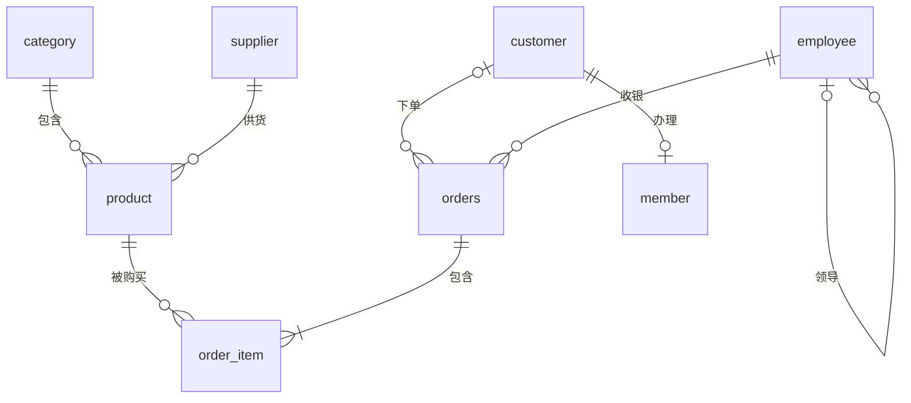

# 附录 C 小店示例数据库说明

全书贯穿使用一个“社区小店”的示例库 **shop**，接《Python 编程》里小店的案例：一家开在小区门口的便利店，卖粮油、零食、饮料、日用品，有会员和配送。数据由 `labs/data/make_shop_db.py` 用固定随机种子生成，**内容为虚构**，人名、电话不对应真实的人。时间范围 2025-01-01 到 2026-06-30，书中把 **2026-06-30 当作“今天”**。

## C.1 八张表和它们的联系

| 表 | 含义 | 行数 | 主键 | 外键 |
|---|---|---|---|---|
| category | 商品类别 | 8 | category_id | — |
| supplier | 供应商 | 8 | supplier_id | — |
| product | 商品 | 48 | product_id | category_id → category，supplier_id → supplier |
| employee | 员工 | 8 | employee_id | manager_id → employee（自己参照自己） |
| customer | 顾客 | 200 | customer_id | — |
| member | 会员卡 | 123 | member_id | customer_id → customer（唯一，一位顾客最多一张卡） |
| orders | 订单 | 2501 | order_id | customer_id → customer（可空，散客），employee_id → employee |
| order_item | 订单明细 | 5811 | (order_id, product_id) | order_id → orders，product_id → product |

## C.2 各表的列

**category（类别）**：category_id INT 类别编号；name VARCHAR 类别名。8 个类别：1 粮油米面、2 早餐冲饮、3 休闲零食、4 饮料、5 乳制品、6 生鲜果蔬、7 调味品、8 日用百货。

**supplier（供应商）**：supplier_id INT；name VARCHAR(40) 名称；contact VARCHAR(20) 联系人；phone CHAR(11)；city VARCHAR(20) 所在城市（广州、佛山、东莞、深圳）。

**product（商品）**

| 列 | 类型 | 约束 | 含义 |
|---|---|---|---|
| product_id | INT | 主键，自动增长 | 商品编号 |
| name | VARCHAR(40) | 非空 | 商品名（含规格，如“小米 1kg”） |
| category_id | INT | 非空，外键 | 类别 |
| supplier_id | INT | 外键 | 供应商 |
| price | DECIMAL(8,2) | 非空，CHECK (price > 0) | 售价 |
| cost | DECIMAL(8,2) | | 进价 |
| stock | INT | 非空，默认 0 | 库存 |
| unit | VARCHAR(10) | | 单位（袋、瓶、箱……） |
| description | VARCHAR(200) | | 商品描述（第 12 章做语义搜索用） |
| shelf_date | DATE | | 上架日期 |

**employee（员工）**：employee_id、name、position 职位、manager_id 上级的员工编号、hire_date 入职日期、salary 月薪。8 位员工：店长 1 人、副店长 1 人、收银员 2 人、理货员 2 人、会计 1 人、配送员 1 人。店长的 manager_id 为 NULL，第 5 章用它练自连接。

**customer（顾客）**：customer_id（自动增长）、name、gender ENUM('男','女')、phone CHAR(11)（唯一）、district 所住小区（滨江花园、东风社区、幸福里、学府小区、和平路 5 个）、birth_year 出生年份、reg_date 登记日期。

**member（会员）**：member_id、customer_id（唯一）、level 等级（普通 72、银卡 32、金卡 19）、points 积分、join_date 入会日期。

**orders（订单）**

| 列 | 类型 | 约束 | 含义 |
|---|---|---|---|
| order_id | INT | 主键，自动增长 | 订单号 |
| customer_id | INT | 外键，**可空** | 顾客；散客（没登记的顾客）为 NULL，共 538 单 |
| employee_id | INT | 非空，外键 | 收银的员工 |
| order_time | DATETIME | 非空 | 下单时间（带时分秒） |
| pay_method | VARCHAR(10) | | 微信 1373、支付宝 759、现金 244、银行卡 125 |
| status | VARCHAR(10) | 非空，默认“已完成” | 已完成 2450、已退款 51 |

**order_item（订单明细）**：order_id、product_id（两列合起来是主键）、quantity 数量（CHECK > 0）、unit_price 成交单价。成交单价单独存一份，是因为商品以后可能调价，历史订单要按当时的价格算（第 7 章“反规范化”的例子）。全部明细金额合计 189 972.40 元。

## C.3 数据的几个特点

这些特点是有意设计的，正文和练习会用到：

- **有 NULL**：散客订单的 customer_id、店长的 manager_id 为空，用来练 `IS NULL`、外连接和 `NOT IN` 的坑（第 4、5 章）；
- **有库存为 0 和库存不足的商品**：挂面 1kg、橙汁 1L 库存为 0；库存少于 10 的共 5 种（第 8、9 章）；
- **有没下过单的顾客**：29 位登记了但从没下过订单，用来练左连接找“缺失”（第 5 章）；
- **有退款订单**：统计销售额时要不要排除，是第 4、11 章反复提醒的业务问题；
- **跨两个年度**：2025 年全年和 2026 年上半年，可以做同比、环比和按月统计（第 4、11 章）。

## C.4 各章用到的练习库

为了不把 shop 改乱，有些章节在单独的练习库里做实验：

| 库 | 怎样得到 | 用途 | 章 |
|---|---|---|---|
| shop | `labs/data/shop_mysql.sql` | 全书主线 | 第 1 章起 |
| myshop | 实验 3-1 自己建表、从 CSV 导入 | 练建表和增删改 | 第 3、4 章 |
| joindemo | `labs/ch05/lab5_1_join_types.sql` | 两张小表演示四种连接 | 第 5 章 |
| repair、bookcorner | 第 6 章实验脚本 | E-R 设计练习 | 第 6 章 |
| normdemo | `labs/ch07/lab7_2_decompose.sql` | 订单大表拆到第三范式 | 第 7 章 |
| bigshop | `labs/ch08/lab8_2_make_big.sql` | 100 万行订单，索引对比 | 第 8 章 |
| txshop | `labs/ch09/lab9_0_setup.sql` | 事务、触发器、存储过程 | 第 9 章 |
| PostgreSQL 的 shop | `labs/data/shop_postgres.sql` | 对照 PostgreSQL；pgvector | 第 10、12 章 |

任何时候想让 shop 回到初始状态，重新执行 `labs/data/shop_mysql.sql` 即可。网页“试一试”框使用的是同样数据的 SQLite 版（`docs/tryit/shop.sqlite`），每次刷新网页都会还原。
