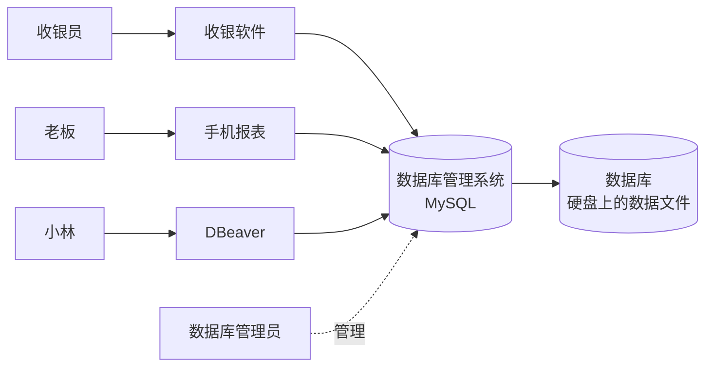
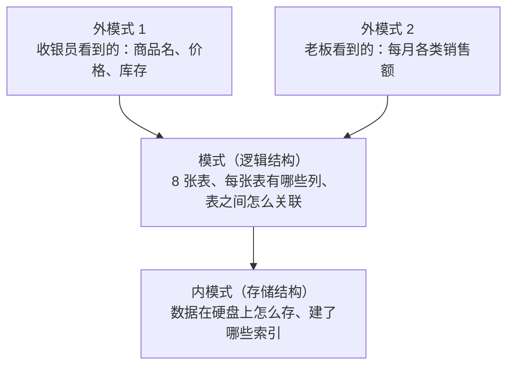
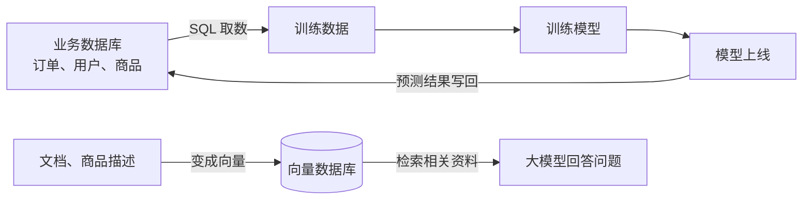
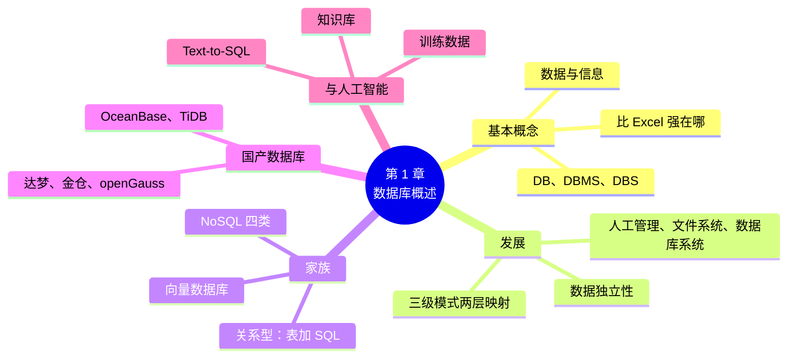

# 第 1 章 数据库概述

!!! abstract "本章学时"
    理论 5 学时 · 实验 1 学时（本章共 3 个实验，教师可任选）

## 学习目标

学完本章，你应该能够：

1. **说出**数据、数据库、数据库管理系统、数据库系统四个概念的含义和相互关系（记忆）；
2. **解释**数据库比 Excel 和普通文件强在哪里，以及三级模式和数据独立性的意思（理解）；
3. **区分**关系型数据库、NoSQL 数据库和向量数据库，能为一个业务场景选出合适的类型（分析）；
4. **完成**本课实验环境的安装：装好 MySQL 8.4 和 DBeaver（或用 Docker 一键启动），连上数据库并运行第一条 SQL（应用）；
5. **说出**常见的国产数据库，以及数据库在人工智能项目中的作用（记忆）。

!!! info "先修要求"
    学习本章前，你需要：

    - 会在电脑上下载、安装软件，会解压文件、找到文件夹；
    - 用过 Excel 或 WPS 表格，知道“行”“列”“工作表”是什么；
    - 第 1 学期《Python 编程》学过的内容本章暂时用不到，第 11 章才会用 Python 访问数据库。

??? abstract "本章概念清单（15 个，点击查看定义和例子）"
    1. [数据库](../../appendix/glossary.md#g-数据库)
    2. [数据库管理系统](../../appendix/glossary.md#g-数据库管理系统)
    3. [数据库系统](../../appendix/glossary.md#g-数据库系统)
    4. [外模式](../../appendix/glossary.md#g-外模式)
    5. [模式](../../appendix/glossary.md#g-模式)
    6. [内模式](../../appendix/glossary.md#g-内模式)
    7. [数据独立性](../../appendix/glossary.md#g-数据独立性)
    8. [关系型数据库](../../appendix/glossary.md#g-关系型数据库)
    9. [SQL](../../appendix/glossary.md#g-SQL)
    10. [MySQL](../../appendix/glossary.md#g-MySQL)
    11. [PostgreSQL](../../appendix/glossary.md#g-PostgreSQL)
    12. [SQLite](../../appendix/glossary.md#g-SQLite)
    13. [NoSQL](../../appendix/glossary.md#g-NoSQL)
    14. [向量数据库](../../appendix/glossary.md#g-向量数据库)
    15. [Text-to-SQL](../../appendix/glossary.md#g-Text-to-SQL)

## 情景导入

幸福里社区的“社区小店”开了快两年，卖米面粮油、早餐、零食、日用品，常客有两百来位。上学期，店里的小林学了 Python，帮老板把商品和账本存进了几个 Excel 文件：一个“商品表.xlsx”，一个“顾客表.xlsx”，每个月一个“销售流水”工作表。

用了一年多，问题一个接一个地冒出来：

- 收银台和仓库各存了一份商品表，仓库补了货改了库存，收银台那份没改，结果系统显示有货、货架上却是空的；
- 老板想知道“去年哪类商品卖得最好”，小林要把 12 个工作表复制到一起，再做数据透视表，忙了一个下午；
- 两个店员同时打开“顾客表.xlsx”录入新会员，后保存的人把先保存的人录的数据覆盖掉了；
- 有一天电脑蓝屏，最近一周的销售流水没了，因为文件只存在那台电脑上；
- 店员小周离职前把整张顾客表（含手机号）拷到了自己的 U 盘上，没人知道。

老板问小林：“大超市几十万条商品、几百万条流水，是怎么管得井井有条的？”答案就是**数据库**。本章先弄清楚数据库是什么、它比 Excel 强在哪里、有哪些种类，然后把本课要用的 MySQL 装好，跑通第一条 SQL。

## 1.1 什么是数据库

### 1.1.1 数据、信息与数据库

先分清两个常被混用的词。**数据**是记录下来的符号，比如“燕麦片、26.90、2026-06-30”；**信息**是数据经过加工、对人有用的含义，比如“燕麦片今天卖出 12 袋，比上周同期多一倍”。数据是原料，信息是产品。

[**数据库**](../../appendix/glossary.md#g-数据库 "长期存储在计算机内、有组织、可共享的大量数据的集合"){ .term }（Database，DB）是长期存储在计算机内、有组织、可共享的大量数据的集合。这个定义里有三个关键词：

- **长期存储**：数据存在硬盘上，关机不丢，可以保存很多年；
- **有组织**：数据按事先设计好的结构存放，比如“商品”一律有编号、名称、价格、库存这几项，不会这一行写价格、那一行漏写；
- **可共享**：收银台、仓库、老板的手机可以同时使用同一份数据，而不是各存一份。

### 1.1.2 数据库管理系统与数据库系统

数据库里的数据不是让人直接用记事本去改的，而是交给一个专门的软件来管理，这个软件就是[**数据库管理系统**](../../appendix/glossary.md#g-数据库管理系统 "位于用户和操作系统之间、专门负责建立、使用和维护数据库的软件"){ .term }（Database Management System，DBMS）。本课用的 MySQL、PostgreSQL 都是数据库管理系统。DBMS 负责的事情包括：

| DBMS 的功能 | 通俗地说 | 社区小店里的例子 |
|---|---|---|
| 数据定义 | 规定数据长什么样 | 商品表必须有名称和价格，价格必须大于 0 |
| 数据操作 | 增、删、改、查 | 录入一笔订单；查询库存少于 10 的商品 |
| 数据库运行管理 | 多人同时用不打架，出错能恢复 | 两台收银机同时卖出最后一袋大米，只能有一台成功 |
| 安全与权限 | 谁能看什么、能改什么 | 店员能查商品，不能看会员手机号 |
| 建立与维护 | 导入、备份、恢复、监控 | 每晚自动备份，电脑坏了能恢复到昨晚 |

我们平时说“用数据库”，说的其实是一整套东西：数据库、数据库管理系统、在它上面开发的应用程序（如收银软件）、管理数据库的人（数据库管理员），再加上运行它们的硬件和操作系统。这一整套合起来叫[**数据库系统**](../../appendix/glossary.md#g-数据库系统 "由数据库、数据库管理系统、应用程序、数据库管理员和用户组成的整体"){ .term }（Database System，DBS）。



四个概念的关系可以用一句话记住：**数据库系统**里，**用户**通过**应用程序**向**数据库管理系统**发出请求，数据库管理系统再去读写**数据库**。

!!! tip "考试常考的包含关系"
    数据库系统（DBS）包含数据库（DB）和数据库管理系统（DBMS）。选择题常问“三者的关系是什么”，答案是 DBS 包括 DB 和 DBMS。

### 1.1.3 数据库比 Excel 强在哪里

Excel 是很好的个人工具，几百行、一个人用、偶尔统计一下，完全够用。但回到情景导入里小店遇到的五个问题，每一个都是 Excel 的“天花板”，也正是数据库的长处：

| 小店遇到的问题 | Excel 的局限 | 数据库怎么解决 |
|---|---|---|
| 两份商品表库存对不上 | 每人一份副本，改了一份忘了另一份 | 只存一份，所有程序都读它，叫**数据共享、冗余小** |
| 汇总 12 个工作表要一下午 | 数据分散，汇总靠手工复制 | 一条 SQL 几毫秒算完，叫**高效查询** |
| 两人同时录入互相覆盖 | 同一时间只能一个人安全地编辑 | DBMS 管理**并发访问**，各写各的，互不覆盖 |
| 电脑蓝屏丢了一周数据 | 文件损坏就没了 | 事务日志 + 定期备份，可以**恢复** |
| 员工拷走整张顾客表 | 能打开文件就能看到全部 | 按用户分配**权限**，并留下访问记录 |

还有一点 Excel 做不到：**数据一致性约束**。在数据库里可以规定“价格必须大于 0”“订单里的顾客编号必须是真实存在的顾客”，录入错了数据库直接拒绝，而 Excel 里什么都能填进去。

!!! warning "不是说 Excel 没用"
    数据库负责“存好、管好”数据，Excel、WPS、BI 工具负责“看”数据。实际工作中常见的做法是：数据存在数据库里，用 SQL 取出需要的部分，再导到 Excel 里做图表。第 11 章会用 Python 把查询结果直接画成图。

## 1.2 数据管理的发展

### 1.2.1 从人工管理到数据库系统

计算机管理数据大致经历了三个阶段：

| 阶段 | 大约时间 | 数据存在哪里 | 主要问题 |
|---|---|---|---|
| 人工管理 | 20 世纪 50 年代中期以前 | 卡片、纸带，跟着程序走 | 数据不保存，一个程序一份数据，不能共享 |
| 文件系统 | 50 年代后期到 60 年代中期 | 硬盘上的文件，由操作系统管理 | 数据冗余大，文件格式变了程序就得改 |
| 数据库系统 | 60 年代后期至今 | 数据库，由 DBMS 统一管理 | —— |

小店现在的做法其实就是“文件系统阶段”：每个 Excel 文件是一个独立的文件，商品信息在商品表、销售流水里各抄了一遍（冗余），如果哪天把“商品表”的列顺序调换了，小林写的 Python 程序就读错列（数据和程序绑得太紧）。数据库系统阶段正是为了解决这两个问题而出现的。

数据库技术本身也在发展：1970 年，IBM 的科德（E. F. Codd）发表论文提出关系模型，<sup class="cite">[[3]](#ref1-3)</sup> 奠定了今天关系型数据库的基础；20 世纪 70 年代后期，SQL 语言诞生，80 年代起 Oracle、DB2、SQL Server 等商业关系数据库占领市场；90 年代中期出现开源的 MySQL 和 PostgreSQL；2000 年后互联网数据爆炸，NoSQL 数据库兴起；最近几年，大模型应用带火了向量数据库（1.3.3）。

### 1.2.2 三级模式与数据独立性

数据库为什么能做到“数据格式变了，程序不用改”？靠的是**三级模式**结构。“模式”（Schema）就是对数据结构的描述，好比房子的设计图。数据库从三个层次来描述同一份数据：



- [**外模式**](../../appendix/glossary.md#g-外模式 "某一类用户看到和使用的那部分数据的结构，也叫用户模式或子模式"){ .term }：某一类用户看到的那部分数据。收银员只看到商品名、价格和库存；老板看到的是汇总后的报表。一个数据库可以有多个外模式，第 8 章学的“视图”就是外模式；
- [**模式**](../../appendix/glossary.md#g-模式 "数据库中全部数据的逻辑结构，包括有哪些表、表有哪些列、表之间的联系和约束"){ .term }（也叫逻辑模式）：全体数据的逻辑结构，有哪些表、每张表有哪些列、列是什么类型、表之间怎样关联。一个数据库只有一个模式；
- [**内模式**](../../appendix/glossary.md#g-内模式 "数据在存储设备上的物理存储方式，如文件组织、索引和压缩方式，也叫存储模式"){ .term }（也叫存储模式）：数据在硬盘上的物理存放方式，比如存成什么文件、按什么顺序排、建了哪些索引。一个数据库也只有一个内模式。

三级之间有两层“映射”，好比两层翻译。它们带来了[**数据独立性**](../../appendix/glossary.md#g-数据独立性 "应用程序不因数据的存储结构或逻辑结构改变而改变的特性，分物理独立性和逻辑独立性"){ .term }：

- **物理独立性**：数据库管理员把数据换了一种存法（比如加了个索引、换了块硬盘），只要调整“模式—内模式”的映射，表的样子不变，程序不用改；
- **逻辑独立性**：表结构变了（比如商品表加了一列“产地”），只要调整“外模式—模式”的映射，收银员看到的那部分不变，收银软件也不用改。

一句话记住：**换了存法，查法不变**。

## 1.3 数据库家族

### 1.3.1 关系型数据库

今天用得最多的是[**关系型数据库**](../../appendix/glossary.md#g-关系型数据库 "用二维表（关系）组织数据、用 SQL 操作数据的数据库"){ .term }（Relational Database）：数据存成一张张二维表，表和表之间通过“编号”联系起来，用 [**SQL**](../../appendix/glossary.md#g-SQL "结构化查询语言，关系数据库的标准语言，用来定义、查询、修改数据和管理权限"){ .term }（Structured Query Language，结构化查询语言）来定义和操作数据。管理关系型数据库的软件叫关系数据库管理系统（RDBMS）。社区小店的数据库就是关系型的，下面是其中的商品表（只列了几列）：

| product_id | name | category_id | price | stock |
|---|---|---|---|---|
| 1 | 东北大米 5kg | 1 | 39.90 | 73 |
| 8 | 燕麦片 1kg | 2 | 26.90 | …… |
| 25 | 纯牛奶 250ml×16 | 5 | 52.00 | …… |

`category_id` 这一列写的是类别编号，具体的类别名称（“粮油米面”“早餐冲饮”）存在另一张类别表里。为什么要这样分开存，第 2 章和第 7 章会详细讲。

常见的关系数据库管理系统：

| 产品 | 出品方 | 特点 |
|---|---|---|
| [**MySQL**](../../appendix/glossary.md#g-MySQL "最流行的开源关系数据库管理系统之一，现由甲骨文公司维护"){ .term } | 甲骨文（Oracle）公司，开源 | 互联网公司用得最多，资料丰富，本课主线 |
| [**PostgreSQL**](../../appendix/glossary.md#g-PostgreSQL "功能强大的开源关系数据库，扩展性好，支持 pgvector 等扩展"){ .term } | 开源社区 | 功能最全的开源数据库，扩展丰富，第 10、12 章用 |
| Oracle Database | 甲骨文公司，商业 | 银行、电信等大型企业的传统选择 |
| SQL Server | 微软，商业 | 和 Windows、.NET 配合紧密 |
| [**SQLite**](../../appendix/glossary.md#g-SQLite "嵌入在程序里的轻量级关系数据库，整个库就是一个文件，无需安装服务"){ .term } | 开源，公有领域 | 整个数据库就是一个文件，手机 App、浏览器里都内置了它；本书网页上的“试一试”就是 SQLite |

### 1.3.2 NoSQL 数据库

互联网时代出现了一些关系型数据库不擅长的场景：数据结构经常变、数据量大到一台服务器装不下、要求每秒几十万次读写。于是出现了一批“不只是 SQL”（Not Only SQL）的数据库，统称 [**NoSQL**](../../appendix/glossary.md#g-NoSQL "不采用（或不只采用）关系表模型的数据库的统称，常见的有键值、文档、列族、图四类"){ .term }。常见的有四类：

| 类型 | 数据长什么样 | 代表产品 | 适合的场景 |
|---|---|---|---|
| 键值数据库 | 一个键对应一个值，像一个超大的 Python 字典 | Redis | 缓存、购物车、验证码、排行榜 |
| 文档数据库 | 一条记录是一个 JSON 文档，字段可以不一样 | MongoDB | 商品详情（不同商品属性不同）、内容管理 |
| 列族数据库 | 按列族存储，可以分布在成百上千台机器上 | HBase | 海量日志、物联网传感器数据（大数据课讲） |
| 图数据库 | 点和边，专门存“谁和谁有关系” | Neo4j | 社交关系、知识图谱、反欺诈 |

NoSQL 不是要取代关系型数据库，而是补它的短处。真实的系统里常常一起用：订单、账务放 MySQL（要求绝对准确），商品浏览记录放 Redis（要求快），商品详情页放 MongoDB（结构灵活）。

### 1.3.3 向量数据库：为人工智能而生

假设顾客在小店的小程序里搜“适合老人吃的软一点的早餐”，关系数据库的 `LIKE '%早餐%'` 只能找出名字或描述里带“早餐”两个字的商品，找不出描述里写着“熬粥绵软易消化”的小米。人工智能模型能把一段文字变成一串数字（叫“向量”），意思相近的文字，向量也相近。专门存储这种向量、并且能快速找出“最相近的几条”的数据库，就是[**向量数据库**](../../appendix/glossary.md#g-向量数据库 "专门存储向量并能快速找出与查询向量最相似的若干条记录的数据库"){ .term }（Vector Database）。

向量数据库是大模型知识库、语义搜索、以图搜图背后的关键部件，代表产品有国产开源的 Milvus，以及 Chroma、PostgreSQL 的扩展 pgvector 等。第 12 章专门讲它的原理。

<iframe class="sim-frame" src="../../sims/db-family/main.html" height="560" loading="lazy" title="数据库家族"></iframe>
动画：数据库家族。给 8 个业务场景各选一种合适的数据库类型，看看理由。[全屏打开](../../sims/db-family/main.html){ target=_blank }
{ .sim-caption }

## 1.4 国产数据库

### 1.4.1 为什么要关注国产数据库

数据库和操作系统、芯片一样，是信息系统的“地基”。过去很长一段时间，我国银行、电信、政务系统的核心数据库主要依赖国外产品。近年来，随着信息技术应用创新（信创）的推进，政府、金融、能源、电信等关键行业在逐步把核心系统换成国产数据库。对同学们来说，这意味着就业市场上懂国产数据库的人越来越吃香。

### 1.4.2 常见的国产数据库

| 产品 | 研发单位 | 兼容哪种语法 | 说明 |
|---|---|---|---|
| 达梦数据库（DM） | 武汉达梦数据库股份有限公司 | 兼容 Oracle 为主 | 老牌国产数据库，政务、能源用得多 |
| 人大金仓（KingbaseES） | 中电科金仓（北京）科技股份有限公司 | 兼容 PostgreSQL、Oracle | 源自中国人民大学，党政、电力行业常见 |
| openGauss | 华为发起的开源社区 | 基于 PostgreSQL | 开源，华为云 GaussDB 的开源版本 |
| OceanBase | 蚂蚁集团孵化，北京奥星贝斯科技有限公司 | 兼容 MySQL、Oracle | 分布式数据库，支撑过支付宝“双十一” |
| TiDB | 平凯星辰（PingCAP） | 兼容 MySQL | 开源分布式数据库 |
| GaussDB | 华为云 | 兼容 PostgreSQL、MySQL 等 | 华为云上的商业数据库 |
| PolarDB | 阿里云 | 兼容 MySQL、PostgreSQL | 阿里云上的云原生数据库 |

看第三列就会发现：**大多数国产数据库都兼容 MySQL 或 PostgreSQL 的语法**。所以本课学的 SQL，在这些数据库上基本可以照搬，学会 MySQL 和 PostgreSQL，就为使用国产数据库打下了基础。想了解各数据库的最新排名，可以看国内数据库社区墨天轮的“中国数据库流行度排行”。<sup class="cite">[[8]](#ref1-8)</sup>

## 1.5 数据库与人工智能

本专业学的是人工智能，为什么要学数据库？因为人工智能项目从头到尾都离不开数据库：



1. **训练数据从数据库里来**：要训练一个“预测哪些会员快要流失”的模型，第一步是用 SQL 从订单表里统计每个会员最近一次消费的时间、消费次数和金额（第 4、5、11 章会做这件事）；
2. **模型结果存回数据库**：模型算出的“流失风险分”存回会员表，收银软件就能在会员结账时提醒店员送张优惠券；
3. **大模型需要向量数据库**：通用大模型不知道小店卖什么、几点关门，把小店的商品描述和常见问答存进向量数据库，大模型回答前先去检索，就能答得准（第 12 章）；
4. **用自然语言查数据库**：现在的大模型能把“上个月卖得最好的 5 种商品是什么”翻译成 SQL（1.7 节），但前提是你看得懂它写的 SQL 对不对。

和数据打交道的岗位，几乎都要求会 SQL：

| 岗位 | 和数据库的关系 | 对 SQL 的要求 |
|---|---|---|
| 数据库管理员（DBA） | 安装、配置、备份、调优、权限管理 | 精通，还要懂原理 |
| 数据库开发工程师 | 设计表结构、写存储过程、优化慢查询 | 精通 |
| 后端开发工程师 | 程序里读写数据库 | 熟练 |
| 数据分析师 | 从数据库取数、做报表 | 熟练（查询为主） |
| 人工智能训练师、数据标注员 | 按要求导出、核对、整理数据 | 会基本查询 |

## 1.6 本课怎么学

### 1.6.1 本课用到的工具

| 工具 | 用来做什么 | 从哪一章开始 |
|---|---|---|
| 网页“试一试” | 打开教材网页就能写 SQL、看结果，不用装软件 | 第 1 章 |
| MySQL 8.4 | 本课的主力数据库 | 第 1 章安装，第 3 章起天天用 |
| DBeaver 社区版 | 免费的图形化数据库客户端，点鼠标就能看表、写 SQL | 第 1 章 |
| PostgreSQL 17 | 和 MySQL 对照学习，配合 pgvector 存向量 | 第 10、12 章 |
| Python + PyMySQL | 程序访问数据库 | 第 11 章 |
| Chroma | 体验向量数据库 | 第 12 章 |

MySQL 8.4 是 MySQL 的长期支持版本（LTS），官方承诺长期维护。<sup class="cite">[[4]](#ref1-4)</sup> DBeaver 社区版是免费开源软件，可以连接 MySQL、PostgreSQL、SQLite 以及达梦、人大金仓等几十种数据库。<sup class="cite">[[6]](#ref1-6)</sup>

### 1.6.2 第一次运行 SQL

不用等装软件，现在就可以试。下面这个框里是一条 SQL，意思是“从商品表（product）里，取出名称、价格、库存三列，只要前 5 行”。点“运行”看看结果，再把 `5` 改成 `10` 运行一次：

<div class="sql-try" markdown>

```sql
SELECT name, price, stock
FROM product
LIMIT 5;
```

</div>

这个框背后是一个完整的“社区小店”示例数据库，有 8 张表、2501 笔订单（附录 C 有完整说明）。框里的 SQL 可以随便改，改坏了点“恢复原样”，刷新网页数据也会还原，不用担心弄坏什么。

!!! note "网页里运行的是 SQLite"
    网页里的数据库是 SQLite，它和 MySQL 的大部分写法相同。个别不同的地方，书里会在框旁边注明，以 MySQL 的写法为准。另外，SQLite 显示小数时会省掉末尾的 0，比如 MySQL 里的 `3.50`，网页里显示为 `3.5`。

### 1.6.3 学习建议

1. **多动手**：SQL 和游泳一样，看十遍不如下水一次。每节的“试一试”都要亲手改一改；
2. **先图形界面，再命令**：建表、看数据先在 DBeaver 里点出来，再看它生成的 SQL，降低入门难度；
3. **重视设计**：第 6、7 章的数据库设计是本课最难的部分，也是期末闭卷的重点，要多画图、多讨论；
4. **准备手写**：期末是闭卷考试，要能在纸上写出 SQL。平时练习时，先在纸上写，再上机验证。

## 1.7 前沿视窗：用自然语言问数据库

“上个月哪 5 种商品卖得最好？”过去要把这句话变成 SQL，得会写 SQL；现在，把表结构告诉大模型，它就能写出来。这类技术叫 [**Text-to-SQL**](../../appendix/glossary.md#g-Text-to-SQL "把自然语言问题自动翻译成 SQL 查询语句的技术，也叫 NL2SQL"){ .term }（也叫 NL2SQL）。学术界有一个著名的评测集 Spider，收集了上万个“问题—SQL”对，用来比较各种方法的准确率。<sup class="cite">[[9]](#ref1-9)</sup> 现在，国内外的数据库产品和 BI 工具都在加入“用自然语言问数据”的功能。

但它有三个风险，恰恰说明了学 SQL 的必要：

1. **会写错**：大模型可能连错表、漏掉条件，写出一条能运行、但答案错误的 SQL，不懂 SQL 的人根本发现不了；
2. **会误删数据**：如果给了大模型修改数据的权限，一句没说清楚的话可能变成一条 `DELETE`；
3. **会泄露数据**：把表结构和数据样例发给外部的大模型服务，可能泄露商业秘密和个人信息。

所以，大模型是写 SQL 的好帮手，但最终要由懂 SQL 的人来检查、负责。本课每章的“前沿视窗”和练习里，都会穿插“检查大模型写的 SQL”这类任务。

## 本章实验

!!! abstract "实验总览"
    | 实验 | 类型 | 建议时长 | 内容 |
    |---|---|---|---|
    | 实验 1-1 | ★ 基础 | 20 分钟 | 在网页“试一试”里跑第一批 SQL |
    | 实验 1-2 | ★ 基础 | 45 分钟 | 安装 MySQL 8.4 和 DBeaver（或用 Docker），导入小店示例库 |
    | 实验 1-3 | ☆ 拓展 | 30 分钟 | 同一份数据，Excel 和数据库各回答三个问题 |

    代码和数据见配套资源 `labs/ch01/`、`labs/data/` 目录。

### 实验 1-1 ★ 在网页“试一试”里跑第一批 SQL

**实验目的**

1. 体会“写一条 SQL、马上得到结果”的工作方式；
2. 认识小店示例库的几张表，为后面各章打基础。

**实验环境**：本机 CPU，只需要浏览器（电脑、手机都可以）。**实验数据**：社区小店示例库（教材编写，内容为虚构，见附录 C）。

**实验步骤与代码**

1. 在下面的框里依次运行这几条语句（每次只留一条，或者一次全部运行，结果会依次显示）。`SELECT *` 表示“所有列”，`COUNT(*)` 表示“数一数有多少行”：

<div class="sql-try" markdown>

```sql
SELECT * FROM category;
SELECT COUNT(*) FROM orders;
SELECT name, price FROM product WHERE price < 10;
```

</div>

2. 把第三条的 `10` 改成 `5`，再运行；
3. 把第一条的 `category` 换成 `employee`、`supplier`，看看员工表和供应商表里有什么。

**运行结果**

第二条和第三条的结果（第一条结果是 8 个类别，此处略）：

```text
COUNT(*)
2501

name            price
无糖绿茶 500ml   4.5
西红柿 500g      5.8
挂面 1kg         8.5
…（共 12 行）
```

**实验记录表**

| 步骤 | 观察内容 | 你的结果 |
|---|---|---|
| 1 | 类别表有几行？订单表有几行？ | |
| 2 | 价格低于 5 元的商品有几种？分别是什么？ | |
| 3 | 员工表里店长叫什么？一共有几名员工？ | |

**常见问题排查**

| 现象 | 原因 | 解决办法 |
|---|---|---|
| 点“运行”后一直显示“正在运行” | 网速慢，示例库（约 450 KB）还没下载完 | 稍等几秒；仍不行就刷新网页 |
| 提示 `no such table` | 表名拼错了，比如把 `orders` 写成 `order` | 核对附录 C 中的表名 |
| 提示 `syntax error` | 用了中文标点，比如中文逗号、中文分号 | 把标点全部改成英文半角 |

**思考与练习**

1. `SELECT * FROM orders;` 会返回多少行？网页为什么只显示前 100 行？
2. 价格低于 10 元的 12 种商品里，为什么西红柿排在挂面前面？（提示：这条 SQL 没有要求排序，第 4 章会讲）

**实验报告要求**

截图记录步骤 1～3 的运行结果，填好实验记录表。

### 实验 1-2 ★ 安装 MySQL 8.4 和 DBeaver，导入小店示例库

**实验目的**

1. 在自己的电脑上装好本课的主力数据库 MySQL 8.4 和图形化客户端 DBeaver；
2. 用 DBeaver 连接 MySQL，导入小店示例库，运行第一条查询。

**实验环境**：本机 CPU，Windows 10/11（Mac 的步骤见附录 B），硬盘剩余空间不少于 2 GB。**实验数据**：`labs/data/shop_mysql.sql`（建库脚本，约 290 KB）。

两条路线任选一条：**路线 A** 直接安装（推荐，最常见）；**路线 B** 已经会用 Docker 的同学，用随书的配置一键启动，MySQL 和 PostgreSQL 都有了。

**实验步骤与代码**

路线 A：直接安装

1. **下载 MySQL**：打开 MySQL 官网下载页 `https://dev.mysql.com/downloads/mysql/`，版本选 **8.4 LTS**，操作系统选 Microsoft Windows，下载 MSI 安装包（`mysql-8.4.x-winx64.msi`）。页面提示登录时，点下方的“No thanks, just start my download”即可；
2. **安装**：双击安装包，安装类型选“Typical”，一路“Next”。安装结束时勾选“Run MySQL Configurator”；
3. **配置**：在 MySQL Configurator 里，端口保持 `3306`；给 root 用户设一个密码（**一定要记住**，本书示例用 `shop123`）；Windows 服务名保持 `MySQL84`，勾选“开机自动启动”；最后点“Execute”完成配置；
4. **安装 DBeaver**：打开 `https://dbeaver.io/download/`，下载 Windows 版 DBeaver Community 安装包，一路默认安装；
5. **新建连接**：打开 DBeaver，点左上角插头形状的“新建连接”按钮，选 MySQL，主机填 `localhost`，端口 `3306`，用户名 `root`，密码填第 3 步设的密码。第一次连接时 DBeaver 会提示下载 MySQL 驱动，点“下载”；
6. **导入示例库**：在 DBeaver 左侧右键刚建的连接，选“SQL 编辑器 → 打开 SQL 脚本”，打开 `labs/data/shop_mysql.sql`，点工具栏上的“执行 SQL 脚本”（快捷键 Alt+X）。执行完后右键连接点“刷新”，左侧会出现 `shop` 数据库和 8 张表；
7. **运行第一条查询**：打开一个新的 SQL 编辑器，输入并执行（快捷键 Ctrl+Enter）：

```sql
SELECT VERSION();          -- 查看 MySQL 的版本
USE shop;                  -- 切换到 shop 数据库
SELECT COUNT(*) FROM orders;   -- 数一数订单有多少笔
```

路线 B：Docker 一键启动

已经装好 Docker Desktop 的同学，在 `labs/docker/` 目录打开终端，运行：

```bash
docker compose up -d                          # 启动 MySQL 8.4 和 PostgreSQL 17（第一次要下载镜像）
docker exec -i shop-mysql mysql -uroot -pshop123 --default-character-set=utf8mb4 < ../data/shop_mysql.sql
```

然后按路线 A 的第 5 步用 DBeaver 连接（密码 `shop123`），再做第 7 步。

**运行结果**

编者在 MySQL 8.4.13 上运行第 7 步的结果（DBeaver 里以表格显示，这里用 MySQL 命令行的格式）：

```text
+-----------+
| VERSION() |
+-----------+
| 8.4.13    |
+-----------+
+----------+
| COUNT(*) |
+----------+
|     2501 |
+----------+
```

你的版本号最后一位可能不同（8.4.x 都可以），订单数应该同样是 2501。

**实验记录表**

| 步骤 | 观察内容 | 你的结果 |
|---|---|---|
| 3 | 设置的 root 密码（自己记住，不要写进报告） | —— |
| 6 | DBeaver 左侧 `shop` 库下有哪 8 张表？ | |
| 7 | MySQL 版本号；订单数 | |

**常见问题排查**

| 现象 | 原因 | 解决办法 |
|---|---|---|
| 连接时提示 `Public Key Retrieval is not allowed` | MySQL 8 的默认认证方式需要客户端取公钥 | 在连接设置的“驱动属性”里把 `allowPublicKeyRetrieval` 改成 `true` |
| 提示 `Access denied for user 'root'@'localhost'` | 密码输错 | 重新输入；忘了密码见[附录 B.5](../../appendix/b-environment.md#b5-root) |
| 提示 `Communications link failure` | MySQL 服务没启动，或端口不是 3306 | 在 Windows“服务”里启动 MySQL84；核对端口 |
| DBeaver 下载驱动失败 | 网络慢或被拦截 | 在“窗口 → 首选项 → 连接 → 驱动 → Maven”里换成国内镜像，或请老师拷贝驱动文件 |
| 导入后中文显示成问号 | 脚本没按 UTF-8 读入 | 用 DBeaver 打开脚本（默认 UTF-8）执行；命令行加 `--default-character-set=utf8mb4` |

**思考与练习**

1. MySQL 装好后，在 Windows 的“服务”里能看到一个叫 MySQL84 的服务。为什么说 MySQL 是一个“服务器”程序，而 DBeaver 是“客户端”？
2. 如果室友想用他的电脑连接你电脑上的 MySQL，需要知道哪些信息？

**实验报告要求**

截图：DBeaver 左侧的 8 张表、第 7 步的运行结果。写出你选择的路线和遇到的问题、解决办法。

### 实验 1-3 ☆ 同一份数据，Excel 和数据库各回答三个问题

**实验目的**

1. 亲身体会 1.1.3 节讲的“数据库比 Excel 强在哪里”；
2. 提前看一眼后面几章要学的 SQL 长什么样。

**实验环境**：本机 CPU；Excel 或 WPS 表格；DBeaver（实验 1-2 装好的）。**实验数据**：`labs/data/csv/` 下的 `orders.csv`、`order_item.csv`、`product.csv`、`category.csv`。

**实验步骤与代码**

要回答的三个问题：① 2025 年（只算“已完成”的订单）一共卖了多少钱？② 哪三个类别卖得最多？③ 哪些商品库存不足 10 件？

1. **用 Excel 做**：打开四个 CSV 文件，在明细表里用 VLOOKUP 把订单的日期、状态，商品的类别查过来，加一列“金额 = 数量 × 单价”，再用筛选和数据透视表回答三个问题。记下用了多长时间；
2. **用数据库做**：在 DBeaver 里运行下面三条 SQL（现在看不懂没关系，第 4、5 章会逐句讲）：

```sql
USE shop;
-- 问题 1：2025 年已完成订单的销售额
SELECT SUM(oi.quantity * oi.unit_price) AS 销售额
FROM order_item oi JOIN orders o ON o.order_id = oi.order_id
WHERE o.status = '已完成' AND o.order_time >= '2025-01-01' AND o.order_time < '2026-01-01';
-- 问题 2：销售额前三的类别
SELECT c.name AS 类别, SUM(oi.quantity * oi.unit_price) AS 销售额
FROM order_item oi
JOIN orders o   ON o.order_id = oi.order_id
JOIN product p  ON p.product_id = oi.product_id
JOIN category c ON c.category_id = p.category_id
WHERE o.status = '已完成'
GROUP BY c.name ORDER BY 销售额 DESC LIMIT 3;
-- 问题 3：库存不足 10 件的商品
SELECT name, stock FROM product WHERE stock < 10 ORDER BY stock;
```

3. 对照两种方法的答案是否一致。随书还提供了 `labs/ch01/lab1_3_excel_vs_sql.py`，用 pandas 按 Excel 的思路算一遍，可以用来核对。

**运行结果**

编者在 MySQL 8.4.13 上的运行结果：

```text
+-----------+
| 销售额    |
+-----------+
| 123902.50 |
+-----------+
+--------------+-----------+
| 类别         | 销售额    |
+--------------+-----------+
| 粮油米面     |  51407.60 |
| 早餐冲饮     |  32988.80 |
| 休闲零食     |  24489.00 |
+--------------+-----------+
+-------------------+-------+
| name              | stock |
+-------------------+-------+
| 挂面 1kg          |     0 |
| 橙汁 1L           |     0 |
| 原味薯片 104g     |     8 |
| 苹果 1kg          |     8 |
| 火锅底料 200g     |     8 |
+-------------------+-------+
```

pandas 脚本的结果与上面一致（销售额 123902.5，前三类别 51407.6、32988.8、24489.0）。

**实验记录表**

| 问题 | Excel 的答案 | 用时 | SQL 的答案 | 用时 |
|---|---|---|---|---|
| ① 2025 年销售额 | | | | |
| ② 前三类别 | | | | |
| ③ 库存不足 10 件 | | | | |

**常见问题排查**

| 现象 | 原因 | 解决办法 |
|---|---|---|
| Excel 打开 CSV 中文乱码 | Excel 默认按 GBK 读，文件是 UTF-8 | 用“数据 → 从文本/CSV”导入，文件原始格式选“65001: Unicode (UTF-8)” |
| Excel 算的 2025 年销售额偏大 | 没有排除“已退款”的订单，或把 2026 年的也算进去了 | 先筛选状态和日期，再求和 |

**思考与练习**

1. 如果明天又多了 100 笔订单，两种方法分别要重新做多少工作？
2. 问题 2 用 Excel 做时，需要几次 VLOOKUP？数据库里对应的是 SQL 的哪个部分？

**实验报告要求**

填好记录表，用三五句话写出你对“Excel 与数据库”区别的体会。

## 本章小结

- **数据库**是长期存储、有组织、可共享的数据集合；**数据库管理系统**是管理它的软件（MySQL、PostgreSQL 等）；**数据库系统**是数据库、DBMS、应用程序、管理员和用户的整体，DBS 包含 DB 和 DBMS。
- 和 Excel 相比，数据库的长处是：数据共享冗余小、查询高效、支持多人并发、可以恢复、能分配权限、能强制一致性约束。
- 数据管理经历了人工管理、文件系统、数据库系统三个阶段。数据库用**外模式、模式、内模式**三级描述数据，两层映射带来了**物理独立性**和**逻辑独立性**：换了存法，查法不变。
- 数据库家族：**关系型**（表 + SQL，本课主线）、**NoSQL**（键值、文档、列族、图）、**向量数据库**（按意思找，第 12 章）。
- 达梦、人大金仓、openGauss、OceanBase、TiDB 等国产数据库大多兼容 MySQL 或 PostgreSQL 语法。
- 人工智能项目的训练数据、模型结果、知识库都离不开数据库；大模型能写 SQL，但需要懂 SQL 的人把关。



**下一章预告**

本章我们看到，社区小店的数据存成了一张张表，表和表之间靠“编号”联系。为什么是表？编号怎么联系？表里能放什么、不能放什么？第 2 章讲关系模型，这是关系数据库的理论基础。

## 参考文献

正文中的上标编号（如<sup class="cite">[[1]](#ref1-1)</sup>）对应下面的文献。带链接的可以直接打开；书籍可在图书馆或电子书平台查阅。

<div class="refs" markdown>

**教材与专著**

- <span id="ref1-1"></span>[1] 王珊，杜小勇，陈红. 数据库系统概论[M]. 6 版. 北京：高等教育出版社，2023.
    <span class="ref-note">国内最经典的数据库教材，第 1 章“绪论”系统讲了数据库的基本概念、三级模式和数据独立性，对应本章 1.1、1.2 节。</span>
- <span id="ref1-2"></span>[2] SILBERSCHATZ A, KORTH H F, SUDARSHAN S. Database System Concepts[M]. 7th ed. New York: McGraw-Hill, 2019.
    <span class="ref-note">国外最常用的数据库教材之一，有中译本《数据库系统概念》，第 1 章讲数据库系统的用途和结构。</span>

**经典论文**

- <span id="ref1-3"></span>[3] CODD E F. A relational model of data for large shared data banks[J]. Communications of the ACM, 1970, 13(6): 377-387.
    <span class="ref-note">提出关系模型的开山之作，对应 1.2.1 节，第 2 章还会再提到它。</span>

**在线资源与数据**

- <span id="ref1-4"></span>[4] Oracle. MySQL 8.4 Reference Manual[EB/OL]. [2026-11-01]. https://dev.mysql.com/doc/refman/8.4/en/.
    <span class="ref-note">MySQL 8.4 官方参考手册，本书所有 MySQL 语法以它为准；安装说明见其中“Installing MySQL”一章。</span>
- <span id="ref1-5"></span>[5] The PostgreSQL Global Development Group. PostgreSQL Documentation[EB/OL]. [2026-11-01]. https://www.postgresql.org/docs/.
    <span class="ref-note">PostgreSQL 官方文档，第 10、12 章使用。</span>
- <span id="ref1-6"></span>[6] DBeaver. DBeaver Community[EB/OL]. [2026-11-01]. https://dbeaver.io/.
    <span class="ref-note">DBeaver 社区版官网，下载和使用说明，对应实验 1-2。</span>
- <span id="ref1-7"></span>[7] SQLite. About SQLite[EB/OL]. [2026-11-01]. https://www.sqlite.org/about.html.
    <span class="ref-note">SQLite 官方介绍，说明它是嵌入式、单文件的数据库，对应 1.3.1 节和网页“试一试”。</span>
- <span id="ref1-8"></span>[8] 墨天轮. 中国数据库流行度排行[EB/OL]. [2026-11-01]. https://www.modb.pro/dbRank.
    <span class="ref-note">国内数据库社区维护的国产数据库排行，每月更新，对应 1.4 节。</span>
- <span id="ref1-9"></span>[9] YU T, ZHANG R, YANG K, et al. Spider: a large-scale human-labeled dataset for complex and cross-domain semantic parsing and text-to-SQL task[C]//Proceedings of the 2018 Conference on Empirical Methods in Natural Language Processing. Brussels: ACL, 2018: 3911-3921.
    <span class="ref-note">Text-to-SQL 领域最常用的评测集，对应 1.7 节。</span>

</div>

## 课后练习

选择题和判断题可以直接点击选项作答，系统会马上告诉你对错，并展开答案与解析；多选题选好后点“提交答案”。简答和实操题请先自己作答，再点开“答案与解析”核对。每道题的解析下方都有“回看”链接，做错了可以直接跳回正文复习。

**一、单项选择题**

<div class="quiz" data-answer="C" markdown>

**1.** 数据库系统（DBS）、数据库（DB）和数据库管理系统（DBMS）三者之间的关系是（　　）。

- A. DB 包括 DBS 和 DBMS
- B. DBMS 包括 DB 和 DBS
- C. DBS 包括 DB 和 DBMS
- D. 三者互不包含

</div>

??? tip "答案与解析"
    **答案：C**

    解析：数据库系统是由数据库、数据库管理系统、应用程序、管理员和用户组成的整体，所以它包含 DB 和 DBMS。这是历年等级考试的高频题。

    考查：DB、DBMS、DBS 的关系 · 认知层次：记忆 · [回看 1.1.2](#112)
    { .quiz-meta }

<div class="quiz" data-answer="B" markdown>

**2.** MySQL 属于（　　）。

- A. 数据库
- B. 数据库管理系统
- C. 数据库应用程序
- D. 操作系统

</div>

??? tip "答案与解析"
    **答案：B**

    解析：MySQL 是管理数据库的软件，即数据库管理系统。`shop` 才是一个“数据库”；收银软件是“数据库应用程序”。

    考查：DBMS 的概念 · 认知层次：理解 · [回看 1.1.2](#112)
    { .quiz-meta }

<div class="quiz" data-answer="D" markdown>

**3.** 下列关于数据库特点的说法，错误的是（　　）。

- A. 数据长期存储在计算机中
- B. 数据按一定的结构组织
- C. 数据可以被多个用户、多个程序共享
- D. 每个应用程序都要有一份自己的数据副本

</div>

??? tip "答案与解析"
    **答案：D**

    解析：“每个程序一份数据”正是文件系统和人工管理阶段的缺点，数据库的特点是共享、冗余小。

    考查：数据库的特点 · 认知层次：理解 · [回看 1.1.1](#111)
    { .quiz-meta }

<div class="quiz" data-answer="A" markdown>

**4.** 在数据库的三级模式结构中，描述数据库中全体数据的逻辑结构和特征的是（　　）。

- A. 模式
- B. 外模式
- C. 内模式
- D. 存储模式

</div>

??? tip "答案与解析"
    **答案：A**

    解析：模式（逻辑模式）描述全体数据的逻辑结构；外模式是某类用户看到的局部；内模式（存储模式）描述物理存储。

    考查：三级模式 · 认知层次：记忆 · [回看 1.2.2](#122)
    { .quiz-meta }

<div class="quiz" data-answer="B" markdown>

**5.** 数据库管理员给订单表加了一个索引，加快了查询速度，而所有应用程序都不用修改。这体现了数据的（　　）。

- A. 逻辑独立性
- B. 物理独立性
- C. 完整性
- D. 安全性

</div>

??? tip "答案与解析"
    **答案：B**

    解析：索引属于存储结构（内模式）的改变，程序不受影响，体现的是物理独立性。表结构（模式）改变而程序不变才是逻辑独立性。

    考查：数据独立性 · 认知层次：应用 · [回看 1.2.2](#122)
    { .quiz-meta }

<div class="quiz" data-answer="C" markdown>

**6.** 小店想保存顾客的购物车，要求读写极快，数据丢了影响不大。最合适的是（　　）。

- A. 图数据库
- B. 列族数据库
- C. 键值数据库
- D. 向量数据库

</div>

??? tip "答案与解析"
    **答案：C**

    解析：购物车、缓存、验证码是键值数据库（如 Redis）的典型场景。图数据库擅长关系，列族擅长海量分布式数据，向量数据库擅长按意思找。

    考查：NoSQL 四类 · 认知层次：应用 · [回看 1.3.2](#132-nosql)
    { .quiz-meta }

<div class="quiz" data-answer="D" markdown>

**7.** 顾客搜索“适合老人吃的软一点的早餐”，希望找到描述里写着“熬粥绵软易消化”的小米。最能胜任的是（　　）。

- A. 在关系数据库里用 `LIKE '%早餐%'`
- B. 文档数据库
- C. 键值数据库
- D. 向量数据库

</div>

??? tip "答案与解析"
    **答案：D**

    解析：这是“按意思找”而不是“按字找”，需要把文字变成向量、找最相似的记录，正是向量数据库的用途。`LIKE` 只能匹配字面上的“早餐”二字。

    考查：向量数据库 · 认知层次：应用 · [回看 1.3.3](#133)
    { .quiz-meta }

<div class="quiz" data-answer="A" markdown>

**8.** 下列国产数据库中，以兼容 MySQL 语法为主的是（　　）。

- A. TiDB
- B. openGauss
- C. 人大金仓
- D. 达梦

</div>

??? tip "答案与解析"
    **答案：A**

    解析：TiDB 兼容 MySQL；openGauss 基于 PostgreSQL；人大金仓兼容 PostgreSQL、Oracle；达梦以兼容 Oracle 为主。

    考查：国产数据库 · 认知层次：记忆 · [回看 1.4.2](#142)
    { .quiz-meta }

<div class="quiz" data-answer="B" markdown>

**9.** 提出关系模型、奠定关系数据库理论基础的是（　　）。

- A. 冯·诺依曼
- B. 科德（E. F. Codd）
- C. 图灵
- D. 陈品山（P. Chen）

</div>

??? tip "答案与解析"
    **答案：B**

    解析：1970 年 IBM 的科德发表论文提出关系模型。陈品山提出的是 E-R 模型（第 6 章）。

    考查：数据库发展 · 认知层次：记忆 · [回看 1.2.1](#121)
    { .quiz-meta }

**二、多项选择题**

<div class="quiz quiz-multi" data-answer="ABCD" markdown>

**1.** 与用 Excel 管理数据相比，数据库的优势有（　　）。

- A. 多人可以同时安全地修改数据
- B. 可以给不同用户分配不同的权限
- C. 可以强制“价格必须大于 0”这样的约束
- D. 出现故障后可以恢复数据

</div>

??? tip "答案与解析"
    **答案：ABCD**

    解析：四项都是数据库相对 Excel 的优势，分别对应并发控制、安全控制、完整性约束和恢复。

    考查：数据库的优势 · 认知层次：理解 · [回看 1.1.3](#113-excel)
    { .quiz-meta }

<div class="quiz quiz-multi" data-answer="ABC" markdown>

**2.** 数据库管理系统的功能包括（　　）。

- A. 数据定义
- B. 数据操作
- C. 数据库的运行管理和维护
- D. 设计收银软件的界面

</div>

??? tip "答案与解析"
    **答案：ABC**

    解析：设计界面是应用程序开发的工作，不是 DBMS 的功能。

    考查：DBMS 的功能 · 认知层次：记忆 · [回看 1.1.2](#112)
    { .quiz-meta }

<div class="quiz quiz-multi" data-answer="ABD" markdown>

**3.** 下列属于关系数据库管理系统的有（　　）。

- A. MySQL
- B. PostgreSQL
- C. Redis
- D. SQLite

</div>

??? tip "答案与解析"
    **答案：ABD**

    解析：Redis 是键值数据库，属于 NoSQL。

    考查：数据库家族 · 认知层次：记忆 · [回看 1.3.1](#131)
    { .quiz-meta }

<div class="quiz quiz-multi" data-answer="ACD" markdown>

**4.** 大模型自动生成 SQL（Text-to-SQL）可能带来的风险有（　　）。

- A. 写出能运行但答案错误的 SQL
- B. 让数据库运行速度变快
- C. 误删数据
- D. 把表结构和数据泄露给外部服务

</div>

??? tip "答案与解析"
    **答案：ACD**

    解析：B 不是风险。正因为有 A、C、D 三种风险，大模型写的 SQL 要由懂 SQL 的人检查。

    考查：Text-to-SQL · 认知层次：理解 · [回看 1.7](#17)
    { .quiz-meta }

**三、判断题**

<div class="quiz quiz-judge" data-answer="×" markdown>

**1.** 一个数据库可以有多个模式和多个内模式。

- √ 正确
- × 错误

</div>

??? tip "答案与解析"
    **答案：×**

    解析：一个数据库只有一个模式和一个内模式，但可以有多个外模式。

    考查：三级模式 · 认知层次：记忆 · [回看 1.2.2](#122)
    { .quiz-meta }

<div class="quiz quiz-judge" data-answer="√" markdown>

**2.** 表结构增加了一列，而原有应用程序不用修改，这体现了逻辑独立性。

- √ 正确
- × 错误

</div>

??? tip "答案与解析"
    **答案：√**

    解析：表结构属于模式，模式变了而外模式和程序不变，就是逻辑独立性。

    考查：数据独立性 · 认知层次：理解 · [回看 1.2.2](#122)
    { .quiz-meta }

<div class="quiz quiz-judge" data-answer="×" markdown>

**3.** NoSQL 数据库的出现，是为了完全取代关系型数据库。

- √ 正确
- × 错误

</div>

??? tip "答案与解析"
    **答案：×**

    解析：NoSQL 补关系型数据库的短处，实际系统中两者经常一起使用。

    考查：NoSQL · 认知层次：理解 · [回看 1.3.2](#132-nosql)
    { .quiz-meta }

<div class="quiz quiz-judge" data-answer="√" markdown>

**4.** 本课学的 SQL，在大多数国产数据库上也基本可以使用。

- √ 正确
- × 错误

</div>

??? tip "答案与解析"
    **答案：√**

    解析：大多数国产数据库兼容 MySQL 或 PostgreSQL 语法。

    考查：国产数据库 · 认知层次：理解 · [回看 1.4.2](#142)
    { .quiz-meta }

<div class="quiz quiz-judge" data-answer="×" markdown>

**5.** 有了 Text-to-SQL，数据分析人员就不需要学习 SQL 了。

- √ 正确
- × 错误

</div>

??? tip "答案与解析"
    **答案：×**

    解析：大模型生成的 SQL 可能出错、误删数据或泄露数据，需要懂 SQL 的人检查和把关。

    考查：Text-to-SQL · 认知层次：评价 · [回看 1.7](#17)
    { .quiz-meta }

**四、简答题**

**1.** 结合社区小店的例子，说说数据库比 Excel 强在哪些方面（至少三点）。

??? tip "答案与解析"
    **参考答案：** ① 数据只存一份、多处共享，不会出现收银台和仓库库存对不上；② 查询汇总快，一条 SQL 代替手工合并 12 个工作表；③ 支持多人同时录入，不会互相覆盖；④ 能备份恢复，电脑坏了数据不丢；⑤ 能分配权限，店员看不到会员手机号；⑥ 能设置约束，价格填负数会被拒绝。答出任意三点并结合例子即可。

    考查：数据库的优势 · 认知层次：理解 · [回看 1.1.3](#113-excel)
    { .quiz-meta }

**2.** 什么是三级模式？什么是数据独立性？

??? tip "答案与解析"
    **参考答案：** 三级模式指外模式（某类用户看到的局部数据结构）、模式（全体数据的逻辑结构）和内模式（物理存储结构）。三级之间有外模式/模式、模式/内模式两层映射。数据独立性指数据结构改变时应用程序不用改：存储结构变了程序不变是物理独立性，逻辑结构变了程序不变是逻辑独立性。

    考查：三级模式与数据独立性 · 认知层次：理解 · [回看 1.2.2](#122)
    { .quiz-meta }

**3.** 为什么学人工智能的同学也要学数据库？

??? tip "答案与解析"
    **参考答案：** 训练数据大多存在业务数据库里，要用 SQL 取出来；模型的预测结果要存回数据库才能被业务系统使用；大模型知识库要用向量数据库检索资料；大模型写的 SQL 也要靠懂 SQL 的人检查。

    考查：数据库与人工智能 · 认知层次：理解 · [回看 1.5](#15)
    { .quiz-meta }

**五、实操题**

**1.** 在 DBeaver（或网页“试一试”）里查出员工表 `employee` 的全部数据，写出 SQL 语句，并说出员工表一共有几行、店长的名字是什么。

??? tip "答案与解析"
    **参考答案：** `SELECT * FROM employee;` 员工表共 8 行，职位为“店长”的那一行就是店长（各人数据相同，以运行结果为准）。

    考查：运行 SQL · 认知层次：应用 · [回看 1.6.2](#162-sql)
    { .quiz-meta }

**2.** 在网页“试一试”里，查出价格低于 5 元的商品名称和价格。

??? tip "答案与解析"
    **参考答案：** `SELECT name, price FROM product WHERE price < 5;` 结果为食盐 400g、豆腐 400g、无糖绿茶 500ml、生菜 300g 四种。

    考查：运行 SQL · 认知层次：应用 · [回看 1.6.2](#162-sql)
    { .quiz-meta }
