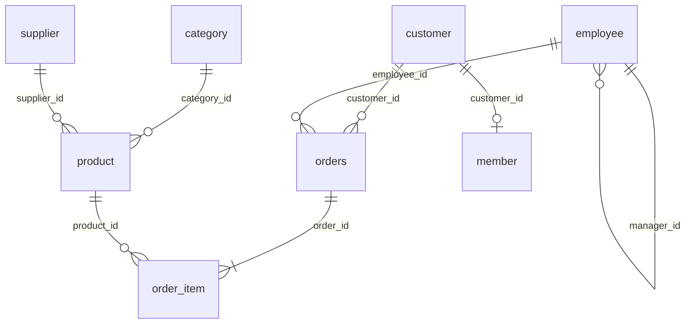
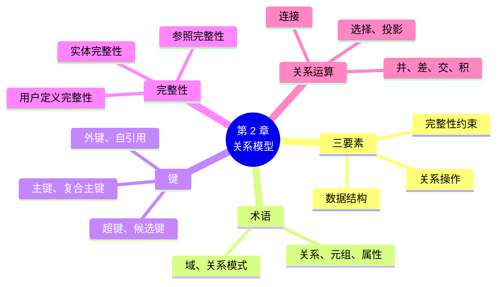

# 第 2 章 关系模型：用表格描述世界

!!! abstract "本章学时"
    理论 5 学时 · 实验 1 学时（本章共 3 个实验，教师可任选）

## 学习目标

学完本章，你应该能够：

1. **说出**关系、元组、属性、域、关系模式等术语，并对应到表、行、列（记忆）；
2. **解释**超键、候选键、主键、外键的含义，能在一组表里找出主键和外键（理解、应用）；
3. **判断**一条数据违反了哪一类完整性约束，并说出数据库会怎样处理（分析）；
4. **说出**选择、投影、连接、并、差五种关系运算的作用，能看懂简单的关系代数表达式（理解）；
5. **把**一张“大杂烩”表拆成几张通过外键联系的表（应用）。

!!! info "先修要求"
    学习本章前，你需要：

    - 知道数据库、数据库管理系统、关系型数据库是什么（[1.1](../01-overview/index.md#11)、[1.3.1](../01-overview/index.md#131)）；
    - 装好 MySQL 和 DBeaver 并导入小店示例库（[实验 1-2](../01-overview/index.md#1-2-mysql-84-dbeaver)），或者会用网页“试一试”。

??? abstract "本章概念清单（19 个，点击查看定义和例子）"
    1. [数据模型](../../appendix/glossary.md#g-数据模型)
    2. [关系模型](../../appendix/glossary.md#g-关系模型)
    3. [关系](../../appendix/glossary.md#g-关系)
    4. [元组](../../appendix/glossary.md#g-元组)
    5. [属性](../../appendix/glossary.md#g-属性)
    6. [域](../../appendix/glossary.md#g-域)
    7. [关系模式](../../appendix/glossary.md#g-关系模式)
    8. [超键](../../appendix/glossary.md#g-超键)
    9. [候选键](../../appendix/glossary.md#g-候选键)
    10. [主键](../../appendix/glossary.md#g-主键)
    11. [外键](../../appendix/glossary.md#g-外键)
    12. [完整性约束](../../appendix/glossary.md#g-完整性约束)
    13. [实体完整性](../../appendix/glossary.md#g-实体完整性)
    14. [参照完整性](../../appendix/glossary.md#g-参照完整性)
    15. [用户定义完整性](../../appendix/glossary.md#g-用户定义完整性)
    16. [关系代数](../../appendix/glossary.md#g-关系代数)
    17. [选择](../../appendix/glossary.md#g-选择)
    18. [投影](../../appendix/glossary.md#g-投影)
    19. [连接](../../appendix/glossary.md#g-连接)

## 情景导入

小林决定把小店的数据搬进数据库。第一步，他照着原来的 Excel 建了一张“销售流水”大表，每卖一样东西记一行：

| 订单号 | 时间 | 顾客 | 顾客电话 | 商品 | 类别 | 单价 | 数量 | 收银员 |
|---|---|---|---|---|---|---|---|---|
| 1001 | 2026-06-30 08:12 | 王秀英 | 10012345678 | 燕麦片 1kg | 早餐冲饮 | 26.90 | 1 | 谢洋燕 |
| 1001 | 2026-06-30 08:12 | 王秀英 | 10012345678 | 纯牛奶 250ml×16 | 乳制品 | 52.00 | 1 | 谢洋燕 |
| 1002 | 2026-06-30 08:30 | 李强 | 10087654321 | 燕麦片 1kg | 早餐冲饮 | 26.90 | 2 | 吴轩建 |

上了数据库的课，小林发现老师给的示例库不是这样的：同样的信息被拆成了顾客表、订单表、订单明细表、商品表、类别表、员工表好几张表，表和表之间只记一个“编号”。为什么要拆？拆开以后，怎么知道 1001 号订单是谁买的、买了什么？数据库又怎么保证“编号”指向的东西真的存在？

这些问题的答案，就是关系数据库的理论基础：**关系模型**。

## 2.1 数据模型与关系模型

### 2.1.1 什么是数据模型

现实世界里有商品、顾客、买卖行为，计算机里只有 0 和 1。要把现实世界“搬进”计算机，需要一套描述数据的方法，这就是[**数据模型**](../../appendix/glossary.md#g-数据模型 "描述数据、数据之间的联系、数据操作和约束的一套概念和方法"){ .term }。历史上出现过层次模型（像一棵倒着的树）、网状模型（像一张网）和关系模型，今天的主流是关系模型。

和建房子类似，数据建模也分层次：先画草图（概念模型，第 6 章的 E-R 图），再出施工图（逻辑模型，本章的关系模型），最后施工（物理模型，表在硬盘上怎么存）。

### 2.1.2 关系模型的三要素

[**关系模型**](../../appendix/glossary.md#g-关系模型 "用二维表来表示实体和实体之间联系的数据模型，由关系数据结构、关系操作和完整性约束三部分组成"){ .term }由科德在 1970 年提出，<sup class="cite">[[3]](#ref2-3)</sup> 它由三部分组成：

| 要素 | 说的是什么 | 本书在哪里讲 |
|---|---|---|
| 数据结构 | 数据一律存成二维表（关系） | 本章 2.2 节 |
| 关系操作 | 对表做选择、投影、连接等运算，SQL 是它的实现 | 本章 2.5 节，第 3～5 章 |
| 完整性约束 | 表里的数据必须满足的规则 | 本章 2.4 节 |

关系模型最大的优点是**简单**：不管是商品、顾客还是“某人在某天买了某件东西”这种联系，统统用表来表示，用户只要会看表就能理解数据。

## 2.2 关系的基本术语

### 2.2.1 表、行、列和它们的“学名”

关系数据库理论里有一套“学名”，教科书和考试常用，平时工作中更多说表、行、列。两套说法要能互相翻译：

| 学名 | 日常说法 | 小店里的例子 |
|---|---|---|
| [**关系**](../../appendix/glossary.md#g-关系 "一张满足一定条件的二维表"){ .term }（Relation） | 表 | 商品表 product |
| [**元组**](../../appendix/glossary.md#g-元组 "关系中的一行，表示一个具体的实体或一次联系"){ .term }（Tuple） | 行、记录 | “燕麦片 1kg, 26.90, ……”这一行 |
| [**属性**](../../appendix/glossary.md#g-属性 "关系中的一列，每列有唯一的名字"){ .term }（Attribute） | 列、字段 | price 价格这一列 |
| [**域**](../../appendix/glossary.md#g-域 "一个属性允许取值的范围"){ .term }（Domain） | 列允许的取值范围 | 性别的域是 {男, 女}；价格的域是大于 0 的金额 |
| 分量 | 一个格子里的值 | 燕麦片那一行价格列上的 26.90 |
| [**关系模式**](../../appendix/glossary.md#g-关系模式 "对关系结构的描述，写成 关系名(属性1, 属性2, …)"){ .term }（Relation Schema） | 表结构 | product(product_id, name, category_id, price, stock, …) |

关系模式和关系的区别，就像“表头”和“整张表”的区别：关系模式是相对固定的结构，关系是某一时刻表里实际有的数据，会随着增删改不断变化。期末考试里写关系模式时，习惯在主键下面画横线，例如：

- 类别（<u>类别编号</u>，类别名称）
- 商品（<u>商品编号</u>，商品名称，类别编号，供应商编号，售价，进价，库存，单位）

### 2.2.2 一张表要成为“关系”需要满足的条件

不是随便一张表都能叫关系。关系有几条基本性质：

1. **每个格子只能放一个不可再分的值**。“电话：10012345678，10087654321”这样一个格子里放两个电话，就不符合要求（第 7 章称为“第一范式”）；
2. **列的名字不能重复**，同一列的值来自同一个域（价格列里不能混进“缺货”两个字）；
3. **任意两行不能完全相同**；
4. **行的顺序、列的顺序都无关紧要**。交换两行或两列，还是同一个关系。

第 4 条很重要：表里的行没有“天然的顺序”。实验 1-1 里，你可能已经发现不加排序条件时，商品的显示顺序看起来有点乱，这是正常的。想要有顺序，要在查询里明确写出排序要求（第 4 章的 `ORDER BY`）。

用网页“试一试”看看小店示例库里的员工表，数一数它有几个属性、几个元组：

<div class="sql-try" markdown>

```sql
SELECT * FROM employee;
```

</div>

## 2.3 键：用什么来找到一行

### 2.3.1 超键、候选键与主键

收银员要给“王秀英”记一笔积分，可顾客表里也许有两个王秀英，怎么知道是哪一个？必须有一个能**唯一确定一行**的东西，这就是“键”。

- [**超键**](../../appendix/glossary.md#g-超键 "能唯一标识关系中每一行的一个或一组属性，可以含有多余的属性"){ .term }（Super Key）：能唯一确定一行的一个属性或一组属性。在顾客表里，{顾客编号}、{手机号}、{顾客编号, 姓名} 都是超键，最后一个里的“姓名”其实是多余的；
- [**候选键**](../../appendix/glossary.md#g-候选键 "不含多余属性的超键，去掉其中任何一个属性就不能唯一标识一行"){ .term }（Candidate Key）：不含多余属性的超键。{顾客编号} 和 {手机号} 都是候选键；
- [**主键**](../../appendix/glossary.md#g-主键 "从候选键中选定、用来唯一标识每一行的那个键，不能重复也不能为空"){ .term }（Primary Key）：从候选键里选一个“正式”用来标识行的。顾客表选 {顾客编号} 做主键。主键的值**不能重复，也不能为空**。

为什么不用手机号做主键？因为手机号会换，有的顾客也不愿意留手机号（示例库里就有约 5% 的顾客手机号为空）。实际设计中，常常专门加一个没有业务含义的编号列做主键，例如 `customer_id`，由数据库自动生成 1、2、3……，这种主键叫“代理键”。

主键也可以由几列共同组成，叫**复合主键**。订单明细表 order_item 记录“某笔订单里买了某样商品多少件”，单看订单号会重复（一笔订单买好几样），单看商品号也会重复（一样商品被很多订单买），但 {订单号, 商品号} 合起来就唯一了：

| order_id | product_id | quantity | unit_price |
|---|---|---|---|
| 1 | 33 | 1 | 4.50 |
| 1 | 34 | 1 | 6.50 |
| 1 | 35 | 3 | 4.00 |
| 1 | 39 | 1 | 3.50 |

包含在任何一个候选键中的属性叫**主属性**，其余的叫**非主属性**。这两个词第 7 章判断范式时会用到。

### 2.3.2 外键：把表连起来

回到情景导入的问题：订单表里只写了 `customer_id`，怎么知道是谁买的？答案是去顾客表里找 `customer_id` 相同的那一行。订单表里的 `customer_id` 就是一个[**外键**](../../appendix/glossary.md#g-外键 "一个表中引用另一个表主键的列，用来建立两张表之间的联系"){ .term }（Foreign Key）：它的值引用顾客表的主键。



图中每条连线都是一个外键：线的一端是被引用的表（主键所在的表，叫**被参照关系**），另一端是引用它的表（外键所在的表，叫**参照关系**）。小店示例库一共有 9 个外键，把 8 张表连成了一张网。

关于外键，有三点要注意：

1. 外键和它引用的主键，**列名可以不同，但取值的含义和类型要相同**。员工表的 `manager_id` 引用的就是本表的 `employee_id`（上级也是员工），这叫“自引用”；
2. 外键的值可以为空（NULL），表示“暂时没有对应”。订单表里有 538 笔订单的 `customer_id` 是空的，它们是没留信息的散客；
3. 一个表可以有多个外键。商品表同时引用类别表和供应商表。

<iframe class="sim-frame" src="../../sims/keys-links/main.html" height="560" loading="lazy" title="主键与外键"></iframe>
动画：主键与外键。点一行订单，看它通过外键连到哪位顾客、哪位收银员、买了哪些商品；再试着把外键改成一个不存在的编号，看看会发生什么。[全屏打开](../../sims/keys-links/main.html){ target=_blank }
{ .sim-caption }

现在可以回答小林的问题了：为什么要拆表？因为拆开以后，王秀英的电话只存一次（在顾客表），燕麦片的类别只存一次（在商品表），要改电话、改类别只改一处；需要完整信息时，通过外键再把表“拼”回来（第 5 章的连接查询）。第 7 章会更严格地讲“怎样拆才对”。

## 2.4 完整性约束：数据必须遵守的规则

### 2.4.1 三类完整性

[**完整性约束**](../../appendix/glossary.md#g-完整性约束 "数据库中的数据必须满足的规则，用来保证数据正确、有效、相容"){ .term }是数据必须遵守的规则，由数据库管理系统负责检查，违反了就拒绝执行。关系模型有三类完整性约束：

| 类别 | 规则 | 违反了会怎样（小店的例子） |
|---|---|---|
| [**实体完整性**](../../appendix/glossary.md#g-实体完整性 "主键的值不能为空，也不能重复"){ .term } | 主键不能为空、不能重复 | 两个顾客编号都是 1，积分记到谁头上？ |
| [**参照完整性**](../../appendix/glossary.md#g-参照完整性 "外键的值要么为空，要么必须等于被参照表中某个主键的值"){ .term } | 外键要么为空，要么等于被参照表里某个已有的主键值 | 订单写着顾客 999，可顾客表里没有 999 号 |
| [**用户定义完整性**](../../appendix/glossary.md#g-用户定义完整性 "针对具体业务定义的约束，如非空、唯一、取值范围、默认值"){ .term } | 按业务定的规则：非空、唯一、取值范围等 | 价格填了 -5；性别填了“未知” |

前两类是关系模型规定必须满足的，叫“关系的两个不变性”；第三类由设计数据库的人根据业务来定。

### 2.4.2 数据库怎样把关

让我们故意违反一下这些规则，看 MySQL 怎么回应。下面是编者在小店示例库上运行的结果（实验 2-2 你会亲手做一遍）。

**违反实体完整性**：插入一个主键为空、或者主键和已有的重复的类别：

```sql
INSERT INTO category (category_id, name) VALUES (NULL, '冷冻食品');
INSERT INTO category (category_id, name) VALUES (1, '冷冻食品');   -- 1 号已经是“粮油米面”
```

```text
ERROR 1048 (23000) at line 1: Column 'category_id' cannot be null
ERROR 1062 (23000) at line 1: Duplicate entry '1' for key 'category.PRIMARY'
```

**违反参照完整性**：给一个不存在的顾客（999 号）下订单；删除一个还有商品在用的类别：

```sql
INSERT INTO orders (customer_id, employee_id, order_time) VALUES (999, 3, '2026-06-30 10:00:00');
DELETE FROM category WHERE category_id = 1;   -- 东北大米等商品还属于 1 号类别
```

```text
ERROR 1452 (23000) at line 1: Cannot add or update a child row: a foreign key constraint fails (`shop`.`orders`, CONSTRAINT `orders_ibfk_1` FOREIGN KEY (`customer_id`) REFERENCES `customer` (`customer_id`))
ERROR 1451 (23000) at line 1: Cannot delete or update a parent row: a foreign key constraint fails (`shop`.`product`, CONSTRAINT `product_ibfk_1` FOREIGN KEY (`category_id`) REFERENCES `category` (`category_id`))
```

第二条错误值得细看：参照完整性不仅管“插入”，也管“删除”。如果允许删掉 1 号类别，东北大米这些商品的 `category_id` 就指向了一个不存在的类别，成了“孤儿”。MySQL 默认的做法是**拒绝删除**；建表时也可以指定别的做法，比如“级联删除”（类别删了，属于它的商品也一起删）或“置空”（把商品的类别编号改成 NULL），第 3 章建表时会讲。

**违反用户定义完整性**：价格改成负数（建表时规定了 `CHECK (price > 0)`）；性别填“未知”（规定了只能是“男”或“女”）；类别名重复（规定了名称唯一）：

```sql
UPDATE product SET price = -5 WHERE product_id = 1;
INSERT INTO customer (name, gender, reg_date) VALUES ('测试', '未知', '2026-06-30');
INSERT INTO category (category_id, name) VALUES (9, '饮料');
```

```text
ERROR 3819 (HY000) at line 1: Check constraint 'product_chk_1' is violated.
ERROR 1265 (01000) at line 1: Data truncated for column 'gender' at row 1
ERROR 1062 (23000) at line 1: Duplicate entry '饮料' for key 'category.name'
```

读懂报错信息是一项重要技能。MySQL 的报错由三部分组成：错误编号（如 1452）、状态码（如 23000，表示违反完整性约束）和说明文字。说明文字里通常会告诉你是哪张表、哪个约束出了问题。

!!! tip "报错不可怕"
    初学者看到满屏红色的 ERROR 会紧张。其实上面这些报错都是数据库在“尽职尽责”地保护数据：如果它不报错，脏数据就进了库，以后的报表、模型全会出错。附录 B 整理了本课最常见的 20 条报错和处理办法。

## 2.5 关系运算：对表做“加减乘除”

### 2.5.1 为什么要学关系运算

数学里对数字做加减乘除，关系模型里对表做运算：输入一张或几张表，输出一张新表。这套运算叫[**关系代数**](../../appendix/glossary.md#g-关系代数 "以关系为运算对象、运算结果也是关系的一组运算，包括选择、投影、连接、并、差等"){ .term }。我们不需要会推导，但要知道每种运算“把表怎么变”，因为后面每一条 SQL 查询，本质上都是这几种运算的组合。期末考试也常出“写出关系代数表达式”或“说出表达式的含义”的题。

### 2.5.2 选择与投影

[**选择**](../../appendix/glossary.md#g-选择 "从关系中挑出满足条件的行，结果的列不变，记作 σ"){ .term }（Selection，符号 σ，读作“西格玛”）：**横着切**，挑出满足条件的行。例如“价格低于 5 元的商品”：

\[ \sigma_{\text{price}<5}(\text{product}) \]

| product_id | name | category_id | price |
|---|---|---|---|
| 22 | 无糖绿茶 500ml | 4 | 4.50 |
| 33 | 生菜 300g | 6 | 4.50 |
| 35 | 豆腐 400g | 6 | 4.00 |
| 39 | 食盐 400g | 7 | 3.50 |

（为了排版，这里只显示了 4 列；选择运算本身保留全部列。）

[**投影**](../../appendix/glossary.md#g-投影 "从关系中挑出指定的列，并去掉重复的行，记作 π"){ .term }（Projection，符号 π，读作“派”）：**竖着切**，只留下指定的列，并且去掉重复的行。例如“顾客都住在哪些小区”：

\[ \pi_{\text{district}}(\text{customer}) \]

顾客表有 200 行，但投影到 district 一列后，重复的去掉，只剩 5 行：滨江花园、和平路、东风社区、学府小区、幸福里。

选择和投影可以组合：先选出价格低于 5 元的商品，再只看名称：

\[ \pi_{\text{name}}(\sigma_{\text{price}<5}(\text{product})) \]

对应的 SQL 是 `SELECT name FROM product WHERE price < 5;`：`WHERE` 管选择，`SELECT` 后面的列名管投影。在下面的框里改改条件和列名试试：

<div class="sql-try" markdown>

```sql
SELECT name FROM product WHERE price < 5;
```

</div>

### 2.5.3 连接

[**连接**](../../appendix/glossary.md#g-连接 "把两个关系按照某种条件拼接成一个新关系的运算，记作 ⋈"){ .term }（Join，符号 ⋈）：把两张表按条件“拼”成一张。最常用的是按外键等于主键来拼，叫**等值连接**；如果拼完后把重复的那一列去掉，叫**自然连接**。例如把价格低于 5 元的商品和类别表连起来，就能看到类别名称：

| 商品 name | 类别 name |
|---|---|
| 无糖绿茶 500ml | 饮料 |
| 生菜 300g | 生鲜果蔬 |
| 豆腐 400g | 生鲜果蔬 |
| 食盐 400g | 调味品 |

连接是关系数据库的“灵魂”：表拆开存是为了不冗余，用连接拼回来是为了看完整信息。第 5 章会花一整章讲它。

### 2.5.4 并、差、交与笛卡尔积

这几种运算来自数学里的集合运算，要求参加运算的两张表**列数相同、对应列的类型相同**。

- **并**（∪）：两张表的行合在一起，去掉重复。例如“顾客住的小区”∪“供应商所在城市”，得到一张“地点”表；
- **差**（−）：在第一张表中、但不在第二张表中的行。例如“全部顾客编号” − “下过订单的顾客编号” = “从没下过订单的顾客”，小店示例库里有 29 位；
- **交**（∩）：两张表都有的行；
- **笛卡尔积**（×）：第一张表的每一行和第二张表的每一行两两配对。8 个类别 × 8 个供应商 = 64 行，大多数配对没有意义。连接其实就是“先做笛卡尔积，再按条件选择”，第 5 章会看到忘了写连接条件时，结果就变成了笛卡尔积。

<iframe class="sim-frame" src="../../sims/relational-algebra/main.html" height="600" loading="lazy" title="关系代数五种运算"></iframe>
动画：关系代数五种运算。选一种运算、改一改条件，看两张小表怎样变成结果表。[全屏打开](../../sims/relational-algebra/main.html){ target=_blank }
{ .sim-caption }

| 运算 | 符号 | 作用 | 对应的 SQL（后面几章学） |
|---|---|---|---|
| 选择 | σ | 挑行 | `WHERE` |
| 投影 | π | 挑列并去重 | `SELECT DISTINCT 列名` |
| 连接 | ⋈ | 按条件拼表 | `JOIN … ON` |
| 并 | ∪ | 合并两表的行 | `UNION` |
| 差 | − | 在甲不在乙 | `NOT EXISTS`、`NOT IN`、`EXCEPT` |
| 笛卡尔积 | × | 两两配对 | `CROSS JOIN` |

## 2.6 前沿视窗：关系模型 50 多年，为什么还是主流

科德 1970 年提出关系模型时，很多人认为它太“学术”、效率太低。半个多世纪过去，IT 领域的技术换了好几代，关系数据库却依然是企业核心数据的首选。原因主要有三条：

1. **简单统一**：一切都是表，业务人员也看得懂；
2. **数据和程序分离**：用 SQL 说“要什么”，不用说“怎么找”，数据库自己去优化（第 8 章）；
3. **数学基础扎实**：关系代数保证了查询结果的确定性，完整性约束保证了数据的正确性。

有趣的是，2000 年后流行的许多 NoSQL 数据库，后来又纷纷加上了类似 SQL 的查询语言；大数据领域的 Hive、Spark 也用 SQL 作为主要接口（《大数据技术处理技术》课会学到）；新兴的向量数据库，很多也提供 SQL 接口，甚至直接做成关系数据库的扩展（第 12 章的 pgvector）。可以说，学会关系模型和 SQL，是一项“半衰期”很长的技能。

## 本章实验

!!! abstract "实验总览"
    | 实验 | 类型 | 建议时长 | 内容 |
    |---|---|---|---|
    | 实验 2-1 | ★ 基础 | 30 分钟 | 在 DBeaver 里浏览小店示例库，找出每张表的主键和外键 |
    | 实验 2-2 | ★ 基础 | 30 分钟 | 故意违反三类完整性，看数据库怎样报错 |
    | 实验 2-3 | ☆ 拓展 | 40 分钟 | 把一张“大杂烩”表拆成几张关系表 |

    SQL 脚本见配套资源 `labs/ch02/` 目录。

### 实验 2-1 ★ 浏览小店示例库，找出主键和外键

**实验目的**

1. 学会在 DBeaver 里查看表结构、数据和表之间的关系图；
2. 能写出小店 8 张表的关系模式，标出主键和外键。

**实验环境**：本机 CPU，MySQL 8.4 + DBeaver（实验 1-2）。**实验数据**：小店示例库 `shop`。

**实验步骤与代码**

1. 在 DBeaver 左侧展开 `shop → 表`，双击 `product`，在右侧依次点“属性”“数据”“ER 图”三个标签页，观察商品表有哪些列、前几行数据、和哪些表有连线；
2. 选中 `shop` 数据库本身，右键选“查看图表”（或在数据库上点“ER 图”标签），看全部 8 张表的关系图，和 2.3.2 节的图对比；
3. 也可以用 SQL 一次查出全部主键和外键。MySQL 把这些信息存在一个叫 `information_schema` 的“数据库的数据库”里（文件 `labs/ch02/lab2_1_keys.sql`）：

```sql
SELECT TABLE_NAME AS 表, COLUMN_NAME AS 列,
       CONSTRAINT_NAME AS 约束, REFERENCED_TABLE_NAME AS 参照表
FROM information_schema.KEY_COLUMN_USAGE
WHERE TABLE_SCHEMA = 'shop'
ORDER BY TABLE_NAME, CONSTRAINT_NAME;
```

**运行结果**

编者在 MySQL 8.4.13 上的运行结果（约束名为 `PRIMARY` 的是主键，参照表不为 NULL 的是外键，其余是唯一约束）：

```text
+------------+-------------+-------------------+-----------+
| 表         | 列          | 约束              | 参照表    |
+------------+-------------+-------------------+-----------+
| category   | name        | name              | NULL      |
| category   | category_id | PRIMARY           | NULL      |
| customer   | phone       | phone             | NULL      |
| customer   | customer_id | PRIMARY           | NULL      |
| employee   | manager_id  | employee_ibfk_1   | employee  |
| employee   | employee_id | PRIMARY           | NULL      |
| member     | customer_id | customer_id       | NULL      |
| member     | customer_id | member_ibfk_1     | customer  |
| member     | member_id   | PRIMARY           | NULL      |
| order_item | order_id    | order_item_ibfk_1 | orders    |
| order_item | product_id  | order_item_ibfk_2 | product   |
| order_item | product_id  | PRIMARY           | NULL      |
| order_item | order_id    | PRIMARY           | NULL      |
| orders     | customer_id | orders_ibfk_1     | customer  |
| orders     | employee_id | orders_ibfk_2     | employee  |
| orders     | order_id    | PRIMARY           | NULL      |
| product    | product_id  | PRIMARY           | NULL      |
| product    | category_id | product_ibfk_1    | category  |
| product    | supplier_id | product_ibfk_2    | supplier  |
| supplier   | supplier_id | PRIMARY           | NULL      |
+------------+-------------+-------------------+-----------+
```

**实验记录表**

| 表 | 关系模式（主键下画横线，外键标 *） | 外键引用哪张表 |
|---|---|---|
| category | | |
| supplier | | |
| product | | |
| customer | | |
| member | | |
| employee | | |
| orders | | |
| order_item | | |

**常见问题排查**

| 现象 | 原因 | 解决办法 |
|---|---|---|
| ER 图里看不到连线 | 表没有定义外键，或刷新前的缓存 | 右键连接选“刷新”；确认导入的是随书脚本 |
| 查询结果为空 | `TABLE_SCHEMA` 写成了别的库名 | 确认库名是 `shop`（全小写） |

**思考与练习**

1. 为什么 order_item 表的 `PRIMARY` 出现了两行？
2. member 表的 `customer_id` 列上同时有唯一约束和外键，这说明顾客和会员之间是什么样的对应关系？

**实验报告要求**

提交填好的记录表和全库 ER 图的截图。

### 实验 2-2 ★ 故意违反三类完整性

**实验目的**

1. 亲手验证实体完整性、参照完整性、用户定义完整性；
2. 学会读 MySQL 的报错信息。

**实验环境**：本机 CPU，MySQL 8.4 + DBeaver。**实验数据**：小店示例库 `shop`。下面的语句都会被数据库拒绝，所以不会改坏数据。

**实验步骤与代码**

依次执行 `labs/ch02/lab2_2_violations.sql` 里的 7 条语句（DBeaver 里把光标放在某一条上按 Ctrl+Enter，只执行这一条），把报错的编号和关键词记下来。语句和编者的运行结果见 2.4.2 节。

**运行结果**

见 2.4.2 节的 7 条报错（编者在 MySQL 8.4.13 上实际运行所得）。

**实验记录表**

| 序号 | 语句想做什么 | 违反了哪类完整性 | 错误编号 | 报错里的关键词 |
|---|---|---|---|---|
| 1 | 主键为空 | | | |
| 2 | 主键重复 | | | |
| 3 | 不存在的顾客下单 | | | |
| 4 | 删除还在用的类别 | | | |
| 5 | 价格为负 | | | |
| 6 | 性别填“未知” | | | |
| 7 | 类别名重复 | | | |

**常见问题排查**

| 现象 | 原因 | 解决办法 |
|---|---|---|
| 第 3 条居然执行成功了 | 你的顾客表里恰好有 999 号，或外键没建 | 把 999 换成 99999；确认用的是随书建库脚本 |
| DBeaver 弹出“确认执行”对话框 | DBeaver 对 DELETE、UPDATE 默认要求确认 | 点“是”，数据库会拒绝，数据不会被删 |

**思考与练习**

1. 第 4 条如果想成功删除 1 号类别，有哪几种办法？各有什么后果？
2. 在网页“试一试”里做同样的实验，SQLite 的报错文字和 MySQL 有什么不同？

**实验报告要求**

提交填好的记录表；回答思考题 1。

### 实验 2-3 ☆ 把“大杂烩”表拆成关系表

**实验目的**

1. 体会“一张大表”的冗余和问题；
2. 练习按实体拆表，并用主键、外键把表连起来。

**实验环境**：纸笔或 Excel；有余力的同学在 DBeaver 里建表验证。**实验数据**：情景导入里的“销售流水”大表。

**实验步骤与代码**

1. 找出大表里重复出现的信息（例如王秀英的电话出现了几次）；
2. 想一想这张表里描述了哪几类“东西”（顾客、商品、类别、订单、收银员……），每类东西拆成一张表，写出关系模式，标出主键；
3. 想一想“某笔订单买了某商品几件”这种信息该放在哪张表，它的主键是什么；
4. 标出外键，画出表之间的连线；
5. 和小店示例库的 8 张表对比，看看你的设计和它有什么异同。

**运行结果**

参考拆法（与示例库一致，属性只列主要的）：顾客（<u>顾客编号</u>，姓名，电话）；类别（<u>类别编号</u>，类别名称）；商品（<u>商品编号</u>，名称，类别编号*，售价）；员工（<u>员工编号</u>，姓名）；订单（<u>订单号</u>，时间，顾客编号*，员工编号*）；订单明细（<u>订单号*，商品编号*</u>，数量，成交单价）。

**实验记录表**

| 我拆出的表 | 关系模式 | 主键 | 外键 |
|---|---|---|---|
| | | | |

**常见问题排查**

| 现象 | 原因 | 解决办法 |
|---|---|---|
| 拆出的订单表里还有“商品”列 | 一笔订单有多样商品，放在订单表里一格放不下 | 单独建订单明细表 |
| 不知道单价放商品表还是明细表 | 两处含义不同 | 商品表放“现在的售价”，明细表放“当时的成交价”（第 7 章讲反规范化） |

**思考与练习**

1. 拆完以后，要查“王秀英 6 月 30 日买了什么”，需要用到哪几张表？
2. 为什么订单明细里也要存一份单价，不怕和商品表重复吗？

**实验报告要求**

提交你的拆分方案（关系模式 + 连线图），以及和示例库对比的说明。

## 本章小结

- **关系模型**由数据结构（二维表）、关系操作、完整性约束三要素组成，1970 年由科德提出。
- 学名对照：关系 = 表，元组 = 行，属性 = 列，域 = 列的取值范围，关系模式 = 表结构，写作“关系名（属性1，属性2，…）”。
- 关系的性质：格子里只放单一值，列名不重复，行不完全相同，行列顺序无关紧要。
- **超键**能唯一确定一行；不含多余属性的超键是**候选键**；选定的一个候选键是**主键**（不重复、不为空）；引用其他表主键的列是**外键**。
- 三类完整性：**实体完整性**（主键非空不重复）、**参照完整性**（外键为空或对得上）、**用户定义完整性**（非空、唯一、取值范围等），违反时数据库拒绝执行并报错。
- 关系运算：**选择**挑行（WHERE），**投影**挑列（SELECT），**连接**拼表（JOIN），并、差、交、笛卡尔积来自集合运算。



**下一章预告**

懂了关系模型，就可以动手建表了。第 3 章学习 SQL 的第一部分：怎样建数据库、建表、定义约束，以及怎样插入、修改、删除数据。你会亲手把本章讲的主键、外键、CHECK 约束写成一条条 SQL。

## 参考文献

正文中的上标编号（如<sup class="cite">[[1]](#ref2-1)</sup>）对应下面的文献。带链接的可以直接打开；书籍可在图书馆或电子书平台查阅。

<div class="refs" markdown>

**教材与专著**

- <span id="ref2-1"></span>[1] 王珊，杜小勇，陈红. 数据库系统概论[M]. 6 版. 北京：高等教育出版社，2023.
    <span class="ref-note">第 2 章“关系数据库”系统讲了关系、码、完整性和关系代数，比本章更严格，适合想深入的同学。</span>
- <span id="ref2-2"></span>[2] SILBERSCHATZ A, KORTH H F, SUDARSHAN S. Database System Concepts[M]. 7th ed. New York: McGraw-Hill, 2019.
    <span class="ref-note">第 2 章 Introduction to the Relational Model 讲关系的结构、键和关系代数。</span>

**经典论文**

- <span id="ref2-3"></span>[3] CODD E F. A relational model of data for large shared data banks[J]. Communications of the ACM, 1970, 13(6): 377-387.
    <span class="ref-note">关系模型的原始论文，对应 2.1.2 节和 2.6 节。</span>

**在线资源与数据**

- <span id="ref2-4"></span>[4] Oracle. MySQL 8.4 Reference Manual: FOREIGN KEY Constraints[EB/OL]. [2026-11-01]. https://dev.mysql.com/doc/refman/8.4/en/create-table-foreign-keys.html.
    <span class="ref-note">MySQL 外键的官方说明，包括级联删除、置空等参照动作，对应 2.4.2 节。</span>
- <span id="ref2-5"></span>[5] Oracle. MySQL 8.4 Reference Manual: The INFORMATION_SCHEMA KEY_COLUMN_USAGE Table[EB/OL]. [2026-11-01]. https://dev.mysql.com/doc/refman/8.4/en/information-schema-key-column-usage-table.html.
    <span class="ref-note">实验 2-1 查询主键和外键用到的系统表。</span>
- <span id="ref2-6"></span>[6] Oracle. MySQL 8.4 Reference Manual: Server Error Message Reference[EB/OL]. [2026-11-01]. https://dev.mysql.com/doc/mysql-errors/8.4/en/server-error-reference.html.
    <span class="ref-note">MySQL 全部错误编号的官方说明，读不懂报错时查它，对应 2.4.2 节和实验 2-2。</span>

</div>

## 课后练习

选择题和判断题可以直接点击选项作答，系统会马上告诉你对错，并展开答案与解析；多选题选好后点“提交答案”。简答和实操题请先自己作答，再点开“答案与解析”核对。每道题的解析下方都有“回看”链接，做错了可以直接跳回正文复习。

**一、单项选择题**

<div class="quiz" data-answer="B" markdown>

**1.** 在关系模型中，一个关系对应一张二维表，表中的一行称为（　　）。

- A. 属性
- B. 元组
- C. 域
- D. 关系模式

</div>

??? tip "答案与解析"
    **答案：B**

    解析：行是元组（记录），列是属性（字段），域是属性的取值范围，关系模式是表结构。

    考查：关系术语 · 认知层次：记忆 · [回看 2.2.1](#221)
    { .quiz-meta }

<div class="quiz" data-answer="C" markdown>

**2.** 关系模型的三个组成部分是（　　）。

- A. 表、行、列
- B. 主键、外键、索引
- C. 数据结构、关系操作、完整性约束
- D. 外模式、模式、内模式

</div>

??? tip "答案与解析"
    **答案：C**

    解析：D 是第 1 章的三级模式，不要混淆。

    考查：关系模型三要素 · 认知层次：记忆 · [回看 2.1.2](#212)
    { .quiz-meta }

<div class="quiz" data-answer="A" markdown>

**3.** 关系数据库中，能唯一标识表中每一行、且不含多余属性的属性组称为（　　）。

- A. 候选键
- B. 超键
- C. 外键
- D. 非主属性

</div>

??? tip "答案与解析"
    **答案：A**

    解析：超键可以含多余属性，去掉多余属性后就是候选键。

    考查：候选键 · 认知层次：理解 · [回看 2.3.1](#231)
    { .quiz-meta }

<div class="quiz" data-answer="D" markdown>

**4.** 订单明细表 order_item（订单号，商品号，数量，成交单价）中，一笔订单可以买多种商品，一种商品可以出现在多笔订单中。它的主键应该是（　　）。

- A. 订单号
- B. 商品号
- C. 数量
- D. {订单号，商品号}

</div>

??? tip "答案与解析"
    **答案：D**

    解析：单独的订单号、商品号都会重复，两者合起来才唯一，是复合主键。

    考查：复合主键 · 认知层次：应用 · [回看 2.3.1](#231)
    { .quiz-meta }

<div class="quiz" data-answer="B" markdown>

**5.** 订单表中的“顾客编号”引用顾客表的主键，订单表中的“顾客编号”称为（　　）。

- A. 主键
- B. 外键
- C. 候选键
- D. 超键

</div>

??? tip "答案与解析"
    **答案：B**

    解析：引用另一张表主键的列就是外键。

    考查：外键 · 认知层次：理解 · [回看 2.3.2](#232)
    { .quiz-meta }

<div class="quiz" data-answer="C" markdown>

**6.** 向订单表插入一行，其顾客编号为 999，而顾客表中没有 999 号顾客，数据库拒绝了插入。这是因为违反了（　　）。

- A. 实体完整性
- B. 用户定义完整性
- C. 参照完整性
- D. 数据独立性

</div>

??? tip "答案与解析"
    **答案：C**

    解析：外键的值必须为空或等于被参照表中已有的主键值，这是参照完整性。

    考查：参照完整性 · 认知层次：应用 · [回看 2.4.1](#241)
    { .quiz-meta }

<div class="quiz" data-answer="A" markdown>

**7.** “主键的值不能为空”属于（　　）。

- A. 实体完整性
- B. 参照完整性
- C. 用户定义完整性
- D. 以上都不是

</div>

??? tip "答案与解析"
    **答案：A**

    解析：实体完整性规定主键不能为空、不能重复。

    考查：实体完整性 · 认知层次：记忆 · [回看 2.4.1](#241)
    { .quiz-meta }

<div class="quiz" data-answer="B" markdown>

**8.** 从商品表中只取出“名称”和“价格”两列，这种关系运算是（　　）。

- A. 选择
- B. 投影
- C. 连接
- D. 笛卡尔积

</div>

??? tip "答案与解析"
    **答案：B**

    解析：挑列是投影，挑行是选择。

    考查：投影 · 认知层次：理解 · [回看 2.5.2](#252)
    { .quiz-meta }

<div class="quiz" data-answer="D" markdown>

**9.** 关系 R 有 8 行，关系 S 有 8 行，R × S（笛卡尔积）的结果有（　　）行。

- A. 8
- B. 16
- C. 0
- D. 64

</div>

??? tip "答案与解析"
    **答案：D**

    解析：笛卡尔积把两表的行两两配对，行数相乘：8 × 8 = 64。

    考查：笛卡尔积 · 认知层次：应用 · [回看 2.5.4](#254)
    { .quiz-meta }

**二、多项选择题**

<div class="quiz quiz-multi" data-answer="ACD" markdown>

**1.** 关于关系的性质，下列说法正确的有（　　）。

- A. 每个分量都必须是不可再分的值
- B. 行的顺序不同，就是不同的关系
- C. 任意两行不能完全相同
- D. 同一个关系中，列名不能重复

</div>

??? tip "答案与解析"
    **答案：ACD**

    解析：行的顺序和列的顺序都无关紧要，交换后还是同一个关系，所以 B 错。

    考查：关系的性质 · 认知层次：理解 · [回看 2.2.2](#222)
    { .quiz-meta }

<div class="quiz quiz-multi" data-answer="ABD" markdown>

**2.** 下列属于用户定义完整性的有（　　）。

- A. 商品价格必须大于 0
- B. 性别只能是“男”或“女”
- C. 订单中的顾客编号必须是存在的顾客
- D. 类别名称不能重复

</div>

??? tip "答案与解析"
    **答案：ABD**

    解析：C 是参照完整性。

    考查：完整性分类 · 认知层次：分析 · [回看 2.4.1](#241)
    { .quiz-meta }

<div class="quiz quiz-multi" data-answer="BC" markdown>

**3.** 顾客表（顾客编号，姓名，手机号，小区）中，顾客编号和手机号都不重复，姓名可能重名。下列属于候选键的有（　　）。

- A. {姓名}
- B. {顾客编号}
- C. {手机号}
- D. {顾客编号，姓名}

</div>

??? tip "答案与解析"
    **答案：BC**

    解析：D 是超键但含多余的“姓名”，不是候选键；A 会重复，连超键都不是。

    考查：候选键 · 认知层次：分析 · [回看 2.3.1](#231)
    { .quiz-meta }

<div class="quiz quiz-multi" data-answer="ABC" markdown>

**4.** 关于外键，下列说法正确的有（　　）。

- A. 外键的列名可以和被引用的主键列名不同
- B. 外键的值可以为空
- C. 一个表可以有多个外键
- D. 外键必须引用另一张表，不能引用本表

</div>

??? tip "答案与解析"
    **答案：ABC**

    解析：员工表的上级编号引用本表的员工编号，叫自引用，所以 D 错。

    考查：外键 · 认知层次：理解 · [回看 2.3.2](#232)
    { .quiz-meta }

**三、判断题**

<div class="quiz quiz-judge" data-answer="√" markdown>

**1.** 关系模式是对关系结构的描述，相对固定；关系是某一时刻表中的数据，会随时变化。

- √ 正确
- × 错误

</div>

??? tip "答案与解析"
    **答案：√**

    考查：关系与关系模式 · 认知层次：理解 · [回看 2.2.1](#221)
    { .quiz-meta }

<div class="quiz quiz-judge" data-answer="×" markdown>

**2.** 一张表可以有多个主键。

- √ 正确
- × 错误

</div>

??? tip "答案与解析"
    **答案：×**

    解析：一张表只能有一个主键（但主键可以由多列组成），可以有多个候选键。

    考查：主键 · 认知层次：理解 · [回看 2.3.1](#231)
    { .quiz-meta }

<div class="quiz quiz-judge" data-answer="√" markdown>

**3.** 投影运算会去掉结果中重复的行。

- √ 正确
- × 错误

</div>

??? tip "答案与解析"
    **答案：√**

    解析：关系中不能有完全相同的行，所以投影后要去重。SQL 中需写 `DISTINCT` 才会去重。

    考查：投影 · 认知层次：理解 · [回看 2.5.2](#252)
    { .quiz-meta }

<div class="quiz quiz-judge" data-answer="×" markdown>

**4.** 参照完整性只在插入数据时检查，删除数据时不检查。

- √ 正确
- × 错误

</div>

??? tip "答案与解析"
    **答案：×**

    解析：删除被引用的行时也会检查，MySQL 默认拒绝删除仍被引用的行（错误 1451）。

    考查：参照完整性 · 认知层次：理解 · [回看 2.4.2](#242)
    { .quiz-meta }

<div class="quiz quiz-judge" data-answer="√" markdown>

**5.** 两个关系做并运算，要求它们的列数相同、对应列的类型相同。

- √ 正确
- × 错误

</div>

??? tip "答案与解析"
    **答案：√**

    考查：集合运算 · 认知层次：记忆 · [回看 2.5.4](#254)
    { .quiz-meta }

**四、简答题**

**1.** 什么是实体完整性和参照完整性？各举一个社区小店的例子。

??? tip "答案与解析"
    **参考答案：** 实体完整性：主键不能为空、不能重复，例如两位顾客的编号不能都是 1。参照完整性：外键的值要么为空，要么等于被参照表中某个已有的主键值，例如订单的顾客编号必须是顾客表里真实存在的顾客（或者为空表示散客）。

    考查：完整性约束 · 认知层次：理解 · [回看 2.4.1](#241)
    { .quiz-meta }

**2.** 为什么不把所有信息放在一张大表里，而要拆成多张表？拆开后怎么得到完整信息？

??? tip "答案与解析"
    **参考答案：** 一张大表会大量重复存储同样的信息（如顾客电话、商品类别），改一处要改很多行，容易改漏造成不一致，也浪费空间。拆成多张表后每条信息只存一次，表之间用外键联系；需要完整信息时，用连接运算按外键把表拼回来。

    考查：外键与连接 · 认知层次：理解 · [回看 2.3.2](#232)
    { .quiz-meta }

**3.** 说出关系代数表达式 \( \pi_{\text{name}}(\sigma_{\text{price}<5}(\text{product})) \) 的含义，并写出对应的 SQL。

??? tip "答案与解析"
    **参考答案：** 先从商品表中选出价格低于 5 元的行，再只保留名称列，即“价格低于 5 元的商品名称”。SQL：`SELECT name FROM product WHERE price < 5;`

    考查：关系代数 · 认知层次：应用 · [回看 2.5.2](#252)
    { .quiz-meta }

**五、实操题**

**1.** 学生选课数据库有三张表：学生（学号，姓名，专业），课程（课程号，课程名，学分），选课（学号，课程号，成绩）。写出三个关系模式，标出主键（画横线）和外键（标 *）。

??? tip "答案与解析"
    **参考答案：** 学生（<u>学号</u>，姓名，专业）；课程（<u>课程号</u>，课程名，学分）；选课（<u>学号*，课程号*</u>，成绩）。选课表的主键是 {学号，课程号}，其中学号是引用学生表的外键，课程号是引用课程表的外键。

    考查：主键与外键 · 认知层次：应用 · [回看 2.3](#23)
    { .quiz-meta }

**2.** 在网页“试一试”里，分别写出实现“选择”和“投影”的 SQL：① 查出库存为 0 的商品的全部信息；② 查出所有供应商所在的城市（不重复）。

??? tip "答案与解析"
    **参考答案：** ① `SELECT * FROM product WHERE stock = 0;`（挂面 1kg、橙汁 1L 两种）；② `SELECT DISTINCT city FROM supplier;`（广州、佛山、东莞、深圳 4 个城市）。

    考查：选择与投影 · 认知层次：应用 · [回看 2.5.2](#252)
    { .quiz-meta }
