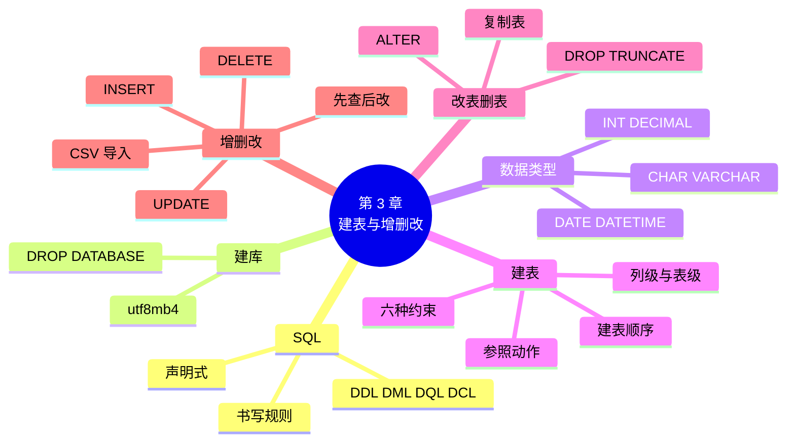

# 第 3 章 SQL 入门：建库、建表与增删改

!!! abstract "本章学时"
    理论 7 学时 · 实验 2 学时（本章共 3 个实验，教师可任选）

## 学习目标

学完本章，你应该能够：

1. **说出** SQL 的特点和 DDL、DML、DQL、DCL 四类语句各管什么（记忆）；
2. **为**一列数据选择合适的数据类型，说出 DECIMAL 和 FLOAT、CHAR 和 VARCHAR 的区别（理解、应用）；
3. **写出**建库、建表语句，在表上定义主键、外键、非空、唯一、默认值、检查约束（应用）；
4. **运行并修改**给定的 SQL，完成修改表结构、插入、修改、删除数据和从 CSV 导入数据（应用）；
5. **判断**一条 UPDATE 或 DELETE 会影响哪些行，养成“先查后改”的习惯（分析、评价）。

!!! info "先修要求"
    学习本章前，你需要：

    - 理解主键、外键和三类完整性约束（[2.3](../02-relational-model/index.md#23)、[2.4](../02-relational-model/index.md#24)）；
    - 装好 MySQL 8.4 和 DBeaver（[实验 1-2](../01-overview/index.md#1-2-mysql-84-dbeaver)）。

??? abstract "本章概念清单（11 个，点击查看定义和例子）"
    1. [声明式语言](../../appendix/glossary.md#g-声明式语言)
    2. [DDL](../../appendix/glossary.md#g-DDL)
    3. [DML](../../appendix/glossary.md#g-DML)
    4. [DQL](../../appendix/glossary.md#g-DQL)
    5. [DCL](../../appendix/glossary.md#g-DCL)
    6. [字符集](../../appendix/glossary.md#g-字符集)
    7. [数据类型](../../appendix/glossary.md#g-数据类型)
    8. [非空约束](../../appendix/glossary.md#g-非空约束)
    9. [唯一约束](../../appendix/glossary.md#g-唯一约束)
    10. [默认值](../../appendix/glossary.md#g-默认值)
    11. [检查约束](../../appendix/glossary.md#g-检查约束)

## 情景导入

第 2 章，小林在纸上把小店的大表拆成了几张关系表。现在要把它们真正建到 MySQL 里去。他打开 DBeaver，发现可以点鼠标建表：填表名、加列、选类型、勾主键……很方便。可是做到“价格”这一列时卡住了：类型下拉框里有 INT、FLOAT、DOUBLE、DECIMAL、VARCHAR……几十种，选哪个？

更麻烦的是，老板说下周要在另一台电脑上也装一套一样的数据库。难道再点一遍？

小林请教了做开发的表哥，表哥说：“点鼠标是给人看的，SQL 才是给数据库的。把建表写成 SQL 脚本，到哪台电脑都是一运行就好。”本章就来学 SQL 的第一部分：建库、建表，以及往表里增、删、改数据。

## 3.1 认识 SQL

### 3.1.1 SQL 的特点

SQL 最早由 IBM 的研究人员在 20 世纪 70 年代提出，<sup class="cite">[[3]](#ref3-3)</sup> 后来成为国际标准，几乎所有关系数据库都支持它。SQL 有三个特点：

1. **说“要什么”，不说“怎么做”**：写 `SELECT name FROM product WHERE price < 5`，只说了“要价格低于 5 元的商品名”，至于先读哪个文件、用不用索引，由数据库自己决定。这叫[**声明式语言**](../../appendix/glossary.md#g-声明式语言 "只描述想要什么结果、不描述具体执行步骤的编程语言，SQL 是典型代表"){ .term }，和 Python 这种要一步步写清楚怎么做的语言不同；
2. **一种语言管全部**：建表、增删改查、管理权限都用 SQL；
3. **接近英语**：`SELECT … FROM … WHERE …` 读起来就像一句英语，“从……里选出……，条件是……”。

### 3.1.2 四类 SQL 语句

SQL 语句按用途分成四类：

| 类别 | 全称 | 管什么 | 主要语句 | 本书哪一章 |
|---|---|---|---|---|
| [**DDL**](../../appendix/glossary.md#g-DDL "数据定义语言，用来创建、修改、删除数据库对象，如 CREATE、ALTER、DROP"){ .term } | 数据定义语言 | 建、改、删数据库和表的“结构” | CREATE、ALTER、DROP、TRUNCATE | 第 3 章 |
| [**DML**](../../appendix/glossary.md#g-DML "数据操纵语言，用来插入、修改、删除表中的数据，如 INSERT、UPDATE、DELETE"){ .term } | 数据操纵语言 | 增、删、改表里的“数据” | INSERT、UPDATE、DELETE | 第 3 章 |
| [**DQL**](../../appendix/glossary.md#g-DQL "数据查询语言，即 SELECT 语句，用来从表中查询数据"){ .term } | 数据查询语言 | 查数据 | SELECT | 第 4、5 章 |
| [**DCL**](../../appendix/glossary.md#g-DCL "数据控制语言，用来授予和收回权限，如 GRANT、REVOKE"){ .term } | 数据控制语言 | 权限 | GRANT、REVOKE | 第 10 章 |

有的书把 DQL 归入 DML，还有的另列一类“事务控制语言”（COMMIT、ROLLBACK，第 9 章），知道就行，不必纠结。

### 3.1.3 书写规则

SQL 的书写规则不多，记住这几条就能少走弯路：

| 规则 | 说明 | 例子 |
|---|---|---|
| 以分号结尾 | 一条语句写完加英文分号 `;`，可以写成多行 | `SELECT * FROM product;` |
| 关键字不分大小写 | `SELECT` 和 `select` 一样，本书关键字统一大写，便于区分 | `select * from product;` 也对 |
| 名字用英文 | 库名、表名、列名用英文字母、数字、下划线，小写为主 | `order_item`，不用“订单明细” |
| 字符串和日期用单引号 | 文字、日期要用英文单引号括起来，数字不用 | `'燕麦片 1kg'`、`'2026-06-30'`、`26.90` |
| 两种注释 | `--` 后面空一格写单行注释；`/* */` 包住多行注释 | `-- 这是注释` |
| 标点全用英文半角 | 中文逗号、中文括号、中文引号都会报语法错误 | `(1, '粮油米面')` |

!!! warning "最常见的入门错误"
    初学者 80% 的语法错误来自三件事：用了中文标点、漏了单引号、漏了逗号。报错信息里出现 `You have an error in your SQL syntax ... near '……'`，就去看 near 后面引号里那段的前后。

## 3.2 建数据库

### 3.2.1 CREATE DATABASE 与字符集

一个 MySQL 服务器里可以有很多个数据库。实验 1-2 导入的 `shop` 是示例库，本章我们新建一个自己的库 `myshop`，在里面练习（改坏了也不影响示例库）：

```sql
CREATE DATABASE myshop DEFAULT CHARACTER SET utf8mb4;   -- 新建数据库，字符集用 utf8mb4
SHOW DATABASES;                                          -- 列出服务器上所有的数据库
USE myshop;                                              -- 切换到 myshop，后面的语句都在它里面执行
```

```text
+--------------------+
| Database           |
+--------------------+
| information_schema |
| myshop             |
| mysql              |
| performance_schema |
| shop               |
| sys                |
+--------------------+
```

列表里除了 `myshop` 和 `shop`，另外四个是 MySQL 自带的系统库（存用户、权限、运行状态等），**不要去改它们**。

建库时最重要的选项是[**字符集**](../../appendix/glossary.md#g-字符集 "规定数据库用哪种编码存储文字，中文环境推荐 utf8mb4"){ .term }，它决定文字用什么编码存储（编码的概念见《Python 编程》的文件读写一章）。存中文请一律用 `utf8mb4`，它能存所有汉字和表情符号。MySQL 8.4 的默认字符集已经是 `utf8mb4`，但写上更保险，换到老版本的 MySQL 上也不会出问题。

!!! warning "utf8 不是真正的 UTF-8"
    MySQL 里还有一个叫 `utf8` 的字符集，它是历史遗留的“残缺版”，存不了表情符号和一部分生僻字。看到老教程里写 `CHARACTER SET utf8`，请改成 `utf8mb4`。

### 3.2.2 删除数据库

```sql
DROP DATABASE myshop;              -- 删除整个数据库，里面所有的表和数据都没了
DROP DATABASE IF EXISTS myshop;    -- 如果存在就删，不存在也不报错（脚本里常用）
```

`DROP DATABASE` 不会问“你确定吗”，执行就删，而且**不能撤销**。在自己电脑上练习无所谓，在工作中删库前一定要先备份（第 10 章）。

## 3.3 数据类型：为每一列选“容器”

建表时要为每一列指定[**数据类型**](../../appendix/glossary.md#g-数据类型 "规定一列能存什么样的值以及占多大空间，如 INT、DECIMAL、VARCHAR、DATE"){ .term }，好比为不同的东西选不同的容器：鸡蛋放蛋托，大米放米桶。选对了类型，数据库才能正确存储、比较和计算。

### 3.3.1 数值类型

| 类型 | 能存什么 | 小店里用在哪 |
|---|---|---|
| `INT` | 整数，约 ±21 亿 | 编号、库存、数量、积分 |
| `SMALLINT` / `TINYINT` | 小一点的整数，省空间 | 出生年份（SMALLINT） |
| `BIGINT` | 很大的整数 | 订单量特别大的平台的订单号 |
| `DECIMAL(M,D)` | 精确小数，共 M 位，其中 D 位小数 | 售价、进价、工资：`DECIMAL(8,2)` 最大 999999.99 |
| `FLOAT` / `DOUBLE` | 近似小数（浮点数） | 科学计算、传感器读数、第 12 章的向量 |

**存钱一定用 DECIMAL**。浮点数是“近似值”，在 MySQL 里试一下就知道：

```sql
SELECT CAST(0.1 AS DOUBLE) + CAST(0.2 AS DOUBLE) AS 浮点数相加;
CREATE TABLE t_money (f FLOAT, d DECIMAL(10,2));
INSERT INTO t_money VALUES (1234567.89, 1234567.89);
SELECT * FROM t_money;
```

```text
+---------------------+
| 浮点数相加          |
+---------------------+
| 0.30000000000000004 |
+---------------------+
+---------+------------+
| f       | d          |
+---------+------------+
| 1234570 | 1234567.89 |
+---------+------------+
```

0.1 加 0.2 不等于 0.3；同样存 1234567.89，FLOAT 列存成了 1234570，“丢”了 2 毛 1。账本上这样的误差是不能接受的。

### 3.3.2 字符串类型

| 类型 | 说明 | 适合 |
|---|---|---|
| `CHAR(n)` | 定长，不管实际存几个字都占 n 个字符的位置 | 长度固定的：手机号 `CHAR(11)`、身份证号 `CHAR(18)` |
| `VARCHAR(n)` | 变长，最多 n 个字符，存多少占多少 | 长度不固定的：姓名、商品名、地址 |
| `TEXT` | 长文本 | 商品详情、评论 |
| `ENUM('a','b',…)` | 只能从列出的几个值里选一个 | 性别 `ENUM('男','女')` |

`n` 指的是**字符数**，不是字节数。在 utf8mb4 下，一个汉字是 1 个字符，但占 3 个字节：

```sql
SELECT LENGTH('燕麦片') AS 字节数, CHAR_LENGTH('燕麦片') AS 字符数;
```

```text
+-----------+-----------+
| 字节数    | 字符数    |
+-----------+-----------+
|         9 |         3 |
+-----------+-----------+
```

所以 `VARCHAR(20)` 能存 20 个汉字。手机号为什么用 `CHAR(11)` 而不用 `INT`？因为手机号不做加减乘除，而且有的号码以 0 开头（如固定电话 020……），存成数字会把开头的 0 丢掉。**不参与计算的“编号类”数字，一般存成字符串**。

### 3.3.3 日期时间类型

| 类型 | 格式 | 小店里用在哪 |
|---|---|---|
| `DATE` | `'2026-06-30'` | 注册日期、上架日期、入职日期 |
| `TIME` | `'08:12:30'` | 营业开始时间 |
| `DATETIME` | `'2026-06-30 08:12:30'` | 下单时间 |
| `TIMESTAMP` | 同上，但会随时区换算 | 记录“最后修改时间” |
| `YEAR` | `2026` | 年份 |

日期写成 `'年-月-日'`，月和日不足两位要补 0。不要把日期存成 VARCHAR，否则没法正确地比较先后、计算间隔天数。

### 3.3.4 选类型的口诀

1. 能用整数不用小数，能用短的不用长的；
2. 钱用 DECIMAL，编号类数字用 CHAR；
3. 长度固定用 CHAR，不固定用 VARCHAR；
4. 日期时间用日期类型，不用字符串；
5. 取值只有几种的，考虑 ENUM，或者另建一张表用外键引用（第 6 章）。

## 3.4 建表与约束

### 3.4.1 CREATE TABLE 的基本格式

```sql
CREATE TABLE 表名 (
  列名1 数据类型 [列级约束],
  列名2 数据类型 [列级约束],
  ……,
  [表级约束]
);
```

方括号表示“可以没有”。先在 `myshop` 里建最简单的类别表：

```sql
CREATE TABLE category (
  category_id INT PRIMARY KEY,          -- 类别编号，整数，主键
  name        VARCHAR(20) NOT NULL UNIQUE   -- 类别名称，不能为空，不能重复
);
```

再建商品表，它通过外键引用类别表：

```sql
CREATE TABLE product (
  product_id  INT PRIMARY KEY AUTO_INCREMENT,       -- 商品编号，自动编号
  name        VARCHAR(40) NOT NULL,                 -- 商品名称，必填
  category_id INT NOT NULL,                         -- 属于哪个类别，必填
  price       DECIMAL(8,2) NOT NULL CHECK (price > 0),  -- 售价，必须大于 0
  stock       INT NOT NULL DEFAULT 0,               -- 库存，不填就是 0
  shelf_date  DATE,                                 -- 上架日期，可以不填
  FOREIGN KEY (category_id) REFERENCES category(category_id)  -- 外键
);
```

建好后用 `SHOW TABLES` 看库里有哪些表，用 `DESC 表名` 看表结构：

```sql
SHOW TABLES;
DESC product;
```

```text
+------------------+
| Tables_in_myshop |
+------------------+
| category         |
| product          |
+------------------+
+-------------+--------------+------+-----+---------+----------------+
| Field       | Type         | Null | Key | Default | Extra          |
+-------------+--------------+------+-----+---------+----------------+
| product_id  | int          | NO   | PRI | NULL    | auto_increment |
| name        | varchar(40)  | NO   |     | NULL    |                |
| category_id | int          | NO   | MUL | NULL    |                |
| price       | decimal(8,2) | NO   |     | NULL    |                |
| stock       | int          | NO   |     | 0       |                |
| shelf_date  | date         | YES  |     | NULL    |                |
+-------------+--------------+------+-----+---------+----------------+
```

`Key` 列里，`PRI` 表示主键，`MUL` 表示这一列上有一个允许重复值的索引（MySQL 会自动给外键列建索引，第 8 章讲）。

!!! tip "先点鼠标，再读 SQL"
    在 DBeaver 里也可以图形化建表：右键“表 → 新建表”，填好列名、类型，勾选“非空”“自增”，在“约束”“外键”标签页里加主键和外键，最后点“保存”，DBeaver 会弹出它生成的 CREATE TABLE 语句让你确认。对照着读这条语句，是学建表 SQL 最快的办法。

在下面的空数据库里，可以直接试试建表和插入（网页里的 SQLite 不支持 `AUTO_INCREMENT`，所以这里没写；`INTEGER PRIMARY KEY` 在 SQLite 里会自动编号）：

<div class="sql-try" data-db="empty" markdown>

```sql
CREATE TABLE category (
  category_id INTEGER PRIMARY KEY,
  name        VARCHAR(20) NOT NULL UNIQUE
);
INSERT INTO category (name) VALUES ('粮油米面'), ('早餐冲饮');
SELECT * FROM category;
```

</div>

### 3.4.2 六种常用约束

第 2 章讲的完整性约束，在建表时就是用下面这些关键字来定义的：

| 约束 | 关键字 | 作用 | 对应第 2 章的 |
|---|---|---|---|
| 主键约束 | `PRIMARY KEY` | 不重复、不为空 | 实体完整性 |
| 外键约束 | `FOREIGN KEY … REFERENCES …` | 值必须在被参照表中存在（或为空） | 参照完整性 |
| [**非空约束**](../../appendix/glossary.md#g-非空约束 "规定某列不允许为空值，写作 NOT NULL"){ .term } | `NOT NULL` | 必须填 | 用户定义完整性 |
| [**唯一约束**](../../appendix/glossary.md#g-唯一约束 "规定某列（或几列组合）的值不能重复，写作 UNIQUE，允许有空值"){ .term } | `UNIQUE` | 不能重复，但允许为空 | 用户定义完整性 |
| [**默认值**](../../appendix/glossary.md#g-默认值 "插入数据时没有给某列赋值，就自动填入的值，写作 DEFAULT"){ .term } | `DEFAULT 值` | 不填时自动填这个值 | —— |
| [**检查约束**](../../appendix/glossary.md#g-检查约束 "规定某列的值必须满足的条件，写作 CHECK (条件)，MySQL 8.0.16 起生效"){ .term } | `CHECK (条件)` | 值必须满足条件 | 用户定义完整性 |

另外，`AUTO_INCREMENT` 不是约束，而是一个属性：插入时不给这一列赋值，MySQL 就自动填上“当前最大编号 + 1”，用来做没有业务含义的代理主键（[2.3.1](../02-relational-model/index.md#231)）。一张表只能有一个自增列，而且它必须是主键（或带索引的列）。

**主键和唯一约束的区别**常考：一张表只能有一个主键，但可以有多个唯一约束；主键不能为空，唯一约束允许为空（顾客表的手机号是唯一的，但可以不留）。

### 3.4.3 列级约束与表级约束

约束可以写在列的后面（**列级约束**），也可以在所有列写完后单独写（**表级约束**）。只涉及一列的约束两种写法都行；**涉及多列的约束只能写成表级的**，比如订单明细表的复合主键：

```sql
CREATE TABLE order_item (
  order_id   INT,
  product_id INT,
  quantity   INT NOT NULL CHECK (quantity > 0),
  unit_price DECIMAL(8,2) NOT NULL,
  PRIMARY KEY (order_id, product_id),                          -- 复合主键：表级约束
  FOREIGN KEY (order_id)   REFERENCES orders(order_id),
  FOREIGN KEY (product_id) REFERENCES product(product_id)
);
```

还可以用 `CONSTRAINT 名字` 给约束起个名字，以后删除约束或看报错时更清楚，例如 `CONSTRAINT fk_item_product FOREIGN KEY (product_id) REFERENCES product(product_id)`。不起名字，MySQL 会自动起一个，比如第 2 章报错里看到的 `product_ibfk_1`。

### 3.4.4 外键的参照动作

第 2 章看到，删除还被商品引用的类别会被拒绝。这是外键的默认动作，建外键时可以改：

| 写法 | 删除（或修改）被参照的行时 | 适合 |
|---|---|---|
| 不写，或 `ON DELETE RESTRICT` | 拒绝，报错 1451 | 大多数情况，最安全 |
| `ON DELETE CASCADE` | 级联：引用它的行一起删除 | 订单删了，订单明细跟着删 |
| `ON DELETE SET NULL` | 置空：把引用它的外键改成 NULL | 员工离职删除后，订单的收银员改为空 |

用一个小例子看级联删除的效果：

```sql
CREATE TABLE demo_parent (id INT PRIMARY KEY);
CREATE TABLE demo_child (id INT PRIMARY KEY, pid INT,
  FOREIGN KEY (pid) REFERENCES demo_parent(id) ON DELETE CASCADE);
INSERT INTO demo_parent VALUES (1), (2);
INSERT INTO demo_child VALUES (10, 1), (11, 1), (12, 2);
DELETE FROM demo_parent WHERE id = 1;   -- 删除父表的 1 号
SELECT * FROM demo_child;               -- 子表里引用 1 号的两行也没了
```

```text
+----+------+
| id | pid  |
+----+------+
| 12 |    2 |
+----+------+
```

级联删除很方便，但也很危险：一不小心，删一行可能连带删掉成百上千行。小店示例库全部用默认的“拒绝”。

### 3.4.5 建表的先后顺序

有外键的表，必须**先建被参照的表，再建参照它的表**；删表时反过来，先删参照的表。小店 8 张表的建表顺序是：类别、供应商 → 商品；员工、顾客 → 会员、订单 → 订单明细。随书脚本 `labs/ch03/lab3_1_create_myshop.sql` 就是按这个顺序写的（实验 3-1）。

## 3.5 修改和删除表

### 3.5.1 ALTER TABLE：改表结构

表建好后发现少了一列、类型不对，用 `ALTER TABLE` 修改，不用删了重建：

```sql
ALTER TABLE product ADD COLUMN origin VARCHAR(20) DEFAULT '国产' AFTER name;  -- 增加一列，放在 name 后面
ALTER TABLE product MODIFY COLUMN name VARCHAR(60) NOT NULL;                -- 修改列的类型（加长）
ALTER TABLE product RENAME COLUMN origin TO place;                         -- 改列名
ALTER TABLE product DROP COLUMN place;                                     -- 删除一列
```

| 想做什么 | 写法 |
|---|---|
| 增加列 | `ADD COLUMN 列名 类型 [约束] [FIRST / AFTER 某列]` |
| 修改列类型或约束 | `MODIFY COLUMN 列名 新类型 [约束]` |
| 改列名（可同时改类型） | `RENAME COLUMN 旧名 TO 新名`，或 `CHANGE COLUMN 旧名 新名 类型` |
| 删除列 | `DROP COLUMN 列名` |
| 增加约束 | `ADD PRIMARY KEY (…)`、`ADD UNIQUE (…)`、`ADD FOREIGN KEY …` |
| 删除约束 | `DROP FOREIGN KEY 约束名`、`DROP INDEX 约束名`、`DROP CHECK 约束名` |
| 改表名 | `RENAME TABLE 旧名 TO 新名;` |

!!! warning "改类型可能丢数据"
    把 `VARCHAR(60)` 改成 `VARCHAR(10)`，已有的长名字放不下，MySQL 会报错拒绝；把 DECIMAL 改成 INT，小数部分会被四舍五入。修改有数据的表之前，先备份。

### 3.5.2 复制表

做实验、做备份时，常常需要复制一张表：

```sql
CREATE TABLE product_bak LIKE product;          -- 只复制表结构（含主键、索引），不复制数据
INSERT INTO product_bak SELECT * FROM product;  -- 再把数据复制过去
CREATE TABLE cheap_product AS                   -- 用查询结果直接建新表（结构 + 数据，但不带主键等约束）
  SELECT product_id, name, price FROM product WHERE price < 5;
SELECT * FROM cheap_product;
```

```text
+------------+--------------------+-------+
| product_id | name               | price |
+------------+--------------------+-------+
|         22 | 无糖绿茶 500ml     |  4.50 |
|         33 | 生菜 300g          |  4.50 |
|         35 | 豆腐 400g          |  4.00 |
|         39 | 食盐 400g          |  3.50 |
+------------+--------------------+-------+
```

### 3.5.3 DROP 与 TRUNCATE

| 语句 | 删什么 | 表还在吗 | 自增编号 |
|---|---|---|---|
| `DROP TABLE 表名;` | 表结构和全部数据 | 不在了 | —— |
| `TRUNCATE TABLE 表名;` | 全部数据（清空） | 还在，是空表 | 从 1 重新开始 |
| `DELETE FROM 表名;` | 全部数据（一行行删） | 还在，是空表 | 接着原来的编号 |

如果表被别的表的外键引用，`TRUNCATE` 会被拒绝：

```text
ERROR 1701 (42000) at line 1: Cannot truncate a table referenced in a foreign key constraint (`myshop`.`product`, CONSTRAINT `product_ibfk_1`)
```

这是 TRUNCATE 和 DELETE 的又一个区别。DELETE 是 DML，可以带条件、可以回滚（第 9 章）；TRUNCATE 和 DROP 是 DDL，不能带条件，执行后一般不能撤销。

## 3.6 插入、修改、删除数据

### 3.6.1 INSERT：插入数据

```sql
INSERT INTO category VALUES (1, '粮油米面');                       -- ① 不写列名：值的个数、顺序要和表的列完全一致
INSERT INTO category (category_id, name) VALUES (2, '早餐冲饮'), (3, '休闲零食');   -- ② 写列名，一次插多行
INSERT INTO product (name, category_id, price, stock, shelf_date)
VALUES ('东北大米 5kg', 1, 39.90, 73, '2025-05-12');               -- ③ 只给部分列赋值
INSERT INTO product (name, category_id, price) VALUES ('燕麦片 1kg', 2, 26.90), ('原味薯片 104g', 3, 8.9);
SELECT * FROM product;
```

```text
+------------+-------------------+-------------+-------+-------+------------+
| product_id | name              | category_id | price | stock | shelf_date |
+------------+-------------------+-------------+-------+-------+------------+
|          1 | 东北大米 5kg      |           1 | 39.90 |    73 | 2025-05-12 |
|          2 | 燕麦片 1kg        |           2 | 26.90 |     0 | NULL       |
|          3 | 原味薯片 104g     |           3 |  8.90 |     0 | NULL       |
+------------+-------------------+-------------+-------+-------+------------+
```

几点观察：

- `product_id` 没给值，`AUTO_INCREMENT` 自动填了 1、2、3；
- 燕麦片和薯片没给 `stock`，`DEFAULT 0` 自动填了 0；没给 `shelf_date`，又没有默认值，就是 `NULL`（空值，表示“不知道”或“没有”）；
- 薯片写的是 `8.9`，`DECIMAL(8,2)` 存成了 `8.90`。

**推荐写法②③，总是写出列名**。不写列名的写法①，一旦以后表加了一列，这条语句就会报“列数不对”的错误。

### 3.6.2 UPDATE：修改数据

```sql
UPDATE 表名 SET 列1 = 值1 [, 列2 = 值2 …] [WHERE 条件];
```

```sql
UPDATE product SET stock = 50 WHERE product_id = 2;          -- 燕麦片库存改为 50
UPDATE product SET price = price * 0.9 WHERE category_id = 3; -- 休闲零食打九折：新值可以用旧值计算
SELECT * FROM product;
```

```text
+------------+-------------------+-------------+-------+-------+------------+
| product_id | name              | category_id | price | stock | shelf_date |
+------------+-------------------+-------------+-------+-------+------------+
|          1 | 东北大米 5kg      |           1 | 39.90 |    73 | 2025-05-12 |
|          2 | 燕麦片 1kg        |           2 | 26.90 |    50 | NULL       |
|          3 | 原味薯片 104g     |           3 |  8.01 |     0 | NULL       |
+------------+-------------------+-------------+-------+-------+------------+
```

8.90 × 0.9 = 8.01，DECIMAL(8,2) 按四舍五入保留两位小数。

### 3.6.3 DELETE：删除数据

```sql
DELETE FROM 表名 [WHERE 条件];
```

```sql
DELETE FROM product WHERE product_id = 3;   -- 删除 3 号商品（薯片）
SELECT ROW_COUNT();                          -- 上一条语句影响了几行
```

```text
+-------------+
| ROW_COUNT() |
+-------------+
|           1 |
+-------------+
```

删掉 3 号以后再插入一种新商品，它的编号会是 4 而不是 3：自增编号只增不减，删掉的号不会再用。这正是代理主键想要的效果——编号只用来标识，不怕“断号”。

在网页“试一试”里，改的是你浏览器里的一份示例库副本，可以放心地增删改。试着给饮料类涨价，再查看结果：

<div class="sql-try" markdown>

```sql
UPDATE product SET price = price + 1 WHERE category_id = 4;
SELECT product_id, name, price FROM product WHERE category_id = 4;
```

</div>

### 3.6.4 “忘写 WHERE”的事故与防护

`UPDATE` 和 `DELETE` 的 `WHERE` 是可以省略的，省略的意思是“**全部行**”。`UPDATE product SET price = 1;` 会把所有商品都改成 1 元，`DELETE FROM orders;` 会删光全部订单。这类事故在真实工作中屡见不鲜。三个防护习惯：

1. **先查后改**：把 `UPDATE … SET … WHERE 条件` 里的条件先放进 `SELECT * FROM 表 WHERE 条件` 运行一下，确认选中的正是想改的那几行，再执行修改；
2. **打开安全更新模式**：`SET SQL_SAFE_UPDATES = 1;` 后，不带“用主键等列作条件”的 WHERE 的 UPDATE、DELETE 会被拒绝：

```text
ERROR 1175 (HY000) at line 1: You are using safe update mode and you tried to update a table without a WHERE that uses a KEY column.
```

3. **改之前先备份，或在事务里改**：第 9 章学了事务，改错了可以 `ROLLBACK` 撤回；第 10 章学备份恢复。

DBeaver 默认对没有 WHERE 的 UPDATE、DELETE 会弹出确认框，看到它时要停下来想一想。

## 3.7 从文件导入数据

实际工作中，数据很少一行行手敲 INSERT，更多是从 Excel、CSV 文件批量导入。有两种做法：

**做法一：DBeaver 导入向导（推荐初学者）**。右键目标表 → “导入数据” → 选“CSV” → 选文件 → 在“导入设置”里确认编码为 UTF-8、分隔符为逗号、第一行是表头，勾选“将空字符串设为 NULL” → 检查列的对应关系 → 开始。实验 3-1 会一步步做。

**做法二：LOAD DATA 语句**，适合写进脚本反复使用：

```sql
LOAD DATA LOCAL INFILE 'data/csv/supplier.csv'   -- 本机上的 CSV 文件
INTO TABLE supplier
CHARACTER SET utf8mb4                            -- 文件编码
FIELDS TERMINATED BY ',' ENCLOSED BY '"'         -- 逗号分隔，字段可能用双引号包住
LINES TERMINATED BY '\r\n'                       -- Windows 换行
IGNORE 1 LINES;                                  -- 跳过第一行表头
```

```text
+-------------+
| ROW_COUNT() |
+-------------+
|           8 |
+-------------+
```

`LOCAL` 表示文件在客户端这台电脑上。出于安全考虑，MySQL 默认禁止这个功能，用命令行运行时要加 `--local-infile=1`，服务器端也要打开 `local_infile` 设置（附录 B）。

导入的顺序和建表一样：**先导入被参照的表，再导入参照它的表**，否则外键检查会失败。

## 3.8 前沿视窗：让大模型帮你写建表语句

把需求告诉大模型，比如“帮我设计一个社区小店的会员积分表，MySQL 8”，几秒钟它就能写出一条完整的 CREATE TABLE。这能大大提高效率，但要按下面的清单检查一遍再用：

| 检查项 | 常见问题 |
|---|---|
| 主键有没有？ | 有时会漏掉，或者用了会重复的列做主键 |
| 钱是不是 DECIMAL？ | 经常写成 FLOAT 或 DOUBLE |
| 外键引用的表和列存在吗？ | 大模型不知道你库里的真实表名，会“编”一个 |
| 字符集是不是 utf8mb4？ | 老资料里的 `utf8` 会被照搬过来 |
| 约束合理吗？ | CHECK 条件写反、NOT NULL 加多或加少 |
| 语法是不是 MySQL 的？ | 有时混入 PostgreSQL、SQL Server 的写法（如 `SERIAL`、`IDENTITY`） |

更好的用法是：先自己设计（第 6 章的方法），再让大模型挑毛病、补遗漏。实验 3-3 的思考题里有一个这样的练习。

## 本章实验

!!! abstract "实验总览"
    | 实验 | 类型 | 建议时长 | 内容 |
    |---|---|---|---|
    | 实验 3-1 | ★ 基础 | 45 分钟 | 用脚本建 myshop 库的 8 张表，从 CSV 导入数据 |
    | 实验 3-2 | ★ 基础 | 45 分钟 | 修改表结构，插入、修改、删除数据并核对 |
    | 实验 3-3 | ☆ 拓展 | 40 分钟 | 自己设计并建一张“会员积分流水”表 |

    SQL 脚本见配套资源 `labs/ch03/` 目录。

### 实验 3-1 ★ 建 myshop 库并从 CSV 导入数据

**实验目的**

1. 读懂一个完整的建库建表脚本，理解建表顺序；
2. 学会用 DBeaver（或 LOAD DATA）从 CSV 文件批量导入数据。

**实验环境**：本机 CPU，MySQL 8.4 + DBeaver。**实验数据**：`labs/data/csv/` 下的 8 个 CSV 文件（教材编写，内容为虚构）。

**实验步骤与代码**

1. 在 DBeaver 里打开 `labs/ch03/lab3_1_create_myshop.sql`，先**通读一遍**：数一数有几条 CREATE TABLE，每张表的主键、外键、约束分别是什么。然后按 Alt+X 执行整个脚本，刷新后左侧出现 `myshop` 库和 8 张空表。脚本开头部分：

```sql
DROP DATABASE IF EXISTS myshop;   -- 如果已经有 myshop，先删掉重建（注意：会删除里面的全部数据）
CREATE DATABASE myshop DEFAULT CHARACTER SET utf8mb4 COLLATE utf8mb4_0900_ai_ci;
USE myshop;

CREATE TABLE category (
  category_id INT PRIMARY KEY,
  name        VARCHAR(20) NOT NULL UNIQUE
);
-- ……其余 7 张表
```

2. **用 DBeaver 导入**：按“类别、供应商、员工、顾客、会员、商品、订单、订单明细”的顺序，对每张表右键 → “导入数据” → CSV → 选 `labs/data/csv/` 下同名的文件 → 编码 UTF-8、勾选“表头”和“将空字符串设为 NULL” → 下一步直到“开始”；
3. 也可以用命令行一次导完（会用命令行的同学）：在 `labs/` 目录下运行

```bash
mysql -uroot -p --local-infile=1 --default-character-set=utf8mb4 < ch03/lab3_1_load_csv.sql
```

脚本里订单表的导入语句是这样写的，`@customer_id` 先把 CSV 里的值读到一个变量里，`NULLIF` 再把空字符串变成 NULL（散客没有顾客编号）：

```sql
LOAD DATA LOCAL INFILE 'data/csv/orders.csv' INTO TABLE orders
  CHARACTER SET utf8mb4 FIELDS TERMINATED BY ',' ENCLOSED BY '"' LINES TERMINATED BY '\r\n'
  IGNORE 1 LINES (order_id, @customer_id, employee_id, order_time, pay_method, status)
  SET customer_id = NULLIF(@customer_id, '');
```

4. 核对各表行数（脚本最后一条语句）。

**运行结果**

编者在 MySQL 8.4.13 上用命令行脚本导入后的核对结果：

```text
+------------+--------+
| 表         | 行数   |
+------------+--------+
| category   |      8 |
| supplier   |      8 |
| employee   |      8 |
| customer   |    200 |
| member     |    123 |
| product    |     48 |
| orders     |   2501 |
| order_item |   5811 |
+------------+--------+
```

另外核对：`SELECT COUNT(*) FROM orders WHERE customer_id IS NULL;` 结果为 538（散客订单），`SELECT COUNT(*) FROM customer WHERE phone IS NULL;` 结果为 13。

**实验记录表**

| 步骤 | 观察内容 | 你的结果 |
|---|---|---|
| 1 | 脚本里有几条 CREATE TABLE？哪张表最先建、哪张最后建？为什么？ | |
| 2/3 | 8 张表的行数是否与上面一致？ | |
| 4 | 散客订单数、没留手机号的顾客数 | |

**常见问题排查**

| 现象 | 原因 | 解决办法 |
|---|---|---|
| 导入订单明细时报外键错误 1452 | 订单或商品还没导入 | 按步骤 2 的顺序导入 |
| 散客订单的 customer_id 变成了 0 | 没有把空字符串设为 NULL | DBeaver 勾选“将空字符串设为 NULL”；或用脚本里的 NULLIF |
| 报错 `Loading local data is disabled` | 服务器或客户端没开 local_infile | 命令行加 `--local-infile=1`；服务器执行 `SET GLOBAL local_infile = 1;` |
| 中文变问号 | 编码不对 | 导入时编码选 UTF-8，脚本里有 `CHARACTER SET utf8mb4` |

**思考与练习**

1. 如果先导入订单明细、后导入订单，会发生什么？
2. `DROP DATABASE IF EXISTS myshop;` 这一句有什么风险？在什么情况下不该放进脚本？

**实验报告要求**

截图：DBeaver 中 myshop 的 8 张表，以及行数核对结果。回答思考题。

### 实验 3-2 ★ 修改表结构与增删改数据

**实验目的**

1. 练习 ALTER TABLE 增删列；
2. 练习 INSERT、UPDATE、DELETE，养成“先查后改”的习惯。

**实验环境**：本机 CPU，MySQL 8.4 + DBeaver。**实验数据**：实验 3-1 建好的 `myshop`（不要在示例库 `shop` 上做）。

**实验步骤与代码**

逐条执行 `labs/ch03/lab3_2_alter_dml.sql`（每次执行一条，看结果后再执行下一条）：

```sql
USE myshop;
ALTER TABLE product ADD COLUMN barcode CHAR(13) AFTER name;            -- 1 加“条形码”列
INSERT INTO product (name, barcode, category_id, supplier_id, price, cost, stock, unit)
VALUES ('桂林米粉 1kg', '6900000000017', 1, 1, 18.80, 13.00, 40, '袋');  -- 2 新商品
SELECT product_id, name, barcode, price, stock FROM product
WHERE product_id = LAST_INSERT_ID();                                   -- 3 看刚插入的行
SELECT product_id, name, price FROM product WHERE category_id = 4;     -- 4 先查
UPDATE product SET price = ROUND(price * 0.95, 2) WHERE category_id = 4;   -- 5 再改：饮料九五折
SELECT product_id, name, price FROM product WHERE category_id = 4;
UPDATE product SET stock = stock + 60 WHERE product_id = 5;            -- 6 挂面补货 60 袋
SELECT name, stock FROM product WHERE product_id = 5;
SELECT product_id, name FROM product WHERE name = '桂林米粉 1kg';       -- 7 先确认只有 1 行
DELETE FROM product WHERE name = '桂林米粉 1kg';                        --   再删除
ALTER TABLE product DROP COLUMN barcode;                               -- 8 删掉条形码列
SELECT COUNT(*) AS 商品数 FROM product;
```

**运行结果**

编者在 MySQL 8.4.13 上的运行结果（节选）：

```text
+------------+------------------+---------------+-------+-------+
| product_id | name             | barcode       | price | stock |
+------------+------------------+---------------+-------+-------+
|         49 | 桂林米粉 1kg     | 6900000000017 | 18.80 |    40 |
+------------+------------------+---------------+-------+-------+
修改前：
+------------+---------------------+-------+
| product_id | name                | price |
+------------+---------------------+-------+
|         20 | 矿泉水 550ml×24     | 28.00 |
|         21 | 可乐 330ml×6        | 15.90 |
|         22 | 无糖绿茶 500ml      |  4.50 |
|         23 | 橙汁 1L             | 13.80 |
|         24 | 凉茶 310ml×12       | 36.00 |
+------------+---------------------+-------+
九五折后：
+------------+---------------------+-------+
| product_id | name                | price |
+------------+---------------------+-------+
|         20 | 矿泉水 550ml×24     | 26.60 |
|         21 | 可乐 330ml×6        | 15.11 |
|         22 | 无糖绿茶 500ml      |  4.28 |
|         23 | 橙汁 1L             | 13.11 |
|         24 | 凉茶 310ml×12       | 34.20 |
+------------+---------------------+-------+
+------------+-------+
| name       | stock |
+------------+-------+
| 挂面 1kg   |    60 |
+------------+-------+
+-----------+
| 商品数    |
+-----------+
|        48 |
+-----------+
```

**实验记录表**

| 步骤 | 观察内容 | 你的结果 |
|---|---|---|
| 3 | 桂林米粉的编号是多少？为什么不是 1？ | |
| 5 | 可乐九五折后是多少？手算 15.90 × 0.95 = ？ | |
| 7 | DELETE 影响了几行？ | |
| 8 | 最后商品数是多少？ | |

**常见问题排查**

| 现象 | 原因 | 解决办法 |
|---|---|---|
| 第 1 步报 `Duplicate column name 'barcode'` | 这一步执行过两次 | 已经加过了，跳到下一步 |
| 第 5 步执行了两次，价格打了两次折 | UPDATE 每执行一次就改一次 | 重新执行实验 3-1 的两个脚本，恢复 myshop |
| 报 1175 安全更新模式错误 | 打开了 SQL_SAFE_UPDATES，而条件列不是键 | 用主键作条件，或临时 `SET SQL_SAFE_UPDATES = 0;` |

**思考与练习**

1. 第 5 步如果漏写了 WHERE，会发生什么？怎样补救？
2. 写一条 SQL，把所有库存为 0 的商品库存改成 20。执行前先写出对应的 SELECT 检查语句。

**实验报告要求**

提交记录表和思考题 2 的两条 SQL 及运行结果截图。

### 实验 3-3 ☆ 设计并建一张“会员积分流水”表

**实验目的**

1. 综合运用数据类型和六种约束，独立写出一条 CREATE TABLE；
2. 用插入测试数据的方法检验约束是否生效。

**实验环境**：本机 CPU，MySQL 8.4 + DBeaver。**实验数据**：`myshop` 库。

**实验步骤与代码**

需求：老板想知道每位会员的积分是怎么来的、怎么花的。每次积分变动要记一笔“流水”：哪位会员、因为哪笔订单（手工调整时没有订单）、加了或扣了多少分（不能为 0）、原因（只能是消费、兑换、调整、过期四种之一）、什么时间（不填就取当前时间）。

1. 自己先写出 `points_log` 表的 CREATE TABLE 语句，选好类型、加好约束；
2. 插入两条正常数据和三条“故意错误”的数据（不存在的会员、积分为 0、原因不在列表里），看约束是否生效；
3. 对照参考答案 `labs/ch03/lab3_3_points_log.sql`：

```sql
CREATE TABLE points_log (
  log_id     INT PRIMARY KEY AUTO_INCREMENT,               -- 流水号，自动编号
  member_id  INT NOT NULL,                                 -- 哪位会员
  order_id   INT,                                          -- 因哪笔订单变动（手工调整时为空）
  change_pts INT NOT NULL CHECK (change_pts <> 0),         -- 变动积分：正数加分，负数扣分
  reason     ENUM('消费','兑换','调整','过期') NOT NULL,    -- 变动原因
  log_time   DATETIME NOT NULL DEFAULT CURRENT_TIMESTAMP,  -- 变动时间，不填就取当前时间
  FOREIGN KEY (member_id) REFERENCES member(member_id),
  FOREIGN KEY (order_id) REFERENCES orders(order_id)
);
```

**运行结果**

编者运行参考答案及测试数据的结果：

```text
+--------+-----------+----------+------------+--------+---------------------+
| log_id | member_id | order_id | change_pts | reason | log_time            |
+--------+-----------+----------+------------+--------+---------------------+
|      1 |         1 |     2501 |         35 | 消费   | 2026-06-30 19:20:00 |
|      2 |         1 |     NULL |       -100 | 兑换   | 2026-06-30 19:25:00 |
+--------+-----------+----------+------------+--------+---------------------+
ERROR 1452 (23000) at line 18: Cannot add or update a child row: a foreign key constraint fails (`myshop`.`points_log`, CONSTRAINT `points_log_ibfk_1` FOREIGN KEY (`member_id`) REFERENCES `member` (`member_id`))
ERROR 3819 (HY000) at line 1: Check constraint 'points_log_chk_1' is violated.
ERROR 1265 (01000) at line 1: Data truncated for column 'reason' at row 1
```

**实验记录表**

| 测试 | 你预计的结果 | 实际结果 |
|---|---|---|
| 正常的消费加分 | | |
| 不存在的会员 999 | | |
| 积分为 0 | | |
| 原因为“赠送” | | |

**常见问题排查**

| 现象 | 原因 | 解决办法 |
|---|---|---|
| 建表报错 `Failed to open the referenced table 'member'` | 在 shop 或其他库里建的，或 member 表不存在 | 先 `USE myshop;` |
| CHECK 不起作用 | MySQL 版本低于 8.0.16 | 升级到 8.4 |

**思考与练习**

1. 你的设计和参考答案有哪些不同？你的设计有没有更好的地方？
2. 把你写的 CREATE TABLE 发给一个大模型，请它“检查这个 MySQL 建表语句的问题”，对照 3.8 节的清单，判断它的建议哪些有道理、哪些不对。

**实验报告要求**

提交你自己的建表语句、测试结果截图和与参考答案的对比说明。

## 本章小结

- SQL 是**声明式语言**，分四类：**DDL** 定义结构（CREATE、ALTER、DROP、TRUNCATE），**DML** 增删改数据（INSERT、UPDATE、DELETE），**DQL** 查询（SELECT），**DCL** 管权限（GRANT、REVOKE）。
- 书写规则：分号结尾，关键字不分大小写，字符串和日期用英文单引号，标点全用英文半角。
- 建库时字符集用 **utf8mb4**。选类型：钱用 DECIMAL，编号类数字用 CHAR，长度不固定用 VARCHAR，日期用 DATE / DATETIME。
- 六种约束：**PRIMARY KEY、FOREIGN KEY、NOT NULL、UNIQUE、DEFAULT、CHECK**；多列约束写成表级约束；外键默认拒绝删除被引用的行，可改为 CASCADE 或 SET NULL。
- 有外键的表，先建（导入）被参照的表，删除时反过来。
- **DROP** 删表，**TRUNCATE** 清空，**DELETE** 按条件删行；UPDATE、DELETE 不写 WHERE 就是“全部行”，要**先查后改**，必要时打开安全更新模式。
- 批量导入用 DBeaver 导入向导或 LOAD DATA，注意编码和空值。



**下一章预告**

数据进了库，接下来就是用它回答问题：今天卖了多少钱？哪些商品快卖完了？哪类商品最受欢迎？第 4 章学习 SQL 里用得最多的语句——SELECT，从单张表里查询、筛选、排序和分组统计。

## 参考文献

正文中的上标编号（如<sup class="cite">[[1]](#ref3-1)</sup>）对应下面的文献。带链接的可以直接打开；书籍可在图书馆或电子书平台查阅。

<div class="refs" markdown>

**教材与专著**

- <span id="ref3-1"></span>[1] 王珊，杜小勇，陈红. 数据库系统概论[M]. 6 版. 北京：高等教育出版社，2023.
    <span class="ref-note">第 3 章“关系数据库标准语言 SQL”讲数据定义和数据更新，第 5 章讲完整性约束的定义。</span>
- <span id="ref3-2"></span>[2] BEAULIEU A. Learning SQL[M]. 3rd ed. Sebastopol: O'Reilly Media, 2020.
    <span class="ref-note">面向初学者的 SQL 入门书，以 MySQL 为例，第 2 章讲建表和数据类型。</span>

**经典论文**

- <span id="ref3-3"></span>[3] CHAMBERLIN D D, BOYCE R F. SEQUEL: a structured English query language[C]//Proceedings of the 1974 ACM SIGFIDET Workshop on Data Description, Access and Control. New York: ACM, 1974: 249-264.
    <span class="ref-note">SQL 的前身 SEQUEL 的原始论文，对应 3.1.1 节。</span>

**在线资源与数据**

- <span id="ref3-4"></span>[4] Oracle. MySQL 8.4 Reference Manual: Data Types[EB/OL]. [2026-11-01]. https://dev.mysql.com/doc/refman/8.4/en/data-types.html.
    <span class="ref-note">MySQL 全部数据类型的官方说明，对应 3.3 节。</span>
- <span id="ref3-5"></span>[5] Oracle. MySQL 8.4 Reference Manual: CREATE TABLE Statement[EB/OL]. [2026-11-01]. https://dev.mysql.com/doc/refman/8.4/en/create-table.html.
    <span class="ref-note">建表语句的完整语法，包括 CHECK 约束和外键参照动作，对应 3.4 节。</span>
- <span id="ref3-6"></span>[6] Oracle. MySQL 8.4 Reference Manual: LOAD DATA Statement[EB/OL]. [2026-11-01]. https://dev.mysql.com/doc/refman/8.4/en/load-data.html.
    <span class="ref-note">从文本文件批量导入数据的语法和 local_infile 安全说明，对应 3.7 节和实验 3-1。</span>
- <span id="ref3-7"></span>[7] Oracle. MySQL 8.4 Reference Manual: The utf8mb4 Character Set[EB/OL]. [2026-11-01]. https://dev.mysql.com/doc/refman/8.4/en/charset-unicode-utf8mb4.html.
    <span class="ref-note">utf8mb4 字符集的说明，以及它和旧的 utf8（utf8mb3）的区别，对应 3.2.1 节。</span>

</div>

## 课后练习

选择题和判断题可以直接点击选项作答，系统会马上告诉你对错，并展开答案与解析；多选题选好后点“提交答案”。简答和实操题请先自己作答，再点开“答案与解析”核对。每道题的解析下方都有“回看”链接，做错了可以直接跳回正文复习。

**一、单项选择题**

<div class="quiz" data-answer="A" markdown>

**1.** 下列 SQL 语句中，属于数据定义语言（DDL）的是（　　）。

- A. CREATE TABLE
- B. INSERT
- C. SELECT
- D. GRANT

</div>

??? tip "答案与解析"
    **答案：A**

    解析：INSERT 是 DML，SELECT 是 DQL，GRANT 是 DCL。

    考查：SQL 语句分类 · 认知层次：记忆 · [回看 3.1.2](#312-sql)
    { .quiz-meta }

<div class="quiz" data-answer="C" markdown>

**2.** 存储商品售价（如 26.90 元），最合适的数据类型是（　　）。

- A. FLOAT
- B. INT
- C. DECIMAL(8,2)
- D. VARCHAR(10)

</div>

??? tip "答案与解析"
    **答案：C**

    解析：钱要精确，用 DECIMAL；FLOAT 是近似值会有误差；INT 存不了小数；VARCHAR 不能正确比较大小和计算。

    考查：数据类型 · 认知层次：应用 · [回看 3.3.1](#331)
    { .quiz-meta }

<div class="quiz" data-answer="B" markdown>

**3.** 存储 11 位手机号，最合适的数据类型是（　　）。

- A. INT
- B. CHAR(11)
- C. DECIMAL(11,0)
- D. DATE

</div>

??? tip "答案与解析"
    **答案：B**

    解析：手机号不参与计算、长度固定，用 CHAR(11)。INT 最大约 21 亿，存不下 11 位数字。

    考查：数据类型 · 认知层次：应用 · [回看 3.3.2](#332)
    { .quiz-meta }

<div class="quiz" data-answer="D" markdown>

**4.** 在 utf8mb4 字符集下，`VARCHAR(20)` 的列最多能存（　　）。

- A. 20 个字节
- B. 6 个汉字
- C. 10 个汉字
- D. 20 个汉字

</div>

??? tip "答案与解析"
    **答案：D**

    解析：VARCHAR(n) 的 n 是字符数，一个汉字是一个字符（占 3 个字节）。

    考查：字符串类型 · 认知层次：理解 · [回看 3.3.2](#332)
    { .quiz-meta }

<div class="quiz" data-answer="A" markdown>

**5.** 建表时要求“库存不填时自动为 0”，应使用（　　）。

- A. DEFAULT 0
- B. NOT NULL
- C. CHECK (stock = 0)
- D. UNIQUE

</div>

??? tip "答案与解析"
    **答案：A**

    考查：默认值 · 认知层次：应用 · [回看 3.4.2](#342)
    { .quiz-meta }

<div class="quiz" data-answer="C" markdown>

**6.** 关于主键约束和唯一约束，下列说法正确的是（　　）。

- A. 一张表可以有多个主键
- B. 唯一约束的列不允许为空
- C. 一张表可以有多个唯一约束
- D. 主键的值可以为空

</div>

??? tip "答案与解析"
    **答案：C**

    解析：一张表只有一个主键，主键不能为空；唯一约束可以有多个，并且允许为空。

    考查：主键与唯一约束 · 认知层次：理解 · [回看 3.4.2](#342)
    { .quiz-meta }

<div class="quiz" data-answer="B" markdown>

**7.** 订单明细表以 {订单号，商品号} 为主键，定义主键的正确写法是（　　）。

- A. 在两列后面各写一个 PRIMARY KEY
- B. 在列定义之后写 PRIMARY KEY (order_id, product_id)
- C. 只在 order_id 后写 PRIMARY KEY
- D. 用 UNIQUE 代替

</div>

??? tip "答案与解析"
    **答案：B**

    解析：涉及多列的约束只能写成表级约束。A 会被当成定义两个主键而报错。

    考查：表级约束 · 认知层次：应用 · [回看 3.4.3](#343)
    { .quiz-meta }

<div class="quiz" data-answer="D" markdown>

**8.** 要删除商品表中的全部数据但保留表结构，且让自增编号从 1 重新开始，应使用（　　）。

- A. DROP TABLE product;
- B. DELETE FROM product;
- C. ALTER TABLE product DROP;
- D. TRUNCATE TABLE product;

</div>

??? tip "答案与解析"
    **答案：D**

    解析：DROP 连表结构一起删；DELETE 删数据但自增编号接着原来的。另外，被外键引用的表不能 TRUNCATE。

    考查：DROP、TRUNCATE、DELETE · 认知层次：理解 · [回看 3.5.3](#353-drop-truncate)
    { .quiz-meta }

<div class="quiz" data-answer="A" markdown>

**9.** 执行 `UPDATE product SET price = price * 0.9;` 的结果是（　　）。

- A. 所有商品的价格都打九折
- B. 只有第一行打九折
- C. 报错，因为缺少 WHERE
- D. 什么也不改

</div>

??? tip "答案与解析"
    **答案：A**

    解析：不写 WHERE 就是全部行。只有打开了安全更新模式才会报错 1175。

    考查：UPDATE · 认知层次：分析 · [回看 3.6.4](#364-where)
    { .quiz-meta }

**二、多项选择题**

<div class="quiz quiz-multi" data-answer="ABD" markdown>

**1.** 下列 SQL 写法中有错误的是（　　）。

- A. `INSERT INTO category VALUES (9，'冷冻食品');`
- B. `INSERT INTO category VALUES (9, 冷冻食品);`
- C. `insert into category values (9, '冷冻食品');`
- D. `INSERT INTO category VALUES (9, "冷冻食品")；`

</div>

??? tip "答案与解析"
    **答案：ABD**

    解析：A 用了中文逗号；B 字符串没加引号；D 用了中文分号（MySQL 也接受双引号字符串，但不推荐）。C 关键字小写没问题。

    考查：书写规则 · 认知层次：分析 · [回看 3.1.3](#313)
    { .quiz-meta }

<div class="quiz quiz-multi" data-answer="ABC" markdown>

**2.** 关于外键的参照动作，下列说法正确的有（　　）。

- A. 默认情况下，删除仍被引用的行会被拒绝
- B. ON DELETE CASCADE 会把引用它的行一起删除
- C. ON DELETE SET NULL 会把引用它的外键改为 NULL
- D. 外键列不能为空

</div>

??? tip "答案与解析"
    **答案：ABC**

    解析：外键列可以为空（散客订单的顾客编号就是空），除非另加 NOT NULL。

    考查：参照动作 · 认知层次：理解 · [回看 3.4.4](#344)
    { .quiz-meta }

<div class="quiz quiz-multi" data-answer="ACD" markdown>

**3.** 防止“忘写 WHERE”造成事故的做法有（　　）。

- A. 先用同样条件的 SELECT 确认要改的行
- B. 改完再写 WHERE
- C. 打开安全更新模式 SQL_SAFE_UPDATES
- D. 修改前先备份或在事务中修改

</div>

??? tip "答案与解析"
    **答案：ACD**

    考查：先查后改 · 认知层次：评价 · [回看 3.6.4](#364-where)
    { .quiz-meta }

<div class="quiz quiz-multi" data-answer="BCD" markdown>

**4.** 下列关于 ALTER TABLE 的写法，正确的有（　　）。

- A. `ALTER TABLE product ADD barcode;`
- B. `ALTER TABLE product ADD COLUMN barcode CHAR(13);`
- C. `ALTER TABLE product DROP COLUMN barcode;`
- D. `ALTER TABLE product MODIFY COLUMN name VARCHAR(60) NOT NULL;`

</div>

??? tip "答案与解析"
    **答案：BCD**

    解析：A 加列时没写数据类型。

    考查：ALTER TABLE · 认知层次：应用 · [回看 3.5.1](#351-alter-table)
    { .quiz-meta }

**三、判断题**

<div class="quiz quiz-judge" data-answer="×" markdown>

**1.** MySQL 中，存中文时字符集选 `utf8` 和 `utf8mb4` 完全一样。

- √ 正确
- × 错误

</div>

??? tip "答案与解析"
    **答案：×**

    解析：MySQL 的 `utf8` 是残缺版（utf8mb3），存不了表情符号和部分生僻字，应使用 utf8mb4。

    考查：字符集 · 认知层次：记忆 · [回看 3.2.1](#321-create-database)
    { .quiz-meta }

<div class="quiz quiz-judge" data-answer="√" markdown>

**2.** 有外键的表，必须先建被参照的表，再建参照它的表。

- √ 正确
- × 错误

</div>

??? tip "答案与解析"
    **答案：√**

    考查：建表顺序 · 认知层次：理解 · [回看 3.4.5](#345)
    { .quiz-meta }

<div class="quiz quiz-judge" data-answer="×" markdown>

**3.** 删除了自增编号为 3 的行后，下一次插入的行会重新使用编号 3。

- √ 正确
- × 错误

</div>

??? tip "答案与解析"
    **答案：×**

    解析：自增编号只增不减，删除的号不会再用。

    考查：AUTO_INCREMENT · 认知层次：理解 · [回看 3.6.3](#363-delete)
    { .quiz-meta }

<div class="quiz quiz-judge" data-answer="√" markdown>

**4.** `INSERT` 语句中写出列名，可以避免表结构变化后语句出错。

- √ 正确
- × 错误

</div>

??? tip "答案与解析"
    **答案：√**

    考查：INSERT · 认知层次：理解 · [回看 3.6.1](#361-insert)
    { .quiz-meta }

<div class="quiz quiz-judge" data-answer="×" markdown>

**5.** SQL 是一种需要写清每一步执行过程的过程式语言。

- √ 正确
- × 错误

</div>

??? tip "答案与解析"
    **答案：×**

    解析：SQL 是声明式语言，只说要什么结果，怎么执行由数据库决定。

    考查：SQL 的特点 · 认知层次：理解 · [回看 3.1.1](#311-sql)
    { .quiz-meta }

**四、简答题**

**1.** 比较 DROP TABLE、TRUNCATE TABLE 和 DELETE FROM 的区别。

??? tip "答案与解析"
    **参考答案：** DROP 删除表结构和全部数据，表不存在了；TRUNCATE 清空全部数据，保留表结构，自增编号从 1 重新开始，不能带条件，被外键引用的表不能 TRUNCATE；DELETE 是 DML，可以带 WHERE 条件删除部分行，不带条件时删除全部行，自增编号接着原来的，可以在事务中回滚。DROP、TRUNCATE 属于 DDL。

    考查：删除操作 · 认知层次：理解 · [回看 3.5.3](#353-drop-truncate)
    { .quiz-meta }

**2.** 为什么存钱要用 DECIMAL 而不是 FLOAT？为什么手机号要用 CHAR 而不是 INT？

??? tip "答案与解析"
    **参考答案：** FLOAT 是近似值，存储和计算会有误差（如 1234567.89 存成 1234570），账目不能有误差，所以用精确的 DECIMAL。手机号不参与计算，长度固定，可能以 0 开头，INT 也存不下 11 位，所以用 CHAR(11)。

    考查：数据类型 · 认知层次：理解 · [回看 3.3](#33)
    { .quiz-meta }

**3.** 说出六种常用约束的关键字和作用。

??? tip "答案与解析"
    **参考答案：** PRIMARY KEY 主键，唯一且非空；FOREIGN KEY 外键，值须在被参照表中存在或为空；NOT NULL 非空；UNIQUE 唯一，可为空；DEFAULT 默认值，不填时自动填入；CHECK 检查约束，值须满足条件。

    考查：约束 · 认知层次：记忆 · [回看 3.4.2](#342)
    { .quiz-meta }

**五、实操题**

**1.** 为学生选课数据库写出建表语句：学生表 student（学号 sno CHAR(10) 主键，姓名 sname 非空，性别 ssex 只能是男或女，出生日期 sbirth），课程表 course（课程号 cno CHAR(6) 主键，课程名 cname 非空且唯一，学分 credit 为 1～6 的整数），选课表 sc（学号、课程号为复合主键并分别是外键，成绩 grade 为 0～100 的小数，保留一位）。

??? tip "答案与解析"
    **参考答案：**

    ```sql
    CREATE TABLE student (
      sno    CHAR(10) PRIMARY KEY,
      sname  VARCHAR(20) NOT NULL,
      ssex   ENUM('男','女'),
      sbirth DATE
    );
    CREATE TABLE course (
      cno    CHAR(6) PRIMARY KEY,
      cname  VARCHAR(40) NOT NULL UNIQUE,
      credit INT CHECK (credit BETWEEN 1 AND 6)
    );
    CREATE TABLE sc (
      sno   CHAR(10),
      cno   CHAR(6),
      grade DECIMAL(4,1) CHECK (grade BETWEEN 0 AND 100),
      PRIMARY KEY (sno, cno),
      FOREIGN KEY (sno) REFERENCES student(sno),
      FOREIGN KEY (cno) REFERENCES course(cno)
    );
    ```

    考查：建表与约束 · 认知层次：应用 · [回看 3.4](#34)
    { .quiz-meta }

**2.** 在上题的表中：① 插入学生（'2026010001', '王小明', '男', '2000-05-01'）；② 把课程 'C00001' 的学分改为 4；③ 删除学号为 '2026010001' 的学生的全部选课记录。写出 SQL。

??? tip "答案与解析"
    **参考答案：**

    ```sql
    INSERT INTO student (sno, sname, ssex, sbirth) VALUES ('2026010001', '王小明', '男', '2000-05-01');
    UPDATE course SET credit = 4 WHERE cno = 'C00001';
    DELETE FROM sc WHERE sno = '2026010001';
    ```

    考查：增删改 · 认知层次：应用 · [回看 3.6](#36)
    { .quiz-meta }
