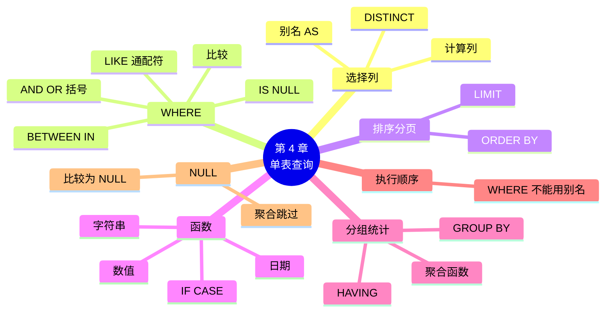

# 第 4 章 单表查询与分组统计

!!! abstract "本章学时"
    理论 7 学时 · 实验 2 学时（本章共 3 个实验，教师可任选）

## 学习目标

学完本章，你应该能够：

1. **说出** SELECT 语句各个子句的作用，以及它们的书写顺序和执行顺序（记忆）；
2. **解释**为什么 WHERE 里不能用列别名、WHERE 和 HAVING 有什么区别（理解）；
3. **写出**带筛选、排序、分页、计算列和函数的单表查询（应用）；
4. **用** COUNT、SUM、AVG、MAX、MIN 和 GROUP BY、HAVING 完成分组统计（应用）；
5. **判断**含 NULL 的数据在比较、计数和求平均时会得到什么结果（分析）。

!!! info "先修要求"
    学习本章前，你需要：

    - 知道关系代数里的选择和投影（[2.5](../02-relational-model/index.md#25)）；
    - 建好了 myshop 库，或者能使用示例库 shop（[实验 3-1](../03-sql-ddl-dml/index.md#3-1-myshop-csv)、[附录 C](../../appendix/c-shop-db.md)）。

??? abstract "本章概念清单（10 个，点击查看定义和例子）"
    1. [查询](../../appendix/glossary.md#g-查询)
    2. [别名](../../appendix/glossary.md#g-别名)
    3. [DISTINCT](../../appendix/glossary.md#g-DISTINCT)
    4. [通配符](../../appendix/glossary.md#g-通配符)
    5. [分页](../../appendix/glossary.md#g-分页)
    6. [CASE 表达式](../../appendix/glossary.md#g-CASE-表达式)
    7. [聚合函数](../../appendix/glossary.md#g-聚合函数)
    8. [分组](../../appendix/glossary.md#g-分组)
    9. [HAVING](../../appendix/glossary.md#g-HAVING)
    10. [执行顺序](../../appendix/glossary.md#g-执行顺序)

## 情景导入

小林把数据导进 myshop 以后，老板第二天一早就来“考”他了：

> “昨天卖了几单？”
> “哪些东西快卖完了，要赶紧进货？”
> “最贵的五样东西是什么？”
> “现在用微信付钱的人多，还是用支付宝的多？”
> “哪个小区来买东西的人最多？”

以前这些问题，小林要翻收银小票、在 Excel 里筛选、排序、做数据透视表，一个问题十几分钟。表哥告诉他：每个问题都是一条 SELECT 语句，写好了一秒出结果，而且明天换个日期再跑一次就行。

SELECT 是 SQL 里用得最多的语句。数据分析师、程序员每天写得最多的就是它。本章先学从**一张表**里查询：选列、筛行、排序、计算、分组统计。下一章再学把几张表连起来查。

本章的例子都在示例库 `shop` 上运行（数据截至 2026 年 6 月 30 日，内容为虚构）。网页里的“试一试”框可以直接改、直接运行。

## 4.1 SELECT 的基本用法

### 4.1.1 选择列

[**查询**](../../appendix/glossary.md#g-查询 "从数据库中按条件取出数据的操作，在 SQL 中用 SELECT 语句完成"){ .term }最简单的格式是：

```sql
SELECT 列名1, 列名2, … FROM 表名;
```

意思是“从某张表里选出某几列”。比如查看商品的名称和售价：

```sql
SELECT name, price FROM product LIMIT 5;
```

```text
+--------------------+-------+
| name               | price |
+--------------------+-------+
| 东北大米 5kg       | 39.90 |
| 泰国香米 2.5kg     | 32.80 |
| 花生油 5L          | 89.00 |
| 菜籽油 5L          | 65.00 |
| 挂面 1kg           |  8.50 |
+--------------------+-------+
```

`LIMIT 5` 表示只要前 5 行，免得 48 行一下子刷满屏幕（4.3 节细讲）。这其实就是第 2 章的**投影**：从表里挑出需要的列。

几点说明：

1. 列名之间用英文逗号隔开，**最后一列后面不要逗号**；
2. `SELECT * FROM product;` 里的 `*` 表示“所有列”。看一眼表里有什么时很方便，但正式的查询最好写出列名：一是只取需要的列更快，二是表结构变了也不容易出错；
3. 结果也是一张表，叫“结果集”。它只是显示出来，并不保存，也不会改动原表。

### 4.1.2 别名和计算列

SELECT 后面不光能写列名，还能写**表达式**，也就是算出一个新列。比如每件商品的毛利是“售价 − 进价”，毛利率是“毛利 ÷ 售价 × 100”：

<div class="sql-try" markdown>

```sql
SELECT name AS 商品名,
       price AS 售价,
       price - cost AS 每件毛利,
       ROUND((price - cost) / price * 100, 1) AS 毛利率
FROM product
LIMIT 5;
```

</div>

在 MySQL 中的运行结果：

```text
+--------------------+--------+--------------+-----------+
| 商品名             | 售价   | 每件毛利     | 毛利率    |
+--------------------+--------+--------------+-----------+
| 东北大米 5kg       |  39.90 |         8.90 |      22.3 |
| 泰国香米 2.5kg     |  32.80 |         7.30 |      22.3 |
| 花生油 5L          |  89.00 |        17.00 |      19.1 |
| 菜籽油 5L          |  65.00 |        13.00 |      20.0 |
| 挂面 1kg           |   8.50 |         2.50 |      29.4 |
+--------------------+--------+--------------+-----------+
```

`AS` 后面是这一列在结果里显示的名字，叫[**别名**](../../appendix/glossary.md#g-别名 "用 AS 给查询结果中的列（或表）另起的名字，只在这条语句里有效"){ .term }。别名只影响显示，不改表里的列名。`AS` 可以省略（写成 `price 售价`），但写上更好读。别名里如果有空格或特殊符号，要用反引号括起来，如 `` AS `毛利率 %` ``。

计算列可以用 `+ - * /` 和括号，规则和小学算术一样：先乘除后加减，括号优先。`ROUND(x, 1)` 是四舍五入保留 1 位小数，4.4 节再讲更多函数。

!!! tip "计算列不会改动原表"
    `price - cost` 只是在显示结果时算出来的，表里并没有“毛利”这一列。如果真想把它存起来，要用第 3 章的 ALTER TABLE 加列再 UPDATE。一般不这样做：能算出来的就不存，免得进价改了毛利忘了改（第 7 章讲的“冗余”）。

### 4.1.3 去掉重复：DISTINCT

顾客分布在哪几个小区？直接 `SELECT district FROM customer;` 会得到 200 行，每位顾客一行，小区名重复很多次。在列名前加 [**DISTINCT**](../../appendix/glossary.md#g-DISTINCT "SELECT 中的关键字，去掉结果里完全相同的重复行"){ .term } 就能去掉重复：

<div class="sql-try" markdown>

```sql
SELECT DISTINCT district FROM customer;
```

</div>

```text
+--------------+
| district     |
+--------------+
| 滨江花园     |
| 和平路       |
| 东风社区     |
| 学府小区     |
| 幸福里       |
+--------------+
```

注意：DISTINCT 作用于它后面的**所有列**的组合。`SELECT DISTINCT district, gender FROM customer;` 去掉的是“小区 + 性别”都相同的行，结果是 10 行（5 个小区 × 2 种性别），不是 5 行。

## 4.2 WHERE：筛选行

### 4.2.1 比较运算

要“挑行”，在 FROM 后面加 WHERE 条件，只有条件成立的行才会出现在结果里。这就是第 2 章的**选择**运算。比如找出库存不足 20 件的商品：

<div class="sql-try" markdown>

```sql
SELECT name, price, stock
FROM product
WHERE stock < 20;
```

</div>

```text
+-------------------+-------+-------+
| name              | price | stock |
+-------------------+-------+-------+
| 挂面 1kg          |  8.50 |     0 |
| 原味薯片 104g     |  8.90 |     8 |
| 橙汁 1L           | 13.80 |     0 |
| 苹果 1kg          | 12.80 |     8 |
| 火锅底料 200g     | 19.90 |     8 |
| 保鲜膜 30m        | 12.50 |    13 |
+-------------------+-------+-------+
```

常用的比较运算符：

| 运算符 | 含义 | 例子 |
|---|---|---|
| `=` | 等于（只写一个等号） | `category_id = 4` |
| `<>` 或 `!=` | 不等于 | `status <> '已退款'` |
| `>`、`>=` | 大于、大于等于 | `price >= 50` |
| `<`、`<=` | 小于、小于等于 | `stock < 20` |

文字和日期要加英文单引号：`WHERE pay_method = '微信'`、`WHERE order_time >= '2026-06-01'`。数字不加引号。

### 4.2.2 BETWEEN、IN、LIKE

**BETWEEN … AND …：在某个范围内**，两头都包含。找售价在 10～15 元之间的商品：

```sql
SELECT name, price FROM product WHERE price BETWEEN 10 AND 15;
```

它等价于 `price >= 10 AND price <= 15`，结果是 9 种商品（全麦面包 12.90、鲜肉包 15.00 等）。

**IN (…)：等于列表中的某一个**。找饮料（类别 4）和乳制品（类别 5）：

```sql
SELECT name, category_id FROM product WHERE category_id IN (4, 5);
```

它等价于 `category_id = 4 OR category_id = 5`，列表长的时候 IN 简洁得多。结果是 9 行。`NOT IN (4, 5)` 则表示“不是 4 也不是 5”。

**LIKE：按模式匹配文字**，用两个[**通配符**](../../appendix/glossary.md#g-通配符 "LIKE 模式中代表任意字符的符号：% 代表任意多个字符（含 0 个），_ 代表恰好一个字符"){ .term }：

| 通配符 | 含义 | 例子 | 能匹配 |
|---|---|---|---|
| `%` | 任意多个字符（包括 0 个） | `'%奶%'` | 纯牛奶、原味酸奶、儿童奶酪棒 |
| `_` | 恰好一个字符 | `'__ %'` | 名字是两个字、后面跟空格的，如“挂面 1kg” |

<div class="sql-try" markdown>

```sql
SELECT name, price FROM product WHERE name LIKE '%奶%';
```

</div>

```text
+------------------------+-------+
| name                   | price |
+------------------------+-------+
| 纯牛奶 250ml×16        | 52.00 |
| 低脂牛奶 1L            | 15.50 |
| 原味酸奶 100g×8        | 19.90 |
| 儿童奶酪棒 20 支       | 39.90 |
+------------------------+-------+
```

`'%1kg'` 表示“以 1kg 结尾”，能找出挂面、小米、燕麦片、香蕉、苹果、土豆 6 种；`'花生%'` 表示“以花生开头”。不加通配符的 `LIKE '花生油 5L'` 就和 `=` 一样了。

!!! warning "LIKE 不能代替 =，也不要滥用 %"
    `WHERE name LIKE '%奶%'` 要把每一行的名字都从头到尾看一遍，数据多时很慢；开头是 `%` 的 LIKE 用不上索引（第 8 章）。精确查找用 `=`，只有“名字里包含某个词”这类需求才用 LIKE。

### 4.2.3 IS NULL：找空值

第 2 章讲过，NULL 表示“不知道、没填”。13 位顾客没有留手机号，怎么把他们找出来？很多人第一次会写成 `WHERE phone = NULL`，结果却是 0 行：

```sql
SELECT COUNT(*) FROM customer WHERE phone = NULL;   -- 结果是 0，写错了
SELECT COUNT(*) FROM customer WHERE phone IS NULL;  -- 结果是 13，正确
```

原因是 NULL 和任何值比较（包括和 NULL 自己比较），结果都是“不知道”（NULL），而不是“成立”，所以一行也选不出来（4.7 节细讲）。判断空值**只能用 `IS NULL` 和 `IS NOT NULL`**。

### 4.2.4 AND、OR、NOT 与括号

多个条件用逻辑运算符组合：

- `AND`：两个条件**都**成立；
- `OR`：两个条件**至少一个**成立；
- `NOT`：条件取反，如 `NOT stock > 20`、`NOT IN`、`NOT LIKE`、`IS NOT NULL`。

**AND 比 OR 先算**，就像乘法比加法先算一样。看下面这个容易出错的例子：老板要“饮料或乳制品里，售价超过 10 元的”。

```sql
-- 写法 1：没加括号
SELECT name, category_id, price FROM product
WHERE category_id = 4 OR category_id = 5 AND price > 10;
```

```text
+------------------------+-------------+-------+
| name                   | category_id | price |
+------------------------+-------------+-------+
| 矿泉水 550ml×24        |           4 | 28.00 |
| 可乐 330ml×6           |           4 | 15.90 |
| 无糖绿茶 500ml         |           4 |  4.50 |
| 橙汁 1L                |           4 | 13.80 |
| 凉茶 310ml×12          |           4 | 36.00 |
| 纯牛奶 250ml×16        |           5 | 52.00 |
| 低脂牛奶 1L            |           5 | 15.50 |
| 原味酸奶 100g×8        |           5 | 19.90 |
| 儿童奶酪棒 20 支       |           5 | 39.90 |
+------------------------+-------------+-------+
```

4.50 元的无糖绿茶也出来了！因为 AND 先算，这条语句实际的意思是 `category_id = 4 OR (category_id = 5 AND price > 10)`：所有饮料，加上 10 元以上的乳制品。正确写法要加括号：

<div class="sql-try" markdown>

```sql
SELECT name, category_id, price FROM product
WHERE (category_id = 4 OR category_id = 5) AND price > 10;
```

</div>

这次是 8 行，无糖绿茶不见了。**口诀：AND 和 OR 混用时，一律加括号。** 写成 `category_id IN (4, 5) AND price > 10` 也可以，更清楚。

## 4.3 排序与分页

### 4.3.1 ORDER BY：排序

关系表里的行本来是没有顺序的，不加排序时，MySQL 按它方便的顺序返回。想按某列排序，在最后加 ORDER BY：

- `ASC` 升序（从小到大，默认，可省略）；
- `DESC` 降序（从大到小）。

最贵的 5 种商品：

<div class="sql-try" markdown>

```sql
SELECT name, price
FROM product
ORDER BY price DESC
LIMIT 5;
```

</div>

```text
+----------------------+-------+
| name                 | price |
+----------------------+-------+
| 每日坚果 25g×30      | 99.00 |
| 花生油 5L            | 89.00 |
| 菜籽油 5L            | 65.00 |
| 纯牛奶 250ml×16      | 52.00 |
| 洗衣液 3kg           | 45.90 |
+----------------------+-------+
```

可以按多列排序：先按第一列排，第一列相同的再按第二列排。`ORDER BY category_id, price DESC` 表示“按类别从小到大，同一类别里按价格从高到低”。注意 `DESC` 只管紧挨着它的那一列，`category_id` 仍是升序。

几个细节：

1. ORDER BY 后面可以用别名，如 `ORDER BY 毛利率 DESC`（4.6 节解释为什么这里可以、WHERE 里不可以）；
2. 文字排序按字符集的规则，汉字的先后不一定是拼音顺序；
3. 升序排列时，NULL 排在最前面。

### 4.3.2 LIMIT：只取前几行和分页

- `LIMIT n`：只要前 n 行；
- `LIMIT m, n`：跳过前 m 行，再取 n 行。也可以写成 `LIMIT n OFFSET m`。

网页上的商品列表每页显示 5 个，第 3 页就是跳过 10 个、取 5 个：

```sql
SELECT product_id, name FROM product ORDER BY product_id LIMIT 10, 5;
```

结果是编号 11～15 的五种商品。用 LIMIT 做[**分页**](../../appendix/glossary.md#g-分页 "把很多行结果分成若干页逐页显示，MySQL 中用 LIMIT 跳过若干行再取若干行实现"){ .term }时，一定要配合 ORDER BY，否则每次查出来的顺序可能不同，翻页时会出现重复或漏掉的行。第 k 页（每页 n 行）的写法是 `LIMIT (k-1)×n, n`。

!!! note "不同数据库的写法"
    LIMIT 是 MySQL、PostgreSQL、SQLite 的写法。SQL Server 用 `SELECT TOP 5 …`，标准 SQL 和 Oracle 新版用 `FETCH FIRST 5 ROWS ONLY`。考试和本书以 MySQL 为准。

## 4.4 常用函数

函数就像计算器上的按键：给它一个或几个值，它算出一个结果。MySQL 有几百个函数，下面只列最常用的。用的时候查[附录 A](../../appendix/a-sql.md) 或官方手册即可，不必死记。

### 4.4.1 字符串函数

| 函数 | 作用 | 例子 | 结果 |
|---|---|---|---|
| `CONCAT(a, b, …)` | 把几段文字连起来 | `CONCAT('花生油', '（', '桶', '）')` | 花生油（桶） |
| `CHAR_LENGTH(s)` | 字符数 | `CHAR_LENGTH('花生油 5L')` | 6 |
| `LEFT(s, n)`、`RIGHT(s, n)` | 取左边、右边 n 个字符 | `LEFT('东北大米', 2)` | 东北 |
| `SUBSTRING(s, 起点, 长度)` | 从中间截取 | `SUBSTRING('13812345678', 4, 4)` | 1234 |
| `REPLACE(s, 旧, 新)` | 替换 | `REPLACE('5kg', 'kg', '千克')` | 5千克 |
| `TRIM(s)` | 去掉两头空格 | `TRIM('  大米 ')` | 大米 |
| `UPPER(s)`、`LOWER(s)` | 转大写、小写 | `UPPER('ml')` | ML |

一个实用的例子：给顾客手机号“打码”，只显示前 3 位和后 4 位（示例库的手机号都以 100 开头，是虚构的）：

<div class="sql-try" markdown>

```sql
SELECT name, phone,
       CONCAT(LEFT(phone, 3), '****', RIGHT(phone, 4)) AS 脱敏手机号
FROM customer
WHERE phone IS NOT NULL
ORDER BY customer_id
LIMIT 3;
```

</div>

```text
+-----------+-------------+-----------------+
| name      | phone       | 脱敏手机号      |
+-----------+-------------+-----------------+
| 徐洋娟    | 10054751779 | 100****1779     |
| 刘斌      | 10018603208 | 100****3208     |
| 潘梅      | 10038222646 | 100****2646     |
+-----------+-------------+-----------------+
```

注意：`CONCAT` 的参数里只要有一个是 NULL，结果就是 NULL。所以上面加了 `phone IS NOT NULL`。

### 4.4.2 数值函数

| 函数 | 作用 | 例子 | 结果 |
|---|---|---|---|
| `ROUND(x, d)` | 四舍五入保留 d 位小数（d 省略为 0） | `ROUND(26.875, 2)` | 26.88 |
| `TRUNCATE(x, d)` | 直接截掉，不四舍五入 | `TRUNCATE(26.875, 1)` | 26.8 |
| `CEIL(x)`、`FLOOR(x)` | 向上、向下取整 | `CEIL(3.2)`、`FLOOR(3.8)` | 4、3 |
| `ABS(x)` | 绝对值 | `ABS(-5)` | 5 |
| `MOD(a, b)` | a 除以 b 的余数 | `MOD(17, 5)` | 2 |

以上结果都在 MySQL 8.4 上验证过。`CEIL` 在小店里很常用：48 瓶水、每箱 24 瓶，要 `CEIL(50 / 24)` = 3 箱。

### 4.4.3 日期函数

日期是小店数据分析最常用的维度：按天、按月、按星期统计。

| 函数 | 作用 | 例子（`order_time` = 2025-01-01 09:32:44） | 结果 |
|---|---|---|---|
| `YEAR(d)`、`MONTH(d)`、`DAY(d)` | 取年、月、日 | `MONTH(order_time)` | 1 |
| `HOUR(d)` | 取小时 | `HOUR(order_time)` | 9 |
| `DATE(d)` | 只取日期部分 | `DATE(order_time)` | 2025-01-01 |
| `DATE_FORMAT(d, 格式)` | 按格式显示 | `DATE_FORMAT(order_time, '%Y-%m')` | 2025-01 |
| `DAYOFWEEK(d)` | 星期几（1 = 星期日，2 = 星期一……7 = 星期六） | `DAYOFWEEK(order_time)` | 4（星期三） |
| `CURDATE()`、`NOW()` | 今天的日期、现在的日期时间 | `CURDATE()` | 运行那天的日期 |
| `DATEDIFF(d1, d2)` | d1 比 d2 晚多少天 | `DATEDIFF('2026-06-30', '2026-06-01')` | 29 |
| `DATE_ADD(d, INTERVAL n 单位)`、`DATE_SUB(…)` | 加上、减去一段时间 | `DATE_SUB('2026-06-30', INTERVAL 3 MONTH)` | 2026-03-30 |
| `TIMESTAMPDIFF(单位, d1, d2)` | 两个时间相差多少个单位 | `TIMESTAMPDIFF(YEAR, '2018-06-01', '2026-06-30')` | 8 |

`DATE_FORMAT` 的格式符：`%Y` 四位年、`%m` 两位月、`%d` 两位日、`%H` 小时、`%i` 分、`%s` 秒。

例：算每位员工到 2026 年 6 月 30 日入职了多少天、满几年：

```sql
SELECT name, hire_date,
       DATEDIFF('2026-06-30', hire_date) AS 入职天数,
       TIMESTAMPDIFF(YEAR, hire_date, '2026-06-30') AS 工龄
FROM employee;
```

```text
+-----------+------------+--------------+--------+
| name      | hire_date  | 入职天数     | 工龄   |
+-----------+------------+--------------+--------+
| 邓建丽    | 2018-06-01 |         2951 |      8 |
| 郭磊      | 2022-08-01 |         1429 |      3 |
| 谢洋燕    | 2023-05-18 |         1139 |      3 |
| 吴轩建    | 2022-06-07 |         1484 |      4 |
| 杨梅      | 2019-11-24 |         2410 |      6 |
| 蒋平玉    | 2024-05-27 |          764 |      2 |
| 田杰强    | 2023-09-10 |         1024 |      2 |
| 刘英      | 2021-05-06 |         1881 |      5 |
+-----------+------------+--------------+--------+
```

!!! tip "按日期范围筛选，推荐用“大于等于 + 小于”"
    查 2026 年 6 月的订单，写 `WHERE order_time >= '2026-06-01' AND order_time < '2026-07-01'` 最稳妥。`BETWEEN '2026-06-01' AND '2026-06-30'` 会漏掉 6 月 30 日白天的订单，因为 `'2026-06-30'` 等于 `2026-06-30 00:00:00`。`WHERE MONTH(order_time) = 6` 也能用，但会把每年的 6 月都选上，而且用不上索引。

本书示例数据截至 2026 年 6 月 30 日，所以例子里用 `'2026-06-30'` 当“今天”。在真实系统里，换成 `CURDATE()` 就行。

### 4.4.4 条件函数：IF 和 CASE

**IF(条件, 成立时的值, 不成立时的值)**：二选一。

```sql
SELECT name, stock, IF(stock = 0, '缺货', '有货') AS 状态 FROM product LIMIT 6;
```

**CASE WHEN**：多选一，从上往下判断，遇到第一个成立的就停：

<div class="sql-try" markdown>

```sql
SELECT name, stock,
       CASE WHEN stock = 0  THEN '缺货'
            WHEN stock < 20 THEN '库存紧张'
            ELSE '充足'
       END AS 库存状态
FROM product
WHERE product_id IN (1, 5, 14, 27);
```

</div>

```text
+----------------------+-------+--------------+
| name                 | stock | 库存状态     |
+----------------------+-------+--------------+
| 东北大米 5kg         |    73 | 充足         |
| 挂面 1kg             |     0 | 缺货         |
| 原味薯片 104g        |     8 | 库存紧张     |
| 原味酸奶 100g×8      |    74 | 充足         |
+----------------------+-------+--------------+
```

挂面的库存 0 也小于 20，但第一个 WHEN 已经成立，所以显示“缺货”而不是“库存紧张”。**条件的先后顺序很重要**，范围小的写前面。CASE 必须以 `END` 结尾，忘写是常见错误。没有 ELSE 时，都不成立的结果是 NULL。

[**CASE 表达式**](../../appendix/glossary.md#g-CASE-表达式 "按条件从多个值中选一个的 SQL 表达式，CASE WHEN 条件 THEN 值 … ELSE 值 END"){ .term }是标准 SQL，所有数据库都支持；IF 是 MySQL 自己的函数。

**IFNULL(值, 替代值)**：值为 NULL 时换成替代值。比如显示电话时，没留的显示“未留”：`IFNULL(phone, '未留')`。标准 SQL 里对应的函数是 `COALESCE`。

## 4.5 聚合与分组

### 4.5.1 聚合函数

前面的函数是“一行进、一行出”。还有一类函数是“很多行进、一个值出”，把一列数据汇总成一个数，叫[**聚合函数**](../../appendix/glossary.md#g-聚合函数 "把多行数据汇总成一个值的函数，如 COUNT 计数、SUM 求和、AVG 平均、MAX 最大、MIN 最小"){ .term }：

| 函数 | 作用 | 对 NULL 的处理 |
|---|---|---|
| `COUNT(*)` | 行数 | 每一行都算，不管有没有 NULL |
| `COUNT(列)` | 这一列不是 NULL 的行数 | 跳过 NULL |
| `COUNT(DISTINCT 列)` | 这一列有多少种不同的值 | 跳过 NULL |
| `SUM(列)` | 求和 | 跳过 NULL |
| `AVG(列)` | 平均值 | 跳过 NULL（分母也不算这些行） |
| `MAX(列)`、`MIN(列)` | 最大、最小值，对文字和日期也能用 | 跳过 NULL |

<div class="sql-try" markdown>

```sql
SELECT COUNT(*)              AS 商品数,
       MIN(price)            AS 最低价,
       MAX(price)            AS 最高价,
       ROUND(AVG(price), 2)  AS 平均价,
       SUM(stock)            AS 总库存
FROM product;
```

</div>

```text
+-----------+-----------+-----------+-----------+-----------+
| 商品数    | 最低价    | 最高价    | 平均价    | 总库存    |
+-----------+-----------+-----------+-----------+-----------+
|        48 |      3.50 |     99.00 |     23.33 |      3339 |
+-----------+-----------+-----------+-----------+-----------+
```

再看 COUNT 的三种写法有什么不同：

```sql
SELECT COUNT(*)                 AS 顾客数,
       COUNT(phone)             AS 留了手机号,
       COUNT(DISTINCT district) AS 小区数
FROM customer;
```

```text
+-----------+-----------------+-----------+
| 顾客数    | 留了手机号      | 小区数    |
+-----------+-----------------+-----------+
|       200 |             187 |         5 |
+-----------+-----------------+-----------+
```

200 位顾客里 13 位没留手机号，所以 `COUNT(phone)` 是 187。

### 4.5.2 GROUP BY：分组统计

上面的统计是对“整张表”算一个数。老板更常问的是“**每个**类别各有多少商品”“**每种**支付方式各多少单”。这就要先把行按某一列分成若干组，再对每组分别做聚合，这叫[**分组**](../../appendix/glossary.md#g-分组 "用 GROUP BY 把某列值相同的行归为一组，再对每组分别做聚合统计"){ .term }：

<div class="sql-try" markdown>

```sql
SELECT category_id, COUNT(*) AS 商品数, ROUND(AVG(price), 2) AS 平均价
FROM product
GROUP BY category_id;
```

</div>

```text
+-------------+-----------+-----------+
| category_id | 商品数    | 平均价    |
+-------------+-----------+-----------+
|           1 |         7 |     39.00 |
|           2 |         6 |     24.75 |
|           3 |         6 |     30.52 |
|           4 |         5 |     19.64 |
|           5 |         4 |     31.83 |
|           6 |         7 |      9.93 |
|           7 |         6 |     12.58 |
|           8 |         7 |     20.67 |
+-------------+-----------+-----------+
```

可以把 GROUP BY 想成**把商品按类别放进 8 个篮子**，然后对每个篮子数一数有几件、算一算平均价，每个篮子在结果里变成一行。和 Excel 的“数据透视表”是一个意思。

<iframe class="sim-frame" src="../../sims/group-having/main.html" height="600" loading="lazy" title="分组统计与 HAVING"></iframe>
动画：分组统计与 HAVING。选一个分组的列和一个聚合函数，看表里的行怎样落进“篮子”、每个篮子怎样变成一行；再加一个 HAVING 条件，看哪些篮子被拿走。[全屏打开](../../sims/group-having/main.html){ target=_blank }
{ .sim-caption }

几个常见用法：

```sql
-- 已完成订单里，每种支付方式各多少单，从多到少
SELECT pay_method, COUNT(*) AS 单数
FROM orders
WHERE status = '已完成'
GROUP BY pay_method
ORDER BY 单数 DESC;
```

```text
+------------+--------+
| pay_method | 单数   |
+------------+--------+
| 微信       |   1345 |
| 支付宝     |    744 |
| 现金       |    241 |
| 银行卡     |    120 |
+------------+--------+
```

```sql
-- 按两列分组：每个小区男、女顾客各多少人
SELECT district, gender, COUNT(*) AS 人数
FROM customer
GROUP BY district, gender
ORDER BY district, gender;
```

结果是 10 行，每个“小区 + 性别”的组合一行（东风社区 男 23、东风社区 女 18……）。

```sql
-- 按月分组：用函数算出“年月”再分组（别名可以用在 GROUP BY 里）
SELECT DATE_FORMAT(order_time, '%Y-%m') AS 月份, COUNT(*) AS 订单数
FROM orders
GROUP BY 月份
ORDER BY 月份;
```

**分组查询的铁律：SELECT 后面只能写“分组的列”和“聚合函数”。** 如果写了别的列，比如：

```sql
SELECT category_id, name, COUNT(*) FROM product GROUP BY category_id;
```

MySQL 8 会报错：

```text
ERROR 1055 (42000): Expression #2 of SELECT list is not in GROUP BY clause and contains nonaggregated column 'shop.product.name' which is not functionally dependent on columns in GROUP BY clause; this is incompatible with sql_mode=only_full_group_by
```

道理很简单：类别 1 这个“篮子”里有 7 种商品，结果只有一行，`name` 该显示哪一种？数据库不知道，只好报错。<sup class="cite">[[5]](#ref4-5)</sup> 一些老版本 MySQL 和网页里的 SQLite 不报错，而是随便挑一个显示，这样更危险，因为结果看起来像对的。

### 4.5.3 HAVING：筛选分组

“商品数不少于 7 种的类别有哪些？”这个条件针对的是“分组后的统计值”，不能写在 WHERE 里，要写在 GROUP BY 后面的 [**HAVING**](../../appendix/glossary.md#g-HAVING "GROUP BY 之后对分组进行筛选的子句，条件里可以使用聚合函数"){ .term } 里：

<div class="sql-try" markdown>

```sql
SELECT category_id, COUNT(*) AS 商品数
FROM product
GROUP BY category_id
HAVING COUNT(*) >= 7;
```

</div>

```text
+-------------+-----------+
| category_id | 商品数    |
+-------------+-----------+
|           1 |         7 |
|           6 |         7 |
|           8 |         7 |
+-------------+-----------+
```

如果硬写进 WHERE，`WHERE COUNT(*) >= 7`，MySQL 会报 `ERROR 1111 (HY000): Invalid use of group function`（错误使用了聚合函数）。

**WHERE 和 HAVING 的区别**：

| | WHERE | HAVING |
|---|---|---|
| 筛选的对象 | 分组**之前**的每一行 | 分组**之后**的每一组 |
| 能不能用聚合函数 | 不能 | 能 |
| 打个比方 | 东西放进篮子之前，先挑掉不要的 | 篮子装好、数完以后，拿走不要的篮子 |

两个可以一起用。“售价超过 20 元的商品里，哪些类别至少有 3 种？”

```sql
SELECT category_id, COUNT(*) AS 商品数
FROM product
WHERE price > 20             -- 先挑出 20 元以上的商品
GROUP BY category_id         -- 再按类别分组
HAVING COUNT(*) >= 3;        -- 最后只留商品数 >= 3 的组
```

```text
+-------------+-----------+
| category_id | 商品数    |
+-------------+-----------+
|           1 |         5 |
|           2 |         3 |
+-------------+-----------+
```

!!! tip "能在 WHERE 里筛的，就不要放到 HAVING 里"
    `HAVING category_id = 1` 在 MySQL 里也能运行，但它要先把所有行分好组再扔掉，白白多干了活。不涉及聚合函数的条件，写在 WHERE 里。

## 4.6 SQL 的书写顺序和执行顺序

到这里，SELECT 的所有子句都学完了。完整的单表查询按下面的**顺序书写**，顺序不能乱：

```sql
SELECT   列、表达式、聚合函数       -- 5
FROM     表                         -- 1
WHERE    行的条件                   -- 2
GROUP BY 分组的列                   -- 3
HAVING   组的条件                   -- 4
ORDER BY 排序的列                   -- 6
LIMIT    行数;                      -- 7
```

但数据库**执行**的顺序不一样，是右边注释的编号：

1. **FROM**：先找到表，拿到所有行；
2. **WHERE**：一行一行检查，留下条件成立的；
3. **GROUP BY**：把留下的行分组；
4. **HAVING**：把不满足条件的组去掉；
5. **SELECT**：算出每一列（包括计算列和别名），去重（DISTINCT）；
6. **ORDER BY**：排序；
7. **LIMIT**：取前几行。

<iframe class="sim-frame" src="../../sims/sql-order/main.html" height="620" loading="lazy" title="SELECT 的执行顺序"></iframe>
动画：SELECT 的执行顺序。点“下一步”，看一条完整的分组查询怎样从 FROM 开始，经过 WHERE、GROUP BY、HAVING、SELECT、ORDER BY、LIMIT，每一步之后表里还剩哪些行。[全屏打开](../../sims/sql-order/main.html){ target=_blank }
{ .sim-caption }

理解了[**执行顺序**](../../appendix/glossary.md#g-执行顺序 "SELECT 语句各子句被数据库处理的先后：FROM、WHERE、GROUP BY、HAVING、SELECT、ORDER BY、LIMIT"){ .term }，很多“怪规定”就说得通了：

- **为什么 WHERE 里不能用别名？** 执行 WHERE（第 2 步）的时候，SELECT（第 5 步）还没执行，别名还没起出来。比如：

    ```sql
    SELECT name, price - cost AS 毛利 FROM product WHERE 毛利 > 20;
    ```

    MySQL 报 `ERROR 1054 (42S22): Unknown column '毛利' in 'where clause'`。改成 `WHERE price - cost > 20` 就对了，结果只有每日坚果（毛利 27.00）。<sup class="cite">[[6]](#ref4-6)</sup>

- **为什么 ORDER BY 里能用别名？** 排序（第 6 步）在 SELECT 之后，别名已经有了。
- **为什么 WHERE 里不能用聚合函数？** 第 2 步还没分组，没法“数一组有几行”。
- **为什么 HAVING 里能用聚合函数？** 第 4 步时已经分好组了。（MySQL 还允许在 GROUP BY 和 HAVING 里用别名，这是 MySQL 的扩展，别的数据库不一定行。）

!!! warning "网页“试一试”和 MySQL 的差别"
    网页里运行的是 SQLite，它比 MySQL “宽松”：WHERE 里用别名、GROUP BY 时 SELECT 了别的列，它都不报错。要看到上面这些报错，请在自己电脑的 MySQL 上运行。考试和工作都以 MySQL 的规则为准。

## 4.7 NULL 的坑

NULL 不是 0，也不是空字符串，而是“不知道”。它在运算里有自己的规矩，不了解就容易算错。

**规矩 1：和 NULL 做比较、做算术，结果都是 NULL。**

```sql
SELECT NULL = NULL, NULL IS NULL, 1 + NULL, CONCAT('a', NULL);
```

```text
+-------------+--------------+----------+-------------------+
| NULL = NULL | NULL IS NULL | 1 + NULL | CONCAT('a', NULL) |
+-------------+--------------+----------+-------------------+
|        NULL |            1 |     NULL | NULL              |
+-------------+--------------+----------+-------------------+
```

两个“不知道”是不是相等？还是不知道。所以找空值只能用 `IS NULL`（结果 1 表示成立）。

**规矩 2：WHERE 只留下条件“成立”的行，结果是 NULL 的行会被扔掉。** 这会造成一个隐蔽的错误：`WHERE 列 <> 某值` 不会选出该列是 NULL 的行。

**规矩 3：聚合函数（除了 `COUNT(*)`）都跳过 NULL。**

用一个小例子看清楚：四个人给新品试吃打分，张大爷没打分（NULL）。

<div class="sql-try" data-db="empty" markdown>

```sql
CREATE TABLE tasting (name VARCHAR(10), stars INT);
INSERT INTO tasting VALUES ('小林', 5), ('王阿姨', 3), ('张大爷', NULL), ('李姐', 4);
SELECT COUNT(*), COUNT(stars), SUM(stars), AVG(stars), SUM(stars) / COUNT(*) FROM tasting;
SELECT name FROM tasting WHERE stars <> 5;
```

</div>

在 MySQL 中的结果：

```text
+----------+--------------+------------+------------+-----------------------+
| COUNT(*) | COUNT(stars) | SUM(stars) | AVG(stars) | SUM(stars) / COUNT(*) |
+----------+--------------+------------+------------+-----------------------+
|        4 |            3 |         12 |     4.0000 |                3.0000 |
+----------+--------------+------------+------------+-----------------------+
+-----------+
| name      |
+-----------+
| 王阿姨    |
| 李姐      |
+-----------+
```

- `AVG(stars)` 是 12 ÷ 3 = 4，没打分的人不算在分母里；如果把“没打分”当 0 分，平均分应是 12 ÷ 4 = 3。哪个对，要看业务的意思，**写统计之前要想清楚 NULL 代表什么**。想把 NULL 当 0，写 `AVG(IFNULL(stars, 0))`；
- “打分不是 5 分的人”应该有 3 个，但 `stars <> 5` 只查出 2 个，张大爷被漏掉了。要包括他，写 `WHERE stars <> 5 OR stars IS NULL`。

**规矩 4：GROUP BY 把所有 NULL 归为一组；升序排序时 NULL 在最前。** 比如按顾客统计订单数，散客订单（customer_id 为 NULL）会单独成一组，538 单，排在“下单最多的顾客”前面。要去掉它，加 `WHERE customer_id IS NOT NULL`（实验 4-1 问题 8）。

## 4.8 前沿视窗：用大白话问数据

第 1 章提到过 [Text-to-SQL](../../appendix/glossary.md#g-Text-to-SQL)：用自然语言提问，由大模型翻译成 SQL。像“2026 年 6 月每种支付方式各多少单”这样的单表统计，现在的大模型大多能写对。研究人员用 Spider 等测试集衡量这类能力：给出数据库和问题，看模型写出的 SQL 能不能查出正确答案。<sup class="cite">[[7]](#ref4-7)</sup> 不少数据库工具和 BI 软件已经内置了“问数”功能。

但是，模型写的 SQL 能运行，不等于答案对。学完本章，你已经能检查最常见的几种错误：

| 检查项 | 常见错误 | 本章哪一节 |
|---|---|---|
| 条件有没有括号 | AND、OR 混用不加括号 | 4.2.4 |
| 日期范围对不对 | 用 BETWEEN 漏掉最后一天的白天 | 4.4.3 |
| NULL 有没有考虑 | 散客、没打分的行被漏掉或单独成组 | 4.7 |
| 统计口径对不对 | 退款订单算没算进去；AVG 的分母是谁 | 4.5、4.7 |
| 行数合不合理 | 每组一行？总数对得上吗？ | 4.5.2 |

**最好的习惯是：让模型写，自己读懂，再用一两个手算得出的数核对。** 比如问“6 月一共多少单”，可以先查 6 月 30 日一天的单数（4 单），对着收银记录核一下。

## 本章实验

!!! abstract "实验总览"
    | 实验 | 类型 | 建议时长 | 内容 |
    |---|---|---|---|
    | 实验 4-1 | ★ 基础 | 45 分钟 | 用 SELECT 回答老板的十个问题，改条件再查 |
    | 实验 4-2 | ★ 基础 | 45 分钟 | 按月、按钟点、按星期、按商品和类别分组统计 |
    | 实验 4-3 | ☆ 拓展 | 30 分钟 | 用 GROUP BY + HAVING 找出“三个月没来过的老顾客” |

    SQL 脚本见配套资源 `labs/ch04/` 目录。三个实验都在示例库 `shop` 上做（只查询，不修改数据）。

### 实验 4-1 ★ 回答老板的十个问题

**实验目的**

1. 熟练写出带 WHERE、ORDER BY、LIMIT 的查询；
2. 学会把一句业务问题“翻译”成 SQL，并能修改条件回答类似的问题。

**实验环境**：本机 CPU，MySQL 8.4 + DBeaver。**实验数据**：示例库 `shop`（[附录 C](../../appendix/c-shop-db.md)，内容为虚构，数据截至 2026-06-30）。

**实验步骤与代码**

1. 在 DBeaver 中打开 `labs/ch04/lab4_1_ten_questions.sql`；
2. **先不看答案**：读每个问题的注释，自己试着写一遍 SQL；
3. 把光标放在一条语句上，按 Ctrl+Enter 只执行这一条，和脚本里的参考写法、下面的参考结果对照；
4. 完成“实验记录表”里的改写任务。

脚本中的部分语句：

```sql
USE shop;

-- 问题 1：2026 年 6 月 30 日这一天有几单？
SELECT COUNT(*) AS 订单数
FROM orders
WHERE DATE(order_time) = '2026-06-30';

-- 问题 2：订单 2499 买了哪些商品，一共多少钱？
SELECT product_id, quantity, unit_price, quantity * unit_price AS 小计
FROM order_item
WHERE order_id = 2499;
SELECT SUM(quantity * unit_price) AS 订单金额
FROM order_item
WHERE order_id = 2499;

-- 问题 6：2026 年 6 月一共多少单？其中退款几单？
SELECT status, COUNT(*) AS 单数
FROM orders
WHERE order_time >= '2026-06-01' AND order_time < '2026-07-01'
GROUP BY status;

-- 问题 8：下单次数最多的 5 位顾客（不算散客）
SELECT customer_id, COUNT(*) AS 下单次数
FROM orders
WHERE customer_id IS NOT NULL
GROUP BY customer_id
ORDER BY 下单次数 DESC
LIMIT 5;

-- 问题 10：毛利率最高的 5 种商品
SELECT name, price, cost,
       ROUND((price - cost) / price * 100, 1) AS 毛利率
FROM product
ORDER BY 毛利率 DESC
LIMIT 5;
```

**运行结果**

编者在 MySQL 8.4.13 上的运行结果（节选）：

```text
问题 1
+-----------+
| 订单数    |
+-----------+
|         4 |
+-----------+
问题 2
+------------+----------+------------+--------+
| product_id | quantity | unit_price | 小计   |
+------------+----------+------------+--------+
|          3 |        1 |      89.00 |  89.00 |
|         35 |        1 |       4.00 |   4.00 |
|         41 |        2 |      19.90 |  39.80 |
|         47 |        1 |      19.80 |  19.80 |
+------------+----------+------------+--------+
+--------------+
| 订单金额     |
+--------------+
|       152.60 |
+--------------+
问题 3：缺货或库存不足 20 件
+------------+-------------------+-------+
| product_id | name              | stock |
+------------+-------------------+-------+
|          5 | 挂面 1kg          |     0 |
|         23 | 橙汁 1L           |     0 |
|         14 | 原味薯片 104g     |     8 |
|         32 | 苹果 1kg          |     8 |
|         41 | 火锅底料 200g     |     8 |
|         48 | 保鲜膜 30m        |    13 |
+------------+-------------------+-------+
问题 6
+-----------+--------+
| status    | 单数   |
+-----------+--------+
| 已完成    |    139 |
| 已退款    |      2 |
+-----------+--------+
问题 7：2026 年上半年各支付方式（已完成）
+------------+--------+
| pay_method | 单数   |
+------------+--------+
| 微信       |    446 |
| 支付宝     |    257 |
| 现金       |     65 |
| 银行卡     |     45 |
+------------+--------+
问题 8
+-------------+--------------+
| customer_id | 下单次数     |
+-------------+--------------+
|          28 |           49 |
|          26 |           45 |
|         193 |           40 |
|         167 |           40 |
|         108 |           40 |
+-------------+--------------+
问题 9：各小区顾客人数
+--------------+--------+
| district     | 人数   |
+--------------+--------+
| 滨江花园     |     50 |
| 东风社区     |     41 |
| 幸福里       |     40 |
| 学府小区     |     37 |
| 和平路       |     32 |
+--------------+--------+
问题 10
+-------------+-------+------+-----------+
| name        | price | cost | 毛利率    |
+-------------+-------+------+-----------+
| 生菜 300g   |  4.50 | 2.80 |      37.8 |
| 食盐 400g   |  3.50 | 2.20 |      37.1 |
| 话梅 150g   |  9.90 | 6.30 |      36.4 |
| 土豆 1kg    |  6.50 | 4.20 |      35.4 |
| 豆腐 400g   |  4.00 | 2.60 |      35.0 |
+-------------+-------+------+-----------+
```

问题 4、5 的结果与 4.3.1、4.2.2 节相同。问题 8 中有 3 位顾客并列 40 次，并列时谁排前面不确定，你的结果顺序可能不同；要固定顺序，可以写 `ORDER BY 下单次数 DESC, customer_id`。

**实验记录表**

| 任务 | 要求 | 你的 SQL 和结果 |
|---|---|---|
| 改写 1 | 问题 1 改成查 2026 年 6 月 28 日（参考答案：6 单） | |
| 改写 2 | 问题 3 改成“库存不足 30 件，且售价超过 10 元” | |
| 改写 3 | 问题 5 改成“名字以‘1kg’结尾的商品”（参考答案：6 种） | |
| 改写 4 | 问题 8 改成“2026 年下单最多的 3 位顾客” | |
| 改写 5 | 问题 10 改成“毛利率最低的 5 种商品” | |

**常见问题排查**

| 现象 | 原因 | 解决办法 |
|---|---|---|
| `ERROR 1046 (3D000): No database selected` | 没有选择数据库 | 先执行 `USE shop;`，或在 DBeaver 顶部选中 shop |
| `ERROR 1054 … Unknown column '下单次数' in 'where clause'` | 在 WHERE 里用了别名 | 改用原表达式，或把条件放到 HAVING |
| 问题 6 查出来是 0 行 | 日期写成了中文格式，或年份写错 | 日期写成 `'2026-06-01'` 这种格式 |
| 问题 8 第一行是 NULL、538 次 | 没去掉散客订单 | 加 `WHERE customer_id IS NOT NULL` |

**思考与练习**

1. 问题 1 用的 `DATE(order_time) = '2026-06-30'` 和 `order_time >= '2026-06-30' AND order_time < '2026-07-01'` 结果一样吗？哪个更好？为什么？
2. 问题 2 只能查出商品编号，看不到商品名称。要同时显示名称，需要用到哪两张表？（第 5 章学习）

**实验报告要求**

提交五个改写任务的 SQL 和结果截图，回答思考题。

### 实验 4-2 ★ 按月、按商品、按类别统计

**实验目的**

1. 熟练使用 GROUP BY 和聚合函数；
2. 学会用日期函数按月、按钟点、按星期分组，读懂统计结果里的规律。

**实验环境**：本机 CPU，MySQL 8.4 + DBeaver。**实验数据**：示例库 `shop`。

**实验步骤与代码**

依次执行 `labs/ch04/lab4_2_monthly_stats.sql` 中的 5 条语句：

```sql
USE shop;

-- 1. 每月订单数和退款单数
SELECT DATE_FORMAT(order_time, '%Y-%m') AS 月份,
       COUNT(*) AS 订单数,
       SUM(status = '已退款') AS 退款单数
FROM orders
GROUP BY 月份
ORDER BY 月份;

-- 2. 一天里哪个钟点最忙？
SELECT HOUR(order_time) AS 钟点, COUNT(*) AS 订单数
FROM orders
GROUP BY 钟点
ORDER BY 钟点;

-- 3. 一周里哪天最忙？（DAYOFWEEK：1 = 星期日，2 = 星期一……7 = 星期六）
SELECT DAYOFWEEK(order_time) AS 星期, COUNT(*) AS 订单数
FROM orders
GROUP BY 星期
ORDER BY 星期;

-- 4. 销售额前 10 的商品（按订单明细统计，含已退款订单）
SELECT product_id,
       SUM(quantity) AS 销量,
       SUM(quantity * unit_price) AS 销售额
FROM order_item
GROUP BY product_id
ORDER BY 销售额 DESC
LIMIT 10;

-- 5. 各类别的商品数、平均毛利率、库存金额（按进价算）
SELECT category_id,
       COUNT(*) AS 商品数,
       ROUND(AVG((price - cost) / price) * 100, 1) AS 平均毛利率,
       SUM(cost * stock) AS 库存金额
FROM product
GROUP BY category_id
ORDER BY 库存金额 DESC;
```

第 1 条里的 `SUM(status = '已退款')` 是个小技巧：在 MySQL 里，条件成立算 1、不成立算 0，把它们加起来就是“成立的有几行”。写成标准 SQL 是 `SUM(CASE WHEN status = '已退款' THEN 1 ELSE 0 END)`。

**运行结果**

编者在 MySQL 8.4.13 上的运行结果：

```text
1. 每月订单数（共 18 行，节选首尾）
+---------+-----------+--------------+
| 月份    | 订单数    | 退款单数     |
+---------+-----------+--------------+
| 2025-01 |       146 |            3 |
| 2025-02 |       130 |            4 |
| 2025-03 |       148 |            2 |
| ……      |           |              |
| 2026-04 |       136 |            1 |
| 2026-05 |       144 |            3 |
| 2026-06 |       141 |            2 |
+---------+-----------+--------------+
2. 按钟点
+--------+-----------+
| 钟点   | 订单数    |
+--------+-----------+
|      7 |       373 |
|      8 |       390 |
|      9 |       202 |
|     11 |       200 |
|     12 |       178 |
|     17 |       187 |
|     18 |       373 |
|     19 |       191 |
|     20 |       201 |
|     21 |       206 |
+--------+-----------+
3. 按星期
+--------+-----------+
| 星期   | 订单数    |
+--------+-----------+
|      1 |       471 |
|      2 |       312 |
|      3 |       313 |
|      4 |       313 |
|      5 |       312 |
|      6 |       320 |
|      7 |       460 |
+--------+-----------+
4. 销售额前 10 的商品
+------------+--------+-----------+
| product_id | 销量   | 销售额    |
+------------+--------+-----------+
|          3 |    172 |  15308.00 |
|         15 |    149 |  14751.00 |
|          4 |    188 |  12220.00 |
|         11 |    238 |  10710.00 |
|         25 |    186 |   9672.00 |
|          1 |    201 |   8019.90 |
|         28 |    193 |   7700.70 |
|          8 |    251 |   6751.90 |
|          2 |    195 |   6396.00 |
|         44 |    138 |   6334.20 |
+------------+--------+-----------+
5. 各类别
+-------------+-----------+-----------------+--------------+
| category_id | 商品数    | 平均毛利率      | 库存金额     |
+-------------+-----------+-----------------+--------------+
|           1 |         7 |            23.4 |     17689.90 |
|           3 |         6 |            31.7 |     10457.60 |
|           2 |         6 |            29.8 |      9690.80 |
|           5 |         4 |            27.6 |      6864.50 |
|           8 |         7 |            31.8 |      6613.40 |
|           6 |         7 |            31.9 |      4046.50 |
|           7 |         6 |            32.0 |      3379.10 |
|           4 |         5 |            29.4 |      3176.80 |
+-------------+-----------+-----------------+--------------+
```

读结果：早上 7、8 点和傍晚 18 点是高峰（上班前、下班后）；星期六、星期日（7 和 1）比工作日多五成左右。示例数据是按这样的规律生成的，所以 10 点、13～16 点没有订单，真实小店的数据会更“乱”一些。

**实验记录表**

| 步骤 | 观察内容 | 你的结果 |
|---|---|---|
| 1 | 订单最多和最少的月份各是哪个月？ | |
| 2/3 | 如果只能在一个时段多安排一名收银员，你选哪个钟点、星期几？ | |
| 4 | 销量最大的商品（product_id）和销售额最大的商品是同一个吗？为什么？ | |
| 5 | 哪个类别压的钱（库存金额）最多？它的毛利率高不高？ | |
| 拓展 | 第 4 条只统计已完成订单该怎么写？（提示：order_item 表里没有订单状态，第 5 章学了连接再做） | |

**常见问题排查**

| 现象 | 原因 | 解决办法 |
|---|---|---|
| 第 1 条每个月只有一行但月份乱序 | 没写 ORDER BY | 加 `ORDER BY 月份` |
| 第 3 条星期看不懂 | DAYOFWEEK 从星期日开始数 | 1 是星期日；也可以用 `WEEKDAY()`，0 是星期一 |
| 报错 1055 | SELECT 里写了没分组的列 | SELECT 里只写分组列和聚合函数 |

**思考与练习**

1. 怎样算出“每个月平均每天多少单”？（提示：每个月的天数可以用 `COUNT(DISTINCT DATE(order_time))` 算出“有订单的天数”）
2. 第 5 条的“平均毛利率”是各商品毛利率的平均值，和“类别总毛利 ÷ 类别总售价”一样吗？哪个更能代表这个类别的赚钱能力？

**实验报告要求**

截图 5 条语句的结果，完成实验记录表，用三五句话给老板写一段“排班建议”。

### 实验 4-3 ☆ 找出“三个月没来过的老顾客”

**实验目的**

1. 综合运用 GROUP BY、HAVING、MAX、DATEDIFF 和 DATE_SUB；
2. 体会“先看全貌、再加条件”的分步写法。

**实验环境**：本机 CPU，MySQL 8.4 + DBeaver。**实验数据**：示例库 `shop`，以 2026-06-30 为“今天”。

**实验背景**

老板想给“以前常来、最近不来了”的老顾客发一张优惠券。“老顾客”定义为来过至少 5 次，“最近不来了”定义为最近 3 个月（2026-03-30 以后）没有下过单。

**实验步骤与代码**

```sql
USE shop;

-- 第 1 步：每位顾客最后一次来是哪天、一共来过几次
SELECT customer_id,
       COUNT(*) AS 来店次数,
       DATE(MAX(order_time)) AS 最后一次
FROM orders
WHERE customer_id IS NOT NULL
GROUP BY customer_id
ORDER BY 最后一次
LIMIT 10;

-- 第 2 步：只留下“来过至少 5 次、但最近 3 个月没来”的顾客
SELECT customer_id,
       COUNT(*) AS 来店次数,
       DATE(MAX(order_time)) AS 最后一次,
       DATEDIFF('2026-06-30', MAX(order_time)) AS 多少天没来
FROM orders
WHERE customer_id IS NOT NULL
GROUP BY customer_id
HAVING COUNT(*) >= 5
   AND MAX(order_time) < DATE_SUB('2026-06-30', INTERVAL 3 MONTH)
ORDER BY 多少天没来 DESC;
```

**运行结果**

编者在 MySQL 8.4.13 上的运行结果：

```text
第 1 步
+-------------+--------------+--------------+
| customer_id | 来店次数     | 最后一次     |
+-------------+--------------+--------------+
|          19 |            1 | 2025-12-08   |
|          12 |           12 | 2026-01-02   |
|          56 |           13 | 2026-01-08   |
|         152 |           17 | 2026-01-29   |
|           6 |            7 | 2026-02-07   |
|          49 |            6 | 2026-02-12   |
|         102 |           34 | 2026-02-19   |
|          26 |           45 | 2026-02-19   |
|         107 |           16 | 2026-02-22   |
|          70 |            6 | 2026-02-26   |
+-------------+--------------+--------------+
第 2 步
+-------------+--------------+--------------+-----------------+
| customer_id | 来店次数     | 最后一次     | 多少天没来      |
+-------------+--------------+--------------+-----------------+
|          12 |           12 | 2026-01-02   |             179 |
|          56 |           13 | 2026-01-08   |             173 |
|         152 |           17 | 2026-01-29   |             152 |
|           6 |            7 | 2026-02-07   |             143 |
|          49 |            6 | 2026-02-12   |             138 |
|          26 |           45 | 2026-02-19   |             131 |
|         102 |           34 | 2026-02-19   |             131 |
|         107 |           16 | 2026-02-22   |             128 |
|          70 |            6 | 2026-02-26   |             124 |
|         194 |            6 | 2026-03-05   |             117 |
|         142 |           36 | 2026-03-11   |             111 |
|          97 |            5 | 2026-03-16   |             106 |
|          11 |           21 | 2026-03-17   |             105 |
|           5 |            8 | 2026-03-20   |             102 |
|         127 |           23 | 2026-03-23   |              99 |
+-------------+--------------+--------------+-----------------+
```

一共 15 位。顾客 19 只来过 1 次，不算老顾客，所以第 2 步里没有他。顾客 26 来过 45 次（下单次数第二多），却已经 131 天没来了，最值得老板打个电话问问。

**实验记录表**

| 任务 | 你的结果 |
|---|---|
| 把“老顾客”改为至少 10 次，还剩几位？ | |
| 把“最近不来了”改为 2 个月，有几位？ | |
| 这 15 位里，有没有会员？（提示：要查 member 表，第 5 章用子查询或连接来做） | |

**思考与练习**

1. 为什么 `MAX(order_time) < …` 这个条件要写在 HAVING 里，而不是 WHERE 里？如果写成 `WHERE order_time < DATE_SUB('2026-06-30', INTERVAL 3 MONTH)`，查出来的意思变成了什么？
2. 在真实系统里，`'2026-06-30'` 应换成什么函数？

**实验报告要求**

提交第 2 步的结果截图和记录表，回答思考题。

## 本章小结

- SELECT 的完整书写顺序：**SELECT → FROM → WHERE → GROUP BY → HAVING → ORDER BY → LIMIT**；执行顺序：**FROM → WHERE → GROUP BY → HAVING → SELECT → ORDER BY → LIMIT**。
- SELECT 后可写列、表达式和函数，用 **AS** 起别名，用 **DISTINCT** 去重。别名能用在 ORDER BY 里，不能用在 WHERE 里。
- WHERE 筛行：比较运算、**BETWEEN**（含两端）、**IN**、**LIKE**（`%` 任意多个字符，`_` 一个字符）、**IS NULL**；AND 比 OR 先算，混用时加括号。
- **ORDER BY** 排序（ASC 升序、DESC 降序），**LIMIT m, n** 跳过 m 行取 n 行，分页要配合排序。
- 常用函数：字符串（CONCAT、LEFT、CHAR_LENGTH）、数值（ROUND、CEIL）、日期（YEAR、MONTH、DATE_FORMAT、DATEDIFF、DATE_SUB）、条件（IF、**CASE WHEN … END**、IFNULL）。
- 聚合函数 **COUNT、SUM、AVG、MAX、MIN**；**GROUP BY** 分组，SELECT 里只能写分组列和聚合函数；**HAVING** 筛分组，可用聚合函数。
- NULL 的规矩：比较结果是 NULL；判断用 IS NULL；聚合函数（除 COUNT(*)）跳过 NULL；GROUP BY 把 NULL 归为一组。



**下一章预告**

实验里好几次遇到“只看到编号、看不到名字”“订单明细里没有订单状态”的问题，因为数据分在不同的表里。第 5 章学习连接查询和子查询，把几张表“拼”起来，回答“张阿姨上个月买了哪些东西”这类问题。

## 参考文献

正文中的上标编号（如<sup class="cite">[[5]](#ref4-5)</sup>）对应下面的文献。带链接的可以直接打开；书籍可在图书馆或电子书平台查阅。

<div class="refs" markdown>

**教材与专著**

- <span id="ref4-1"></span>[1] 王珊，杜小勇，陈红. 数据库系统概论[M]. 6 版. 北京：高等教育出版社，2023.
    <span class="ref-note">第 3 章“关系数据库标准语言 SQL”的数据查询部分，讲单表查询、聚集函数和 GROUP BY。</span>
- <span id="ref4-2"></span>[2] BEAULIEU A. Learning SQL[M]. 3rd ed. Sebastopol: O'Reilly Media, 2020.
    <span class="ref-note">第 3～4 章讲查询入门和过滤，第 8 章讲分组与聚合，例子以 MySQL 为准。</span>

**在线资源与数据**

- <span id="ref4-3"></span>[3] Oracle. MySQL 8.4 Reference Manual: SELECT Statement[EB/OL]. [2026-11-01]. https://dev.mysql.com/doc/refman/8.4/en/select.html.
    <span class="ref-note">SELECT 语句的完整语法，包括 LIMIT 的两种写法，对应 4.1～4.3 节。</span>
- <span id="ref4-4"></span>[4] Oracle. MySQL 8.4 Reference Manual: Aggregate Function Descriptions[EB/OL]. [2026-11-01]. https://dev.mysql.com/doc/refman/8.4/en/aggregate-functions.html.
    <span class="ref-note">COUNT、SUM、AVG 等聚合函数的说明，包括它们对 NULL 的处理，对应 4.5.1 节。</span>
- <span id="ref4-5"></span>[5] Oracle. MySQL 8.4 Reference Manual: MySQL Handling of GROUP BY[EB/OL]. [2026-11-01]. https://dev.mysql.com/doc/refman/8.4/en/group-by-handling.html.
    <span class="ref-note">解释 ONLY_FULL_GROUP_BY 模式和错误 1055，对应 4.5.2 节。</span>
- <span id="ref4-6"></span>[6] Oracle. MySQL 8.4 Reference Manual: Problems with Column Aliases[EB/OL]. [2026-11-01]. https://dev.mysql.com/doc/refman/8.4/en/problems-with-alias.html.
    <span class="ref-note">说明标准 SQL 不允许在 WHERE 中引用列别名及其原因，对应 4.6 节。</span>
- <span id="ref4-8"></span>[8] Oracle. MySQL 8.4 Reference Manual: Working with NULL Values[EB/OL]. [2026-11-01]. https://dev.mysql.com/doc/refman/8.4/en/working-with-null.html.
    <span class="ref-note">MySQL 教程中关于 NULL 比较和 IS NULL 的说明，对应 4.2.3 节和 4.7 节。</span>

**经典论文**

- <span id="ref4-7"></span>[7] YU T, ZHANG R, YANG K, et al. Spider: a large-scale human-labeled dataset for complex and cross-domain semantic parsing and text-to-SQL task[C]//Proceedings of the 2018 Conference on Empirical Methods in Natural Language Processing. Brussels: Association for Computational Linguistics, 2018: 3911-3921.
    <span class="ref-note">经典的 Text-to-SQL 测试集，对应 4.8 节。</span>

</div>

## 课后练习

选择题和判断题可以直接点击选项作答，系统会马上告诉你对错，并展开答案与解析；多选题选好后点“提交答案”。简答和实操题请先自己作答，再点开“答案与解析”核对。每道题的解析下方都有“回看”链接，做错了可以直接跳回正文复习。

**一、单项选择题**

<div class="quiz" data-answer="B" markdown>

**1.** 要去掉查询结果中的重复行，应在 SELECT 后使用关键字（　　）。

- A. UNIQUE
- B. DISTINCT
- C. DIFFERENT
- D. GROUP

</div>

??? tip "答案与解析"
    **答案：B**

    解析：UNIQUE 是建表时的唯一约束，不是查询关键字。

    考查：DISTINCT · 认知层次：记忆 · [回看 4.1.3](#413-distinct)
    { .quiz-meta }

<div class="quiz" data-answer="C" markdown>

**2.** 查询名字中第二个字是“米”的商品，条件应写成（　　）。

- A. `name LIKE '%米%'`
- B. `name LIKE '米%'`
- C. `name LIKE '_米%'`
- D. `name = '_米%'`

</div>

??? tip "答案与解析"
    **答案：C**

    解析：`_` 代表恰好一个字符，`%` 代表任意多个字符。A 是“包含米”，B 是“以米开头”，D 用 `=` 时通配符不起作用。

    考查：通配符 · 认知层次：应用 · [回看 4.2.2](#422-betweeninlike)
    { .quiz-meta }

<div class="quiz" data-answer="D" markdown>

**3.** 查询没有留手机号的顾客，正确的条件是（　　）。

- A. `phone = NULL`
- B. `phone = ''`
- C. `phone = 0`
- D. `phone IS NULL`

</div>

??? tip "答案与解析"
    **答案：D**

    解析：和 NULL 用 `=` 比较的结果是 NULL，选不出任何行；判断空值只能用 IS NULL。

    考查：IS NULL · 认知层次：理解 · [回看 4.2.3](#423-is-null)
    { .quiz-meta }

<div class="quiz" data-answer="A" markdown>

**4.** `price BETWEEN 10 AND 15` 等价于（　　）。

- A. `price >= 10 AND price <= 15`
- B. `price > 10 AND price < 15`
- C. `price >= 10 OR price <= 15`
- D. `price > 10 AND price <= 15`

</div>

??? tip "答案与解析"
    **答案：A**

    解析：BETWEEN 包含两个端点。

    考查：BETWEEN · 认知层次：理解 · [回看 4.2.2](#422-betweeninlike)
    { .quiz-meta }

<div class="quiz" data-answer="B" markdown>

**5.** 商品列表每页显示 10 条，要取第 3 页，应写（　　）。

- A. `LIMIT 3, 10`
- B. `LIMIT 20, 10`
- C. `LIMIT 30, 10`
- D. `LIMIT 10, 3`

</div>

??? tip "答案与解析"
    **答案：B**

    解析：第 k 页跳过 (k−1)×n 行，即跳过 20 行、取 10 行。

    考查：分页 · 认知层次：应用 · [回看 4.3.2](#432-limit)
    { .quiz-meta }

<div class="quiz" data-answer="C" markdown>

**6.** SELECT 语句各子句中，最先执行的是（　　）。

- A. SELECT
- B. WHERE
- C. FROM
- D. ORDER BY

</div>

??? tip "答案与解析"
    **答案：C**

    解析：执行顺序为 FROM → WHERE → GROUP BY → HAVING → SELECT → ORDER BY → LIMIT。

    考查：执行顺序 · 认知层次：记忆 · [回看 4.6](#46-sql)
    { .quiz-meta }

<div class="quiz" data-answer="D" markdown>

**7.** 下列哪个子句中可以使用聚合函数作为筛选条件（　　）。

- A. FROM
- B. WHERE
- C. GROUP BY
- D. HAVING

</div>

??? tip "答案与解析"
    **答案：D**

    解析：WHERE 在分组之前执行，不能用聚合函数；HAVING 在分组之后筛选，可以用。

    考查：HAVING · 认知层次：理解 · [回看 4.5.3](#453-having)
    { .quiz-meta }

<div class="quiz" data-answer="A" markdown>

**8.** 表 tasting 中 stars 列的值为 5、3、NULL、4，则 `AVG(stars)` 的结果是（　　）。

- A. 4
- B. 3
- C. NULL
- D. 12

</div>

??? tip "答案与解析"
    **答案：A**

    解析：AVG 跳过 NULL，(5+3+4)÷3 = 4。

    考查：NULL 与聚合函数 · 认知层次：应用 · [回看 4.7](#47-null)
    { .quiz-meta }

<div class="quiz" data-answer="C" markdown>

**9.** 执行 `SELECT category_id, name, COUNT(*) FROM product GROUP BY category_id;`，MySQL 8 会（　　）。

- A. 正常返回每个类别的第一个商品名
- B. 返回所有商品
- C. 报错，因为 name 既不是分组列也不在聚合函数里
- D. 报错，因为 COUNT(*) 不能和 GROUP BY 一起用

</div>

??? tip "答案与解析"
    **答案：C**

    解析：MySQL 8 默认开启 ONLY_FULL_GROUP_BY，SELECT 中只能出现分组列和聚合函数，否则报错 1055。

    考查：GROUP BY 规则 · 认知层次：分析 · [回看 4.5.2](#452-group-by)
    { .quiz-meta }

**二、多项选择题**

<div class="quiz quiz-multi" data-answer="ABD" markdown>

**1.** 下列条件中，与 `category_id IN (4, 5)` 结果相同的有（　　）。

- A. `category_id = 4 OR category_id = 5`
- B. `category_id BETWEEN 4 AND 5`（category_id 为整数）
- C. `category_id = 4 AND category_id = 5`
- D. `NOT (category_id <> 4 AND category_id <> 5)`

</div>

??? tip "答案与解析"
    **答案：ABD**

    解析：C 要求同时等于 4 和 5，不可能成立。D 是“不是（既不等于 4 也不等于 5）”，等于“等于 4 或等于 5”。B 对整数而言只有 4、5 两个值。

    考查：IN 与逻辑运算 · 认知层次：分析 · [回看 4.2.4](#424-andornot)
    { .quiz-meta }

<div class="quiz quiz-multi" data-answer="ACD" markdown>

**2.** 关于 COUNT 函数，下列说法正确的有（　　）。

- A. `COUNT(*)` 统计所有行，包括含 NULL 的行
- B. `COUNT(phone)` 统计所有行
- C. `COUNT(DISTINCT district)` 统计不同小区的个数
- D. 表里有 200 行、其中 13 行 phone 为 NULL，则 `COUNT(phone)` 为 187

</div>

??? tip "答案与解析"
    **答案：ACD**

    解析：COUNT(列) 跳过该列为 NULL 的行。

    考查：聚合函数 · 认知层次：理解 · [回看 4.5.1](#451)
    { .quiz-meta }

<div class="quiz quiz-multi" data-answer="BC" markdown>

**3.** 在 MySQL 中，下列子句中可以使用 SELECT 里定义的列别名的有（　　）。

- A. WHERE
- B. ORDER BY
- C. HAVING
- D. FROM

</div>

??? tip "答案与解析"
    **答案：BC**

    解析：WHERE 在 SELECT 之前执行，不能用别名；ORDER BY 在之后，可以。MySQL 还允许在 GROUP BY 和 HAVING 中使用别名（这是 MySQL 的扩展）。

    考查：执行顺序与别名 · 认知层次：理解 · [回看 4.6](#46-sql)
    { .quiz-meta }

<div class="quiz quiz-multi" data-answer="ABC" markdown>

**4.** 要查询 2026 年 6 月的全部订单，下列条件中正确的有（　　）。

- A. `order_time >= '2026-06-01' AND order_time < '2026-07-01'`
- B. `DATE_FORMAT(order_time, '%Y-%m') = '2026-06'`
- C. `YEAR(order_time) = 2026 AND MONTH(order_time) = 6`
- D. `order_time BETWEEN '2026-06-01' AND '2026-06-30'`

</div>

??? tip "答案与解析"
    **答案：ABC**

    解析：order_time 是日期时间类型，D 中的 '2026-06-30' 等于当天 0 点，会漏掉 6 月 30 日的订单。A 最推荐，因为能用上索引。

    考查：日期筛选 · 认知层次：评价 · [回看 4.4.3](#443)
    { .quiz-meta }

**三、判断题**

<div class="quiz quiz-judge" data-answer="×" markdown>

**1.** 在 SELECT 中写 `price - cost AS 毛利`，会在 product 表中增加一列“毛利”。

- √ 正确
- × 错误

</div>

??? tip "答案与解析"
    **答案：×**

    解析：计算列和别名只在查询结果中显示，不会改动原表。

    考查：计算列 · 认知层次：理解 · [回看 4.1.2](#412)
    { .quiz-meta }

<div class="quiz quiz-judge" data-answer="√" markdown>

**2.** 在 WHERE 条件中，AND 的优先级高于 OR。

- √ 正确
- × 错误

</div>

??? tip "答案与解析"
    **答案：√**

    解析：所以 AND、OR 混用时应加括号明确意思。

    考查：逻辑运算优先级 · 认知层次：记忆 · [回看 4.2.4](#424-andornot)
    { .quiz-meta }

<div class="quiz quiz-judge" data-answer="×" markdown>

**3.** `ORDER BY category_id, price DESC` 表示两列都按降序排列。

- √ 正确
- × 错误

</div>

??? tip "答案与解析"
    **答案：×**

    解析：DESC 只作用于紧挨着它的 price，category_id 仍是默认的升序。

    考查：ORDER BY · 认知层次：理解 · [回看 4.3.1](#431-order-by)
    { .quiz-meta }

<div class="quiz quiz-judge" data-answer="√" markdown>

**4.** CASE WHEN 表达式中，前面的条件成立后，后面的条件不再判断。

- √ 正确
- × 错误

</div>

??? tip "答案与解析"
    **答案：√**

    解析：所以挂面库存为 0 时显示“缺货”而不是“库存紧张”，条件的先后顺序很重要。

    考查：CASE 表达式 · 认知层次：理解 · [回看 4.4.4](#444-if-case)
    { .quiz-meta }

<div class="quiz quiz-judge" data-answer="×" markdown>

**5.** `WHERE stars <> 5` 会选出 stars 为 NULL 的行。

- √ 正确
- × 错误

</div>

??? tip "答案与解析"
    **答案：×**

    解析：NULL 与 5 比较的结果是 NULL，不算成立，这一行会被漏掉。要包括它，需加 `OR stars IS NULL`。

    考查：NULL 的比较 · 认知层次：分析 · [回看 4.7](#47-null)
    { .quiz-meta }

**四、简答题**

**1.** 写出 SELECT 语句各子句的书写顺序和执行顺序，并用执行顺序解释“为什么 WHERE 里不能使用列别名”。

??? tip "答案与解析"
    **参考答案：** 书写顺序：SELECT、FROM、WHERE、GROUP BY、HAVING、ORDER BY、LIMIT。执行顺序：FROM、WHERE、GROUP BY、HAVING、SELECT、ORDER BY、LIMIT。列别名是在 SELECT 这一步才定义的，而 WHERE 在 SELECT 之前执行，那时别名还不存在，所以不能用；ORDER BY 在 SELECT 之后执行，所以可以用别名。

    考查：执行顺序 · 认知层次：理解 · [回看 4.6](#46-sql)
    { .quiz-meta }

**2.** 比较 WHERE 和 HAVING 的区别，各举一个例子。

??? tip "答案与解析"
    **参考答案：** WHERE 在分组之前筛选行，不能使用聚合函数，如 `WHERE price > 20` 先挑出 20 元以上的商品；HAVING 在分组之后筛选组，可以使用聚合函数，如 `HAVING COUNT(*) >= 3` 只留下商品数不少于 3 的类别。两者可以同时使用；不涉及聚合函数的条件应写在 WHERE 里，效率更高。

    考查：WHERE 与 HAVING · 认知层次：理解 · [回看 4.5.3](#453-having)
    { .quiz-meta }

**3.** 举例说明 NULL 在比较和求平均时可能造成的错误，以及如何避免。

??? tip "答案与解析"
    **参考答案：** ① 比较：`WHERE phone = NULL` 一行也查不出，应写 `IS NULL`；`WHERE stars <> 5` 会漏掉 stars 为 NULL 的行，应加 `OR stars IS NULL`。② 求平均：AVG 跳过 NULL，分母只算有值的行，如 5、3、NULL、4 的平均是 4 而不是 3；如果业务上 NULL 应当按 0 算，写 `AVG(IFNULL(stars, 0))`。写统计前要先想清楚 NULL 在业务上代表什么。

    考查：NULL · 认知层次：分析 · [回看 4.7](#47-null)
    { .quiz-meta }

**五、实操题**

**1.** 基于示例库 shop 写出 SQL：① 查询售价在 20～50 元之间、库存少于 50 件的商品名称、售价和库存，按售价从高到低排列；② 查询每个职位（position）的员工人数和平均工资（保留 2 位小数），只显示人数不少于 2 人的职位。

??? tip "答案与解析"
    **参考答案：**

    ```sql
    SELECT name, price, stock
    FROM product
    WHERE price BETWEEN 20 AND 50 AND stock < 50
    ORDER BY price DESC;

    SELECT position, COUNT(*) AS 人数, ROUND(AVG(salary), 2) AS 平均工资
    FROM employee
    GROUP BY position
    HAVING COUNT(*) >= 2;
    ```

    第 ② 题在示例库上的结果是收银员、理货员两行，各 2 人，平均工资 5350.00 和 5100.00。

    考查：筛选、排序与分组 · 认知层次：应用 · [回看 4.5](#45)
    { .quiz-meta }

**2.** 基于示例库 shop 的 orders 表写出 SQL：统计 2025 年每个月用现金支付的订单数，按月份排序；再用 CASE WHEN 把每个月标为“多”（不少于 15 单）或“少”。

??? tip "答案与解析"
    **参考答案：**

    ```sql
    SELECT MONTH(order_time) AS 月份,
           COUNT(*) AS 现金单数,
           CASE WHEN COUNT(*) >= 15 THEN '多' ELSE '少' END AS 评价
    FROM orders
    WHERE pay_method = '现金'
      AND order_time >= '2025-01-01' AND order_time < '2026-01-01'
    GROUP BY 月份
    ORDER BY 月份;
    ```

    CASE 里可以使用聚合函数，因为 SELECT 在分组之后执行。

    考查：日期函数、分组与 CASE · 认知层次：应用 · [回看 4.4.4](#444-if-case)
    { .quiz-meta }
