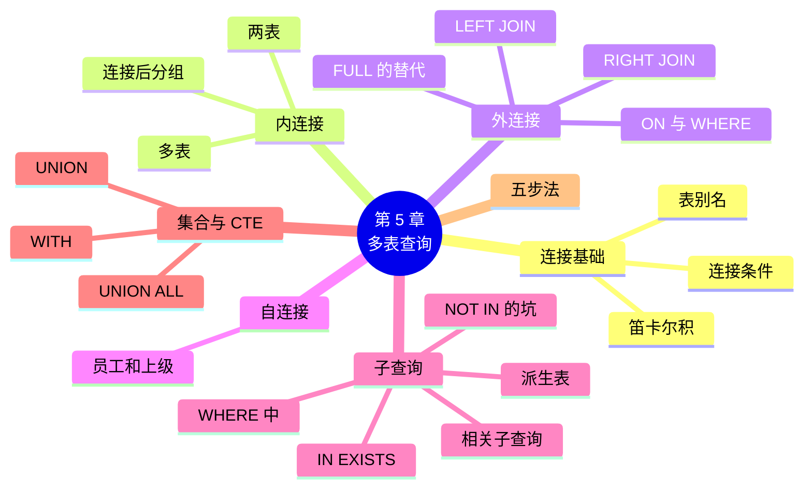

# 第 5 章 多表查询：连接与子查询

!!! abstract "本章学时"
    理论 7 学时 · 实验 2 学时（本章共 3 个实验，教师可任选）

## 学习目标

学完本章，你应该能够：

1. **说出**内连接、左外连接、右外连接、全外连接各保留哪些行（记忆、理解）；
2. **解释**忘写连接条件为什么会得到笛卡尔积，`NOT IN` 遇到 NULL 为什么会查不出结果（理解）；
3. **写出**两表、多表连接和自连接查询，写出 WHERE、FROM、SELECT 中的子查询（应用）；
4. **用** UNION 合并结果，用 WITH 把复杂查询拆成几步（应用）；
5. **按步骤**分析一个业务问题需要哪些表、怎样连接，并检查结果的行数是否合理（分析、评价）。

!!! info "先修要求"
    学习本章前，你需要：

    - 理解主键、外键和关系代数的连接运算（[2.3](../02-relational-model/index.md#23)、[2.5](../02-relational-model/index.md#25)）；
    - 能写带 WHERE、GROUP BY、HAVING 的单表查询（[第 4 章](../04-single-table-query/index.md)）。

??? abstract "本章概念清单（11 个，点击查看定义和例子）"
    1. [笛卡尔积](../../appendix/glossary.md#g-笛卡尔积)
    2. [表别名](../../appendix/glossary.md#g-表别名)
    3. [内连接](../../appendix/glossary.md#g-内连接)
    4. [外连接](../../appendix/glossary.md#g-外连接)
    5. [自连接](../../appendix/glossary.md#g-自连接)
    6. [子查询](../../appendix/glossary.md#g-子查询)
    7. [EXISTS](../../appendix/glossary.md#g-EXISTS)
    8. [相关子查询](../../appendix/glossary.md#g-相关子查询)
    9. [派生表](../../appendix/glossary.md#g-派生表)
    10. [UNION](../../appendix/glossary.md#g-UNION)
    11. [公用表表达式](../../appendix/glossary.md#g-公用表表达式)

## 情景导入

老顾客王芳（顾客编号 81）来店里问：“我上个月在你们这儿买过一种面粉，挺好用的，叫什么来着？”

小林想用第 4 章学的 SELECT 查一下，却发现问题不简单：

- 王芳的名字在 **customer**（顾客表）里；
- 她哪天来买过，在 **orders**（订单表）里，只记着顾客编号 81；
- 每单买了什么，在 **order_item**（订单明细表）里，只记着商品编号；
- 商品编号对应什么名字，在 **product**（商品表）里。

一个问题要用到四张表。第 2 章把大表拆开，是为了不重复存数据；查询的时候，就要通过外键把它们再“拼”回来。这就是本章要学的**连接**。另一种办法是“先查出一个结果，再拿它去查别的”，叫**子查询**。

## 5.1 为什么要连接

### 5.1.1 笛卡尔积：忘写连接条件的后果

在 FROM 后面写两张表，中间用逗号隔开，会得到什么？

```sql
SELECT p.name, p.category_id, c.category_id, c.name
FROM product p, category c
WHERE p.product_id <= 2
ORDER BY p.product_id, c.category_id
LIMIT 4;
```

```text
+------------------+-------------+-------------+--------------+
| name             | category_id | category_id | name         |
+------------------+-------------+-------------+--------------+
| 东北大米 5kg     |           1 |           1 | 粮油米面     |
| 东北大米 5kg     |           1 |           2 | 早餐冲饮     |
| 东北大米 5kg     |           1 |           3 | 休闲零食     |
| 东北大米 5kg     |           1 |           4 | 饮料         |
+------------------+-------------+-------------+--------------+
```

东北大米和每一个类别都配了一对：“东北大米 · 饮料”“东北大米 · 休闲零食”……这叫[**笛卡尔积**](../../appendix/glossary.md#g-笛卡尔积 "把第一张表的每一行和第二张表的每一行两两配对得到的结果，行数是两表行数的乘积"){ .term }（第 2 章的 × 运算）。48 种商品 × 8 个类别 = 384 行，绝大多数配对没有意义。只有 `p.category_id = c.category_id` 的那一对才是对的。

笛卡尔积有多可怕？订单表 2501 行、订单明细表 5811 行，忘了写连接条件：

```sql
SELECT COUNT(*) FROM orders o JOIN order_item oi;   -- 忘了写 ON
```

结果是 **14533311** 行，一千四百多万行！表再大一点，数据库会被拖慢甚至卡死。**连接查询一定要写连接条件**，n 张表至少要 n − 1 个连接条件。

### 5.1.2 表别名

上面的 `product p`、`category c` 里，`p`、`c` 是[**表别名**](../../appendix/glossary.md#g-表别名 "在 FROM 中给表起的简短名字，用来区分不同表里的同名列，如 product p"){ .term }。两张表都有 `name`、`category_id` 列，写 `name` 数据库不知道指的是哪张表的，会报 `Column 'name' in field list is ambiguous`（列名不明确）。写成 `p.name`、`c.name` 就清楚了。

别名的规则：

- 写在表名后面，`AS` 可写可不写：`product AS p` 或 `product p`；
- 起了别名以后，这条语句里就要用别名，不能再写 `product.name`；
- 取表名的首字母最常见，如 `orders o`、`order_item oi`。

## 5.2 内连接

### 5.2.1 两表连接

[**内连接**](../../appendix/glossary.md#g-内连接 "只保留两张表中满足连接条件、能对得上的行的连接，用 INNER JOIN … ON 写"){ .term }的格式是：

```sql
SELECT …
FROM 表1 [INNER] JOIN 表2 ON 连接条件;
```

`INNER` 可以省略，只写 `JOIN` 就是内连接。查看每种商品属于哪个类别：

<div class="sql-try" markdown>

```sql
SELECT p.name AS 商品, c.name AS 类别, p.price
FROM product p
JOIN category c ON c.category_id = p.category_id
ORDER BY p.product_id
LIMIT 5;
```

</div>

```text
+--------------------+--------------+-------+
| 商品               | 类别         | price |
+--------------------+--------------+-------+
| 东北大米 5kg       | 粮油米面     | 39.90 |
| 泰国香米 2.5kg     | 粮油米面     | 32.80 |
| 花生油 5L          | 粮油米面     | 89.00 |
| 菜籽油 5L          | 粮油米面     | 65.00 |
| 挂面 1kg           | 粮油米面     |  8.50 |
+--------------------+--------------+-------+
```

连接条件一般就是“**外键 = 被参照的主键**”。读这条语句的方法：“从商品表出发，按类别编号到类别表里找到对应的那一行，把两行拼成一行。”

!!! note "另一种老写法"
    `FROM product p, category c WHERE c.category_id = p.category_id` 也是内连接，在很多老教材和考试题里能看到。它把连接条件和筛选条件都写在 WHERE 里，表多了容易漏写。本书推荐 `JOIN … ON` 的写法：连接条件写在 ON 里，筛选条件写在 WHERE 里，一目了然。

### 5.2.2 多表连接

再连一张表，就再写一个 `JOIN … ON`。查 50 元以上的商品，以及它的类别和供应商：

<div class="sql-try" markdown>

```sql
SELECT p.name AS 商品, c.name AS 类别, s.name AS 供应商, s.city
FROM product p
JOIN category c ON c.category_id = p.category_id
JOIN supplier s ON s.supplier_id = p.supplier_id
WHERE p.price > 50;
```

</div>

```text
+----------------------+--------------+-----------------------+--------+
| 商品                 | 类别         | 供应商                | city   |
+----------------------+--------------+-----------------------+--------+
| 花生油 5L            | 粮油米面     | 禾丰粮油批发部        | 广州   |
| 菜籽油 5L            | 粮油米面     | 禾丰粮油批发部        | 广州   |
| 每日坚果 25g×30      | 休闲零食     | 开心零食供应链        | 深圳   |
| 纯牛奶 250ml×16      | 乳制品       | 南粤乳业配送站        | 佛山   |
+----------------------+--------------+-----------------------+--------+
```

现在可以回答王芳的问题了。从顾客出发，依次连订单、订单明细、商品，像顺着外键“走路”：

```text
customer ──customer_id──▶ orders ──order_id──▶ order_item ──product_id──▶ product
```

```sql
SELECT o.order_id, o.order_time, p.name AS 商品, oi.quantity AS 数量, oi.unit_price AS 单价
FROM customer c
JOIN orders o      ON o.customer_id = c.customer_id
JOIN order_item oi ON oi.order_id = o.order_id
JOIN product p     ON p.product_id = oi.product_id
WHERE c.customer_id = 81
  AND o.order_time >= '2026-05-01' AND o.order_time < '2026-06-01'
ORDER BY o.order_time;
```

```text
+----------+---------------------+--------------------+--------+--------+
| order_id | order_time          | 商品               | 数量   | 单价   |
+----------+---------------------+--------------------+--------+--------+
|     2282 | 2026-05-15 09:42:29 | 全麦面粉 2.5kg     |      2 |  22.00 |
|     2307 | 2026-05-20 08:22:47 | 东北大米 5kg       |      2 |  39.90 |
|     2307 | 2026-05-20 08:22:47 | 小米 1kg           |      1 |  15.80 |
|     2307 | 2026-05-20 08:22:47 | 牛肉干 100g        |      3 |  35.00 |
|     2307 | 2026-05-20 08:22:47 | 无糖绿茶 500ml     |      1 |   4.50 |
+----------+---------------------+--------------------+--------+--------+
```

是 5 月 15 日买的“全麦面粉 2.5kg”。5 月王芳来了两次，第二次买了 4 种商品，所以订单 2307 出现了 4 行：**连接后的行数，由“最细”的那张表决定**，这里是订单明细。

### 5.2.3 连接以后再分组

连接得到的结果也是一张表，可以接着用第 4 章的 WHERE、GROUP BY、ORDER BY。第 4 章遗留的问题“每个类别卖了多少钱（只算已完成订单）”，要用到订单（状态）、订单明细（数量和单价）、商品（类别编号）、类别（类别名）四张表：

```sql
SELECT cat.name AS 类别, SUM(oi.quantity * oi.unit_price) AS 销售额
FROM order_item oi
JOIN orders o     ON o.order_id = oi.order_id
JOIN product p    ON p.product_id = oi.product_id
JOIN category cat ON cat.category_id = p.category_id
WHERE o.status = '已完成'
GROUP BY cat.name
ORDER BY 销售额 DESC;
```

```text
+--------------+-----------+
| 类别         | 销售额    |
+--------------+-----------+
| 粮油米面     |  51407.60 |
| 早餐冲饮     |  32988.80 |
| 休闲零食     |  24489.00 |
| 乳制品       |  24005.60 |
| 日用百货     |  18340.30 |
| 生鲜果蔬     |  13307.30 |
| 饮料         |  12147.90 |
| 调味品       |   9768.60 |
+--------------+-----------+
```

执行顺序还是第 4 章那一套，只是第 1 步 FROM 变成了“先把几张表连起来”。

## 5.3 外连接

### 5.3.1 内连接会“丢”行

内连接只留两边对得上的行。问题是：有些行在另一张表里本来就**没有**对应的行。比如，一共 200 位顾客，统计每人下单几次：

```sql
SELECT c.name, COUNT(*) AS 下单次数
FROM customer c JOIN orders o ON o.customer_id = c.customer_id
GROUP BY c.customer_id, c.name;
```

结果只有 171 行。另外 29 位注册了但从没买过东西的顾客，在订单表里找不到对应的行，被内连接“丢”掉了。老板恰恰想知道这些人是谁。

### 5.3.2 左外连接和右外连接

[**外连接**](../../appendix/glossary.md#g-外连接 "除了对得上的行，还保留某一张表中对不上的行、另一边填 NULL 的连接，分为左外连接、右外连接和全外连接"){ .term }会把对不上的行也留下来，缺的那一边填 NULL：

- **左外连接** `LEFT [OUTER] JOIN`：左边（写在 JOIN 前面）的表**全部保留**；
- **右外连接** `RIGHT [OUTER] JOIN`：右边（写在 JOIN 后面）的表**全部保留**。

用两张很小的表最容易看清楚（实验 5-1 的数据）：4 位顾客，赵六、王五没买过东西；5 笔订单，104 是散客，105 的顾客编号录错了，在顾客表里找不到。

```text
customer               orders
+----+------+          +----------+-------------+--------+
| id | name |          | order_id | customer_id | amount |
+----+------+          +----------+-------------+--------+
|  1 | 张三 |          |      101 |           1 |  35.00 |
|  2 | 李四 |          |      102 |           1 |  12.50 |
|  3 | 王五 |          |      103 |           2 |  88.00 |
|  4 | 赵六 |          |      104 |        NULL |   9.90 |
+----+------+          |      105 |           9 |  20.00 |
                       +----------+-------------+--------+
```

| 连接方式 | 结果行数 | 留下了谁 |
|---|---|---|
| 内连接 | 3 | 101、102（张三）、103（李四） |
| 左外连接（顾客为左表） | 5 | 上面 3 行 + 王五、赵六（订单一侧填 NULL） |
| 右外连接（订单为右表） | 5 | 上面 3 行 + 104、105（顾客一侧填 NULL） |
| 全外连接 | 7 | 上面 3 行 + 王五、赵六 + 104、105 |

<iframe class="sim-frame" src="../../sims/join-types/main.html" height="620" loading="lazy" title="四种连接对比"></iframe>
动画：四种连接对比。切换内连接、左连接、右连接、全连接，看两张小表里哪些行连上了、哪些行被留下并填上 NULL、哪些行被丢掉；也可以试试“忘写连接条件”。[全屏打开](../../sims/join-types/main.html){ target=_blank }
{ .sim-caption }

回到小店，用左外连接统计每位顾客的下单次数，没买过的也留下：

<div class="sql-try" markdown>

```sql
SELECT c.name, COUNT(o.order_id) AS 下单次数
FROM customer c
LEFT JOIN orders o ON o.customer_id = c.customer_id
GROUP BY c.customer_id, c.name
ORDER BY 下单次数, c.customer_id
LIMIT 3;
```

</div>

```text
+-----------+--------------+
| name      | 下单次数     |
+-----------+--------------+
| 潘桂敏    |            0 |
| 徐怡洋    |            0 |
| 韩娜怡    |            0 |
+-----------+--------------+
```

注意这里写的是 `COUNT(o.order_id)` 而不是 `COUNT(*)`。没买过的顾客，左连接后也有一行（订单一侧全是 NULL），`COUNT(*)` 会把这一行算成 1 次；`COUNT(o.order_id)` 跳过 NULL，才是 0。这是外连接加分组时最常见的错误。

**找“没有”的东西**是左外连接最常用的场合：左连接以后，右边是 NULL 的，就是在右表里找不到的。

```sql
-- 注册了但从没买过东西的顾客有多少？
SELECT COUNT(*) AS 没买过的顾客
FROM customer c
LEFT JOIN orders o ON o.customer_id = c.customer_id
WHERE o.order_id IS NULL;
```

结果是 29。

!!! tip "左连接和右连接可以互换"
    `A LEFT JOIN B` 和 `B RIGHT JOIN A` 的结果一样。实际工作中大家习惯只用 LEFT JOIN：把“要全部保留”的表写在最前面，读起来更顺。

### 5.3.3 全外连接的替代写法

全外连接 `FULL OUTER JOIN` 两边都全部保留。PostgreSQL、SQL Server 支持它，**MySQL 不支持**，<sup class="cite">[[3]](#ref5-3)</sup> 要用“左连接 UNION 右连接”代替：

```sql
SELECT c.customer_id, c.name, o.order_id, o.amount
FROM customer c LEFT JOIN orders o ON o.customer_id = c.customer_id
UNION
SELECT c.customer_id, c.name, o.order_id, o.amount
FROM customer c RIGHT JOIN orders o ON o.customer_id = c.customer_id;
```

UNION 会把两个结果合在一起并去掉重复的行（5.6 节），对得上的 3 行在两边都出现，只保留一份，最终是 7 行。

### 5.3.4 ON 和 WHERE 放条件的区别

内连接时，条件写在 ON 里还是 WHERE 里，结果一样。**外连接时不一样**：

- 写在 **ON** 里：是“怎样配对”的条件，左表的行一个不少，配不上的填 NULL；
- 写在 **WHERE** 里：是连接**之后**的筛选，右边是 NULL 的行会被筛掉，外连接就“退化”成了内连接。

比如想列出所有顾客，并显示他们 2026 年 6 月的订单数，6 月的条件要写在 ON 里：

```sql
SELECT c.name, COUNT(o.order_id) AS 六月下单
FROM customer c
LEFT JOIN orders o ON o.customer_id = c.customer_id
                  AND o.order_time >= '2026-06-01'
GROUP BY c.customer_id, c.name;
```

这样得到 200 行，6 月没来的顾客是 0。如果把 `o.order_time >= '2026-06-01'` 写进 WHERE，6 月没来的顾客那一行的 order_time 是 NULL，条件不成立，就被扔掉了，只剩 6 月来过的 86 位。

## 5.4 自连接

一张表和**它自己**连接，叫[**自连接**](../../appendix/glossary.md#g-自连接 "一张表和它自己连接，要给同一张表起两个不同的别名，常用于员工和上级这类自己参照自己的情况"){ .term }。员工表里的 `manager_id` 是外键，参照的正是员工表自己的 `employee_id`（上级也是员工）。要显示“员工 · 上级姓名”，就把员工表当成两张表用，起两个别名：`e` 当“员工”，`m` 当“上级”：

<div class="sql-try" markdown>

```sql
SELECT e.name AS 员工, e.position AS 职位, m.name AS 上级
FROM employee e
LEFT JOIN employee m ON m.employee_id = e.manager_id
ORDER BY e.employee_id;
```

</div>

```text
+-----------+-----------+-----------+
| 员工      | 职位      | 上级      |
+-----------+-----------+-----------+
| 邓建丽    | 店长      | NULL      |
| 郭磊      | 副店长    | 邓建丽    |
| 谢洋燕    | 收银员    | 郭磊      |
| 吴轩建    | 收银员    | 郭磊      |
| 杨梅      | 理货员    | 郭磊      |
| 蒋平玉    | 理货员    | 郭磊      |
| 田杰强    | 会计      | 邓建丽    |
| 刘英      | 配送员    | 郭磊      |
+-----------+-----------+-----------+
```

用 LEFT JOIN 是为了留下店长（她没有上级）；用 JOIN 的话，店长这一行就没了。自连接还常用来比较同一张表里的两行，实验 5-3 用它找“经常一起买的两种商品”。

## 5.5 子查询

把一个 SELECT 写在另一条语句里面，用括号括起来，叫[**子查询**](../../appendix/glossary.md#g-子查询 "嵌在另一条 SQL 语句里、用括号括起来的 SELECT，它的结果给外面的语句使用"){ .term }。外面的叫主查询。数据库一般先算子查询，再把结果交给主查询用。<sup class="cite">[[4]](#ref5-4)</sup>

子查询可以出现在三个地方：WHERE 里、FROM 里、SELECT 里。

### 5.5.1 WHERE 中的子查询

**① 和一个值比较。** 哪些商品比全店平均价贵？平均价要先算出来：

```sql
SELECT name, price
FROM product
WHERE price > (SELECT AVG(price) FROM product)
ORDER BY price DESC;
```

括号里的子查询算出 23.33，主查询再找 `price > 23.33` 的商品，结果 16 行。这件事不能写成 `WHERE price > AVG(price)`，因为 WHERE 里不能用聚合函数（第 4 章）。子查询返回**一个值**时，可以用 `=`、`>`、`<` 等比较。

**② IN：在一组值里。** 金卡会员的姓名和电话：

<div class="sql-try" markdown>

```sql
SELECT name, phone
FROM customer
WHERE customer_id IN (SELECT customer_id FROM member WHERE level = '金卡')
ORDER BY customer_id
LIMIT 5;
```

</div>

子查询返回金卡会员的 19 个顾客编号，主查询找出编号在这一组里的顾客。子查询返回**一列多个值**时，要用 IN，不能用 `=`（否则报错 `Subquery returns more than 1 row`）。

**③ EXISTS：存不存在。** [**EXISTS**](../../appendix/glossary.md#g-EXISTS "判断子查询是否至少返回一行的运算符，返回了就为真，常和相关子查询一起用来查“有没有”"){ .term } 只关心子查询有没有查出行，不关心查出什么。从没买过东西的顾客：

```sql
SELECT COUNT(*)
FROM customer c
WHERE NOT EXISTS (SELECT 1 FROM orders o WHERE o.customer_id = c.customer_id);
```

结果是 29，和 5.3.2 节用左连接算的一样。`SELECT 1` 里的 1 没有特别意思，写什么都行，因为 EXISTS 只看有没有行。

!!! warning "NOT IN 遇到 NULL：一行也查不出来"
    同样是“没买过东西的顾客”，用 NOT IN 写：

    ```sql
    SELECT COUNT(*) FROM customer
    WHERE customer_id NOT IN (SELECT customer_id FROM orders);
    ```

    结果是 **0**！原因是订单表里有 538 笔散客订单，customer_id 是 NULL。`81 NOT IN (1, 2, …, NULL)` 意思是“81 ≠ 1 并且 81 ≠ 2 …… 并且 81 ≠ NULL”，最后一项的结果是“不知道”（第 4 章 4.7 节），整个条件就不成立。解决办法：子查询里加 `WHERE customer_id IS NOT NULL`（结果 29），或者改用 NOT EXISTS。**子查询的列可能有 NULL 时，用 NOT EXISTS 更安全。**

### 5.5.2 相关子查询

上面 EXISTS 例子里的子查询用到了主查询的 `c.customer_id`，它要对主查询的**每一行**算一次，叫[**相关子查询**](../../appendix/glossary.md#g-相关子查询 "用到了主查询中的列、要对主查询的每一行分别执行一次的子查询"){ .term }。前面“比全店平均价贵”的子查询和主查询无关，只算一次，叫不相关子查询。

一个更实用的例子：哪些商品比**自己所在类别**的平均价贵？每个商品要和“自己那一类”的平均价比，平均价跟着类别变：

```sql
SELECT p.name, p.category_id, p.price
FROM product p
WHERE p.price > (SELECT AVG(p2.price)
                 FROM product p2
                 WHERE p2.category_id = p.category_id)
ORDER BY p.category_id, p.price DESC
LIMIT 8;
```

```text
+------------------------+-------------+-------+
| name                   | category_id | price |
+------------------------+-------------+-------+
| 花生油 5L              |           1 | 89.00 |
| 菜籽油 5L              |           1 | 65.00 |
| 东北大米 5kg           |           1 | 39.90 |
| 速溶咖啡 40 条         |           2 | 45.00 |
| 即食豆浆粉 30 包       |           2 | 29.90 |
| 燕麦片 1kg             |           2 | 26.90 |
| 每日坚果 25g×30        |           3 | 99.00 |
| 牛肉干 100g            |           3 | 35.00 |
+------------------------+-------------+-------+
```

读的方法：主查询拿到花生油这一行，它的类别是 1，就把 1 代入子查询，算出类别 1 的平均价 39.00，89.00 > 39.00，留下；再拿下一行……同一张表用了两次，所以要用 `p`、`p2` 两个别名区分。

### 5.5.3 FROM 中的子查询（派生表）

子查询的结果是一张表，就可以放在 FROM 后面当作一张表来用，叫[**派生表**](../../appendix/glossary.md#g-派生表 "写在 FROM 中、把子查询的结果当作一张临时表来用的写法，必须起别名"){ .term }。派生表**必须起别名**。

“每种支付方式平均每单多少钱”分两步：先算出每笔订单的金额，再按支付方式求平均：

```sql
SELECT t.pay_method AS 支付方式, ROUND(AVG(t.金额), 2) AS 平均每单
FROM (SELECT o.order_id, o.pay_method, SUM(oi.quantity * oi.unit_price) AS 金额
      FROM orders o JOIN order_item oi ON oi.order_id = o.order_id
      GROUP BY o.order_id, o.pay_method) AS t
GROUP BY t.pay_method
ORDER BY 平均每单 DESC;
```

不能一步写成 `AVG(SUM(…))`，聚合函数不能套聚合函数，所以先在派生表里求和，再在外面求平均。

### 5.5.4 SELECT 中的子查询

子查询还可以作为一列写在 SELECT 里，此时它**只能返回一个值**：

```sql
SELECT name, price,
       ROUND(price - (SELECT AVG(price) FROM product), 2) AS 比平均价高
FROM product
ORDER BY price DESC
LIMIT 3;
```

```text
+----------------------+-------+-----------------+
| name                 | price | 比平均价高      |
+----------------------+-------+-----------------+
| 每日坚果 25g×30      | 99.00 |           75.67 |
| 花生油 5L            | 89.00 |           65.67 |
| 菜籽油 5L            | 65.00 |           41.67 |
+----------------------+-------+-----------------+
```

### 5.5.5 子查询和连接怎么选

很多问题两种都能写：

| 问题 | 用连接 | 用子查询 |
|---|---|---|
| 金卡会员的姓名 | `customer JOIN member … WHERE level = '金卡'` | `WHERE customer_id IN (SELECT … FROM member …)` |
| 没买过东西的顾客 | `LEFT JOIN orders … WHERE o.order_id IS NULL` | `WHERE NOT EXISTS (…)` |

选择的建议：

1. **结果要显示两张表的列**，用连接（子查询里的列显示不出来）；
2. **只是拿另一张表做条件**，用子查询读起来更像人话：“编号在金卡会员名单里的顾客”；
3. 性能上，MySQL 8 的优化器会把很多子查询自动改写成连接，初学阶段先求写对、读懂。

## 5.6 集合操作：UNION

[**UNION**](../../appendix/glossary.md#g-UNION "把两个 SELECT 的结果上下合并成一个结果的集合操作，UNION 去重，UNION ALL 不去重"){ .term } 把两个查询的结果**上下拼**在一起（连接是左右拼）。要求两个查询的**列数相同、对应列的类型相近**，结果的列名取第一个查询的。

```sql
-- 一份“联系人名单”：收银员和佛山供应商的联系人
SELECT name AS 姓名, '员工' AS 身份 FROM employee WHERE position = '收银员'
UNION ALL
SELECT contact, '供应商联系人' FROM supplier WHERE city = '佛山';
```

```text
+-----------+--------------------+
| 姓名      | 身份               |
+-----------+--------------------+
| 谢洋燕    | 员工               |
| 吴轩建    | 员工               |
| 黄志明    | 供应商联系人       |
+-----------+--------------------+
```

- **UNION**：合并后去掉重复的行；
- **UNION ALL**：全部保留，不去重，速度更快。

“6 月来过店里的顾客”和“金卡会员”合起来有多少人？用 UNION 是 98 人；用 UNION ALL 得到 140，因为同一位顾客 6 月来了几次就算几次，既是金卡会员又来过的也算了两次。要的是“人数”，就该用 UNION。

MySQL 8.4 还支持 `INTERSECT`（交集：两边都有）和 `EXCEPT`（差集：前面有、后面没有）。比如“6 月来过的金卡会员”用 INTERSECT 是 7 人，“6 月没来的金卡会员”用 EXCEPT 是 12 人。老版本 MySQL 不支持，可以用 IN、NOT IN 子查询代替。

## 5.7 用 WITH 把长查询拆成几步

派生表一层套一层，括号多了很难读。[**公用表表达式**](../../appendix/glossary.md#g-公用表表达式 "用 WITH 名字 AS (子查询) 在语句开头先定义好的临时结果，后面可以像表一样按名字使用，简称 CTE"){ .term }（Common Table Expression，CTE）让你在语句开头先给子查询起个名字，后面像用表一样用它：<sup class="cite">[[5]](#ref5-5)</sup>

<div class="sql-try" markdown>

```sql
WITH order_amount AS (                       -- 第 1 步：每笔已完成订单的金额
  SELECT o.order_id, o.pay_method,
         SUM(oi.quantity * oi.unit_price) AS 金额
  FROM orders o
  JOIN order_item oi ON oi.order_id = o.order_id
  WHERE o.status = '已完成'
  GROUP BY o.order_id, o.pay_method
)
SELECT pay_method AS 支付方式,                -- 第 2 步：按支付方式统计
       COUNT(*) AS 单数,
       ROUND(AVG(金额), 2) AS 平均每单,
       MAX(金额) AS 最大一单
FROM order_amount
GROUP BY pay_method
ORDER BY 平均每单 DESC;
```

</div>

```text
+--------------+--------+--------------+--------------+
| 支付方式     | 单数   | 平均每单     | 最大一单     |
+--------------+--------+--------------+--------------+
| 银行卡       |    120 |        77.43 |       307.30 |
| 现金         |    241 |        76.48 |       387.80 |
| 微信         |   1345 |        76.25 |       414.70 |
| 支付宝       |    744 |        75.50 |       420.50 |
+--------------+--------+--------------+--------------+
```

它和 5.5.3 节的派生表做的是同一件事（这里多加了“已完成”的条件），但是从上往下读就是解题步骤：先算每单金额，再按支付方式统计。几个要点：

- 多个 CTE 用逗号隔开：`WITH a AS (…), b AS (…) SELECT …`，后面的可以用前面的；
- CTE 只在这一条语句里有效，语句结束就没了；
- MySQL 8.0 开始支持 WITH，5.7 及更早的版本不支持。

各平均每单的金额差不多，说明顾客用什么方式付钱和买多少关系不大。

## 5.8 怎样一步步写出复杂查询

零基础写多表查询，最怕一上来就写一大段。按下面五步来，每一步都运行一下，看结果对不对：

1. **找表**：问题里提到的每样东西在哪张表？把表名和它们之间的外键画出来（就像 5.2.2 节那条“路”）；
2. **写连接**：从“最主要”的表出发，一张一张 JOIN 上来，先 `SELECT *` 加 `LIMIT 5` 看看拼出来的样子；
3. **加条件**：写 WHERE；
4. **分组、排序**：写 GROUP BY、HAVING、ORDER BY，把 `*` 换成真正要的列；
5. **核对行数**：结果行数合理吗？可以用一两个手算得出的数核对。比如“每个类别的销售额”加起来，应该等于“全部已完成订单的总金额”。

!!! tip "行数突然变多？多半是连接出了问题"
    连接后行数比预想的多很多，常见原因有两个：一是漏了连接条件（笛卡尔积）；二是连接了“一对多”的表，“一”那边的行被复制了几份，再对它求 SUM 就会重复计算。比如订单连上明细后，订单的行被复制成了明细的行数，这时如果对订单表里的某个金额列求和，就会算多。

## 5.9 前沿视窗：当连接多到写不动——图数据库

小店的连接最多四五张表。可是有些问题，关系一层套一层：“我朋友的朋友里，有谁也买过这款奶粉？”“这笔转账经过了哪些账户？”在关系数据库里，每多一层关系就要多写一次自连接，层数一多，SQL 又长又慢。

**图数据库**换了一种存法：把“人、商品、账户”存成**点**，把“朋友、购买、转账”存成**边**，查询时顺着边一步步走过去，不需要连接。代表产品有 Neo4j，国产的有 NebulaGraph、TuGraph 等。它们用 Cypher 等图查询语言，比如“王芳买过的商品，还有谁买过”可以写成：

```text
MATCH (c:Customer {name: '王芳'})-[:BOUGHT]->(p:Product)<-[:BOUGHT]-(other:Customer)
RETURN other.name, p.name
```

社交推荐、金融反欺诈、知识图谱是图数据库的主要用途。<sup class="cite">[[7]](#ref5-7)</sup> 不过对大多数业务（订单、库存、财务），关系数据库加上本章的连接查询仍然是首选。第 12 章还会介绍另一种新型数据库——向量数据库。

## 本章实验

!!! abstract "实验总览"
    | 实验 | 类型 | 建议时长 | 内容 |
    |---|---|---|---|
    | 实验 5-1 | ★ 基础 | 30 分钟 | 用两张小表对比四种连接，看哪些行留下、哪些变空 |
    | 实验 5-2 | ★ 基础 | 60 分钟 | 用连接和子查询完成小店的八个查询 |
    | 实验 5-3 | ☆ 拓展 | 40 分钟 | 用自连接找出“买了 A 也买了 B”的商品组合 |

    SQL 脚本见配套资源 `labs/ch05/` 目录。

### 实验 5-1 ★ 四种连接对比

**实验目的**

1. 亲手验证内连接、左外连接、右外连接、全外连接各保留哪些行；
2. 看到忘写连接条件产生的笛卡尔积。

**实验环境**：本机 CPU，MySQL 8.4 + DBeaver。**实验数据**：脚本自己建的 `joindemo` 库（2 张小表，内容为虚构）。

**实验步骤与代码**

1. 在 DBeaver 中打开 `labs/ch05/lab5_1_join_types.sql`，先执行前面的建库、建表、插入语句（到 `INSERT INTO orders` 为止）；
2. **先预测**：在实验记录表里写下每种连接你认为会得到几行、有哪些订单号；
3. 再逐条执行 5 条查询，对照预测。

查询部分：

```sql
-- 1. 内连接：只留两边都对得上的
SELECT c.customer_id, c.name, o.order_id, o.amount
FROM customer c
INNER JOIN orders o ON o.customer_id = c.customer_id
ORDER BY c.customer_id, o.order_id;

-- 2. 左外连接：左表（顾客）全留，右边对不上的填 NULL
SELECT c.customer_id, c.name, o.order_id, o.amount
FROM customer c
LEFT JOIN orders o ON o.customer_id = c.customer_id
ORDER BY c.customer_id, o.order_id;

-- 3. 右外连接：右表（订单）全留，左边对不上的填 NULL
SELECT c.customer_id, c.name, o.order_id, o.amount
FROM customer c
RIGHT JOIN orders o ON o.customer_id = c.customer_id
ORDER BY o.order_id;

-- 4. 全外连接：两边都全留。MySQL 不支持 FULL JOIN，用左连接 UNION 右连接代替
SELECT c.customer_id, c.name, o.order_id, o.amount
FROM customer c LEFT JOIN orders o ON o.customer_id = c.customer_id
UNION
SELECT c.customer_id, c.name, o.order_id, o.amount
FROM customer c RIGHT JOIN orders o ON o.customer_id = c.customer_id;

-- 5. 忘了写连接条件：笛卡尔积，4 × 5 = 20 行
SELECT COUNT(*) AS 行数 FROM customer, orders;
```

**运行结果**

编者在 MySQL 8.4.13 上的运行结果：

```text
1. 内连接
+-------------+--------+----------+--------+
| customer_id | name   | order_id | amount |
+-------------+--------+----------+--------+
|           1 | 张三   |      101 |  35.00 |
|           1 | 张三   |      102 |  12.50 |
|           2 | 李四   |      103 |  88.00 |
+-------------+--------+----------+--------+
2. 左外连接
+-------------+--------+----------+--------+
| customer_id | name   | order_id | amount |
+-------------+--------+----------+--------+
|           1 | 张三   |      101 |  35.00 |
|           1 | 张三   |      102 |  12.50 |
|           2 | 李四   |      103 |  88.00 |
|           3 | 王五   |     NULL |   NULL |
|           4 | 赵六   |     NULL |   NULL |
+-------------+--------+----------+--------+
3. 右外连接
+-------------+--------+----------+--------+
| customer_id | name   | order_id | amount |
+-------------+--------+----------+--------+
|           1 | 张三   |      101 |  35.00 |
|           1 | 张三   |      102 |  12.50 |
|           2 | 李四   |      103 |  88.00 |
|        NULL | NULL   |      104 |   9.90 |
|        NULL | NULL   |      105 |  20.00 |
+-------------+--------+----------+--------+
4. 全外连接（行的先后顺序可能不同）
+-------------+--------+----------+--------+
| customer_id | name   | order_id | amount |
+-------------+--------+----------+--------+
|           1 | 张三   |      102 |  12.50 |
|           1 | 张三   |      101 |  35.00 |
|           2 | 李四   |      103 |  88.00 |
|           3 | 王五   |     NULL |   NULL |
|           4 | 赵六   |     NULL |   NULL |
|        NULL | NULL   |      104 |   9.90 |
|        NULL | NULL   |      105 |  20.00 |
+-------------+--------+----------+--------+
5. 笛卡尔积
+--------+
| 行数   |
+--------+
|     20 |
+--------+
```

右外连接结果里，104 和 105 的 customer_id 都显示 NULL。注意这一列取的是**顾客表**的 `c.customer_id`：104 本来就是散客，105 的订单里写的是 9，但顾客表里没有 9 号，所以顾客一侧整行都是 NULL。

**实验记录表**

| 连接方式 | 你预测的行数 | 实际行数 | 被留下的“对不上的行” |
|---|---|---|---|
| 内连接 | | | |
| 左外连接 | | | |
| 右外连接 | | | |
| 全外连接 | | | |
| 笛卡尔积 | | | |

**常见问题排查**

| 现象 | 原因 | 解决办法 |
|---|---|---|
| `ERROR 1064 … near 'FULL JOIN'` | MySQL 不支持 FULL JOIN | 用左连接 UNION 右连接 |
| `Column 'customer_id' in field list is ambiguous` | 两张表都有这一列，没写表别名 | 写成 `c.customer_id` 或 `o.customer_id` |
| 全外连接得到 10 行 | 把 UNION 写成了 UNION ALL，对得上的 3 行重复了 | 用 UNION |

**思考与练习**

1. 把查询 3 的 SELECT 里的 `c.customer_id` 改成 `o.customer_id`，105 那一行会显示什么？为什么？
2. 真实的小店数据库里给 orders.customer_id 加了外键，还会出现 105 这样的订单吗？（回看第 2 章参照完整性）

**实验报告要求**

完成实验记录表，截图 4 种连接的结果，回答思考题。

### 实验 5-2 ★ 用连接和子查询完成小店的八个查询

**实验目的**

1. 熟练写出多表连接、外连接、自连接；
2. 能用子查询解决“和平均值比较”这类问题，并按 5.8 节的五步法写复杂查询。

**实验环境**：本机 CPU，MySQL 8.4 + DBeaver。**实验数据**：示例库 `shop`。

**实验步骤与代码**

打开 `labs/ch05/lab5_2_eight_queries.sql`。每个查询**先自己按五步法写一遍**，再和脚本对照。脚本中的八个查询：

```sql
USE shop;

-- 查询 1：王芳（顾客 81）2026 年 5 月买了哪些东西？（四表连接，见 5.2.2 节）

-- 查询 2：金额最大的 5 笔订单，显示顾客姓名（散客显示“散客”）
SELECT o.order_id, IFNULL(c.name, '散客') AS 顾客, SUM(oi.quantity * oi.unit_price) AS 金额
FROM orders o
LEFT JOIN customer c ON c.customer_id = o.customer_id
JOIN order_item oi   ON oi.order_id = o.order_id
GROUP BY o.order_id, c.name
ORDER BY 金额 DESC
LIMIT 5;

-- 查询 3：每个类别的销售额（只算已完成订单，见 5.2.3 节）

-- 查询 4：2026 年每个月的销售额（只算已完成订单）
SELECT DATE_FORMAT(o.order_time, '%Y-%m') AS 月份, SUM(oi.quantity * oi.unit_price) AS 销售额
FROM orders o
JOIN order_item oi ON oi.order_id = o.order_id
WHERE o.status = '已完成' AND o.order_time >= '2026-01-01'
GROUP BY 月份
ORDER BY 月份;

-- 查询 5：注册了但从来没买过东西的顾客有多少位？（左连接 + IS NULL，见 5.3.2 节）

-- 查询 6：售价高于全店平均售价的商品（子查询，见 5.5.1 节）

-- 查询 7：每位员工和他的上级（自连接，见 5.4 节）

-- 查询 8：积分最高的 5 位金卡会员的姓名、电话和积分
SELECT c.name, c.phone, m.points
FROM customer c
JOIN member m ON m.customer_id = c.customer_id
WHERE m.level = '金卡'
ORDER BY m.points DESC
LIMIT 5;
```

**运行结果**

编者在 MySQL 8.4.13 上的运行结果（查询 1、3、5、6、7 的结果与正文相同，这里只列其余 3 个）：

```text
查询 2
+----------+-----------+--------+
| order_id | 顾客      | 金额   |
+----------+-----------+--------+
|      448 | 陈梅      | 420.50 |
|     2406 | 何萱燕    | 414.70 |
|     1220 | 田英晓    | 387.80 |
|     2165 | 罗志霞    | 374.00 |
|     1721 | 王宇怡    | 337.00 |
+----------+-----------+--------+
查询 4
+---------+-----------+
| 月份    | 销售额    |
+---------+-----------+
| 2026-01 |  10125.50 |
| 2026-02 |  10021.40 |
| 2026-03 |  11238.70 |
| 2026-04 |   9989.30 |
| 2026-05 |   9936.40 |
| 2026-06 |  11241.30 |
+---------+-----------+
查询 8
+-----------+-------------+--------+
| name      | phone       | points |
+-----------+-------------+--------+
| 谢丽      | 10044317367 |   3049 |
| 杨萱子    | 10025373924 |   2441 |
| 徐洋娟    | 10054751779 |   2416 |
| 陈梅      | 10099446135 |   2271 |
| 蒋燕伟    | 10095060188 |   2232 |
+-----------+-------------+--------+
```

**实验记录表**

| 任务 | 要求 | 你的 SQL 和结果 |
|---|---|---|
| 核对 | 查询 3 八个类别的销售额加起来，是否等于“全部已完成订单的总金额”？写出求总金额的 SQL | |
| 改写 1 | 查询 1 改成查王芳 2026 年全年一共花了多少钱 | |
| 改写 2 | 查询 5 改用 NOT EXISTS 写，结果是否还是 29？ | |
| 改写 3 | 查询 6 改成“比本类别平均价便宜的商品”（相关子查询） | |
| 改写 4 | 查询 8 改用 IN 子查询写，能显示积分吗？为什么？ | |

**常见问题排查**

| 现象 | 原因 | 解决办法 |
|---|---|---|
| 查询 2 散客订单不见了 | orders 和 customer 之间用了 JOIN | 改成 LEFT JOIN |
| 查询 3 销售额比预想大很多 | 少写了一个 ON，产生了笛卡尔积 | 4 张表要有 3 个 ON |
| `Subquery returns more than 1 row` | 子查询返回多个值却用了 `=` | 改用 IN |
| `Every derived table must have its own alias` | FROM 里的子查询没起别名 | 在括号后写 `AS t` |

**思考与练习**

1. 查询 2 里为什么 GROUP BY 要写 `o.order_id, c.name` 两列？只写 `o.order_id` 行不行？（提示：order_id 是订单表的主键，可以试一试）
2. 查询 4 如果不加 `o.status = '已完成'`，结果会变大还是变小？

**实验报告要求**

提交八个查询的结果截图和实验记录表。

### 实验 5-3 ☆ 找出“买了 A 也买了 B”的商品组合

**实验目的**

1. 用自连接比较同一张表里的两行；
2. 综合运用连接、分组和 WITH，完成一个真实的“购物篮分析”。

**实验环境**：本机 CPU，MySQL 8.4 + DBeaver。**实验数据**：示例库 `shop`。

**实验背景**

超市常把经常一起买的商品摆在一起，或者做“买 A 送 B 优惠券”。这种分析叫购物篮分析。思路是：把同一张订单里的商品两两配对，再数每一对一起出现了多少次。

**实验步骤与代码**

```sql
USE shop;

-- 第 1 步：同一张订单里的两件商品配成一对（order_item 和自己连接）
--   a.product_id < b.product_id：每对只算一次，也不和自己配对
SELECT a.order_id, a.product_id AS 商品A, b.product_id AS 商品B
FROM order_item a
JOIN order_item b ON b.order_id = a.order_id AND a.product_id < b.product_id
WHERE a.order_id = 2499;

-- 第 2 步：统计每一对一起出现在多少张订单里，取前 10，并换成商品名
WITH pairs AS (
  SELECT a.product_id AS pa, b.product_id AS pb, COUNT(*) AS 同单次数
  FROM order_item a
  JOIN order_item b ON b.order_id = a.order_id AND a.product_id < b.product_id
  GROUP BY a.product_id, b.product_id
)
SELECT p1.name AS 商品A, p2.name AS 商品B, pairs.同单次数
FROM pairs
JOIN product p1 ON p1.product_id = pairs.pa
JOIN product p2 ON p2.product_id = pairs.pb
ORDER BY pairs.同单次数 DESC, pairs.pa, pairs.pb
LIMIT 10;

-- 第 3 步：买了“燕麦片 1kg”（商品 8）的订单里，还常买什么？
SELECT p.name AS 一起买的商品, COUNT(*) AS 次数
FROM order_item a
JOIN order_item b ON b.order_id = a.order_id AND b.product_id <> a.product_id
JOIN product p    ON p.product_id = b.product_id
WHERE a.product_id = 8
GROUP BY p.name
ORDER BY 次数 DESC, p.name
LIMIT 5;
```

**运行结果**

编者在 MySQL 8.4.13 上的运行结果：

```text
第 1 步（订单 2499 有 4 件商品，两两配对得 6 对）
+----------+---------+---------+
| order_id | 商品A   | 商品B   |
+----------+---------+---------+
|     2499 |       3 |      35 |
|     2499 |       3 |      41 |
|     2499 |       3 |      47 |
|     2499 |      35 |      41 |
|     2499 |      35 |      47 |
|     2499 |      41 |      47 |
+----------+---------+---------+
第 2 步
+------------------------+------------------------+--------------+
| 商品A                  | 商品B                  | 同单次数     |
+------------------------+------------------------+--------------+
| 全麦面粉 2.5kg         | 燕麦片 1kg             |           21 |
| 小米 1kg               | 豆腐 400g              |           16 |
| 速溶咖啡 40 条         | 低脂牛奶 1L            |           16 |
| 挂面 1kg               | 豆腐 400g              |           15 |
| 泰国香米 2.5kg         | 即食豆浆粉 30 包       |           13 |
| 花生油 5L              | 全麦面包 400g          |           13 |
| 小米 1kg               | 全麦面包 400g          |           13 |
| 燕麦片 1kg             | 芝麻糊 600g            |           13 |
| 燕麦片 1kg             | 豆腐 400g              |           13 |
| 即食豆浆粉 30 包       | 速溶咖啡 40 条         |           13 |
+------------------------+------------------------+--------------+
第 3 步
+--------------------+--------+
| 一起买的商品       | 次数   |
+--------------------+--------+
| 全麦面粉 2.5kg     |     21 |
| 芝麻糊 600g        |     13 |
| 豆腐 400g          |     13 |
| 米醋 500ml         |     11 |
| 菜籽油 5L          |     11 |
+--------------------+--------+
```

“全麦面粉 + 燕麦片”一起出现了 21 次，排第一。可以建议老板把这两样摆在相邻的货架上。

**实验记录表**

| 任务 | 你的结果 |
|---|---|
| 第 1 步：订单 2484 有 5 件商品，应该配出几对？运行验证 | |
| 把第 1 步的 `<` 改成 `<>`，订单 2499 得到几行？为什么？ | |
| 第 3 步换成“速溶咖啡 40 条”（商品 11），最常一起买的是什么？ | |

**思考与练习**

1. “一起出现次数多”就一定说明两样东西有关系吗？如果两样东西本来就卖得特别多（比如大米），会怎样？（提示：数据挖掘里用“支持度”“置信度”“提升度”来衡量，有兴趣可以查一查）
2. 第 2 步不用 WITH，改用派生表怎么写？哪种更好读？

**实验报告要求**

截图第 2、3 步结果，完成记录表，给老板写一条摆货建议。

## 本章小结

- 数据分在多张表里，查询时通过“**外键 = 主键**”把它们连起来。**忘写连接条件得到笛卡尔积**，行数是两表行数的乘积。n 张表至少要 n − 1 个连接条件。
- 多表查询要用**表别名**区分同名列。
- **内连接**（JOIN … ON）只留对得上的行；**左外连接**（LEFT JOIN）保留左表全部行，**右外连接**保留右表全部行，对不上的一边填 NULL；MySQL 没有 FULL JOIN，用左连接 UNION 右连接代替。
- 外连接配合 `IS NULL` 用来找“没有”的东西；外连接后计数用 `COUNT(右表的列)`；外连接时右表的条件写在 ON 里。
- **自连接**：同一张表起两个别名，常用于员工和上级。
- **子查询**可以写在 WHERE（比较、IN、EXISTS）、FROM（派生表，必须起别名）、SELECT（只能返回一个值）中；**相关子查询**对主查询的每一行执行一次。子查询的列可能有 NULL 时，用 NOT EXISTS 而不用 NOT IN。
- **UNION** 去重合并，**UNION ALL** 不去重；**WITH**（CTE）把长查询拆成有名字的几步。
- 写复杂查询五步法：找表、写连接、加条件、分组排序、核对行数。



**下一章预告**

前五章用的都是现成的小店数据库。如果老板要开网上订货、搞会员积分，原来的表不够用了，新的表该怎么设计？第 6 章学习数据库设计的方法：从需求出发，画 E-R 图，再转成一张张表。

## 参考文献

正文中的上标编号（如<sup class="cite">[[3]](#ref5-3)</sup>）对应下面的文献。带链接的可以直接打开；书籍可在图书馆或电子书平台查阅。

<div class="refs" markdown>

**教材与专著**

- <span id="ref5-1"></span>[1] 王珊，杜小勇，陈红. 数据库系统概论[M]. 6 版. 北京：高等教育出版社，2023.
    <span class="ref-note">第 3 章的连接查询、嵌套查询、集合查询部分，与本章 5.2～5.6 节对应。</span>
- <span id="ref5-2"></span>[2] BEAULIEU A. Learning SQL[M]. 3rd ed. Sebastopol: O'Reilly Media, 2020.
    <span class="ref-note">第 5 章讲多表查询，第 9 章讲子查询，第 10 章讲外连接和自连接。</span>
- <span id="ref5-7"></span>[7] ROBINSON I, WEBBER J, EIFREM E. Graph Databases[M]. 2nd ed. Sebastopol: O'Reilly Media, 2015.
    <span class="ref-note">图数据库的入门书，介绍点、边的数据模型和 Cypher 查询语言，对应 5.9 节。</span>

**在线资源与数据**

- <span id="ref5-3"></span>[3] Oracle. MySQL 8.4 Reference Manual: JOIN Clause[EB/OL]. [2026-11-01]. https://dev.mysql.com/doc/refman/8.4/en/join.html.
    <span class="ref-note">MySQL 支持的各种连接写法；语法中只有 INNER、CROSS、LEFT、RIGHT、NATURAL，没有 FULL，对应 5.2～5.3 节。</span>
- <span id="ref5-4"></span>[4] Oracle. MySQL 8.4 Reference Manual: Subqueries[EB/OL]. [2026-11-01]. https://dev.mysql.com/doc/refman/8.4/en/subqueries.html.
    <span class="ref-note">子查询的种类：标量、IN、EXISTS、相关子查询、派生表，对应 5.5 节。</span>
- <span id="ref5-5"></span>[5] Oracle. MySQL 8.4 Reference Manual: WITH (Common Table Expressions)[EB/OL]. [2026-11-01]. https://dev.mysql.com/doc/refman/8.4/en/with.html.
    <span class="ref-note">公用表表达式的语法，以及它和派生表的比较，对应 5.7 节。</span>
- <span id="ref5-6"></span>[6] Oracle. MySQL 8.4 Reference Manual: UNION Clause[EB/OL]. [2026-11-01]. https://dev.mysql.com/doc/refman/8.4/en/union.html.
    <span class="ref-note">UNION、UNION ALL 的语法，对应 5.6 节。</span>

</div>

## 课后练习

选择题和判断题可以直接点击选项作答，系统会马上告诉你对错，并展开答案与解析；多选题选好后点“提交答案”。简答和实操题请先自己作答，再点开“答案与解析”核对。每道题的解析下方都有“回看”链接，做错了可以直接跳回正文复习。

**一、单项选择题**

<div class="quiz" data-answer="C" markdown>

**1.** 表 A 有 10 行，表 B 有 20 行，执行 `SELECT * FROM A, B;`（没有任何条件）得到（　　）。

- A. 10 行
- B. 30 行
- C. 200 行
- D. 20 行

</div>

??? tip "答案与解析"
    **答案：C**

    解析：没有连接条件得到笛卡尔积，行数是两表行数的乘积 10 × 20 = 200。

    考查：笛卡尔积 · 认知层次：理解 · [回看 5.1.1](#511)
    { .quiz-meta }

<div class="quiz" data-answer="B" markdown>

**2.** 要列出所有顾客及其订单，没有订单的顾客也要显示，应使用（　　）。

- A. `customer c JOIN orders o ON …`
- B. `customer c LEFT JOIN orders o ON …`
- C. `customer c RIGHT JOIN orders o ON …`
- D. `customer c, orders o`

</div>

??? tip "答案与解析"
    **答案：B**

    解析：左外连接保留左表（顾客）的全部行。C 保留的是订单表的全部行。

    考查：左外连接 · 认知层次：应用 · [回看 5.3.2](#532)
    { .quiz-meta }

<div class="quiz" data-answer="D" markdown>

**3.** 在 MySQL 中，要实现全外连接，可以（　　）。

- A. 直接写 FULL OUTER JOIN
- B. 写 INNER JOIN
- C. 写 CROSS JOIN
- D. 用左外连接 UNION 右外连接

</div>

??? tip "答案与解析"
    **答案：D**

    解析：MySQL 不支持 FULL OUTER JOIN。

    考查：全外连接 · 认知层次：记忆 · [回看 5.3.3](#533)
    { .quiz-meta }

<div class="quiz" data-answer="A" markdown>

**4.** 查询员工姓名及其上级姓名，需要用到（　　）。

- A. 自连接
- B. 笛卡尔积
- C. UNION
- D. 派生表

</div>

??? tip "答案与解析"
    **答案：A**

    解析：上级也在员工表里，要把员工表和自己连接，起两个别名。

    考查：自连接 · 认知层次：理解 · [回看 5.4](#54)
    { .quiz-meta }

<div class="quiz" data-answer="C" markdown>

**5.** 子查询返回多个值时，主查询的 WHERE 中应使用（　　）。

- A. `=`
- B. `>`
- C. `IN`
- D. `LIKE`

</div>

??? tip "答案与解析"
    **答案：C**

    解析：用 `=`、`>` 和返回多个值的子查询比较，会报错 Subquery returns more than 1 row。

    考查：IN 子查询 · 认知层次：应用 · [回看 5.5.1](#551-where)
    { .quiz-meta }

<div class="quiz" data-answer="B" markdown>

**6.** 写在 FROM 后面的子查询（派生表）必须（　　）。

- A. 只返回一个值
- B. 起别名
- C. 使用 EXISTS
- D. 使用 UNION

</div>

??? tip "答案与解析"
    **答案：B**

    解析：否则报错 Every derived table must have its own alias。

    考查：派生表 · 认知层次：记忆 · [回看 5.5.3](#553-from)
    { .quiz-meta }

<div class="quiz" data-answer="D" markdown>

**7.** orders 表的 customer_id 列中有 NULL，则 `SELECT COUNT(*) FROM customer WHERE customer_id NOT IN (SELECT customer_id FROM orders);` 的结果是（　　）。

- A. 没买过东西的顾客数
- B. 全部顾客数
- C. 报错
- D. 0

</div>

??? tip "答案与解析"
    **答案：D**

    解析：NOT IN 的列表里有 NULL 时，和 NULL 比较的结果是“不知道”，整个条件对每一行都不成立。应在子查询中排除 NULL 或改用 NOT EXISTS。

    考查：NOT IN 与 NULL · 认知层次：分析 · [回看 5.5.1](#551-where)
    { .quiz-meta }

<div class="quiz" data-answer="A" markdown>

**8.** 关于 UNION 和 UNION ALL，正确的是（　　）。

- A. UNION 去掉重复行，UNION ALL 保留重复行
- B. UNION ALL 去掉重复行，UNION 保留重复行
- C. 两者都去掉重复行
- D. 两者合并的查询列数可以不同

</div>

??? tip "答案与解析"
    **答案：A**

    解析：合并的两个查询列数必须相同。

    考查：UNION · 认知层次：记忆 · [回看 5.6](#56-union)
    { .quiz-meta }

<div class="quiz" data-answer="C" markdown>

**9.** 用左外连接统计每位顾客的下单次数，没买过的顾客应显示 0，计数应写成（　　）。

- A. `COUNT(*)`
- B. `COUNT(c.customer_id)`
- C. `COUNT(o.order_id)`
- D. `SUM(o.order_id)`

</div>

??? tip "答案与解析"
    **答案：C**

    解析：没买过的顾客左连接后也有一行，订单一侧是 NULL。COUNT(*) 和 COUNT(c.customer_id) 都会算成 1，COUNT(o.order_id) 跳过 NULL 得 0。

    考查：外连接与计数 · 认知层次：分析 · [回看 5.3.2](#532)
    { .quiz-meta }

**二、多项选择题**

<div class="quiz quiz-multi" data-answer="ABD" markdown>

**1.** 下列写法中，能查出“从没买过东西的顾客”的有（　　）。

- A. `customer c LEFT JOIN orders o ON o.customer_id = c.customer_id WHERE o.order_id IS NULL`
- B. `WHERE NOT EXISTS (SELECT 1 FROM orders o WHERE o.customer_id = c.customer_id)`
- C. `customer c JOIN orders o ON o.customer_id = c.customer_id WHERE o.order_id IS NULL`
- D. `WHERE customer_id NOT IN (SELECT customer_id FROM orders WHERE customer_id IS NOT NULL)`

</div>

??? tip "答案与解析"
    **答案：ABD**

    解析：C 是内连接，没买过的顾客根本不会出现在结果里，再筛 IS NULL 结果为空。

    考查：找“没有”的行 · 认知层次：分析 · [回看 5.5.5](#555)
    { .quiz-meta }

<div class="quiz quiz-multi" data-answer="ACD" markdown>

**2.** 关于子查询，下列说法正确的有（　　）。

- A. 子查询必须用括号括起来
- B. 写在 SELECT 中的子查询可以返回多行
- C. 相关子查询用到了主查询中的列
- D. EXISTS 只关心子查询有没有返回行

</div>

??? tip "答案与解析"
    **答案：ACD**

    解析：SELECT 中的子查询作为一列，只能返回一个值。

    考查：子查询 · 认知层次：理解 · [回看 5.5](#55)
    { .quiz-meta }

<div class="quiz quiz-multi" data-answer="AB" markdown>

**3.** 多表连接后行数比预想的多很多，可能的原因有（　　）。

- A. 漏写了某个连接条件，产生了笛卡尔积
- B. 连接了一对多的表，“一”那边的行被复制
- C. 用了 LIMIT
- D. 用了 WHERE

</div>

??? tip "答案与解析"
    **答案：AB**

    考查：核对行数 · 认知层次：评价 · [回看 5.8](#58)
    { .quiz-meta }

<div class="quiz quiz-multi" data-answer="BCD" markdown>

**4.** 关于 WITH（公用表表达式），下列说法正确的有（　　）。

- A. 定义后在整个数据库中长期有效
- B. 可以一次定义多个，用逗号隔开
- C. 后定义的可以使用前面定义的
- D. MySQL 8.0 开始支持

</div>

??? tip "答案与解析"
    **答案：BCD**

    解析：CTE 只在当前这一条语句中有效。

    考查：WITH · 认知层次：理解 · [回看 5.7](#57-with)
    { .quiz-meta }

**三、判断题**

<div class="quiz quiz-judge" data-answer="√" markdown>

**1.** `A LEFT JOIN B` 和 `B RIGHT JOIN A` 的结果相同。

- √ 正确
- × 错误

</div>

??? tip "答案与解析"
    **答案：√**

    考查：左右外连接 · 认知层次：理解 · [回看 5.3.2](#532)
    { .quiz-meta }

<div class="quiz quiz-judge" data-answer="×" markdown>

**2.** 内连接中，JOIN 关键字前面的 INNER 不能省略。

- √ 正确
- × 错误

</div>

??? tip "答案与解析"
    **答案：×**

    解析：只写 JOIN 默认就是内连接。

    考查：内连接 · 认知层次：记忆 · [回看 5.2.1](#521)
    { .quiz-meta }

<div class="quiz quiz-judge" data-answer="×" markdown>

**3.** 外连接时，右表的筛选条件写在 ON 里和写在 WHERE 里，结果总是一样的。

- √ 正确
- × 错误

</div>

??? tip "答案与解析"
    **答案：×**

    解析：写在 WHERE 里会把右边为 NULL 的行筛掉，外连接退化为内连接。

    考查：ON 与 WHERE · 认知层次：分析 · [回看 5.3.4](#534-on-where)
    { .quiz-meta }

<div class="quiz quiz-judge" data-answer="√" markdown>

**4.** 连接 4 张表，至少需要 3 个连接条件，否则会产生笛卡尔积。

- √ 正确
- × 错误

</div>

??? tip "答案与解析"
    **答案：√**

    考查：连接条件 · 认知层次：理解 · [回看 5.1.1](#511)
    { .quiz-meta }

<div class="quiz quiz-judge" data-answer="×" markdown>

**5.** 两张表连接时，如果都有名为 name 的列，SELECT 中直接写 name，数据库会自动选择第一张表的。

- √ 正确
- × 错误

</div>

??? tip "答案与解析"
    **答案：×**

    解析：会报错 Column 'name' in field list is ambiguous，要写成 p.name 或 c.name。

    考查：表别名 · 认知层次：理解 · [回看 5.1.2](#512)
    { .quiz-meta }

**四、简答题**

**1.** 用实验 5-1 的两张表为例，说明内连接、左外连接、右外连接、全外连接的区别。

??? tip "答案与解析"
    **参考答案：** 内连接只保留两边对得上的行（101、102、103 三行）；左外连接保留左表顾客的全部行，没有订单的王五、赵六也留下，订单一侧填 NULL（5 行）；右外连接保留右表订单的全部行，散客订单 104 和顾客编号错误的 105 也留下，顾客一侧填 NULL（5 行）；全外连接两边都全部保留（7 行），MySQL 中用左连接 UNION 右连接实现。

    考查：四种连接 · 认知层次：理解 · [回看 5.3](#53)
    { .quiz-meta }

**2.** 为什么 `NOT IN` 子查询在遇到 NULL 时会查不出结果？应该怎样避免？

??? tip "答案与解析"
    **参考答案：** `x NOT IN (a, b, NULL)` 等价于 `x <> a AND x <> b AND x <> NULL`，和 NULL 比较的结果是“不知道”（NULL），整个 AND 条件就不可能为真，所以一行也选不出。避免方法：在子查询中加 `WHERE 列 IS NOT NULL` 排除空值，或改用 NOT EXISTS。

    考查：NOT IN 与 NULL · 认知层次：理解 · [回看 5.5.1](#551-where)
    { .quiz-meta }

**3.** 写一个复杂的多表查询，可以按哪几步进行？

??? tip "答案与解析"
    **参考答案：** ① 找表：找出问题涉及的表和它们之间的外键；② 写连接：从主要的表出发逐张 JOIN，先 SELECT * 看连接结果；③ 加 WHERE 条件；④ 写 GROUP BY、HAVING、ORDER BY 并选好列；⑤ 核对行数和结果，用手算得出的数检查。

    考查：五步法 · 认知层次：应用 · [回看 5.8](#58)
    { .quiz-meta }

**五、实操题**

**1.** 基于示例库 shop 写出 SQL：① 查询每个供应商供应的商品种数，显示供应商名称，按种数从多到少排列；② 查询 2026 年 6 月每位收银员（position 为“收银员”）经手的已完成订单数，显示员工姓名。

??? tip "答案与解析"
    **参考答案：**

    ```sql
    SELECT s.name AS 供应商, COUNT(p.product_id) AS 商品种数
    FROM supplier s
    LEFT JOIN product p ON p.supplier_id = s.supplier_id
    GROUP BY s.supplier_id, s.name
    ORDER BY 商品种数 DESC;

    SELECT e.name AS 收银员, COUNT(*) AS 订单数
    FROM employee e
    JOIN orders o ON o.employee_id = e.employee_id
    WHERE e.position = '收银员'
      AND o.status = '已完成'
      AND o.order_time >= '2026-06-01' AND o.order_time < '2026-07-01'
    GROUP BY e.employee_id, e.name;
    ```

    第 ① 题用 LEFT JOIN，是为了让暂时没有商品的供应商也显示为 0。

    考查：连接与分组 · 认知层次：应用 · [回看 5.2.3](#523)
    { .quiz-meta }

**2.** 基于示例库 shop 写出 SQL：查询“售价高于本类别平均售价”的商品，显示商品名、类别名、售价和本类别平均售价（保留 2 位小数）。要求用 WITH 先算出各类别的平均售价，再与商品表、类别表连接。

??? tip "答案与解析"
    **参考答案：**

    ```sql
    WITH cat_avg AS (
      SELECT category_id, AVG(price) AS 平均价
      FROM product
      GROUP BY category_id
    )
    SELECT p.name AS 商品, c.name AS 类别, p.price AS 售价,
           ROUND(a.平均价, 2) AS 本类平均价
    FROM product p
    JOIN category c ON c.category_id = p.category_id
    JOIN cat_avg a  ON a.category_id = p.category_id
    WHERE p.price > a.平均价
    ORDER BY p.category_id, p.price DESC;
    ```

    这是 5.5.2 节相关子查询的另一种写法：先把每类的平均价算好放在 cat_avg 里，再连接比较。

    考查：WITH 与连接 · 认知层次：应用 · [回看 5.7](#57-with)
    { .quiz-meta }
