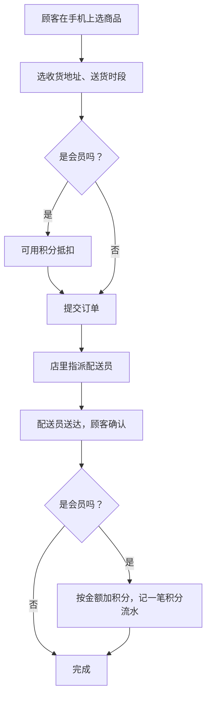
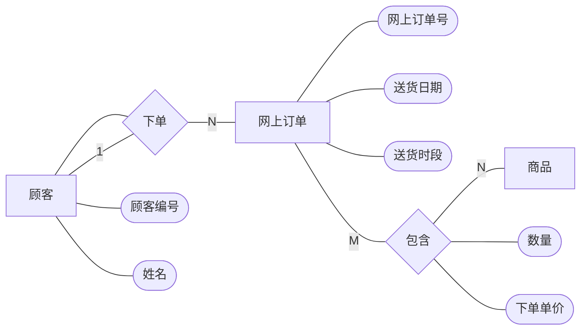
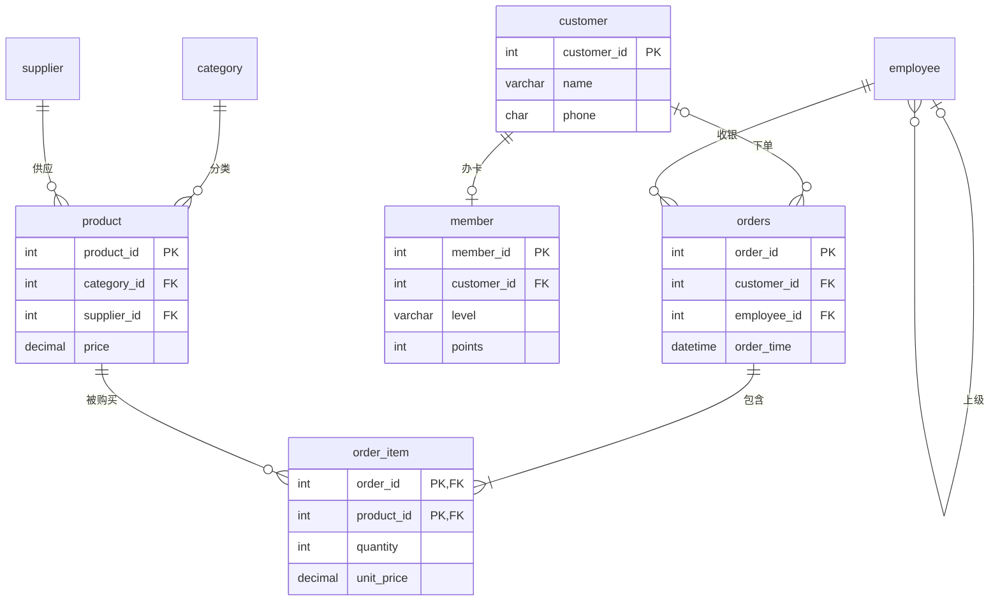
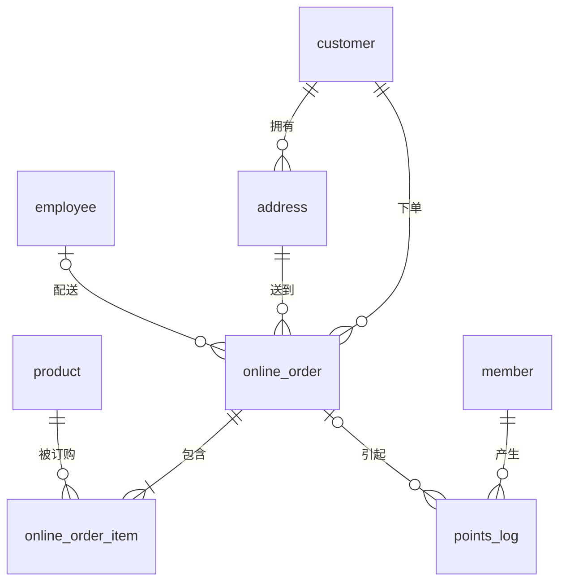
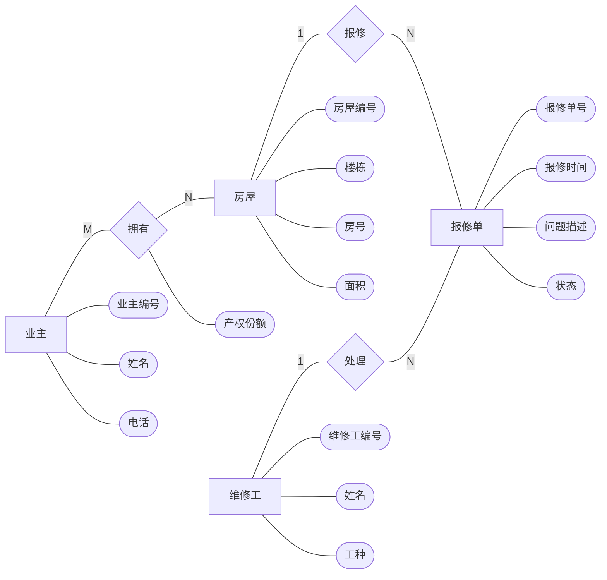
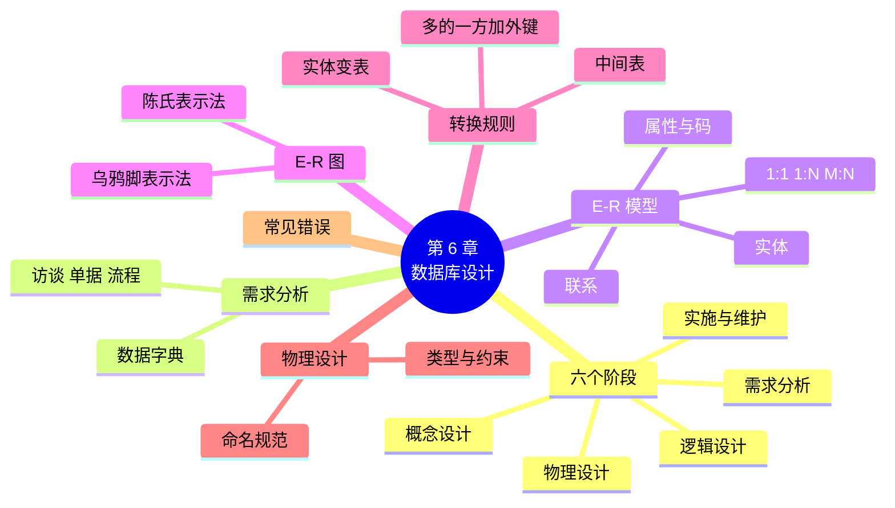

# 第 6 章 数据库设计：从需求到 E-R 图

!!! abstract "本章学时"
    理论 6 学时 · 实验 1 学时 · 线下研讨 2 学时（本章共 3 个实验，教师可任选）

## 学习目标

学完本章，你应该能够：

1. **说出**数据库设计的六个阶段，以及每个阶段的主要成果（记忆）；
2. **区分**实体、属性和联系，判断两个实体之间是一对一、一对多还是多对多（理解、分析）；
3. **画出**一个小业务的 E-R 图，看懂陈氏表示法和乌鸦脚表示法（应用）；
4. **按规则**把 E-R 图转换成关系模式，并写出建表语句（应用）；
5. **找出**一份设计里的常见错误，并提出修改意见（评价）。

!!! info "先修要求"
    学习本章前，你需要：

    - 理解主键、外键和关系模式（[2.2](../02-relational-model/index.md#22)、[2.3](../02-relational-model/index.md#23)）；
    - 会写带约束的建表语句（[3.4](../03-sql-ddl-dml/index.md#34)）；
    - 会写多表连接查询（[5.2](../05-multi-table-query/index.md#52)），用来检验设计。

??? abstract "本章概念清单（11 个，点击查看定义和例子）"
    1. [数据库设计](../../appendix/glossary.md#g-数据库设计)
    2. [需求分析](../../appendix/glossary.md#g-需求分析)
    3. [数据字典](../../appendix/glossary.md#g-数据字典)
    4. [概念设计](../../appendix/glossary.md#g-概念设计)
    5. [实体](../../appendix/glossary.md#g-实体)
    6. [联系](../../appendix/glossary.md#g-联系)
    7. [多对多联系](../../appendix/glossary.md#g-多对多联系)
    8. [E-R 图](../../appendix/glossary.md#g-E-R-图)
    9. [逻辑设计](../../appendix/glossary.md#g-逻辑设计)
    10. [中间表](../../appendix/glossary.md#g-中间表)
    11. [物理设计](../../appendix/glossary.md#g-物理设计)

## 情景导入

小店生意越来越好，老板想做两件新事：

> “很多老顾客让我开个网上订货，在手机上点好，我们送上门。还有，会员积分现在只是个数字，顾客老问‘我的积分怎么少了’，我说不清楚，能不能每一笔都记下来？”

小林打开 myshop 库看了看：现在的表只有门店收银的订单，没有收货地址，没有配送时间，积分只是会员表里的一个数。要加新功能，得加新表。可是加几张？每张有哪些列？表和表之间怎么连？

小林想起第 2 章那张“什么都往里放”的大表，吃过亏：一个电话要改几百行。这次他不想再拍脑袋了。表哥说：“设计数据库就像盖房子，先画图纸，再动工。图纸就是 **E-R 图**。”

本章学习数据库设计的方法：先弄清楚业务要记什么（需求分析），再画出 E-R 图（概念设计），最后按规则转成一张张表（逻辑设计）。本章的设计练习最好分组做，互相挑毛病，线下研讨课就用来做这件事。

## 6.1 数据库设计的六个阶段

[**数据库设计**](../../appendix/glossary.md#g-数据库设计 "根据业务需求，确定数据库中有哪些表、每张表有哪些列和约束、表之间怎样关联的过程"){ .term }一般分六个阶段：<sup class="cite">[[1]](#ref6-1)</sup>


| 阶段 | 要回答的问题 | 成果 | 本书哪里讲 |
|---|---|---|---|
| ① 需求分析 | 业务要记哪些数据？要查什么？ | 需求说明、业务流程、数据字典 | 6.2 节 |
| ② 概念设计 | 有哪些“东西”，它们之间什么关系？ | E-R 图 | 6.3 节 |
| ③ 逻辑设计 | 要建哪些表，主键、外键是什么？ | 关系模式 | 6.4 节，第 7 章检查 |
| ④ 物理设计 | 每列什么类型？建哪些索引？ | 建表脚本 | 6.5 节，第 8 章 |
| ⑤ 实施 | 把库建起来，把老数据导进去 | 数据库 | 第 3 章 |
| ⑥ 运行维护 | 怎样备份、调优、加功能？ | 运维记录 | 第 9、10 章 |

最后那条虚线很重要：设计不是一次就完的。业务变了（比如开网上订货），就要回到第 ① 步。越往后发现问题，改起来越贵：在纸上改 E-R 图只要几分钟，数据库上线一年后再改表结构，可能要停业务、迁移数据、改程序。

## 6.2 需求分析

### 6.2.1 弄清楚要记什么

[**需求分析**](../../appendix/glossary.md#g-需求分析 "数据库设计的第一步：通过访谈、观察业务流程，弄清楚要存哪些数据、要做哪些查询、有哪些规则"){ .term }就是“问清楚”。常用三种方法：

1. **访谈**：找会用这个系统的人聊。不要问“你想要什么表”（他们不懂），要问“你每天做什么、要查什么、什么时候最头疼”；
2. **看单据**：收银小票、进货单、会员登记表上印着的每一栏，几乎都是要存的数据；
3. **走流程**：从头到尾跟一遍业务，画成流程图。

小林访谈了老板、收银员和配送员刘英，整理出“网上订货与积分”的需求：

1. 会员和非会员都能网上订货；一位顾客可以有几个收货地址（自己家、父母家），其中一个是默认地址；
2. 下单时选送货日期和时段（上午、下午、晚上），一张网上订单可以买多种商品，每种有数量；
3. 商品价格会调整，但订单里要记**下单时**的价格；
4. 由一名配送员送货，刚下单时还没有指定配送员；
5. 会员下单可以用积分抵扣；每一笔积分的增加或减少都要记下来：多少分、为什么、哪张订单引起的、什么时候；
6. 老板要查：每天要送多少单、每个配送员送了多少单、某个会员的积分明细。

### 6.2.2 业务流程



流程图上的每一个方框，问一句“这一步要记下什么？”，就能找出要存的数据：订单、地址、配送员、积分流水……

### 6.2.3 数据字典

把找出来的数据项一条条写清楚，就是[**数据字典**](../../appendix/glossary.md#g-数据字典 "对数据库中每个数据项（名称、含义、类型、长度、取值范围、是否可空等）的详细说明，是设计和开发人员共同的参照"){ .term }。它是设计人员、程序员、业务人员共同的“对照表”，避免同一个词大家理解不一样。“网上订单”的部分数据字典：

| 数据项 | 含义 | 类型和长度 | 取值范围 / 规则 | 可空 | 来源 |
|---|---|---|---|---|---|
| 网上订单号 | 每张网上订单的编号 | 整数 | 系统自动编号，不重复 | 否 | 系统 |
| 送货日期 | 顾客要求哪天送 | 日期 | 不早于下单日期 | 否 | 顾客选 |
| 送货时段 | 哪个时段送 | 文字 | 上午、下午、晚上 三选一 | 否 | 顾客选 |
| 使用积分 | 这单抵扣了多少积分 | 整数 | ≥ 0，不超过会员现有积分 | 否，默认 0 | 顾客填 |
| 配送员 | 谁去送 | 员工编号 | 必须是在职员工 | 是（刚下单时） | 店里派 |
| 订单状态 | 订单进行到哪一步 | 文字 | 待配送、配送中、已送达、已取消 | 否 | 系统 |

完整的数据字典模板见[附录 E](../../appendix/e-templates.md)。

## 6.3 概念设计：画 E-R 图

### 6.3.1 实体、属性、联系

[**概念设计**](../../appendix/glossary.md#g-概念设计 "把需求整理成与具体数据库软件无关的模型，通常用 E-R 图表示有哪些实体、属性和联系"){ .term }用 **E-R 模型**（Entity-Relationship，实体—联系模型）来描述业务。它由陈品山（Peter Chen）在 1976 年提出，<sup class="cite">[[3]](#ref6-3)</sup> 只有三个概念：

- [**实体**](../../appendix/glossary.md#g-实体 "现实中可以区分开、需要记录信息的“东西”，如顾客、商品、订单；同一类实体的集合叫实体集"){ .term }：需要记录信息的“东西”，可以是人（顾客、员工）、物（商品）、事（订单、报修）、概念（类别）。**判断方法：它有自己的好几项信息，而且要一个个区分开。**
- **属性**：实体的特征，比如顾客的姓名、电话。能唯一区分每一个实体的属性（或属性组合）叫**码**，就是将来表的主键。
- [**联系**](../../appendix/glossary.md#g-联系 "实体之间的关系，如顾客“下”订单、订单“包含”商品；联系也可以有自己的属性"){ .term }：实体之间的关系，一般是一个动词：顾客“下”订单，订单“包含”商品，配送员“配送”订单。

**一个常见的困惑：一个东西是实体还是属性？** 看它有没有自己的信息。“送货时段”只有“上午、下午、晚上”三个值，没有别的信息，是订单的属性；“收货地址”有收件人、电话、详细地址，一位顾客还有好几个，就应该是实体。

### 6.3.2 三种联系

两个实体之间的联系，按“一个对应几个”分三种：

| 类型 | 写法 | 意思 | 小店的例子 |
|---|---|---|---|
| 一对一 | 1 : 1 | 一个 A 最多对应一个 B，一个 B 也最多对应一个 A | 顾客 — 会员卡（一位顾客最多办一张会员卡） |
| 一对多 | 1 : N | 一个 A 可以对应多个 B，一个 B 只对应一个 A | 类别 — 商品；顾客 — 订单 |
| 多对多 | M : N | 一个 A 可以对应多个 B，一个 B 也可以对应多个 A | 订单 — 商品（一单买多种，一种被很多单买） |

**判断方法：从两头各问一遍。** 比如“顾客”和“收货地址”：

- 一位顾客可以有几个地址？**多个**（自己家、父母家）；
- 一个地址记录属于几位顾客？**一位**（地址是顾客自己填的，两个人填同一个小区也是两条记录）；
- 一头“多”，一头“一”，所以是 **1 : N**。

再比如“订单”和“商品”：一张订单包含多种商品，一种商品出现在多张订单里，两头都是“多”，是 [**多对多联系**](../../appendix/glossary.md#g-多对多联系 "两个实体中，每一方的一个都可以对应另一方的多个，如订单和商品；转成表时要建中间表"){ .term }。

联系也可以有**自己的属性**。“订单包含商品”这个联系，有“数量”和“下单时的单价”：这两项既不属于订单（一张订单里每种商品数量不同），也不属于商品（每一单数量不同），只属于“这一单的这一种商品”这个组合。

### 6.3.3 E-R 图的两种画法

[**E-R 图**](../../appendix/glossary.md#g-E-R-图 "用图形表示实体、属性和联系的设计图，常见陈氏表示法和乌鸦脚表示法两种画法"){ .term }有好几种画法。考试和教材常用**陈氏表示法**，工具软件常用**乌鸦脚表示法**，两种都要认识。

**① 陈氏表示法（Chen 表示法）**

- 实体：**矩形**；属性：**椭圆**，主码属性加下划线；联系：**菱形**；
- 用线连接，线旁边标 1、N、M 表示联系类型。

“顾客下网上订单”画出来是这样（属性只画了几个）：



（网页里用的是自动排版，标准画法中主码属性“顾客编号”“网上订单号”应加下划线。）菱形“包含”上连着“数量”“下单单价”两个椭圆，这就是联系的属性。

**② 乌鸦脚表示法（Crow's Foot）**

- 每个实体画成一个方框，方框里直接列出属性，主键标 PK、外键标 FK；
- 联系画成两个方框之间的连线，线的两头用符号表示“一”还是“多”：一条竖线 `|` 表示“一”，像乌鸦脚一样分叉的三条线表示“多”，小圆圈 `o` 表示“可以没有”。

小店现有的 8 张表画出来就是这样（DBeaver 里右键数据库 → “查看图表”自动生成的也是这种图）：



读其中一条线 `customer |o--o{ orders`：靠近 customer 的一头是 `|o`，表示“一张订单对应**零个或一个**顾客”（散客订单没有顾客）；靠近 orders 的一头是 `o{`，表示“一位顾客对应**零张或多张**订单”。

| 陈氏表示法 | 乌鸦脚表示法 |
|---|---|
| 实体、属性、联系分开画，层次清楚 | 一个方框里列出全部属性，紧凑 |
| 联系用菱形，可以挂属性 | 联系就是一条线，多对多要画成中间表 |
| 适合概念设计、教学和考试 | 适合逻辑设计，和真实的表一一对应 |

<iframe class="sim-frame" src="../../sims/er-to-table/main.html" height="620" loading="lazy" title="E-R 图转换成表"></iframe>
动画：E-R 图转换成表。选一种联系（一对一、一对多、多对多），看陈氏表示法的 E-R 图怎样一步步变成表：实体变成表，外键加在哪一边，什么时候要多建一张中间表。[全屏打开](../../sims/er-to-table/main.html){ target=_blank }
{ .sim-caption }

### 6.3.4 画图工具

- **纸和笔**：讨论阶段最快，改起来方便。线下研讨课就用白纸画；
- **draw.io**（diagrams.net）：免费，有网页版和电脑版，左侧图形库里勾选“Entity Relation”就有 E-R 图的全部符号；
- **DBeaver**：已经建好的库，右键 → “查看图表”自动画出乌鸦脚图，适合检查和写文档；
- **用文字“画”图**：本章的图就是用 Mermaid 写出来的（6.7 节）。

## 6.4 逻辑设计：E-R 图转成关系模式

### 6.4.1 转换规则

[**逻辑设计**](../../appendix/glossary.md#g-逻辑设计 "把 E-R 图按规则转换成关系模式，确定每张表的列、主键和外键"){ .term }就是把 E-R 图变成一张张表（关系模式）。记住四条规则：<sup class="cite">[[1]](#ref6-1)</sup>

| 规则 | 怎么转 | 例子 |
|---|---|---|
| ① 每个实体变成一张表 | 实体的属性变成列，码变成主键 | 收货地址 → address(**address_id**, customer_id, receiver, phone, detail, is_default) |
| ② 1 : N 联系：在“多”的一方加外键 | “多”那张表加一列，参照“一”那张表的主键；联系的属性也放到“多”的一方 | 顾客 1 : N 地址 → address 表加 customer_id |
| ③ M : N 联系：单独建一张中间表 | 中间表的列 = 两边的主键（各是一个外键）+ 联系的属性，主键一般是两个外键的组合 | 网上订单 M : N 商品 → online_order_item(**online_order_id, product_id**, quantity, unit_price) |
| ④ 1 : 1 联系：在任意一方加外键，并加唯一约束 | 一般加在“可有可无”的一方 | 顾客 1 : 1 会员 → member 表加 customer_id，并设为 UNIQUE |

（粗体是主键。）为什么 1 : N 的外键必须放在“多”的一方？试试反过来：在顾客表里加一列“地址编号”，一位顾客有三个地址就要填三个编号，一格里放不下（违反第 2 章说的“每一格只放一个值”）。而每个地址只属于一位顾客，在地址表里放一个顾客编号刚好。

为什么 M : N 一定要建[**中间表**](../../appendix/glossary.md#g-中间表 "为了表示多对多联系而单独建立的表，包含两边实体的主键（作为外键）和联系自身的属性，也叫关联表"){ .term }？因为两边都是“多”，外键放在哪一边都会出现“一格放多个值”。中间表把一个 M : N 拆成了两个 1 : N：一张订单对应中间表的多行，一种商品也对应中间表的多行。小店的 order_item 就是这样一张中间表。

还有两种特殊情况：

- **自身联系**：同一个实体自己和自己的联系，比如员工“领导”员工（1 : N），按规则 ②，在员工表里加外键 manager_id，参照员工表自己（第 5 章的自连接就用它）；
- **联系连着三个实体**：比如“供应商在某天给某个门店送某种商品”，同样建一张中间表，放三个外键。

### 6.4.2 转换示例：网上订货与积分

按 6.2 节的需求，先找实体和联系：

- 实体：顾客（已有）、会员（已有）、商品（已有）、员工（已有，配送员是员工的一种）、**收货地址**、**网上订单**、**积分流水**；
- 联系：
    - 顾客 1 : N 收货地址（“拥有”）；
    - 顾客 1 : N 网上订单（“下单”）；
    - 收货地址 1 : N 网上订单（“送到”）；
    - 员工 1 : N 网上订单（“配送”，可以暂时没有）；
    - 网上订单 M : N 商品（“包含”，有数量、下单单价两个属性）；
    - 会员 1 : N 积分流水（“产生”）；
    - 网上订单 1 : N 积分流水（“引起”，有的流水不是订单引起的，比如生日赠送）。

“积分流水”为什么是实体而不是会员的属性？因为每一笔都有自己的多项信息（分数、原因、时间、订单），一位会员有很多笔，正是需求 5 要的“每一笔都记下来”。会员表里原来的 points 列可以保留，当作“当前余额”方便查询，但它应该等于流水的合计（第 9 章用触发器保证这一点）。

按规则转换，得到 4 张新表（粗体为主键，斜体为外键）：

- address(**address_id**, *customer_id*, receiver, phone, detail, is_default)
- online_order(**online_order_id**, *customer_id*, *address_id*, *courier_id*, created_at, delivery_date, delivery_slot, points_used, status)
- online_order_item(***online_order_id***, ***product_id***, quantity, unit_price)
- points_log(**log_id**, *member_id*, change_points, reason, *online_order_id*, created_at)

画成乌鸦脚图：



实验 6-2 会把这 4 张表真正建出来，并放一笔订单进去试一试。

## 6.5 物理设计

[**物理设计**](../../appendix/glossary.md#g-物理设计 "为关系模式选定具体数据库软件中的数据类型、约束、索引和存储方式，得到可以运行的建表脚本"){ .term }是把关系模式落实到具体的数据库软件（本书是 MySQL 8.4）上，主要做三件事：

1. **选类型和约束**：按第 3 章的方法。比如送货时段用 `ENUM('上午','下午','晚上')`，使用积分加 `CHECK (points_used >= 0)`；
2. **定索引**：经常用来查询、连接的列建索引，比如 online_order 的 delivery_date（每天要查送多少单），第 8 章细讲；
3. **定命名规范**，并且全组遵守。

本书采用的命名规范：

| 规则 | 好的例子 | 不好的例子 |
|---|---|---|
| 表名、列名用英文小写，单词之间用下划线 | `order_item`、`unit_price` | `OrderItem`、`单价` |
| 表名用单数名词 | `product` | `products`、`tb_product_list` |
| 主键用“表名_id” | `product_id` | `id`、`pid` |
| 外键和它参照的主键同名 | `order_item.product_id` | `order_item.goods` |
| 表示时间的列用 `_at`（日期时间）或 `_date`（日期）结尾 | `created_at`、`delivery_date` | `time1` |
| 不用 SQL 关键字做名字 | `orders`、`status` | `order`、`group`（要加反引号才能用） |

订单表叫 `orders` 而不是 `order`，就是因为 ORDER 是关键字（ORDER BY）。列名用中文在 MySQL 里也能运行，但写程序时容易遇到编码问题，不推荐。

## 6.6 常见的设计错误

把下面几种错误记住，评审别人的设计时一条条对照：

| 错误 | 例子 | 后果 | 改法 |
|---|---|---|---|
| ① 一格放多个值 | 顾客表里 phone 列写“13800000000,13900000000” | 查不出“用这个号的顾客”，改一个号要拆字符串 | 多值属性拆成单独的表（如 customer_phone） |
| ② 同一信息存多处 | 订单表里又存一遍顾客姓名和电话 | 顾客改了电话，订单里的还是旧的 | 只存顾客编号，用连接查 |
| ③ 该拆没拆 | 用一张“网上订单”表，列名是“商品1、数量1、商品2、数量2……” | 买 6 种商品就放不下，统计某商品销量要查好几列 | M : N 建中间表 |
| ④ 该有的约束没加 | 外键列没加 FOREIGN KEY，数量没加 CHECK | 出现订到不存在的商品、数量为负数 | 按数据字典加约束 |
| ⑤ 把会变的值当主键 | 用手机号做顾客表主键 | 顾客换号，所有订单里的外键都要改 | 用没有业务含义的编号做主键 |
| ⑥ 存了能算出来的值，却没有办法保证一致 | 订单表存“订单总金额”，明细改了总金额没改 | 两边对不上 | 能算的不存；要存就用触发器或程序同步（第 9 章） |

注意第 ② 条有一个例外：订单明细里的 **unit_price**（下单时的单价）和商品表的 price 看起来重复，其实不是：price 是现在的价格，会调；unit_price 是当时成交的价格，不能变。**它们是两个不同的数据项**，所以都要存。这正是需求 3 说的。

第 ① ～ ③ 条错误的根本原因，第 7 章会用“范式”的理论讲清楚。

## 6.7 前沿视窗：用文字“画”E-R 图

本章的流程图和 E-R 图都不是用鼠标画的，而是用 **Mermaid** 写出来的。比如：

```text
erDiagram
  customer ||--o{ address : "拥有"
  customer ||--o{ online_order : "下单"
```

网页、Markdown 笔记软件、GitHub、Gitee 都能把这几行文字直接显示成图。好处是：

1. **改起来快**：加一张表、改一条联系，改一行字就行，图自动重新排版；
2. **能和代码放在一起管理**：设计文档和建表脚本放在同一个仓库里，谁改了什么一清二楚；
3. **大模型能读、能写**：把需求描述给大模型，可以让它输出 Mermaid 格式的 E-R 图，再贴到工具里查看、修改。反过来，也可以把自己画的 E-R 图（文字）交给大模型，请它对照 6.6 节的清单挑错。

类似的工具还有 DBML（dbdiagram.io 网站使用的格式）和 PlantUML。注意：工具能把图画得很漂亮，但**有哪些实体、联系是一对多还是多对多**，仍然要靠你在需求分析里问清楚。大模型不知道你的小店“一个地址能不能属于两位顾客”，它只会按常见情况猜。

## 本章实验

!!! abstract "实验总览"
    | 实验 | 类型 | 建议时长 | 内容 |
    |---|---|---|---|
    | 实验 6-1 | ★ 基础 | 30 分钟 | 读一张“小区物业报修”的 E-R 图，写出关系模式并建表验证 |
    | 实验 6-2 | ★ 基础 | 45 分钟 | 补全“网上订货与积分”的建表脚本，放一笔订单进去 |
    | 实验 6-3 | ☆ 拓展 | 线下 2 学时 | 小组为“社区图书角”做完整设计，互相评审 |

    SQL 脚本见配套资源 `labs/ch06/` 目录，设计文档模板见[附录 E](../../appendix/e-templates.md)。

### 实验 6-1 ★ 读 E-R 图，写关系模式

**实验目的**

1. 能从 E-R 图中读出实体、属性、联系和联系的类型；
2. 熟练运用四条转换规则，特别是多对多联系的中间表。

**实验环境**：纸笔，本机 MySQL 8.4 + DBeaver。**实验数据**：脚本自己插入的几行虚构数据。

**实验背景**

某小区物业要做一个报修系统。分析后得到下面的 E-R 图（陈氏表示法，属性只画了主要的）：



说明：一套房可以有几位共同业主（夫妻），一位业主可以有几套房；刚报修时还没有派维修工。

**实验步骤与代码**

1. **在纸上**列出：有几个实体？几个联系？每个联系是什么类型？
2. **在纸上**按四条规则写出关系模式（主键画下划线，外键标出参照哪张表）；
3. 打开 `labs/ch06/lab6_1_repair_answer.sql`，对照参考答案，看自己哪里不一样、谁更合理；
4. 运行脚本，看最后一条查询的结果。

参考答案中最关键的两张表：

```sql
-- 联系“拥有”（业主 M : N 房屋）→ 中间表，主键是两个外键的组合
CREATE TABLE owner_house (
  owner_id INT,
  house_id INT,
  share    DECIMAL(5,2) DEFAULT 100.00,   -- 联系自己的属性：产权份额（%）
  PRIMARY KEY (owner_id, house_id),
  FOREIGN KEY (owner_id) REFERENCES owner(owner_id),
  FOREIGN KEY (house_id) REFERENCES house(house_id)
);

-- 实体“报修单”：房屋 1 : N 报修单，维修工 1 : N 报修单 → 在“多”的一方加外键
CREATE TABLE repair_order (
  repair_id   INT PRIMARY KEY AUTO_INCREMENT,
  house_id    INT NOT NULL,
  worker_id   INT,                       -- 刚报修时还没派人，可以为空
  report_time DATETIME NOT NULL,
  problem     VARCHAR(200) NOT NULL,
  status      ENUM('待派单', '维修中', '已完成') NOT NULL DEFAULT '待派单',
  FOREIGN KEY (house_id)  REFERENCES house(house_id),
  FOREIGN KEY (worker_id) REFERENCES worker(worker_id)
);
```

**运行结果**

编者在 MySQL 8.4.13 上的运行结果：

```text
+------------------+
| Tables_in_repair |
+------------------+
| house            |
| owner            |
| owner_house      |
| repair_order     |
| worker           |
+------------------+
+-----------+------------+--------+-----------------------+-----------+-----------+
| repair_id | 房屋       | 业主   | 问题                  | 维修工    | status    |
+-----------+------------+--------+-----------------------+-----------+-----------+
|         1 | 3 栋 501   | 林海   | 厨房水龙头漏水        | 黄师傅    | 已完成    |
|         1 | 3 栋 501   | 苏晴   | 厨房水龙头漏水        | 黄师傅    | 已完成    |
|         2 | 5 栋 1201  | 林海   | 阳台推拉门卡住        | 陈师傅    | 维修中    |
|         3 | 3 栋 501   | 林海   | 卫生间灯不亮          | 未派单    | 待派单    |
|         3 | 3 栋 501   | 苏晴   | 卫生间灯不亮          | 未派单    | 待派单    |
+-----------+------------+--------+-----------------------+-----------+-----------+
```

3 张报修单查出了 5 行：3 栋 501 有林海、苏晴两位业主，所以这套房的报修单各出现两次。这就是第 5 章说的“连接了一对多的表，行被复制”。

**实验记录表**

| 项目 | 你的答案 | 参考答案 |
|---|---|---|
| 实体个数 | | 4 |
| 联系个数和类型 | | 3 个：拥有 M : N，报修 1 : N，处理 1 : N |
| 表的个数 | | 5（4 个实体 + 1 张中间表） |
| “产权份额”放在哪张表？ | | owner_house |
| repair_order 的 worker_id 能否为空？为什么？ | | 能，刚报修时还没派维修工 |

**常见问题排查**

| 现象 | 原因 | 解决办法 |
|---|---|---|
| 在 house 表里加了 owner_id 列 | 把 M : N 当成了 1 : N | 一套房有两位业主就放不下，要建中间表 |
| 在 worker 表里加了 repair_id | 外键放在了“一”的一方 | 1 : N 的外键放在“多”的一方（报修单） |
| 建表报 `Failed to open the referenced table` | 建表顺序不对 | 先建被参照的表（第 3 章 3.4.5 节） |

**思考与练习**

1. 如果一张报修单可能要几个工种的维修工一起处理（先水电、再泥瓦），“处理”联系变成什么类型？表要怎么改？
2. 最后的查询只想每张报修单显示一行，业主名字用顿号连起来，可以怎么做？（提示：MySQL 有 `GROUP_CONCAT` 函数，可以查一查）

**实验报告要求**

提交纸上写的关系模式照片和实验记录表，回答思考题。

### 实验 6-2 ★ 补全“网上订货与积分”的建表脚本

**实验目的**

1. 把 6.4.2 节的关系模式落实为 MySQL 建表脚本；
2. 通过插入一笔订单，检验设计能否满足需求。

**实验环境**：本机 MySQL 8.4 + DBeaver。**实验数据**：实验 3-1 建好的 `myshop` 库（会删除并重建实验 3-3 建过的 points_log 表）。

**实验步骤与代码**

1. 打开 `labs/ch06/lab6_2_online_order_todo.sql`，找到 4 处 `TODO`，按 6.4.2 节的关系模式补全。脚本中待补全的部分：

```sql
CREATE TABLE online_order (
  ……
  FOREIGN KEY (customer_id) REFERENCES customer(customer_id)
  -- TODO 1：再加两个外键：address_id 参照 address，courier_id 参照 employee
);

CREATE TABLE online_order_item (
  -- TODO 2：写出 4 列：online_order_id、product_id、quantity（必须大于 0）、unit_price
  --         主键是哪两列的组合？两个外键分别参照哪张表？
);

CREATE TABLE points_log (
  ……
  -- TODO 3：加一列 online_order_id，它可以为空吗？为什么？
  ……
  FOREIGN KEY (member_id) REFERENCES member(member_id)
  -- TODO 4：加上 online_order_id 的外键
);
```

2. 运行整个脚本。如果报错，按错误信息修改，直到全部通过；
3. 脚本最后插入了一笔测试订单：顾客 1（徐洋娟，金卡会员）6 月 30 日晚上下单，第二天上午送到默认地址，买了 1 袋大米、2 袋燕麦片，用 100 积分抵扣；
4. 和参考答案 `lab6_2_online_order_answer.sql` 对照。

参考答案中的中间表：

```sql
CREATE TABLE online_order_item (
  online_order_id INT,
  product_id      INT,
  quantity        INT NOT NULL CHECK (quantity > 0),
  unit_price      DECIMAL(8,2) NOT NULL,            -- 下单时的价格，以后商品调价也不变
  PRIMARY KEY (online_order_id, product_id),
  FOREIGN KEY (online_order_id) REFERENCES online_order(online_order_id),
  FOREIGN KEY (product_id)      REFERENCES product(product_id)
);
```

**运行结果**

编者在 MySQL 8.4.13 上运行参考答案的结果：

```text
+-----------------+-----------+------------------------+---------------+---------------+--------------+-------------+
| online_order_id | 顾客      | 地址                   | delivery_date | delivery_slot | 商品金额     | points_used |
+-----------------+-----------+------------------------+---------------+---------------+--------------+-------------+
|               1 | 徐洋娟    | 滨江花园 2 栋 301      | 2026-07-01    | 上午          |        93.70 |         100 |
+-----------------+-----------+------------------------+---------------+---------------+--------------+-------------+
+--------+-----------+---------------+--------------+-----------------+---------------------+
| log_id | member_id | change_points | reason       | online_order_id | created_at          |
+--------+-----------+---------------+--------------+-----------------+---------------------+
|      1 |         1 |          -100 | 下单抵扣     |               1 | 2026-06-30 21:05:00 |
+--------+-----------+---------------+--------------+-----------------+---------------------+
```

**实验记录表**

| 检验需求 | 怎样检验 | 你的结果 |
|---|---|---|
| 需求 1：一位顾客多个地址 | 给顾客 1 再插入一个地址，能成功吗？ | |
| 需求 3：记下单时价格 | 把大米的 price 改成 42.00，订单的商品金额变了吗？ | |
| 需求 4：刚下单没有配送员 | 测试订单的 courier_id 是什么？ | |
| 需求 5：积分明细 | 写出查询“会员 1 的全部积分流水”的 SQL | |
| 约束 | 插入一行 quantity = 0 的明细，报什么错？ | |

**常见问题排查**

| 现象 | 原因 | 解决办法 |
|---|---|---|
| 报错 1824 `Failed to open the referenced table 'online_order'` | 被参照的表还没建，比如把 points_log 移到了 online_order 前面 | 按脚本顺序建表 |
| 报错 1452 插入明细失败 | 订单号或商品号不存在 | 检查 `@oid` 是否取到了刚插入的订单号 |
| 报错 1072 `Key column 'xxx' doesn't exist in table` | 外键里的列名拼错了 | 外键里的列名要和上面定义的一致 |

**思考与练习**

1. online_order 已经有 customer_id，又有 address_id，而地址表里也有 customer_id，这算不算“同一信息存两处”？会不会出现“订单的顾客是 A，地址却是 B 的”？怎样防止？
2. 为什么积分流水的 online_order_id 可以为空？举一个不是订单引起的积分变动的例子。

**实验报告要求**

提交补全后的脚本、运行结果截图和实验记录表。

### 实验 6-3 ☆ 小组设计：社区图书角

**实验目的**

1. 完整经历需求分析、概念设计、逻辑设计、物理设计四个阶段；
2. 学会评审别人的设计，用 6.6 节的清单挑错。

**实验环境**：白纸或 draw.io，本机 MySQL 8.4。建议线下研讨课进行，3～4 人一组。

**实验背景**

小区居委会在活动室开了一个图书角：居民可以捐书，也可以借书。现在用一个本子登记，经常找不到书在谁手里。请为它设计一个数据库。已知的情况：

- 居民登记后成为读者，要记姓名、电话、住哪栋楼；
- 同一种书可能有好几本（好几个人捐了同一本绘本），每一本都要能单独借；
- 要记每本书是谁捐的（也有居委会自己买的）；
- 每次借书最多借 14 天，要记借书日期、应还日期、实际还书日期；
- 要能查：哪些书过期没还、某种书还有几本在架上、谁捐的书最多。

**实验步骤**

1. **需求分析（20 分钟）**：组内讨论，补充你们认为还需要的需求，写出数据字典（用附录 E 的模板）；
2. **概念设计（25 分钟）**：画 E-R 图（陈氏表示法），标明联系类型；
3. **逻辑与物理设计（25 分钟）**：转成关系模式，写出建表脚本，插几行数据，写出上面三个查询；
4. **互评（20 分钟）**：和另一组交换设计，按 6.6 节的六条清单挑错，写下评审意见；
5. **对照参考（10 分钟）**：运行 `labs/ch06/lab6_3_book_corner_reference.sql`，看参考设计和你们的有什么不同。

参考设计的一个关键点，是把“书目”和“实体书”分成两张表：

```sql
-- 书目：同一种书（同一个 ISBN）只记一行
CREATE TABLE book (
  isbn        CHAR(13) PRIMARY KEY,
  title       VARCHAR(100) NOT NULL,
  author      VARCHAR(50),
  category_id INT NOT NULL,
  FOREIGN KEY (category_id) REFERENCES book_category(category_id)
);

-- 实体书：同一种书可能有好几本（有人捐了两本），每一本贴一个编号
CREATE TABLE book_copy (
  copy_id    INT PRIMARY KEY AUTO_INCREMENT,
  isbn       CHAR(13) NOT NULL,
  donor_id   INT,                                  -- 谁捐的，可以为空（图书角自己买的）
  shelf_date DATE NOT NULL,
  FOREIGN KEY (isbn)     REFERENCES book(isbn),
  FOREIGN KEY (donor_id) REFERENCES reader(reader_id)
);
```

**运行结果**

参考设计在 MySQL 8.4.13 上插入示例数据后，两个查询的结果：

```text
到 2026-06-30 过期未还
+-----------+--------+--------+--------------+--------------+
| 读者      | 楼栋   | 书名   | 应还日期     | 过期天数     |
+-----------+--------+--------+--------------+--------------+
| 陈阿姨    | 1 栋   | 活着   | 2026-06-24   |            6 |
+-----------+--------+--------+--------------+--------------+
每种书的本数和在架数
+--------------------+-----------+--------+
| 书名               | 总本数    | 在架   |
+--------------------+-----------+--------+
| 小猪佩奇绘本       |         2 |      1 |
| 活着               |         1 |      0 |
| 家常菜 300 例      |         1 |      1 |
+--------------------+-----------+--------+
```

**评审记录表**

| 清单项（6.6 节） | 对方设计中是否存在 | 具体位置和修改建议 |
|---|---|---|
| ① 一格放多个值 | | |
| ② 同一信息存多处 | | |
| ③ 该拆没拆 | | |
| ④ 该有的约束没加 | | |
| ⑤ 把会变的值当主键 | | |
| ⑥ 存了能算出来的值 | | |

**思考与练习**

1. 如果不分“书目”和“实体书”，只建一张 book 表，加一列“本数”，借书时会遇到什么问题？
2. 参考设计用 ISBN 做 book 表的主键，这符合 6.6 节第 ⑤ 条吗？什么情况下会出问题？（提示：有些旧书、自印的书没有 ISBN）

**实验报告要求**

每组提交：数据字典、E-R 图、建表脚本、三个查询及结果、对另一组的评审记录表。

## 本章小结

- 数据库设计分六个阶段：**需求分析 → 概念设计 → 逻辑设计 → 物理设计 → 实施 → 运行维护**，越早发现问题，改起来越便宜。
- 需求分析靠访谈、看单据、走流程，成果包括业务流程图和**数据字典**。
- 概念设计用 **E-R 模型**：**实体**（有自己的多项信息、要逐个区分的东西）、**属性**、**联系**；联系分 **1 : 1、1 : N、M : N**，从两头各问一遍来判断；联系可以有自己的属性。
- E-R 图的两种画法：**陈氏表示法**（矩形、椭圆、菱形）和**乌鸦脚表示法**（方框列属性，线两头的符号表示一和多）。
- 转换规则：实体变表；**1 : N 在“多”的一方加外键**；**M : N 建中间表**，主键是两个外键的组合，联系的属性放在中间表；1 : 1 在任一方加外键并加唯一约束。
- 物理设计：选类型和约束、定索引、遵守命名规范（小写下划线、单数、表名_id、不用关键字）。
- 常见错误：一格多值、一事多存、该拆没拆、缺约束、会变的值做主键、存了能算出来的值。



**下一章预告**

本章靠经验和清单判断设计好不好。有没有一套理论，能严格地说清楚“一张表该不该拆、怎么拆”？第 7 章学习函数依赖和范式，把 6.6 节那些错误背后的道理讲透。

## 参考文献

正文中的上标编号（如<sup class="cite">[[1]](#ref6-1)</sup>）对应下面的文献。带链接的可以直接打开；书籍可在图书馆或电子书平台查阅。

<div class="refs" markdown>

**教材与专著**

- <span id="ref6-1"></span>[1] 王珊，杜小勇，陈红. 数据库系统概论[M]. 6 版. 北京：高等教育出版社，2023.
    <span class="ref-note">第 7 章“数据库设计”讲设计的六个阶段、E-R 模型和 E-R 图向关系模型的转换，与本章对应。</span>
- <span id="ref6-2"></span>[2] HERNANDEZ M J. Database Design for Mere Mortals: 25th Anniversary Edition[M]. 4th ed. Boston: Addison-Wesley, 2020.
    <span class="ref-note">面向非专业读者的数据库设计书，重点讲访谈、需求分析和避免常见设计错误，对应 6.2 节和 6.6 节。</span>

**经典论文**

- <span id="ref6-3"></span>[3] CHEN P P. The entity-relationship model: toward a unified view of data[J]. ACM Transactions on Database Systems, 1976, 1(1): 9-36.
    <span class="ref-note">E-R 模型的原始论文，陈氏表示法就来自这篇论文，对应 6.3 节。</span>

**在线资源与数据**

- <span id="ref6-4"></span>[4] Mermaid. Entity Relationship Diagrams[EB/OL]. [2026-11-01]. https://mermaid.js.org/syntax/entityRelationshipDiagram.html.
    <span class="ref-note">Mermaid 的 E-R 图语法，包括乌鸦脚符号 `||`、`o{`、`|o` 的写法，对应 6.3.3 节和 6.7 节。</span>
- <span id="ref6-5"></span>[5] Oracle. MySQL 8.4 Reference Manual: Keywords and Reserved Words[EB/OL]. [2026-11-01]. https://dev.mysql.com/doc/refman/8.4/en/keywords.html.
    <span class="ref-note">MySQL 的关键字和保留字列表，命名时要避开，对应 6.5 节。</span>

</div>

## 课后练习

选择题和判断题可以直接点击选项作答，系统会马上告诉你对错，并展开答案与解析；多选题选好后点“提交答案”。简答和实操题请先自己作答，再点开“答案与解析”核对。每道题的解析下方都有“回看”链接，做错了可以直接跳回正文复习。

**一、单项选择题**

<div class="quiz" data-answer="B" markdown>

**1.** 画 E-R 图属于数据库设计的（　　）阶段。

- A. 需求分析
- B. 概念设计
- C. 逻辑设计
- D. 物理设计

</div>

??? tip "答案与解析"
    **答案：B**

    解析：概念设计的成果是 E-R 图；逻辑设计把 E-R 图转成关系模式。

    考查：设计阶段 · 认知层次：记忆 · [回看 6.1](#61)
    { .quiz-meta }

<div class="quiz" data-answer="C" markdown>

**2.** 在陈氏表示法的 E-R 图中，联系用（　　）表示。

- A. 矩形
- B. 椭圆
- C. 菱形
- D. 三角形

</div>

??? tip "答案与解析"
    **答案：C**

    解析：实体用矩形，属性用椭圆，联系用菱形。

    考查：陈氏表示法 · 认知层次：记忆 · [回看 6.3.3](#633-e-r)
    { .quiz-meta }

<div class="quiz" data-answer="A" markdown>

**3.** 一个班级有多名学生，一名学生只属于一个班级。班级和学生之间是（　　）联系。

- A. 1 : N
- B. 1 : 1
- C. M : N
- D. N : 1 且 M : N

</div>

??? tip "答案与解析"
    **答案：A**

    解析：从两头各问一遍：一个班级对应多名学生，一名学生对应一个班级，是一对多。

    考查：联系类型 · 认知层次：应用 · [回看 6.3.2](#632)
    { .quiz-meta }

<div class="quiz" data-answer="D" markdown>

**4.** 学生和课程之间是多对多联系，“成绩”是这个联系的属性。转换成关系模式时，成绩应放在（　　）。

- A. 学生表
- B. 课程表
- C. 学生表和课程表都放
- D. 新建的选课表（中间表）

</div>

??? tip "答案与解析"
    **答案：D**

    解析：M : N 联系转成中间表，联系的属性放在中间表里。成绩既不属于某个学生，也不属于某门课，而属于“某个学生的某门课”。

    考查：转换规则 · 认知层次：应用 · [回看 6.4.1](#641)
    { .quiz-meta }

<div class="quiz" data-answer="B" markdown>

**5.** 部门 1 : N 员工，转换成关系模式时，外键应该（　　）。

- A. 加在部门表，参照员工表
- B. 加在员工表，参照部门表
- C. 两张表都加
- D. 新建一张中间表

</div>

??? tip "答案与解析"
    **答案：B**

    解析：1 : N 联系在“多”的一方（员工）加外键。

    考查：转换规则 · 认知层次：应用 · [回看 6.4.1](#641)
    { .quiz-meta }

<div class="quiz" data-answer="C" markdown>

**6.** 有 3 个实体，它们之间有 2 个 1 : N 联系和 1 个 M : N 联系，转换后最少有（　　）张表。

- A. 3
- B. 5
- C. 4
- D. 6

</div>

??? tip "答案与解析"
    **答案：C**

    解析：3 个实体各一张表，1 : N 联系不需要新表，M : N 联系要一张中间表，共 4 张。

    考查：转换规则 · 认知层次：分析 · [回看 6.4.1](#641)
    { .quiz-meta }

<div class="quiz" data-answer="A" markdown>

**7.** 对数据库中每个数据项的名称、含义、类型、取值范围等作详细说明的文档是（　　）。

- A. 数据字典
- B. E-R 图
- C. 业务流程图
- D. 建表脚本

</div>

??? tip "答案与解析"
    **答案：A**

    考查：数据字典 · 认知层次：记忆 · [回看 6.2.3](#623)
    { .quiz-meta }

<div class="quiz" data-answer="D" markdown>

**8.** 下列表名或列名中，最符合本书命名规范的是（　　）。

- A. `OrderItem`
- B. `order`
- C. `商品单价`
- D. `unit_price`

</div>

??? tip "答案与解析"
    **答案：D**

    解析：A 没用小写下划线，B 是 SQL 关键字，C 用了中文。

    考查：命名规范 · 认知层次：理解 · [回看 6.5](#65)
    { .quiz-meta }

<div class="quiz" data-answer="B" markdown>

**9.** 在乌鸦脚表示法中，连线一端像三条分叉的线（乌鸦脚），表示（　　）。

- A. 一
- B. 多
- C. 可以没有
- D. 主键

</div>

??? tip "答案与解析"
    **答案：B**

    解析：竖线表示一，分叉表示多，小圆圈表示可以没有（零个）。

    考查：乌鸦脚表示法 · 认知层次：记忆 · [回看 6.3.3](#633-e-r)
    { .quiz-meta }

**二、多项选择题**

<div class="quiz quiz-multi" data-answer="ACD" markdown>

**1.** 下列属于多对多联系的有（　　）。

- A. 订单与商品
- B. 顾客与会员卡（一人最多办一张）
- C. 学生与课程
- D. 业主与房屋（一套房可以有共同业主）

</div>

??? tip "答案与解析"
    **答案：ACD**

    解析：B 是一对一。

    考查：联系类型 · 认知层次：分析 · [回看 6.3.2](#632)
    { .quiz-meta }

<div class="quiz quiz-multi" data-answer="ABC" markdown>

**2.** 多对多联系转换成的中间表通常包含（　　）。

- A. 一方实体的主键，作为外键
- B. 另一方实体的主键，作为外键
- C. 联系自身的属性
- D. 两方实体的全部属性

</div>

??? tip "答案与解析"
    **答案：ABC**

    解析：实体的其他属性已经在各自的表里，不应在中间表重复存储。

    考查：中间表 · 认知层次：理解 · [回看 6.4.1](#641)
    { .quiz-meta }

<div class="quiz quiz-multi" data-answer="ABD" markdown>

**3.** 下列做法中，属于 6.6 节所说的设计错误的有（　　）。

- A. 在顾客表的 phone 列中存“13800000000,13900000000”
- B. 在订单表中再存一遍顾客的姓名和电话
- C. 在订单明细表中存下单时的单价 unit_price
- D. 用顾客的手机号作为顾客表的主键

</div>

??? tip "答案与解析"
    **答案：ABD**

    解析：C 不是错误：下单时的单价和商品现在的价格是两个不同的数据项，必须存。

    考查：常见设计错误 · 认知层次：评价 · [回看 6.6](#66)
    { .quiz-meta }

<div class="quiz quiz-multi" data-answer="ABCD" markdown>

**4.** 需求分析阶段常用的方法有（　　）。

- A. 访谈业务人员
- B. 收集和分析业务单据
- C. 跟一遍业务流程并画流程图
- D. 整理数据字典

</div>

??? tip "答案与解析"
    **答案：ABCD**

    考查：需求分析 · 认知层次：理解 · [回看 6.2](#62)
    { .quiz-meta }

**三、判断题**

<div class="quiz quiz-judge" data-answer="×" markdown>

**1.** 数据库设计是一次性的工作，数据库建好以后就不用再改设计了。

- √ 正确
- × 错误

</div>

??? tip "答案与解析"
    **答案：×**

    解析：业务变化时要回到需求分析阶段重新设计，越晚修改代价越大。

    考查：设计阶段 · 认知层次：理解 · [回看 6.1](#61)
    { .quiz-meta }

<div class="quiz quiz-judge" data-answer="√" markdown>

**2.** 联系也可以有自己的属性。

- √ 正确
- × 错误

</div>

??? tip "答案与解析"
    **答案：√**

    解析：如“订单包含商品”的数量、“业主拥有房屋”的产权份额。

    考查：联系 · 认知层次：理解 · [回看 6.3.2](#632)
    { .quiz-meta }

<div class="quiz quiz-judge" data-answer="×" markdown>

**3.** 1 : N 联系转换时，外键可以放在任意一方。

- √ 正确
- × 错误

</div>

??? tip "答案与解析"
    **答案：×**

    解析：只能放在“多”的一方，放在“一”的一方会出现一格存多个值。任意一方都可以的是 1 : 1 联系。

    考查：转换规则 · 认知层次：理解 · [回看 6.4.1](#641)
    { .quiz-meta }

<div class="quiz quiz-judge" data-answer="√" markdown>

**4.** 员工表中 manager_id 参照本表的 employee_id，这表示的是实体自身的一对多联系。

- √ 正确
- × 错误

</div>

??? tip "答案与解析"
    **答案：√**

    考查：自身联系 · 认知层次：理解 · [回看 6.4.1](#641)
    { .quiz-meta }

<div class="quiz quiz-judge" data-answer="×" markdown>

**5.** “送货时段”只有上午、下午、晚上三个值，应当设计成一个单独的实体。

- √ 正确
- × 错误

</div>

??? tip "答案与解析"
    **答案：×**

    解析：它没有自己的其他信息，作为网上订单的属性即可（可用 ENUM 类型）。

    考查：实体与属性 · 认知层次：分析 · [回看 6.3.1](#631)
    { .quiz-meta }

**四、简答题**

**1.** 简述 E-R 图转换为关系模式的四条规则。

??? tip "答案与解析"
    **参考答案：** ① 每个实体转换为一张表，实体的属性为列，码为主键；② 1 : N 联系在“多”的一方的表中加入“一”方的主键作为外键，联系的属性也放在“多”的一方；③ M : N 联系单独建一张中间表，包含两方的主键（作为外键）和联系的属性，主键一般为两个外键的组合；④ 1 : 1 联系在任意一方加入另一方的主键作为外键，并加唯一约束。

    考查：转换规则 · 认知层次：记忆 · [回看 6.4.1](#641)
    { .quiz-meta }

**2.** 怎样判断一个事物应该作为实体还是作为属性？举例说明。

??? tip "答案与解析"
    **参考答案：** 看它有没有自己的多项信息、是否需要逐个区分。只有一个值、没有其他信息的作为属性，如订单的“送货时段”；有自己的多项信息（或一个对象可以有多个）的作为实体，如“收货地址”有收件人、电话、详细地址，一位顾客还可以有多个地址，应作为实体。

    考查：实体与属性 · 认知层次：理解 · [回看 6.3.1](#631)
    { .quiz-meta }

**3.** 为什么订单明细表中存了 unit_price，不算“同一信息存多处”的错误？

??? tip "答案与解析"
    **参考答案：** 商品表的 price 是商品现在的售价，会随时调整；订单明细的 unit_price 是下单那一刻成交的价格，订单完成后不能再变。两者含义不同，是两个不同的数据项。如果不存 unit_price，商品调价后，历史订单的金额就会跟着变，账就对不上了。

    考查：常见设计错误 · 认知层次：评价 · [回看 6.6](#66)
    { .quiz-meta }

**五、实操题**

**1.** 某驾校要管理学员练车预约：学员（学员号、姓名、电话）、教练（教练号、姓名、准驾车型）、教练车（车牌号、车型）。一名学员有一名固定教练，一名教练带多名学员；学员每次练车要预约一个时段，记录日期、时段和使用的教练车，一辆车每个时段只能被一名学员使用。① 找出实体和联系，写出联系类型；② 写出关系模式。

??? tip "答案与解析"
    **参考答案：**

    ① 实体：学员、教练、教练车。联系：教练 1 : N 学员（“带”）；学员 M : N 教练车（“预约练车”，属性为日期、时段）。

    ② 关系模式（粗体为主键，斜体为外键）：

    - coach(**coach_id**, name, license_type)
    - student(**student_id**, name, phone, *coach_id*)
    - car(**plate_no**, car_type)
    - booking(**booking_id**, *student_id*, *plate_no*, book_date, slot)，并在 (plate_no, book_date, slot) 上加唯一约束，保证一辆车一个时段只被约一次。

    中间表也可以用 (plate_no, book_date, slot) 作主键，不另设 booking_id。

    考查：完整设计 · 认知层次：应用 · [回看 6.4](#64-e-r)
    { .quiz-meta }

**2.** 为上题的 booking 表写出 MySQL 建表语句，时段只能是“上午”“下午”“晚上”之一。

??? tip "答案与解析"
    **参考答案：**

    ```sql
    CREATE TABLE booking (
      booking_id INT PRIMARY KEY AUTO_INCREMENT,
      student_id INT NOT NULL,
      plate_no   VARCHAR(10) NOT NULL,
      book_date  DATE NOT NULL,
      slot       ENUM('上午', '下午', '晚上') NOT NULL,
      UNIQUE (plate_no, book_date, slot),
      FOREIGN KEY (student_id) REFERENCES student(student_id),
      FOREIGN KEY (plate_no)   REFERENCES car(plate_no)
    );
    ```

    考查：物理设计 · 认知层次：应用 · [回看 6.5](#65)
    { .quiz-meta }
