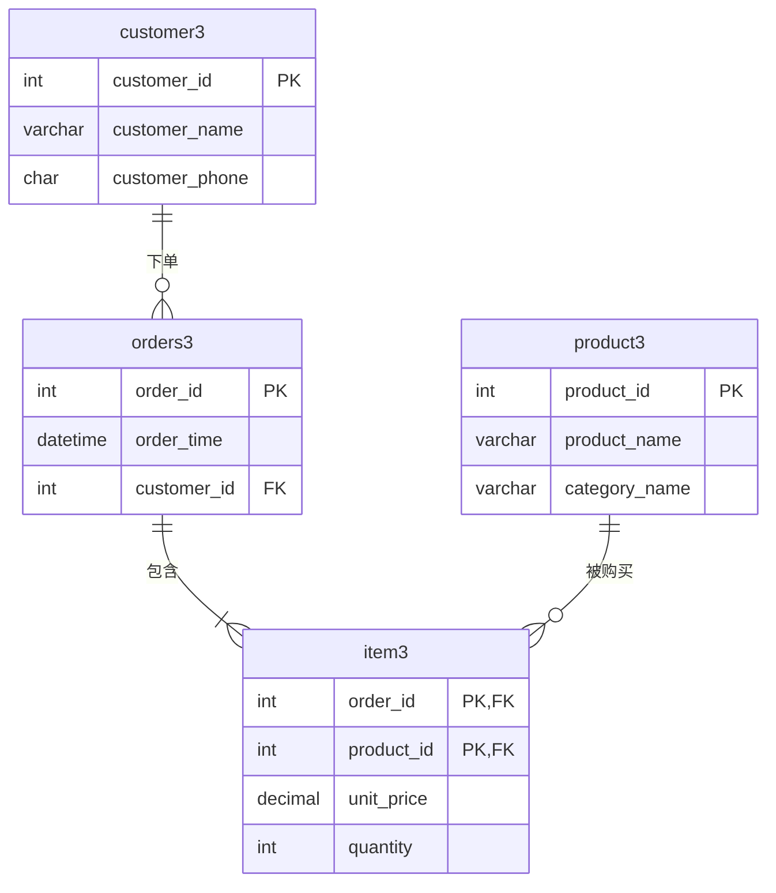
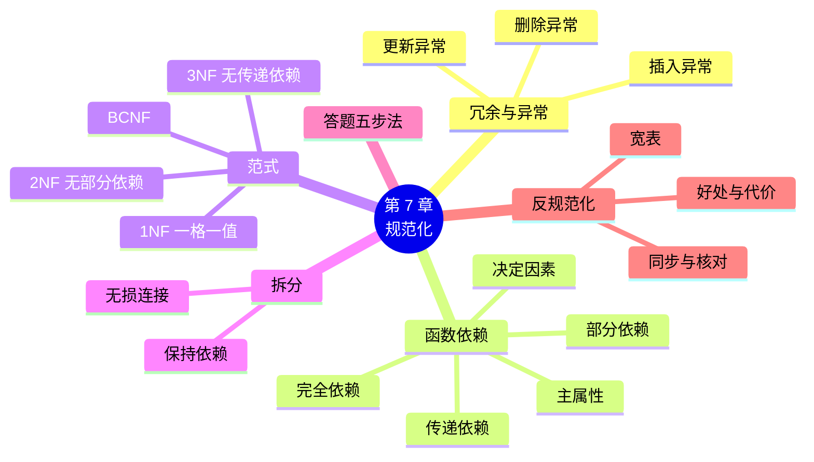

# 第 7 章 规范化与范式

!!! abstract "本章学时"
    理论 7 学时 · 实验 1 学时 · 线下研讨 2 学时（本章共 3 个实验，教师可任选）

## 学习目标

学完本章，你应该能够：

1. **说出**数据冗余会带来的三种异常，并能在一张表里举例指出（记忆、理解）；
2. **写出**一张表中的函数依赖，区分完全依赖、部分依赖和传递依赖（理解、应用）；
3. **判断**一张表属于第几范式，按步骤把它拆分到第三范式（分析、应用）；
4. **验证**拆分后的表能通过连接“拼回”原表，且异常消失（应用）；
5. **评价**一处反规范化设计是否值得，以及需要什么措施保证数据一致（评价）。

!!! info "先修要求"
    学习本章前，你需要：

    - 理解候选键、主键和外键（[2.3](../02-relational-model/index.md#23)）；
    - 会用多表连接把表拼起来（[5.2](../05-multi-table-query/index.md#52)）；
    - 了解 6.6 节列出的常见设计错误（[6.6](../06-er-design/index.md#66)）。

??? abstract "本章概念清单（9 个，点击查看定义和例子）"
    1. [数据冗余](../../appendix/glossary.md#g-数据冗余)
    2. [异常](../../appendix/glossary.md#g-异常)
    3. [函数依赖](../../appendix/glossary.md#g-函数依赖)
    4. [部分依赖](../../appendix/glossary.md#g-部分依赖)
    5. [传递依赖](../../appendix/glossary.md#g-传递依赖)
    6. [范式](../../appendix/glossary.md#g-范式)
    7. [规范化](../../appendix/glossary.md#g-规范化)
    8. [BC 范式](../../appendix/glossary.md#g-BC-范式)
    9. [反规范化](../../appendix/glossary.md#g-反规范化)

## 情景导入

小店刚开张时，小林在 Excel 里记账，一张表记下了所有东西：订单号、时间、顾客姓名、顾客电话、商品名、类别、单价、数量……一行一件商品。用了一个月，问题全冒出来了：

- 老顾客杨萱子换了手机号。小林在表里一查，她一个月里买了 38 件东西，电话**存了 38 遍**。他改了一行就去忙了，结果同一个人在表里有了两个电话，不知道哪个是对的；
- 一月份只有一个人买过“生抽 500ml”。那张订单退了，小林把那一行删掉，表里就**再也找不到**“生抽属于调味品”这条信息了；
- 店里新进了“酸梅汤”，还没人买过。小林想先把它登记进去，可是这张表每一行都要有订单号，**没有订单就放不进去**。

第 6 章用经验清单说过“一事多存”“该拆没拆”是错误。本章要讲清楚背后的道理：什么叫“依赖”，一张表到底该不该拆、怎么拆、拆到什么程度为止。这套理论叫**规范化**，判断的标准叫**范式**。它是数据库课程考试的必考内容。

## 7.1 数据冗余与三种异常

### 7.1.1 一张“什么都往里放”的大表

把示例库 shop 中 2025 年 1 月的订单连起来，就得到小林那张大表（实验 7-2 第 1 步）。叫它 order_wide，主键是（order_id, product_id），前 4 行：

```text
+----------+---------------------+-------------+---------------+----------------+------------+---------------------+---------------+------------+----------+
| order_id | order_time          | customer_id | customer_name | customer_phone | product_id | product_name        | category_name | unit_price | quantity |
+----------+---------------------+-------------+---------------+----------------+------------+---------------------+---------------+------------+----------+
|       46 | 2025-01-11 18:31:18 |          26 | 郑伟涛        | 10042599677    |         13 | 鲜肉包 6 个         | 早餐冲饮      |      15.00 |        3 |
|       46 | 2025-01-11 18:31:18 |          26 | 郑伟涛        | 10042599677    |         19 | 海苔 40g            | 休闲零食      |      16.80 |        1 |
|       46 | 2025-01-11 18:31:18 |          26 | 郑伟涛        | 10042599677    |         33 | 生菜 300g           | 生鲜果蔬      |       4.50 |        2 |
|       47 | 2025-01-11 07:52:05 |          77 | 高轩轩        | 10014833541    |         11 | 速溶咖啡 40 条      | 早餐冲饮      |      45.00 |        3 |
+----------+---------------------+-------------+---------------+----------------+------------+---------------------+---------------+------------+----------+
```

订单 46 买了 3 种商品，于是订单时间、顾客姓名、顾客电话都重复了 3 遍。同一条信息存了很多遍，叫[**数据冗余**](../../appendix/glossary.md#g-数据冗余 "同一条信息在数据库中被重复存储多次，会浪费空间并引起插入、删除、更新异常"){ .term }。一个月 174 行里，杨萱子的电话重复了 38 次。

### 7.1.2 三种异常

冗余不只是浪费空间，更麻烦的是会引起三种[**异常**](../../appendix/glossary.md#g-异常 "设计不好的表在插入、删除、修改数据时出现的问题，分为插入异常、删除异常和更新异常"){ .term }：<sup class="cite">[[1]](#ref7-1)</sup>

| 异常 | 意思 | 在大表里的例子 |
|---|---|---|
| **更新异常** | 同一信息存了多处，改的时候漏改一处，数据就前后矛盾 | 杨萱子换号，38 行只改了 1 行，表里出现两个电话 |
| **删除异常** | 删掉一些数据时，把不该删的其他信息也一起删了 | 删掉唯一一张买过生抽的订单，“生抽属于调味品”也没了 |
| **插入异常** | 想记录一条信息，却因为缺少别的信息而放不进去 | 新商品没人买过，没有订单号，主键不能为空，插不进去 |

实验 7-2 会亲手把这三种异常做出来。插入新商品时，MySQL 的报错是：

```text
ERROR 1048 (23000): Column 'order_id' cannot be null
```

这三种异常的根源是同一个：**一张表里放了好几件“事”**（订单的事、顾客的事、商品的事），它们挤在一起，就互相牵连。解决办法也只有一个：**拆**，一件事一张表。规范化就是告诉你按什么规则拆。

## 7.2 函数依赖

### 7.2.1 “知道了 A，就能确定 B”

在大表里，只要知道了 customer_id（比如 28），customer_name 就确定了（杨萱子），不可能一会儿是杨萱子、一会儿是别人。这种关系叫[**函数依赖**](../../appendix/glossary.md#g-函数依赖 "如果属性 A 的值确定了，属性 B 的值就唯一确定，称 B 函数依赖于 A，记作 A → B"){ .term }，记作：

```text
customer_id → customer_name
```

读作“customer_id **决定** customer_name”或“customer_name **依赖于** customer_id”。箭头左边的叫**决定因素**。

大表中的函数依赖（按业务规则写出来）：

| 函数依赖 | 业务含义 |
|---|---|
| order_id → order_time, customer_id | 一张订单只有一个下单时间、一位顾客 |
| customer_id → customer_name, customer_phone | 一位顾客只有一个姓名、一个电话 |
| product_id → product_name, category_name | 一种商品只有一个名称、属于一个类别 |
| (order_id, product_id) → unit_price, quantity | 某张订单里的某种商品，成交价和数量是确定的 |

几点说明：

1. **函数依赖是业务规则，不是数据碰巧的样子。** 示例数据里没有重名的顾客，于是 customer_name → customer_id 在数据里也“成立”，但现实中会有重名，所以它不是函数依赖。实验 7-1 里的 SQL 只能检查数据“有没有违反”某个依赖，不能证明依赖成立；
2. 反过来不一定成立：order_id → customer_id，但 customer_id 不能决定 order_id（一位顾客有很多订单）；
3. 依赖可以“接力”：order_id → customer_id，customer_id → customer_phone，所以 order_id 也能确定 customer_phone。

### 7.2.2 完全依赖、部分依赖、传递依赖

当决定因素是**几个属性的组合**时，要分清楚：

- **完全依赖**：B 依赖于整个组合，少一个都不行。quantity 依赖于 (order_id, product_id)：只知道订单号不知道买了几件哪种商品，只知道商品号也不行；
- [**部分依赖**](../../appendix/glossary.md#g-部分依赖 "非主属性只依赖于复合码中的一部分属性，而不需要整个码就能确定，是不满足第二范式的原因"){ .term }：B 只依赖于组合中的**一部分**。product_name 只要知道 product_id 就确定了，用不着 order_id。所以 product_name 部分依赖于码 (order_id, product_id)；
- [**传递依赖**](../../appendix/glossary.md#g-传递依赖 "A → B、B → C，且 B 不能决定 A，则 C 通过 B 间接依赖于 A，是不满足第三范式的原因"){ .term }：A → B，B → C（且 B 不能决定 A），那么 C 是“通过 B 间接”依赖于 A 的。比如在订单表里，order_id → customer_id，customer_id → customer_phone，所以 customer_phone 传递依赖于 order_id。

再记住两个名词：

- **主属性**：包含在某个候选码里的属性。大表的码是 (order_id, product_id)，所以 order_id、product_id 是主属性；
- **非主属性**：不在任何候选码里的属性，如 customer_name、unit_price。

范式的判断，就是看**非主属性**对码是怎样依赖的。

## 7.3 第一、第二、第三范式

[**范式**](../../appendix/glossary.md#g-范式 "关系模式满足的规范化程度的级别，常用的有第一、第二、第三范式和 BC 范式，级别越高冗余越少"){ .term }（Normal Form，NF）是“表设计得规不规范”的等级。级别越高，冗余越少。高一级的范式一定满足低一级的所有要求。把低级范式的表拆成高级范式的过程，叫[**规范化**](../../appendix/glossary.md#g-规范化 "通过拆分关系模式消除不合适的函数依赖、减少冗余、使其达到更高范式的过程"){ .term }。第一、第二、第三范式由关系模型的提出者科德（E. F. Codd）在 1971—1972 年提出。<sup class="cite">[[3]](#ref7-3)</sup>

<iframe class="sim-frame" src="../../sims/normal-forms/main.html" height="640" loading="lazy" title="从大表到第三范式"></iframe>
动画：从大表到第三范式。点“下一步”，看订单大表怎样一步步拆开：先找出部分依赖拆到第二范式，再找出传递依赖拆到第三范式，每一步都标出依赖的箭头和被消除的冗余。[全屏打开](../../sims/normal-forms/main.html){ target=_blank }
{ .sim-caption }

### 7.3.1 第一范式（1NF）：一格一值

**定义：** 表中每一格都只存一个不可再分的值。

**口诀：一格一值，没有重复的列组。**

不满足第一范式的例子：

| order_id | customer | 商品 |
|---|---|---|
| 46 | 郑伟涛 | 鲜肉包×3，海苔×1，生菜×2 |

“商品”一格放了三样东西，还混着数量。另一种常见的违反是“重复的列组”：商品1、数量1、商品2、数量2……（第 6 章 6.6 节的错误 ③）。

**拆法：** 一格的多个值拆成多行（或拆出一张表）。拆完就是 order_wide 那样，每件商品一行。在关系数据库里，**所有的表都至少是第一范式**，否则就不能叫关系（第 2 章 2.2 节）。

### 7.3.2 第二范式（2NF）：不能只依赖码的一部分

**定义：** 满足 1NF，并且每个非主属性都**完全依赖**于码（没有部分依赖）。

**口诀：码是一个属性的表，满足 1NF 就自动满足 2NF；码是几个属性的组合时，检查有没有非主属性只靠其中一部分就能确定。**

order_wide 的码是 (order_id, product_id)。检查非主属性：

| 非主属性 | 依赖于 | 是否部分依赖 |
|---|---|---|
| order_time、customer_id、customer_name、customer_phone | 只要 order_id | 是 |
| product_name、category_name | 只要 product_id | 是 |
| unit_price、quantity | 要 (order_id, product_id) 整个 | 否 |

有部分依赖，所以 order_wide **只是 1NF，不是 2NF**。

**拆法：把部分依赖的属性和它们的决定因素拿出去单独成表。**

- 订单：orders2(**order_id**, order_time, customer_id, customer_name, customer_phone)
- 商品：product2(**product_id**, product_name, category_name)
- 明细：item(**order_id, product_id**, unit_price, quantity)

三张表的码都满足“完全依赖”，都是 2NF。商品信息只存一次，删除异常和插入异常中“商品”那部分解决了：没人买过的新商品可以直接放进 product2。

### 7.3.3 第三范式（3NF）：非主属性之间不能有依赖

**定义：** 满足 2NF，并且每个非主属性都**不传递依赖**于码。

**口诀：非主属性只能直接依赖于码，不能依赖于别的非主属性。** 或者说：“只看码，不看别人。”

检查 orders2(**order_id**, order_time, customer_id, customer_name, customer_phone)：

- order_id → customer_id，customer_id → customer_name、customer_phone；
- customer_name、customer_phone 依赖于另一个非主属性 customer_id，是**传递依赖**。

所以 orders2 是 2NF 但不是 3NF：一位顾客下 10 单，姓名和电话还是要存 10 遍，杨萱子换号的更新异常还在。

**拆法：把传递依赖的属性和中间那个决定因素拿出去单独成表，原表只留决定因素作外键。**

- 顾客：customer3(**customer_id**, customer_name, customer_phone)
- 订单：orders3(**order_id**, order_time, customer_id)，customer_id 是外键

再检查 product2(**product_id**, product_name, category_name)：类别名直接依赖于 product_id，没有传递依赖，是 3NF。（严格来说类别还应有自己的编号和表，像 shop 库那样，这是为了让类别本身也能有其他信息，比如“类别负责人”。）

最终的第三范式设计是 4 张表：



和小店 shop 库的结构是一样的。这说明 shop 库本来就是按第三范式设计的。

### 7.3.4 拆分要“拆得开、拼得回”

拆表不能乱拆，必须保证两点：<sup class="cite">[[1]](#ref7-1)</sup>

1. **无损连接**：拆开的表通过连接能**完整、准确地拼回原表**，不多一行也不少一行。做到这一点的关键是：拆出去的表要带走决定因素，并且原表保留它作外键。实验 7-2 里，4 张表连接后正好是 174 行，和大表逐行比对，不一致的行数为 0；
2. **保持函数依赖**：原来的每个函数依赖，拆完后在某一张表里还能找到，这样约束还能在单张表上检查。

如果把大表拆成 (order_id, customer_name) 和 (customer_name, customer_phone)，用姓名做连接，遇到重名的顾客就会拼出不存在的组合，这就是“有损”的拆法。

## 7.4 BC 范式

第三范式只管**非主属性**。如果**主属性**依赖于别的属性，3NF 也可能还有冗余。为此博伊斯（R. F. Boyce）和科德提出了更严格的 [**BC 范式**](../../appendix/glossary.md#g-BC-范式 "每一个函数依赖的决定因素都包含候选码的关系模式，是比第三范式更严格的范式，简称 BCNF"){ .term }（BCNF）。

**定义：** 每一个函数依赖 A → B（B 不包含在 A 中），A 都必须包含候选码。

**口诀：凡是能“决定”别人的，都必须是码（或包含码）。**

经典例子：学校规定，一门课可以有几位老师上，**每位老师只上一门课**；学生选一门课，就跟定其中一位老师。

选课表 sct(学生, 课程, 教师)：

- (学生, 课程) → 教师：一个学生的一门课由一位老师上；
- 教师 → 课程：一位老师只上一门课。

候选码是 (学生, 课程)，也可以是 (学生, 教师)。三个属性都在候选码里，都是主属性，**没有非主属性**，所以不存在部分依赖和传递依赖，sct 是 3NF。

但是“教师 → 课程”的决定因素“教师”不包含候选码，所以**不是 BCNF**。冗余在哪里？每位老师上什么课，在每个学生的每一行里都重复了；一位老师还没有学生选，就记不下他上什么课（插入异常）。拆成 teacher_course(**教师**, 课程) 和 student_teacher(**学生, 教师**) 就是 BCNF。

本书对 BCNF 只要求会判断：**找出所有函数依赖，看每个依赖的左边是不是码。** 实际工作中，设计到 3NF 一般就够了，绝大多数 3NF 的表同时也是 BCNF。

| 范式 | 要求 | 口诀 | 违反时怎么拆 |
|---|---|---|---|
| 1NF | 每格一个不可再分的值 | 一格一值 | 多值拆成多行或单独的表 |
| 2NF | 1NF + 非主属性没有部分依赖 | 不能只靠码的一部分 | 部分依赖的属性连同决定因素拿出去 |
| 3NF | 2NF + 非主属性没有传递依赖 | 只看码，不看别人 | 传递依赖的属性连同中间的决定因素拿出去 |
| BCNF | 每个决定因素都包含候选码 | 能决定别人的都是码 | 违反的依赖单独成表 |

## 7.5 范式判断题的答题步骤

闭卷考试中，“给出一个关系模式和函数依赖，判断它属于第几范式，并分解到 3NF”是高频题型。按下面五步答题，不容易丢分：

1. **写出函数依赖**（题目没给时，按业务常识写）；
2. **找候选码**：哪个（或哪几个）属性能决定其他所有属性？技巧：只出现在箭头左边、从不出现在右边的属性，一定在码里；
3. **分出主属性和非主属性**；
4. **从 1NF 开始逐级判断**：
    - 有没有一格多值？→ 1NF；
    - 码是组合的吗？有非主属性只依赖码的一部分吗？→ 2NF；
    - 有非主属性依赖于另一个非主属性吗？→ 3NF；
    - 每个依赖的左边都是码吗？→ BCNF；
5. **分解**：先消除部分依赖，再消除传递依赖，每拆一次写出新表的码和外键。

**例题：** 学生选课关系 R(学号, 姓名, 系名, 系主任, 课程号, 成绩)，函数依赖：学号 → 姓名、系名；系名 → 系主任；(学号, 课程号) → 成绩。判断 R 最高属于第几范式，并分解到 3NF。

**解：**

1. 函数依赖已给出；
2. 候选码：学号、课程号只在左边出现，(学号, 课程号) 能决定所有属性，是候选码；
3. 主属性：学号、课程号；非主属性：姓名、系名、系主任、成绩；
4. 判断：
    - 每格一个值，满足 1NF；
    - 姓名、系名只依赖于学号（码的一部分），系主任通过系名也只依赖于学号，存在部分依赖，不满足 2NF；
    - 所以 R **最高属于 1NF**；
5. 分解：
    - 消除部分依赖：S(**学号**, 姓名, 系名, 系主任)，SC(**学号, 课程号**, 成绩)。此时都是 2NF；
    - S 中 学号 → 系名，系名 → 系主任，存在传递依赖，继续拆：S1(**学号**, 姓名, 系名)，D(**系名**, 系主任)；
    - 结果：S1(**学号**, 姓名, *系名*)，D(**系名**, 系主任)，SC(***学号*, 课程号**, 成绩)，都满足 3NF（也都满足 BCNF）。

## 7.6 反规范化：故意保留一些冗余

规范化减少了冗余，代价是查询时要连接更多的表。连接多了，查询会变慢，SQL 也更难写。所以在实际工作中，有时会**故意**违反范式，保留一些冗余来换取查询速度，叫[**反规范化**](../../appendix/glossary.md#g-反规范化 "为了提高查询速度或简化查询，有意保留冗余数据、降低范式级别的设计做法，需要额外措施保证数据一致"){ .term }。

小店里常见的几种：

| 做法 | 冗余在哪 | 好处 | 要付出的代价 |
|---|---|---|---|
| 会员表存“当前积分” points | 它等于积分流水的合计 | 查余额不用每次求和 | 每次加减积分，两处都要改 |
| 订单表存“订单总金额” | 它等于明细的数量 × 单价之和 | 统计营业额不用连接明细 | 改明细时要同步改总金额 |
| 每天晚上生成一张“日销售汇总表” | 都能从订单和明细算出来 | 老板看报表秒开 | 汇总表有延迟，当天的数据要等晚上 |

实验 7-3 演示了代价：给订单表加了 total_amount 以后，有人把订单 2499 的火锅底料从 2 包改成 1 包，却忘了改总金额：

```text
+----------+-----------------+-----------------+
| order_id | 存的总金额      | 明细算出的      |
+----------+-----------------+-----------------+
|     2499 |          152.60 |          132.70 |
+----------+-----------------+-----------------+
```

这就是更新异常。所以反规范化要遵守三条原则：

1. **先规范化，再按需要反规范化**：先设计到 3NF，确实遇到了性能问题，再有针对性地加冗余；
2. **要有同步措施**：用事务、触发器（第 9 章）或程序保证冗余的数据跟着改；
3. **定期核对**：像实验 7-3 第 4 步那样，写一条 SQL 定期检查两边是否一致。

!!! note "下单时的单价不是反规范化"
    订单明细里的 unit_price 看起来和商品表的 price 重复，其实是两个不同的数据项（第 6 章 6.6 节）：price 现在可以改，unit_price 是当时成交的价格，不能改。它们之间没有函数依赖 product_id → unit_price：同一种商品，调价前后的订单单价不同。示例数据里没有调过价，所以实验 7-1 检查出这个“依赖”在数据中没有被违反，但它不是业务规则。

## 7.7 前沿视窗：大数据时代的“宽表”

在数据分析领域，反规范化反而很常见。原因是分析的需求和日常业务不同：

- **业务系统**（收银、下单）：经常增删改，每次只动几行，最怕异常，所以要规范化；
- **分析系统**（报表、数据仓库）：数据导进去以后基本不改，但每次查询要扫描几百万行、按各种维度分组。连接越少越快。

所以数据仓库常用**星型模型**：中间一张很大的“事实表”（每笔销售一行，记数量、金额），周围几张“维度表”（日期、商品、顾客、门店），维度表故意不拆细，比如把类别名直接放在商品维度表里。<sup class="cite">[[6]](#ref7-6)</sup> 更进一步，很多公司干脆把常用的连接结果存成一张几十上百列的“大宽表”，供分析师直接查询，这和本章开头那张 order_wide 几乎一样，只是它不会再被修改，所以没有更新异常的问题。

文档型数据库（如 MongoDB）也常把订单明细直接“嵌”在订单文档里，一次读取就拿到全部信息。

**范式不是越高越好，也不是越低越好，要看数据是“常改”还是“常查”。** 学会了规范化，才知道反规范化时放弃了什么、要补上什么。

## 本章实验

!!! abstract "实验总览"
    | 实验 | 类型 | 建议时长 | 内容 |
    |---|---|---|---|
    | 实验 7-1 | ★ 基础 | 30 分钟 | 判断五张表各属于第几范式；用 SQL 检查函数依赖在数据中是否被违反 |
    | 实验 7-2 | ★ 基础 | 45 分钟 | 把订单大表拆到第三范式，验证三种异常消失、拆分无损 |
    | 实验 7-3 | ☆ 拓展 | 线下研讨 | 给订单表加“总金额”列，讨论小店哪些地方适合反规范化 |

    SQL 脚本见配套资源 `labs/ch07/` 目录。建议先做实验 7-2 的第 1 步（建好大表），再做实验 7-1 的上机部分。

### 实验 7-1 ★ 判断范式

**实验目的**

1. 熟练使用 7.5 节的五步法判断范式；
2. 学会用 SQL 检查一个函数依赖在数据中有没有被违反，并理解“数据没有违反”不等于“依赖成立”。

**实验环境**：纸笔；本机 MySQL 8.4 + DBeaver。**实验数据**：实验 7-2 第 1 步建立的 `normdemo.order_wide`（由示例库 shop 生成，内容为虚构）。

**实验步骤与代码**

**第一部分：纸笔判断（20 分钟）。** 判断下面五张表最高属于第几范式，写出理由。粗体为主键。

| 编号 | 关系模式 | 函数依赖 |
|---|---|---|
| ① | product(**product_id**, name, category_id, price) | product_id → name, category_id, price |
| ② | stock_check(**product_id, check_date**, product_name, counted_qty) | (product_id, check_date) → counted_qty；product_id → product_name |
| ③ | employee(**employee_id**, name, position, base_salary) | employee_id → name, position；position → base_salary（同一职位底薪相同） |
| ④ | customer(**customer_id**, name, phones) | phones 列存“10011112222,10033334444” |
| ⑤ | sct(**学生, 课程**, 教师) | (学生, 课程) → 教师；教师 → 课程 |

**第二部分：用 SQL 检查函数依赖（10 分钟）。** 检查 A → B 是否被数据违反的方法：按 A 分组，看有没有哪一组里 B 出现两个以上不同的值。运行 `labs/ch07/lab7_1_check_fd.sql`，其中一条：

```sql
-- 1. customer_id → customer_name：一个顾客编号只对应一个姓名吗？
SELECT 'customer_id → customer_name' AS 依赖, COUNT(*) AS 违反的组数
FROM (SELECT customer_id FROM order_wide
      GROUP BY customer_id HAVING COUNT(DISTINCT customer_name) > 1) t;
```

**运行结果**

编者在 MySQL 8.4.13 上运行整个脚本的结果：

```text
+--------------------------------+-----------------+
| 依赖                           | 违反的组数      |
+--------------------------------+-----------------+
| customer_id → customer_name    |               0 |
| product_id → category_name     |               0 |
| order_id → customer_id         |               0 |
| order_id → product_id          |              49 |
| category_name → product_name   |               8 |
| product_id → unit_price        |               0 |
+--------------------------------+-----------------+
```

“order_id → product_id”有 49 组违反：49 张订单买了不止一种商品，所以订单号不能决定商品号。“product_id → unit_price”在数据里没有被违反，但正如 7.6 节所说，它不是业务规则，商品调价后就会出现违反。

**实验记录表**

| 表 | 最高范式 | 理由（指出哪个依赖造成的） |
|---|---|---|
| ① | | |
| ② | | |
| ③ | | |
| ④ | | |
| ⑤ | | |

参考答案：① 3NF（也是 BCNF），单属性码，非主属性都直接依赖于码；② 1NF，product_name 部分依赖于码；③ 2NF，base_salary 通过 position 传递依赖于码；④ 不满足 1NF，phones 一格多值；⑤ 3NF 但不是 BCNF，决定因素“教师”不是码。

**常见问题排查**

| 现象 | 原因 | 解决办法 |
|---|---|---|
| `Table 'normdemo.order_wide' doesn't exist` | 没先建大表 | 先运行实验 7-2 脚本的第 1 步 |
| 把 ② 判成 2NF | 没注意码是组合的 | 码由几个属性组成时，一定要检查部分依赖 |
| 把 ⑤ 判成 2NF | 以为“教师 → 课程”是传递依赖 | 课程是主属性，3NF 只管非主属性；它违反的是 BCNF |

**思考与练习**

1. 用第二部分的方法检查 `customer_name → customer_id`，结果是多少？能据此说“姓名决定顾客编号”吗？
2. 把 ②、③ 分解到 3NF，写出分解后的关系模式。

**实验报告要求**

提交实验记录表、两道思考题的答案和 SQL 运行截图。

### 实验 7-2 ★ 把订单大表拆到第三范式

**实验目的**

1. 亲手做出更新、删除、插入三种异常；
2. 按 7.3 节的方法拆到第三范式，验证拆分无损、异常消失。

**实验环境**：本机 MySQL 8.4 + DBeaver。**实验数据**：脚本从示例库 shop 中取 2025 年 1 月的订单，在新建的 `normdemo` 库中造出大表。

**实验步骤与代码**

打开 `labs/ch07/lab7_2_decompose.sql`，**一步一步**执行（每步看完结果再执行下一步）。主要语句：

```sql
-- 第 1 步：用示例库 shop 的数据，造一张“什么都往里放”的大宽表（2025 年 1 月的订单）
CREATE TABLE order_wide AS
SELECT o.order_id, o.order_time, o.customer_id, c.name AS customer_name, c.phone AS customer_phone,
       oi.product_id, p.name AS product_name, cat.name AS category_name, oi.unit_price, oi.quantity
FROM shop.orders o
JOIN shop.customer c    ON c.customer_id = o.customer_id
JOIN shop.order_item oi ON oi.order_id = o.order_id
JOIN shop.product p     ON p.product_id = oi.product_id
JOIN shop.category cat  ON cat.category_id = p.category_id
WHERE o.order_time < '2025-02-01';
ALTER TABLE order_wide ADD PRIMARY KEY (order_id, product_id);

-- 第 3 步：更新异常：只改了顾客 28 的一行电话
UPDATE order_wide SET customer_phone = '10099999999'
WHERE customer_id = 28 AND order_id = (SELECT MIN(order_id) FROM (SELECT order_id FROM order_wide WHERE customer_id = 28) t);
SELECT DISTINCT customer_phone FROM order_wide WHERE customer_id = 28;

-- 第 4 步：删除异常：只有一张订单买过的商品
SELECT product_id, product_name, COUNT(*) AS 出现次数
FROM order_wide GROUP BY product_id, product_name HAVING COUNT(*) = 1 ORDER BY product_id;

-- 第 5 步：插入异常：新商品没有订单号，放不进去（这一句会报错，是预期的）
INSERT INTO order_wide (order_id, product_id, product_name, category_name) VALUES (NULL, 99, '新品酸梅汤', '饮料');

-- 第 6 步：拆成第三范式的 4 张表（先把第 3 步改乱的电话改回来）
UPDATE order_wide w JOIN shop.customer c ON c.customer_id = w.customer_id SET w.customer_phone = c.phone;
CREATE TABLE customer3 AS SELECT DISTINCT customer_id, customer_name, customer_phone FROM order_wide;
CREATE TABLE product3  AS SELECT DISTINCT product_id, product_name, category_name FROM order_wide;
CREATE TABLE orders3   AS SELECT DISTINCT order_id, order_time, customer_id FROM order_wide;
CREATE TABLE item3     AS SELECT order_id, product_id, unit_price, quantity FROM order_wide;
-- ……加主键，统计行数

-- 第 7 步：验证“拆了能拼回去”
SELECT COUNT(*) AS 拼回去的行数
FROM item3 i
JOIN orders3 o    ON o.order_id = i.order_id
JOIN customer3 c  ON c.customer_id = o.customer_id
JOIN product3 p   ON p.product_id = i.product_id;

-- 第 8 步：拆分以后，换手机号只改一行
UPDATE customer3 SET customer_phone = '10099999999' WHERE customer_id = 28;
```

`CREATE TABLE … AS SELECT …` 的意思是“用查询结果建一张新表”，第 3 章 3.5.2 节讲过。`SELECT DISTINCT` 去掉了重复的行，正好把冗余去掉。

**运行结果**

编者在 MySQL 8.4.13 上的运行结果（节选）：

```text
第 1 步：大宽表行数 174
第 2 步：电话重复次数最多的顾客
+-------------+---------------+--------------------+
| customer_id | customer_name | 电话重复次数       |
+-------------+---------------+--------------------+
|          28 | 杨萱子        |                 38 |
|          26 | 郑伟涛        |                 27 |
|          77 | 高轩轩        |                 24 |
+-------------+---------------+--------------------+
第 3 步：顾客 28 现在有两个电话
+----------------+
| customer_phone |
+----------------+
| 10099999999    |
| 10025373924    |
+----------------+
第 4 步：只出现过一次的商品（删掉那张订单，商品信息就没了）
+------------+----------------------+--------------+
| product_id | product_name         | 出现次数     |
+------------+----------------------+--------------+
|         16 | 苏打饼干 400g        |            1 |
|         18 | 话梅 150g            |            1 |
|         23 | 橙汁 1L              |            1 |
|         24 | 凉茶 310ml×12        |            1 |
|         36 | 生抽 500ml           |            1 |
|         42 | 抽纸 3 层×10 包      |            1 |
|         48 | 保鲜膜 30m           |            1 |
+------------+----------------------+--------------+
第 5 步
ERROR 1048 (23000): Column 'order_id' cannot be null
第 6 步：拆分后各表行数
+-----------+--------+
| 表        | 行数   |
+-----------+--------+
| customer3 |     13 |
| product3  |     45 |
| orders3   |     82 |
| item3     |    174 |
+-----------+--------+
第 7 步：拼回去的行数 174，与大表逐行比对不一致的行数 0
```

大表 174 行 × 10 列 = 1740 格；拆分后 13×3 + 45×3 + 82×3 + 174×4 = 1116 格，少了三分之一以上，而且每位顾客的电话只存一次。

**实验记录表**

| 异常 | 大表中的表现 | 拆分后还会出现吗？为什么？ |
|---|---|---|
| 更新异常 | | |
| 删除异常 | | |
| 插入异常 | | |

**常见问题排查**

| 现象 | 原因 | 解决办法 |
|---|---|---|
| 整个脚本一次运行，到第 5 步就停了 | 第 5 步的报错是故意的，DBeaver 执行脚本遇错会停 | 逐条执行，或在 DBeaver 的报错对话框中选“跳过” |
| 第 3 步报 `You can't specify target table … for update in FROM clause` | 在 UPDATE 的子查询里直接查同一张表 | 照脚本多套一层子查询 `(SELECT … ) t` |
| customer3 加主键时报 1062 重复 | 第 3 步改乱的电话没改回来，同一顾客出现两行 | 先执行第 6 步开头的 UPDATE 再建表 |

**思考与练习**

1. 第 6 步如果不先把电话改回来，customer3 会有几行？加主键会怎样？这说明了什么？
2. product3 里的 category_name 符合 3NF 吗？如果还要记“类别负责人”，应该怎样再拆？

**实验报告要求**

截图第 3、4、5、7 步的结果，完成实验记录表，回答思考题。

### 实验 7-3 ☆ 讨论：小店哪里适合反规范化

**实验目的**

1. 体会反规范化“查询方便”的好处和“容易不一致”的代价；
2. 学会写核对一致性的 SQL，讨论同步措施。

**实验环境**：本机 MySQL 8.4 + DBeaver，建议线下研讨课分组讨论。**实验数据**：脚本把示例库 shop 的订单和明细复制到 `normdemo` 库中。

**实验步骤与代码**

1. 运行 `labs/ch07/lab7_3_denormalize.sql`：

```sql
-- 2. 反规范化：加一列 total_amount，把算好的结果存起来
ALTER TABLE orders_t ADD COLUMN total_amount DECIMAL(10,2);
UPDATE orders_t o
JOIN (SELECT order_id, SUM(quantity * unit_price) AS amt FROM item_t GROUP BY order_id) s
  ON s.order_id = o.order_id
SET o.total_amount = s.amt;
SELECT order_id, total_amount FROM orders_t WHERE order_id = 2499;   -- 查询不用连接了

-- 3. 代价：顾客退了一包火锅底料，有人改了明细，却忘了改总金额
UPDATE item_t SET quantity = quantity - 1 WHERE order_id = 2499 AND product_id = 41;

-- 4. 两边对不上了：找出存的总金额和明细算出来的不一致的订单
SELECT o.order_id, o.total_amount AS 存的总金额, SUM(i.quantity * i.unit_price) AS 明细算出的
FROM orders_t o JOIN item_t i ON i.order_id = o.order_id
GROUP BY o.order_id, o.total_amount
HAVING o.total_amount <> SUM(i.quantity * i.unit_price);
```

2. 分组讨论下面的问题，每组写一页结论。

**运行结果**

编者在 MySQL 8.4.13 上的运行结果：

```text
1. 从明细算：订单 2499 总金额 152.60
2. 存起来以后直接查：total_amount = 152.60
4. 改了明细以后
+----------+-----------------+-----------------+
| order_id | 存的总金额      | 明细算出的      |
+----------+-----------------+-----------------+
|     2499 |          152.60 |          132.70 |
+----------+-----------------+-----------------+
```

**讨论记录表**

| 候选的冗余设计 | 能带来什么好处 | 要怎样保证一致 | 你们的结论（值得 / 不值得） |
|---|---|---|---|
| 订单表存总金额 | | | |
| 会员表存当前积分（积分流水已有） | | | |
| 商品表存“累计销量” | | | |
| 订单明细存商品名（防止商品改名后看不出当时买的是什么） | | | |
| 每晚生成“日销售汇总表” | | | |

**思考与练习**

1. 小店每天只有一百多单。在这个规模下，订单表存总金额带来的速度提升明显吗？什么规模下才值得？
2. 第 9 章会学触发器。设想一个触发器：每当 item_t 的数量改变，就自动重算 orders_t 的 total_amount。它解决了什么问题？还有什么情况它管不到？

**实验报告要求**

每组提交讨论记录表和一页结论。

## 本章小结

- 一张表放了好几件“事”，会产生**数据冗余**，进而引起**更新异常、删除异常、插入异常**。解决办法是拆表，一件事一张表。
- **函数依赖** A → B：知道了 A 就能唯一确定 B，它是业务规则，不是数据碰巧的样子。码是组合时分**完全依赖**和**部分依赖**；A → B、B → C 时，C **传递依赖**于 A。
- **1NF**：一格一值。**2NF**：非主属性没有部分依赖（单属性码的 1NF 表自动是 2NF）。**3NF**：非主属性没有传递依赖，“只看码，不看别人”。**BCNF**：每个决定因素都包含候选码。
- 拆分要**无损连接**（拼得回）、**保持函数依赖**：拆出去的表带走决定因素，原表保留它作外键。
- 范式题五步法：写依赖、找码、分主属性、逐级判断、分解。
- **反规范化**为了查询快故意保留冗余，要先规范化再按需反规范化，并用事务、触发器或程序保证一致、定期核对。业务系统重规范化，分析系统常用宽表。



**下一章预告**

到这里，表设计好了，数据也会查了。可是示例库只有几千行，真实系统动辄几百万行，查询还能这么快吗？第 8 章学习视图和索引：视图让复杂的查询变成一张“虚拟表”，索引让查询从“翻遍整本书”变成“查目录”。

## 参考文献

正文中的上标编号（如<sup class="cite">[[1]](#ref7-1)</sup>）对应下面的文献。带链接的可以直接打开；书籍可在图书馆或电子书平台查阅。

<div class="refs" markdown>

**教材与专著**

- <span id="ref7-1"></span>[1] 王珊，杜小勇，陈红. 数据库系统概论[M]. 6 版. 北京：高等教育出版社，2023.
    <span class="ref-note">第 6 章“关系数据理论”讲函数依赖、范式和模式分解，本章的定义与之一致。</span>
- <span id="ref7-2"></span>[2] HERNANDEZ M J. Database Design for Mere Mortals: 25th Anniversary Edition[M]. 4th ed. Boston: Addison-Wesley, 2020.
    <span class="ref-note">不用数学符号讲规范化的入门书，适合配合本章阅读。</span>
- <span id="ref7-6"></span>[6] KIMBALL R, ROSS M. The Data Warehouse Toolkit: The Definitive Guide to Dimensional Modeling[M]. 3rd ed. Indianapolis: Wiley, 2013.
    <span class="ref-note">数据仓库维度建模的经典著作，讲事实表、维度表和星型模型，对应 7.7 节。</span>

**经典论文**

- <span id="ref7-3"></span>[3] CODD E F. Further normalization of the data base relational model[M]//RUSTIN R. Data Base Systems. Englewood Cliffs: Prentice-Hall, 1972: 33-64.
    <span class="ref-note">提出第二、第三范式的原始文献，对应 7.3 节。</span>
- <span id="ref7-4"></span>[4] KENT W. A simple guide to five normal forms in relational database theory[J]. Communications of the ACM, 1983, 26(2): 120-125.
    <span class="ref-note">用通俗例子讲解各级范式的短文，著名的说法“依赖于码、整个码，只依赖于码”即出自此文的思路。</span>

**在线资源与数据**

- <span id="ref7-5"></span>[5] Oracle. MySQL 8.4 Reference Manual: CREATE TABLE … SELECT Statement[EB/OL]. [2026-11-01]. https://dev.mysql.com/doc/refman/8.4/en/create-table-select.html.
    <span class="ref-note">用查询结果建表的语法，实验 7-2、7-3 用它造大表和拆表。</span>

</div>

## 课后练习

选择题和判断题可以直接点击选项作答，系统会马上告诉你对错，并展开答案与解析；多选题选好后点“提交答案”。简答和实操题请先自己作答，再点开“答案与解析”核对。每道题的解析下方都有“回看”链接，做错了可以直接跳回正文复习。

**一、单项选择题**

<div class="quiz" data-answer="C" markdown>

**1.** 删除一张订单时，把“某商品属于哪个类别”的信息也一起删掉了，这属于（　　）。

- A. 插入异常
- B. 更新异常
- C. 删除异常
- D. 数据独立性

</div>

??? tip "答案与解析"
    **答案：C**

    考查：三种异常 · 认知层次：理解 · [回看 7.1.2](#712)
    { .quiz-meta }

<div class="quiz" data-answer="A" markdown>

**2.** “知道了学号，就能唯一确定姓名”，记作（　　）。

- A. 学号 → 姓名
- B. 姓名 → 学号
- C. 学号 ← → 姓名
- D. (学号, 姓名) → 学号

</div>

??? tip "答案与解析"
    **答案：A**

    解析：箭头从决定因素指向被决定的属性。

    考查：函数依赖 · 认知层次：记忆 · [回看 7.2.1](#721-a-b)
    { .quiz-meta }

<div class="quiz" data-answer="B" markdown>

**3.** 关系 R(**A, B**, C, D) 中，A → C，(A, B) → D，则 C 对码（　　）。

- A. 完全依赖
- B. 部分依赖
- C. 传递依赖
- D. 没有依赖

</div>

??? tip "答案与解析"
    **答案：B**

    解析：C 只依赖于码 (A, B) 的一部分 A。

    考查：部分依赖 · 认知层次：应用 · [回看 7.2.2](#722)
    { .quiz-meta }

<div class="quiz" data-answer="D" markdown>

**4.** 码只有一个属性、并且满足第一范式的表，一定满足（　　）。

- A. 第三范式
- B. BC 范式
- C. 都不满足
- D. 第二范式

</div>

??? tip "答案与解析"
    **答案：D**

    解析：码只有一个属性时不可能有部分依赖，自动满足 2NF；但可能有传递依赖，不一定满足 3NF。

    考查：第二范式 · 认知层次：理解 · [回看 7.3.2](#732-2nf)
    { .quiz-meta }

<div class="quiz" data-answer="C" markdown>

**5.** 员工表 E(**工号**, 姓名, 部门号, 部门名称)，工号 → 部门号，部门号 → 部门名称。E 最高属于（　　）。

- A. 1NF
- B. 3NF
- C. 2NF
- D. BCNF

</div>

??? tip "答案与解析"
    **答案：C**

    解析：单属性码，满足 2NF；部门名称通过部门号传递依赖于工号，不满足 3NF。

    考查：第三范式 · 认知层次：分析 · [回看 7.3.3](#733-3nf)
    { .quiz-meta }

<div class="quiz" data-answer="A" markdown>

**6.** 第 5 题中的 E 要分解到 3NF，正确的是（　　）。

- A. E1(**工号**, 姓名, 部门号)，E2(**部门号**, 部门名称)
- B. E1(**工号**, 姓名)，E2(**部门号**, 部门名称)
- C. E1(**工号**, 姓名, 部门名称)，E2(**部门号**, 部门名称)
- D. E1(**工号**, 部门号, 部门名称)，E2(**工号**, 姓名)

</div>

??? tip "答案与解析"
    **答案：A**

    解析：B 丢掉了员工和部门的联系，拼不回去；C 用部门名称连接也不对，且 E1 仍有冗余；D 中 E1 仍有传递依赖。

    考查：分解 · 认知层次：应用 · [回看 7.3.4](#734)
    { .quiz-meta }

<div class="quiz" data-answer="B" markdown>

**7.** “一格一值”是（　　）的要求。

- A. 第二范式
- B. 第一范式
- C. 第三范式
- D. BC 范式

</div>

??? tip "答案与解析"
    **答案：B**

    考查：第一范式 · 认知层次：记忆 · [回看 7.3.1](#731-1nf)
    { .quiz-meta }

<div class="quiz" data-answer="D" markdown>

**8.** 关系 R 中每一个函数依赖的决定因素都包含候选码，则 R 至少属于（　　）。

- A. 1NF
- B. 2NF
- C. 3NF
- D. BCNF

</div>

??? tip "答案与解析"
    **答案：D**

    考查：BC 范式 · 认知层次：记忆 · [回看 7.4](#74-bc)
    { .quiz-meta }

<div class="quiz" data-answer="C" markdown>

**9.** 关于反规范化，下列说法正确的是（　　）。

- A. 范式越低越好，所以应尽量反规范化
- B. 反规范化不会带来任何问题
- C. 应先规范化，再根据性能需要有针对性地保留冗余，并采取措施保证一致
- D. 反规范化就是不建主键

</div>

??? tip "答案与解析"
    **答案：C**

    考查：反规范化 · 认知层次：评价 · [回看 7.6](#76)
    { .quiz-meta }

**二、多项选择题**

<div class="quiz quiz-multi" data-answer="ABC" markdown>

**1.** 数据冗余可能引起的异常有（　　）。

- A. 插入异常
- B. 删除异常
- C. 更新异常
- D. 查询异常

</div>

??? tip "答案与解析"
    **答案：ABC**

    考查：三种异常 · 认知层次：记忆 · [回看 7.1.2](#712)
    { .quiz-meta }

<div class="quiz quiz-multi" data-answer="AC" markdown>

**2.** 关系 R(**学号, 课程号**, 姓名, 成绩)，学号 → 姓名，(学号, 课程号) → 成绩。下列说法正确的有（　　）。

- A. 学号和课程号是主属性
- B. R 满足 2NF
- C. 姓名部分依赖于码
- D. 成绩部分依赖于码

</div>

??? tip "答案与解析"
    **答案：AC**

    解析：姓名只依赖于学号，是部分依赖，所以 R 不满足 2NF；成绩要学号和课程号一起才能确定，是完全依赖。

    考查：部分依赖与 2NF · 认知层次：分析 · [回看 7.3.2](#732-2nf)
    { .quiz-meta }

<div class="quiz quiz-multi" data-answer="ABD" markdown>

**3.** 下列设计中，属于反规范化的有（　　）。

- A. 订单表中存储由明细计算出的订单总金额
- B. 会员表中存储当前积分（同时有积分流水表）
- C. 订单明细中存储下单时的成交单价
- D. 每晚把销售数据汇总成一张日报表

</div>

??? tip "答案与解析"
    **答案：ABD**

    解析：C 不是冗余，成交单价和商品现价是两个不同的数据项。

    考查：反规范化 · 认知层次：分析 · [回看 7.6](#76)
    { .quiz-meta }

<div class="quiz quiz-multi" data-answer="BCD" markdown>

**4.** 把一张表拆分成几张表时，应当做到（　　）。

- A. 拆得越多越好
- B. 拆分后通过连接能完整拼回原表
- C. 原有的函数依赖在拆分后的表中仍能体现
- D. 拆出去的表带走决定因素，原表保留它作外键

</div>

??? tip "答案与解析"
    **答案：BCD**

    考查：无损连接与保持依赖 · 认知层次：理解 · [回看 7.3.4](#734)
    { .quiz-meta }

**三、判断题**

<div class="quiz quiz-judge" data-answer="√" markdown>

**1.** 满足第三范式的关系一定满足第二范式。

- √ 正确
- × 错误

</div>

??? tip "答案与解析"
    **答案：√**

    解析：高一级范式满足低一级范式的所有要求。

    考查：范式的关系 · 认知层次：记忆 · [回看 7.3](#73)
    { .quiz-meta }

<div class="quiz quiz-judge" data-answer="×" markdown>

**2.** 只要表中的数据没有违反 A → B，就可以断定 A → B 是一个函数依赖。

- √ 正确
- × 错误

</div>

??? tip "答案与解析"
    **答案：×**

    解析：函数依赖是业务规则，数据碰巧没有违反不能说明它成立，如示例数据中没有重名顾客，但姓名不能决定顾客编号。

    考查：函数依赖 · 认知层次：评价 · [回看 7.2.1](#721-a-b)
    { .quiz-meta }

<div class="quiz quiz-judge" data-answer="×" markdown>

**3.** 满足第三范式的关系一定满足 BC 范式。

- √ 正确
- × 错误

</div>

??? tip "答案与解析"
    **答案：×**

    解析：反过来才成立。如选课表 sct(学生, 课程, 教师) 是 3NF 但不是 BCNF。

    考查：BC 范式 · 认知层次：理解 · [回看 7.4](#74-bc)
    { .quiz-meta }

<div class="quiz quiz-judge" data-answer="√" markdown>

**4.** 关系数据库中的表至少要满足第一范式。

- √ 正确
- × 错误

</div>

??? tip "答案与解析"
    **答案：√**

    考查：第一范式 · 认知层次：记忆 · [回看 7.3.1](#731-1nf)
    { .quiz-meta }

<div class="quiz quiz-judge" data-answer="×" markdown>

**5.** 范式越高越好，所有系统都应设计到 BC 范式以上。

- √ 正确
- × 错误

</div>

??? tip "答案与解析"
    **答案：×**

    解析：范式越高，表越多，查询时连接越多。业务系统一般到 3NF，分析系统常有意反规范化。

    考查：反规范化 · 认知层次：评价 · [回看 7.7](#77)
    { .quiz-meta }

**四、简答题**

**1.** 什么是插入异常、删除异常和更新异常？各举一个小店的例子。

??? tip "答案与解析"
    **参考答案：** 插入异常：想记录一条信息，却因缺少别的信息而无法插入，如新商品没人买过，没有订单号，放不进订单大表。删除异常：删除数据时把不该删的信息也删了，如删掉唯一一张买过生抽的订单，“生抽属于调味品”的信息也没了。更新异常：同一信息存了多处，修改时漏改造成不一致，如顾客换了电话，大表中只改了一行，同一顾客出现两个电话。

    考查：三种异常 · 认知层次：理解 · [回看 7.1.2](#712)
    { .quiz-meta }

**2.** 分别说明 2NF 和 3NF 要消除的是哪种依赖，用口诀概括。

??? tip "答案与解析"
    **参考答案：** 2NF 要消除非主属性对码的部分依赖，口诀“不能只靠码的一部分”；3NF 要消除非主属性对码的传递依赖，口诀“只看码，不看别人”，即非主属性不能依赖于其他非主属性。

    考查：2NF 与 3NF · 认知层次：理解 · [回看 7.3](#73)
    { .quiz-meta }

**3.** 订单表存储“订单总金额”有什么好处和风险？如果要这样设计，需要采取哪些措施？

??? tip "答案与解析"
    **参考答案：** 好处：统计营业额、查订单金额时不用连接明细表求和，查询更快、更简单。风险：总金额是冗余数据，修改明细时如果漏改总金额，两边就不一致（更新异常）。措施：修改明细和总金额放在同一个事务中，或用触发器自动重算；定期用 SQL 核对存储的总金额和明细算出的是否一致。

    考查：反规范化 · 认知层次：评价 · [回看 7.6](#76)
    { .quiz-meta }

**五、实操题**

**1.** 关系模式 借阅(**借书证号, 图书编号, 借书日期**, 读者姓名, 读者电话, 书名, 出版社, 出版社地址, 还书日期)，函数依赖：借书证号 → 读者姓名, 读者电话；图书编号 → 书名, 出版社；出版社 → 出版社地址；(借书证号, 图书编号, 借书日期) → 还书日期。① 判断它最高属于第几范式，说明理由；② 分解到 3NF。

??? tip "答案与解析"
    **参考答案：**

    ① 码是 (借书证号, 图书编号, 借书日期)。读者姓名、读者电话只依赖于借书证号，书名、出版社只依赖于图书编号，都是部分依赖，所以最高属于 1NF。

    ② 先消除部分依赖：读者(**借书证号**, 读者姓名, 读者电话)；图书(**图书编号**, 书名, 出版社, 出版社地址)；借阅(**借书证号, 图书编号, 借书日期**, 还书日期)。图书表中 图书编号 → 出版社 → 出版社地址，有传递依赖，再拆：图书(**图书编号**, 书名, *出版社*)；出版社(**出版社**, 出版社地址)。最终 4 张表都满足 3NF。

    考查：范式判断与分解 · 认知层次：应用 · [回看 7.5](#75)
    { .quiz-meta }

**2.** 在实验 7-2 的 normdemo 库中，写 SQL 检查 `product_name → product_id` 是否被数据违反；再写出把 product3 拆成 product3b(product_id, product_name, category_id) 和 category3(category_id, category_name) 时，用 `CREATE TABLE … AS SELECT` 建 category3 的语句（category_id 可以用 `ROW_NUMBER() OVER (ORDER BY category_name)` 生成，第 11 章会讲这个函数）。

??? tip "答案与解析"
    **参考答案：**

    ```sql
    SELECT COUNT(*) AS 违反的组数
    FROM (SELECT product_name FROM product3
          GROUP BY product_name HAVING COUNT(DISTINCT product_id) > 1) t;

    CREATE TABLE category3 AS
    SELECT ROW_NUMBER() OVER (ORDER BY category_name) AS category_id, category_name
    FROM (SELECT DISTINCT category_name FROM product3) t;
    ```

    第一条的结果为 0。商品名在示例数据中没有重复，但商品名可能改、可能重名，所以通常仍用编号做主键。category3 共 8 行。

    考查：函数依赖检查与拆表 · 认知层次：应用 · [回看 7.3.3](#733-3nf)
    { .quiz-meta }
