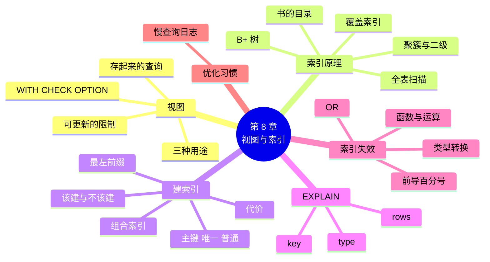

# 第 8 章 视图、索引与查询优化

!!! abstract "本章学时"
    理论 7 学时 · 实验 2 学时（本章共 3 个实验，教师可任选）

## 学习目标

学完本章，你应该能够：

1. **说出**视图和表的区别、视图的三种用途，以及哪些视图不能修改（记忆、理解）；
2. **解释**索引为什么能让查询变快，聚簇索引和二级索引的区别，以及索引的代价（理解）；
3. **创建**视图、普通索引、唯一索引和组合索引，按最左前缀原则设计组合索引（应用）；
4. **读懂** EXPLAIN 结果中的 type、key、rows 三列，判断一条查询是否用上了索引（分析）；
5. **找出**让索引失效的写法并改写，用慢查询日志找到慢 SQL（分析、评价）。

!!! info "先修要求"
    学习本章前，你需要：

    - 会写多表连接和分组查询（[第 4 章](../04-single-table-query/index.md)、[第 5 章](../05-multi-table-query/index.md)）；
    - 理解主键和唯一约束（[3.4.2](../03-sql-ddl-dml/index.md#342)）。

??? abstract "本章概念清单（10 个，点击查看定义和例子）"
    1. [视图](../../appendix/glossary.md#g-视图)
    2. [全表扫描](../../appendix/glossary.md#g-全表扫描)
    3. [索引](../../appendix/glossary.md#g-索引)
    4. [B+ 树](../../appendix/glossary.md#g-B+-树)
    5. [聚簇索引](../../appendix/glossary.md#g-聚簇索引)
    6. [二级索引](../../appendix/glossary.md#g-二级索引)
    7. [组合索引](../../appendix/glossary.md#g-组合索引)
    8. [最左前缀](../../appendix/glossary.md#g-最左前缀)
    9. [执行计划](../../appendix/glossary.md#g-执行计划)
    10. [慢查询日志](../../appendix/glossary.md#g-慢查询日志)

## 情景导入

小店开了网上订货以后，订单越来越多。表哥帮小林模拟了一下三年后的样子：订单表有 **100 万行**，2 万位顾客。

小林在模拟数据上试着查一位顾客的全部订单，在编者的电脑上用了 0.19 秒。“也不慢嘛。”表哥说：“这是一个人查一次。网上订货的高峰时段，几百个顾客同时打开‘我的订单’，每人要等 0.2 秒，数据库就得同时干几百份这样的活，CPU 很快就满了，所有人都在转圈圈。”

表哥加了一行 `CREATE INDEX`，再查一次：0.00 秒，快得测不出来。

另一件事也让小林头疼：会计每个月都要他写那条四张表连接的“销售明细”查询，收银员又不该看到商品的进价。表哥说：“把查询存成**视图**，会计直接查视图就行；给收银员一个没有进价的视图，原表不给他看。”

本章先学视图，再学索引：它为什么快、怎么建、怎么看有没有用上，以及哪些写法会让索引白建。

## 8.1 视图

### 8.1.1 视图是“存起来的查询”

[**视图**](../../appendix/glossary.md#g-视图 "保存在数据库中的一条 SELECT 查询，使用时像一张表，但本身不存数据，数据来自它所查询的基本表"){ .term }就是给一条 SELECT 语句起个名字，存在数据库里。用的时候就像用一张表一样 `SELECT … FROM 视图名`，数据库会自动执行背后的那条查询。<sup class="cite">[[4]](#ref8-4)</sup>

```sql
CREATE VIEW 视图名 AS
SELECT …;
```

关键是：**视图本身不存数据**，所以也叫“虚表”。视图里看到的数据，都是每次查询时从原来的表（叫**基本表**）里现查出来的。基本表的数据变了，视图里看到的马上跟着变。

例如，把第 5 章那条四表连接存成视图：

```sql
CREATE OR REPLACE VIEW v_order_detail AS
SELECT o.order_id, o.order_time, o.status, o.pay_method,
       IFNULL(c.name, '散客') AS customer_name,
       p.name AS product_name, cat.name AS category_name,
       oi.quantity, oi.unit_price, oi.quantity * oi.unit_price AS subtotal
FROM orders o
LEFT JOIN customer c ON c.customer_id = o.customer_id
JOIN order_item oi   ON oi.order_id = o.order_id
JOIN product p       ON p.product_id = oi.product_id
JOIN category cat    ON cat.category_id = p.category_id;
```

`CREATE OR REPLACE` 表示“没有就新建，有了就替换”。以后会计查订单 2499，只要一行：

```sql
SELECT order_id, customer_name, product_name, quantity, subtotal
FROM v_order_detail WHERE order_id = 2499;
```

```text
+----------+---------------+--------------------+----------+----------+
| order_id | customer_name | product_name       | quantity | subtotal |
+----------+---------------+--------------------+----------+----------+
|     2499 | 散客          | 花生油 5L          |        1 |    89.00 |
|     2499 | 散客          | 豆腐 400g          |        1 |     4.00 |
|     2499 | 散客          | 火锅底料 200g      |        2 |    39.80 |
|     2499 | 散客          | 五号电池 8 节      |        1 |    19.80 |
+----------+---------------+--------------------+----------+----------+
```

视图上还可以再建视图。比如每月销售额：

```sql
CREATE OR REPLACE VIEW v_monthly_sales AS
SELECT DATE_FORMAT(order_time, '%Y-%m') AS month,
       COUNT(DISTINCT order_id) AS orders,
       SUM(subtotal) AS sales
FROM v_order_detail
WHERE status = '已完成'
GROUP BY month;
```

管理视图的语句：

| 操作 | 语句 |
|---|---|
| 查看有哪些视图 | `SHOW FULL TABLES WHERE Table_type = 'VIEW';` |
| 查看视图的定义 | `SHOW CREATE VIEW v_order_detail;` |
| 修改视图 | `CREATE OR REPLACE VIEW …` 或 `ALTER VIEW …` |
| 删除视图 | `DROP VIEW v_order_detail;`（只删定义，不影响基本表的数据） |

在 DBeaver 左侧的“视图”文件夹里也能看到、打开它们。

### 8.1.2 视图的三种用途

1. **简化查询**：把复杂的连接、计算藏在视图里，使用的人只看到一张“干净”的表。上面的 v_order_detail 就是这样；
2. **保护数据**：只把一部分列或行给某些人看。收银员要查价格和库存，但不该看到进价和供应商：

    ```sql
    CREATE OR REPLACE VIEW v_cashier_product AS
    SELECT product_id, name, price, stock, unit
    FROM product;
    ```

    第 10 章会学到：只给收银员这个视图的查询权限，不给 product 表的权限，他就只能看到这几列；
3. **保持稳定**：表结构改了（比如拆了一张表），只要改视图的定义，让它输出的列不变，用视图的程序和报表就不用改。

### 8.1.3 通过视图修改数据

简单的视图（只来自一张表、没有分组和去重）可以直接 INSERT、UPDATE、DELETE，修改的其实是基本表。但很多视图**不能修改**，因为数据库没法把修改“翻译”回基本表。MySQL 规定，含有下面这些内容的视图不可更新：<sup class="cite">[[5]](#ref8-5)</sup>

- 聚合函数（SUM、COUNT 等）、DISTINCT、GROUP BY、HAVING；
- UNION；
- 外连接；
- 等等。

道理很简单：v_monthly_sales 的一行是很多行加起来的，把 6 月的销售额改成 20000，数据库不知道该改哪一笔订单。试着修改这类视图，会报错：

```text
ERROR 1288 (HY000): The target table v_cat_count of the UPDATE is not updatable
```

可更新的视图还可以加 **WITH CHECK OPTION**，要求通过视图改过的数据**仍然满足视图的条件**。比如只包含饮料的视图：

```sql
CREATE OR REPLACE VIEW v_drinks AS
SELECT product_id, name, price, category_id
FROM product
WHERE category_id = 4
WITH CHECK OPTION;
```

通过它改饮料的价格可以；想通过它把饮料改成别的类别（改完以后这行就“跑出”视图了），会被拒绝：

```text
ERROR 1369 (HY000): CHECK OPTION failed 'myshop.v_drinks'
```

**建议：视图主要用来查，修改数据还是直接对基本表做。**

## 8.2 索引是什么

### 8.2.1 书的目录

想在一本 500 页的书里找“外连接”这个词，有两种办法：

- 从第 1 页开始一页页翻，最坏要翻 500 页；
- 翻到书后的**索引**，按拼音找到“外连接……第 98 页”，直接翻到第 98 页。

数据库查询也一样。没有索引时，查 `customer_id = 12345` 只能把 100 万行从头到尾看一遍，这叫[**全表扫描**](../../appendix/glossary.md#g-全表扫描 "不借助索引，把表中的每一行都读一遍来找满足条件的行；EXPLAIN 中 type 显示为 ALL"){ .term }。[**索引**](../../appendix/glossary.md#g-索引 "按某一列或几列的值排好序、带有指向数据行位置的辅助结构，像书的目录，能让查询不用逐行查找"){ .term }就是数据库的“目录”：把某一列的值**排好序**，每个值旁边记着这一行在哪里，查的时候先查目录，再直接去拿那几行。

实验 8-2 在 100 万行的订单表上，编者的电脑测得：

| 查询 | 没有索引 | 有索引 |
|---|---|---|
| 查一位顾客的订单（customer_id = 12345） | 0.19 秒，检查约 100 万行 | 0.00 秒，只看 50 行 |
| 按手机号查订单 | 0.28 秒 | 0.00 秒 |

（`0.00 sec` 表示不到 0.005 秒。你的电脑上的具体时间会不同，但差距是一样的。）

### 8.2.2 B+ 树：一层层找下去

索引按什么结构存，才能查得快？MySQL 的 InnoDB 引擎用的是 [**B+ 树**](../../appendix/glossary.md#g-B+-树 "数据库索引最常用的数据结构，像一棵倒过来的多层目录树，所有数据都在最底层的叶子上且按顺序串起来，只要几层就能从上百万行中找到目标"){ .term }。<sup class="cite">[[6]](#ref8-6)</sup> 不需要懂它的算法，记住它的样子就行：

- 它像一棵**倒过来的树**，也像一本书的“总目录 → 章目录 → 页”；
- 最上面的**根**存着几个分界值，比如“1～5000 往左走，5001～10000 往中间走……”；
- 往下一层再细分，一直到最底层的**叶子**，叶子上才是真正的值和行的位置；
- 叶子之间按顺序**串成一条链**，所以“找某个范围”（如 `order_time >= '2026-06-01'`）时，找到起点后顺着链往后读就行。

B+ 树的每个节点能放几百个分界值，所以树很“矮胖”：**三四层就能管住上千万行**。查一个值，只要从根往下走三四步，而不是看 100 万行。

<iframe class="sim-frame" src="../../sims/bplus-tree/main.html" height="620" loading="lazy" title="B+ 树查找"></iframe>
动画：B+ 树查找。输入一个顾客编号，看查找怎样从根节点开始，每一层比较分界值、选一条路往下走，几步就到达叶子；再试试范围查找，看它怎样顺着叶子的链表往后读。[全屏打开](../../sims/bplus-tree/main.html){ target=_blank }
{ .sim-caption }

### 8.2.3 聚簇索引和二级索引

InnoDB 的表有两种索引：<sup class="cite">[[7]](#ref8-7)</sup>

- [**聚簇索引**](../../appendix/glossary.md#g-聚簇索引 "叶子节点存放整行数据的索引，InnoDB 中一般就是主键索引，表的数据本身就按主键顺序存放在这棵 B+ 树上"){ .term }：一般就是**主键**。它的叶子上存的是**整行数据**，换句话说，表本身就是按主键排好序存在这棵 B+ 树里的。所以按主键查最快，一步到位；
- [**二级索引**](../../appendix/glossary.md#g-二级索引 "除聚簇索引以外的索引，叶子上存索引列的值和对应行的主键，找到主键后还要回到聚簇索引取整行"){ .term }：除主键以外自己建的索引。它的叶子上只存“索引列的值 + 这一行的主键”。按它查，先在二级索引里找到主键，再拿主键去聚簇索引里取整行，这一步叫**回表**。

打个比方：聚簇索引像按学号排好的学生档案柜，找到学号就拿到整份档案；二级索引像一张“姓名 → 学号”的对照表，查到学号后还要再去档案柜拿一次。

由此可以得到两条实用的结论：

1. **每张表都要有主键**，最好是短小的、自动增长的整数（第 3 章就是这么做的）。主键越短，所有二级索引越小；
2. 如果查询要的列**全在二级索引里**，就不用回表，更快。这叫**覆盖索引**，EXPLAIN 的 Extra 列会显示 `Using index`。这也是“不要 SELECT *，只取需要的列”的原因之一。

## 8.3 创建和管理索引

### 8.3.1 四种常用索引

| 索引 | 怎么来 | 特点 |
|---|---|---|
| 主键索引 | 定义 PRIMARY KEY 时自动建 | 就是聚簇索引，值唯一、不为空 |
| 唯一索引 | 定义 UNIQUE 约束时自动建，或 `CREATE UNIQUE INDEX` | 值不能重复，可以有 NULL |
| 普通索引 | `CREATE INDEX` | 值可以重复，只为了查得快 |
| 组合索引 | `CREATE INDEX … (列1, 列2)` | 在几列上一起建，按列1排序，列1相同再按列2排序 |

另外，MySQL 会**自动给外键列建索引**（第 3 章看到的 `MUL`），因为连接时要按外键查。

创建和删除的语句：

```sql
CREATE INDEX idx_customer ON orders_big (customer_id);              -- 普通索引
CREATE UNIQUE INDEX uk_phone ON customer (phone);                   -- 唯一索引
CREATE INDEX idx_cust_time ON orders_big (customer_id, order_time); -- 组合索引
SHOW INDEX FROM orders_big;                                         -- 查看表上的索引
DROP INDEX idx_customer ON orders_big;                              -- 删除索引
```

也可以在建表时写在 CREATE TABLE 里：`INDEX idx_customer (customer_id)`。索引名习惯用 `idx_` 开头，唯一索引用 `uk_` 开头。在 DBeaver 里，表的属性页有“索引”标签，也可以点鼠标建。

### 8.3.2 组合索引与最左前缀

[**组合索引**](../../appendix/glossary.md#g-组合索引 "在多列上共同建立的一个索引，先按第一列排序，第一列相同时再按第二列排序，依此类推"){ .term } (customer_id, order_time) 像一本按“姓氏 → 名字”排好的电话簿：先按顾客编号排，同一位顾客的订单再按时间排。

所以它能帮这些查询：

- `WHERE customer_id = 12345`（只用第一列，像“查所有姓王的”）；
- `WHERE customer_id = 12345 AND order_time >= '2026-01-01'`（两列都用上，像“查王姓里名字在某个范围的”）；

但帮不了：

- `WHERE order_time >= '2026-06-30'`（跳过了第一列，像“查所有名字叫‘芳’的人”，电话簿是按姓排的，只能从头翻到尾）。

这条规则叫[**最左前缀**](../../appendix/glossary.md#g-最左前缀 "组合索引只有在查询条件包含它最左边的一列（或从左起连续的几列）时才能被有效使用的规则"){ .term }原则：**组合索引要从最左边的列开始用，不能跳过。** 实验 8-3 中，只有组合索引 (customer_id, order_time) 时：

```text
EXPLAIN SELECT * FROM orders_big WHERE order_time >= '2026-06-30';
type = ALL，key = NULL，rows ≈ 123 万       ← 跳过第一列，用不上，全表扫描（0.51 秒）

EXPLAIN SELECT * FROM orders_big WHERE customer_id = 12345 AND order_time >= '2026-06-01';
type = range，key = idx_cust_time，rows = 2  ← 从最左列开始用，只看 2 行（0.00 秒）
```

（rows 是 MySQL 估计要检查的行数，不一定精确，这里估成了 123 万。）

**设计组合索引的经验：把最常用来做“等于”条件、而且能筛掉最多行的列放在最前面。**

### 8.3.3 什么列该建索引，什么列不该

| 该建 | 不该建 |
|---|---|
| 经常出现在 WHERE 里做筛选的列（customer_id、phone） | 很少用来查询的列（备注、描述） |
| 经常用来连接的列（外键，MySQL 已自动建） | 值的种类很少的列，如性别、状态（只有两三种值，索引筛不掉多少行） |
| 经常用来排序、分组的列（order_time） | 数据很少的表（几百行，全表扫描也很快） |
| 要求唯一的列（用唯一索引，顺便保证不重复） | 经常大批量修改的列 |

### 8.3.4 索引的代价

索引不是越多越好，它有代价：

1. **占空间**：实验 8-2 中，100 万行的订单表数据占 142.8 MB，加了 3 个二级索引后，索引又占了 60.6 MB；
2. **拖慢增删改**：每插入一行，所有索引都要把新值插到排好序的位置。实验 8-2 中，往**没有二级索引**的表里插入 20 万行用了 1.01 秒，往**有 3 个二级索引**的表里插入同样的 20 万行用了 3.22 秒，慢了 3 倍多；
3. **建索引本身要时间**：给 100 万行建一个索引约 1 秒。在几亿行的表上建索引可能要几个小时，所以要在业务不忙的时候做。

**原则：为真正常用的查询建索引，定期检查并删掉没用的索引。** 小店的订单表，建主键、外键索引，再加一个 order_time 的索引（按日期统计用），一般就够了。

## 8.4 看懂执行计划：EXPLAIN

### 8.4.1 EXPLAIN 的用法

一条查询有没有用上索引，不用猜，在它前面加 EXPLAIN，MySQL 就会告诉你它打算**怎么执行**，这叫[**执行计划**](../../appendix/glossary.md#g-执行计划 "数据库决定如何执行一条查询的方案，包括访问哪张表、用不用索引、预计检查多少行，可用 EXPLAIN 查看"){ .term }。EXPLAIN 不会真的执行查询，所以再慢的查询也能立刻看到结果。<sup class="cite">[[3]](#ref8-3)</sup>

建索引前：

```sql
EXPLAIN SELECT * FROM orders_big WHERE customer_id = 12345;
```

```text
+----+-------------+------------+------------+------+---------------+------+---------+------+---------+----------+-------------+
| id | select_type | table      | partitions | type | possible_keys | key  | key_len | ref  | rows    | filtered | Extra       |
+----+-------------+------------+------------+------+---------------+------+---------+------+---------+----------+-------------+
|  1 | SIMPLE      | orders_big | NULL       | ALL  | NULL          | NULL | NULL    | NULL | 1342536 |    10.00 | Using where |
+----+-------------+------------+------------+------+---------------+------+---------+------+---------+----------+-------------+
```

建索引 idx_customer 后：

```text
+----+-------------+------------+------------+------+---------------+--------------+---------+-------+------+----------+-------+
| id | select_type | table      | partitions | type | possible_keys | key          | key_len | ref   | rows | filtered | Extra |
+----+-------------+------------+------------+------+---------------+--------------+---------+-------+------+----------+-------+
|  1 | SIMPLE      | orders_big | NULL       | ref  | idx_customer  | idx_customer | 4       | const |   50 |   100.00 | NULL  |
+----+-------------+------------+------------+------+---------------+--------------+---------+-------+------+----------+-------+
```

### 8.4.2 先会看三列

EXPLAIN 有十几列，初学先看三列：

| 列 | 意思 | 怎么看 |
|---|---|---|
| **type** | 访问方式 | 最怕 `ALL`（全表扫描）；`index` 是把整个索引扫一遍，也不好；`range`、`ref`、`eq_ref`、`const` 都说明用上了索引 |
| **key** | 实际用的索引 | `NULL` 表示没用索引；possible_keys 是“可能用”的，key 才是“真用了”的 |
| **rows** | 预计要检查多少行 | 越小越好；它是估计值，和实际不完全一样 |

type 常见取值从好到差：<sup class="cite">[[3]](#ref8-3)</sup>

| type | 意思 | 例子 |
|---|---|---|
| const | 按主键或唯一索引找一行 | `WHERE order_id = 2499` |
| eq_ref | 连接时每次按主键找一行 | 订单明细连商品表 `ON p.product_id = oi.product_id` |
| ref | 按普通索引找若干行 | `WHERE customer_id = 12345` |
| range | 按索引找一个范围 | `WHERE order_time >= '2026-06-30' AND order_time < '2026-07-01'` |
| index | 把整个索引从头扫到尾 | 对索引列用了函数 |
| ALL | 全表扫描 | 没有可用的索引 |

Extra 列偶尔也要看：`Using index` 表示覆盖索引（不用回表，好）；`Using filesort` 表示要额外排序（ORDER BY 没用上索引，数据多时慢）；`Using temporary` 表示用了临时表（复杂的 GROUP BY，数据多时慢）。

!!! tip "在 DBeaver 里看执行计划"
    选中一条 SELECT，按 Ctrl+Shift+E（或右键“执行” → “解释执行计划”），下方会以表格或树形显示执行计划，和 EXPLAIN 的内容一样。

## 8.5 让索引失效的常见写法

建了索引，查询不一定会用。下面几种写法会让 MySQL 用不上索引，退回全表扫描。实验 8-3 在 100 万行的表上逐一做了对比：

| 慢的写法 | 为什么 | 改写 | 编者实测 |
|---|---|---|---|
| `WHERE DATE(order_time) = '2026-06-30'` | 对列用了函数，索引里存的是原值，不是函数结果 | `WHERE order_time >= '2026-06-30' AND order_time < '2026-07-01'` | type 从 index（扫约 123 万行，0.15 秒）变成 range（796 行，0.00 秒） |
| `WHERE phone = 10005864824` | phone 是字符串，和数字比较时每一行都要先转换类型，等于对列用了函数 | `WHERE phone = '10005864824'` | ALL、0.25 秒 → ref、0.00 秒 |
| `WHERE phone LIKE '%64824'` | 以 % 开头，不知道从目录的哪里开始找 | 业务允许时改成 `LIKE '1000586%'` | ALL、0.16 秒 → range、0.00 秒 |
| `WHERE customer_id = 12345 OR amount > 304.9` | OR 的一边（amount）没有索引，只好全表扫描 | 给 amount 也建索引（MySQL 会合并两个索引的结果），或改写成 UNION | ALL、0.48 秒 → index_merge、0.02 秒 |
| 组合索引 (customer_id, order_time) 上只查 order_time | 违反最左前缀 | 条件里带上第一列，或为 order_time 单独建索引 | ALL、0.51 秒 → range、0.00 秒 |

还有一种常见的：`WHERE customer_id + 1 = 12346`，对列做了计算，同样要改成 `WHERE customer_id = 12345`。

**一句话总结：WHERE 里的索引列要“干干净净”地放在比较符号的一边，不要给它套函数、做运算、改类型。**

!!! note "MySQL 也会“聪明”一点"
    MySQL 8 的优化器比老版本聪明，有时能绕过上面的规则，比如 8.0.13 起支持“跳跃扫描”（skip scan），某些情况下组合索引跳过第一列也能用一部分。但这只在特定条件下起作用，写 SQL 时还是要按上面的原则来，不要依赖它。

## 8.6 查询优化的实用习惯

### 8.6.1 六条习惯

1. **只取需要的列**，少用 `SELECT *`：传输的数据少，还可能用上覆盖索引；
2. **用 LIMIT 限制行数**：页面只显示 20 条，就只取 20 条；
3. **WHERE 里的索引列保持干净**（8.5 节）；
4. **能在 WHERE 里筛的不要放到 HAVING 里**（第 4 章）；
5. **连接的列要有索引**：外键 MySQL 会自动建，自己写的连接条件要检查；
6. **先 EXPLAIN 再上线**：重要的查询，写完先看一眼执行计划，type 是不是 ALL、rows 是不是很大。

### 8.6.2 用慢查询日志找到慢 SQL

真实系统里有成千上万条 SQL，怎么知道哪条慢？MySQL 的[**慢查询日志**](../../appendix/glossary.md#g-慢查询日志 "MySQL 把执行时间超过设定值的 SQL 自动记录下来的日志文件，用来找出需要优化的查询"){ .term }会把执行时间超过设定值的 SQL 自动记下来：<sup class="cite">[[8]](#ref8-8)</sup>

```sql
SET GLOBAL slow_query_log = ON;          -- 打开慢查询日志
SET GLOBAL long_query_time = 0.1;        -- 超过 0.1 秒就算慢（默认是 10 秒）
SHOW VARIABLES LIKE 'slow_query_log%';   -- 查看日志文件在哪里
```

运行一条慢查询以后，日志文件里多了这样一段（编者实测）：

```text
# Time: 2026-11-01T05:19:17.566135Z
# User@Host: root[root] @ localhost []  Id:    20
# Query_time: 0.304686  Lock_time: 0.000002 Rows_sent: 1  Rows_examined: 1000000
use bigshop;
SET timestamp=1793510357;
SELECT COUNT(*) FROM orders_big WHERE phone LIKE '%64824';
```

最有用的两项：`Query_time`（用了多少秒）和 `Rows_examined`（检查了多少行）。返回 1 行却检查了 100 万行，一看就知道没用上索引。

找到慢 SQL 后的处理步骤：**EXPLAIN 看执行计划 → 找原因（没索引？索引失效？）→ 改写或加索引 → 再 EXPLAIN、再计时确认**。

用完记得关掉（`SET GLOBAL slow_query_log = OFF;`），或把 long_query_time 设回合理的值，日志文件会越来越大。

## 8.7 前沿视窗：让数据库自己“调优”

给什么列建索引，传统上靠数据库管理员（DBA）的经验。现在有几种新做法：

- **自动索引推荐**：一些云数据库（如阿里云、腾讯云的 MySQL 服务）会分析一段时间的慢查询日志，自动建议“在某表某列上加索引，预计可以提速多少”，管理员确认后一键执行；
- **大模型辅助诊断**：把慢 SQL 和 EXPLAIN 结果交给大模型，它能指出“对列用了函数”“缺少组合索引”这类常见问题，并给出改写建议。本章的知识正好用来检查它说得对不对：改完以后一定要重新 EXPLAIN、重新计时；
- **自治数据库**：学术界和工业界都在研究用机器学习让数据库自动选索引、调参数、估计查询代价，甚至提出了用模型代替 B+ 树的“学习型索引”。<sup class="cite">[[9]](#ref8-9)</sup>

工具再智能，判断“这个索引值不值得建”仍然要回到 8.3.3、8.3.4 节：查询有多频繁？表有多大？增删改有多频繁？

## 本章实验

!!! abstract "实验总览"
    | 实验 | 类型 | 建议时长 | 内容 |
    |---|---|---|---|
    | 实验 8-1 | ★ 基础 | 40 分钟 | 为小店建三个视图，按会计、收银员、老板三个角色查询；试试通过视图改数据 |
    | 实验 8-2 | ★ 基础 | 50 分钟 | 造 100 万行订单表，对比加索引前后的耗时和 EXPLAIN，量一量索引的代价 |
    | 实验 8-3 | ☆ 拓展 | 40 分钟 | 找出并改写五条“慢 SQL”，用慢查询日志验证 |

    SQL 脚本见配套资源 `labs/ch08/` 目录。实验 8-2、8-3 会新建一个约 200 MB 的 `bigshop` 库，做完可以 `DROP DATABASE bigshop;` 删掉。

### 实验 8-1 ★ 为小店建三个视图

**实验目的**

1. 学会创建视图，并像查表一样查询视图；
2. 体会视图的三种用途，验证哪些视图可以修改。

**实验环境**：本机 MySQL 8.4 + DBeaver。**实验数据**：示例库 `shop`（建视图，不改数据）和实验 3-1 的 `myshop`（第 4 步改数据）。

**实验步骤与代码**

1. 运行 `labs/ch08/lab8_1_views.sql`，建立 8.1 节的三个视图 v_order_detail、v_cashier_product、v_monthly_sales，再用视图查询：

```sql
SELECT order_id, customer_name, product_name, quantity, subtotal
FROM v_order_detail WHERE order_id = 2499;

SELECT * FROM v_cashier_product WHERE stock < 10;

SELECT * FROM v_monthly_sales WHERE month >= '2026-01' ORDER BY month;

SHOW FULL TABLES WHERE Table_type = 'VIEW';
```

2. 在 DBeaver 左侧刷新 shop，展开“视图”，双击 v_order_detail，看“源”标签里的定义；
3. 用视图回答：2026 年 6 月“粮油米面”类卖了多少钱？（自己写 SQL）
4. 运行 `labs/ch08/lab8_1_view_update.sql`，逐条执行，观察哪些修改成功、哪些报错：

```sql
USE myshop;
CREATE OR REPLACE VIEW v_drinks AS
SELECT product_id, name, price, category_id
FROM product
WHERE category_id = 4
WITH CHECK OPTION;

UPDATE v_drinks SET price = 4.80 WHERE name LIKE '无糖绿茶%';       -- 1. 改价格
UPDATE v_drinks SET category_id = 3 WHERE name LIKE '无糖绿茶%';    -- 2. 改类别

CREATE OR REPLACE VIEW v_cat_count AS
SELECT category_id, COUNT(*) AS n FROM product GROUP BY category_id;
UPDATE v_cat_count SET n = 10 WHERE category_id = 1;               -- 3. 改分组视图
```

**运行结果**

编者在 MySQL 8.4.13 上的运行结果：

```text
v_cashier_product WHERE stock < 10
+------------+-------------------+-------+-------+------+
| product_id | name              | price | stock | unit |
+------------+-------------------+-------+-------+------+
|          5 | 挂面 1kg          |  8.50 |     0 | 包   |
|         14 | 原味薯片 104g     |  8.90 |     8 | 罐   |
|         23 | 橙汁 1L           | 13.80 |     0 | 瓶   |
|         32 | 苹果 1kg          | 12.80 |     8 | 份   |
|         41 | 火锅底料 200g     | 19.90 |     8 | 袋   |
+------------+-------------------+-------+-------+------+
v_monthly_sales（2026 年）
+---------+--------+----------+
| month   | orders | sales    |
+---------+--------+----------+
| 2026-01 |    137 | 10125.50 |
| 2026-02 |    123 | 10021.40 |
| 2026-03 |    138 | 11238.70 |
| 2026-04 |    135 |  9989.30 |
| 2026-05 |    141 |  9936.40 |
| 2026-06 |    139 | 11241.30 |
+---------+--------+----------+
第 4 步
1. 改价格：成功，product 表中无糖绿茶的价格变为 4.80
2. ERROR 1369 (HY000): CHECK OPTION failed 'myshop.v_drinks'
3. ERROR 1288 (HY000): The target table v_cat_count of the UPDATE is not updatable
```

v_monthly_sales 的销售额和第 5 章实验 5-2 查询 4 的结果完全一样，说明视图只是把查询存了起来。

**实验记录表**

| 角色 | 用哪个视图 | 能看到什么、看不到什么 | 你写的一条查询 |
|---|---|---|---|
| 会计 | v_order_detail | | |
| 收银员 | v_cashier_product | | |
| 老板 | v_monthly_sales | | |

**常见问题排查**

| 现象 | 原因 | 解决办法 |
|---|---|---|
| `Table 'shop.v_order_detail' doesn't exist` 建 v_monthly_sales 时报错 | v_monthly_sales 用到了 v_order_detail，要先建它 | 按脚本顺序执行 |
| 视图里看到的数据“过时了” | 不会发生：视图每次都现查 | 如果真的看到旧数据，检查是不是查错了库 |
| `View … references invalid table(s)` | 视图引用的表被删了或改了名 | 重建视图 |

**思考与练习**

1. 视图 v_cashier_product 能挡住收银员看进价吗？如果收银员能直接查 product 表呢？（提示：第 10 章的权限）
2. 给 v_order_detail 再加一列“毛利”（需要进价），应该怎么改？会影响已经在用这个视图的查询吗？

**实验报告要求**

截图三个视图的查询结果和第 4 步的报错，完成实验记录表。

### 实验 8-2 ★ 100 万行订单表上的索引对比

**实验目的**

1. 亲手测出索引带来的速度差距；
2. 学会用 EXPLAIN 判断查询是否用上索引；
3. 量一量索引占用的空间和对插入速度的影响。

**实验环境**：本机 MySQL 8.4 + DBeaver，内存 8 GB 以上为宜。**实验数据**：脚本生成的 100 万行虚构订单（2 万位顾客，2023—2026 年）。

**实验步骤与代码**

1. 运行 `labs/ch08/lab8_2_make_big.sql` 造数据。它用 6 张 0～9 的数字表做笛卡尔积（第 5 章的“灾难”，这里正好用来造数据），10^6 = 100 万行：

```sql
INSERT INTO orders_big
SELECT n,
       1 + MOD(n * 7919, 20000)                               AS customer_id,
       ……
FROM (SELECT a.d + b.d * 10 + c.d * 100 + e.d * 1000 + f.d * 10000 + g.d * 100000 + 1 AS n
      FROM digits a, digits b, digits c, digits e, digits f, digits g) t;
```

2. 打开 `labs/ch08/lab8_2_index_compare.sql`，**逐条执行**，每条执行后在 DBeaver 下方的“执行日志”或结果栏里记下耗时：

```sql
-- 1. 没有索引：查顾客 12345 的全部订单
SELECT COUNT(*), SUM(amount) FROM orders_big WHERE customer_id = 12345;
EXPLAIN SELECT * FROM orders_big WHERE customer_id = 12345;

-- 2. 给 customer_id 建索引
CREATE INDEX idx_customer ON orders_big (customer_id);

-- 3. 有了索引，再查一次
SELECT COUNT(*), SUM(amount) FROM orders_big WHERE customer_id = 12345;
EXPLAIN SELECT * FROM orders_big WHERE customer_id = 12345;

-- 4. 按手机号查：建索引前后
-- 5. 组合索引 (customer_id, order_time)，查某位顾客 2026 年的订单
-- 6. 查看索引和占用空间
-- 7. 索引的代价：往有索引和没索引的表各插入 20 万行
```

**运行结果**

编者在 MySQL 8.4.13 上的结果（服务器为云主机，你的电脑上耗时可能是它的几倍，但相对差距一样）：

```text
造数据：1000000 行，2 万位顾客，2023-01-01 至 2026-06-30，约 10 秒

1. 无索引查顾客 12345：50 单，金额 7194.00，0.19 秒；EXPLAIN：type=ALL，key=NULL，rows=1342536
2. 建索引 idx_customer：1.03 秒
3. 有索引再查：0.00 秒；EXPLAIN：type=ref，key=idx_customer，rows=50
4. 按手机号查：无索引 0.28 秒，建索引 1.63 秒，有索引 0.00 秒
5. EXPLAIN（customer_id = 12345 AND order_time >= '2026-01-01'）：
   type=range，key=idx_cust_time，rows=6
6. 数据 142.8 MB，索引 60.6 MB
7. 插入 20 万行：无二级索引 1.01 秒，有 3 个二级索引 3.22 秒
```

**实验记录表**

| 项目 | 你的结果 | 编者的结果 |
|---|---|---|
| 造 100 万行用时 | | 约 10 秒 |
| 无索引查顾客：耗时 / type / rows | | 0.19 秒 / ALL / 1342536 |
| 有索引查顾客：耗时 / type / rows | | 0.00 秒 / ref / 50 |
| 数据和索引各占多少 MB | | 142.8 / 60.6 |
| 插入 20 万行：无索引 / 有索引 | | 1.01 秒 / 3.22 秒 |

**常见问题排查**

| 现象 | 原因 | 解决办法 |
|---|---|---|
| 造数据时 DBeaver 提示超时 | 默认查询超时太短 | 在连接设置里把超时调大，或用命令行 `mysql < lab8_2_make_big.sql` |
| 第二次查询比第一次快很多（还没建索引） | 数据第一次被读进内存后会缓存 | 正常现象；比较时都取第二次的时间 |
| 索引 MB 显示 0.0 | 统计信息还没更新 | 先执行 `ANALYZE TABLE orders_big;` |
| 磁盘空间不足 | bigshop 约占 200 MB | 做完实验 `DROP DATABASE bigshop;` |

**思考与练习**

1. rows 列为什么是 1342536 而不是 1000000？
2. 如果网上订货最常见的查询是“某位顾客最近 10 单”，你会建什么索引？写出 SQL 并用 EXPLAIN 验证。

**实验报告要求**

完成实验记录表，截图有无索引的两个 EXPLAIN 结果，回答思考题。

### 实验 8-3 ☆ 找出并改写五条“慢 SQL”

**实验目的**

1. 识别对列用函数、隐式类型转换、前导 %、OR、违反最左前缀五种索引失效的写法；
2. 用慢查询日志定位慢 SQL，改写后验证效果。

**实验环境**：本机 MySQL 8.4 + DBeaver。**实验数据**：实验 8-2 的 `bigshop.orders_big`（已建好 idx_customer、idx_phone、idx_cust_time）。

**实验步骤与代码**

1. 打开慢查询日志：

```sql
SET GLOBAL slow_query_log = ON;
SET GLOBAL long_query_time = 0.1;
SHOW VARIABLES LIKE 'slow_query_log%';
```

2. 打开 `labs/ch08/lab8_3_slow_sql.sql`，五组“慢 / 快”成对出现。**先只看慢的那条**，自己想一想为什么慢、怎么改，再看脚本里的改写。每条都先 EXPLAIN 再执行：

```sql
-- 慢 1：对列用了函数
EXPLAIN SELECT COUNT(*) FROM orders_big WHERE DATE(order_time) = '2026-06-30';
-- 快 1：改成范围条件，列保持“干净”
EXPLAIN SELECT COUNT(*) FROM orders_big WHERE order_time >= '2026-06-30' AND order_time < '2026-07-01';

-- 慢 2：隐式类型转换（phone 是字符串，却和数字比较）
EXPLAIN SELECT * FROM orders_big WHERE phone = 10005864824;

-- 慢 3：以 % 开头的 LIKE
EXPLAIN SELECT * FROM orders_big WHERE phone LIKE '%64824';

-- 慢 4：OR 的一边没有索引
EXPLAIN SELECT * FROM orders_big WHERE customer_id = 12345 OR amount > 304.9;

-- 慢 5：组合索引 (customer_id, order_time) 跳过了第一列
EXPLAIN SELECT * FROM orders_big WHERE order_time >= '2026-06-30';
```

3. 在 DBeaver 里执行 `SHOW VARIABLES LIKE 'slow_query_log_file';` 找到日志文件，用记事本打开（Docker 环境用 `docker exec shop-mysql tail -30 /var/lib/mysql/<文件名>`），看看哪些语句被记了下来；
4. 实验结束后关闭：`SET GLOBAL slow_query_log = OFF; SET GLOBAL long_query_time = 10;`

**运行结果**

编者在 MySQL 8.4.13 上的对比（结果行数在改写前后都相同）：

| 组 | 慢：type / key / 耗时 | 快：type / key / 耗时 | 结果 |
|---|---|---|---|
| 1 函数 | index / idx_time / 0.15 秒 | range / idx_time / 0.00 秒 | 796 单 |
| 2 类型转换 | ALL / NULL / 0.25 秒 | ref / idx_phone / 0.00 秒 | 50 单 |
| 3 前导 % | ALL / NULL / 0.16 秒 | range / idx_phone / 0.00 秒 | 50 单 / 100 单（条件不同） |
| 4 OR | ALL / NULL / 0.48 秒 | index_merge / idx_customer,idx_amount / 0.02 秒 | 351 单 |
| 5 最左前缀 | ALL / NULL / 0.51 秒 | range / idx_cust_time / 0.00 秒 | 796 单 / 2 单（条件不同） |

第 1 组慢的那条 type 是 index 而不是 ALL：MySQL 发现只需要 order_time 一列，就把整个 idx_time 索引从头扫到尾（比扫整张表省一点），但仍然检查了约 123 万行。慢查询日志中的一段：

```text
# Query_time: 0.304686  Lock_time: 0.000002 Rows_sent: 1  Rows_examined: 1000000
SELECT COUNT(*) FROM orders_big WHERE phone LIKE '%64824';
```

**实验记录表**

| 组 | 慢的原因（一句话） | 你的改写 | 改写后 type |
|---|---|---|---|
| 1 | | | |
| 2 | | | |
| 3 | | | |
| 4 | | | |
| 5 | | | |

**常见问题排查**

| 现象 | 原因 | 解决办法 |
|---|---|---|
| `Access denied; you need the SUPER or SYSTEM_VARIABLES_ADMIN privilege` | 不是 root 用户，不能改全局变量 | 用 root 登录 |
| 慢查询日志里什么也没有 | long_query_time 设得太大，或在设置之前执行的查询 | 设好以后再执行慢查询 |
| 第 3 组改写后结果不一样 | 改写改变了查询的意思（尾号 → 开头） | 只有业务允许时才能这样改；真要按尾号查，可以另存一列“反转的手机号”并建索引 |

**思考与练习**

1. 第 4 组除了给 amount 建索引，还可以怎样用 UNION 改写？写出 SQL 并 EXPLAIN。
2. 有同学说“给每一列都建上索引，就不会慢了”。用本实验和实验 8-2 的数据反驳他。

**实验报告要求**

完成实验记录表，截图慢查询日志中的记录，回答思考题。

## 本章小结

- **视图**是存起来的查询，本身不存数据，每次使用时从基本表现查。用途：简化查询、保护数据（只给看部分列或行）、保持接口稳定。含聚合、DISTINCT、GROUP BY、UNION、外连接的视图不可更新；**WITH CHECK OPTION** 要求通过视图改的数据仍满足视图条件。
- **索引**像书的目录，把列值排好序并记着行的位置，让查询不用**全表扫描**。InnoDB 用 **B+ 树**：矮胖、叶子有序且串成链，三四层就能管住上千万行。
- **聚簇索引**（主键）的叶子存整行数据；**二级索引**的叶子存列值和主键，查到后要**回表**。查询的列都在索引里时是**覆盖索引**。
- 索引种类：主键、唯一、普通、**组合索引**。组合索引遵守**最左前缀**原则。常筛选、连接、排序的列建索引；种类少、很少查的列和小表不建。索引占空间、拖慢增删改。
- **EXPLAIN** 看执行计划，先看 **type**（ALL 最差）、**key**（NULL 表示没用索引）、**rows**。
- 索引失效：对列用函数或运算、隐式类型转换、前导 % 的 LIKE、OR 一边无索引、违反最左前缀。WHERE 里的索引列要保持“干净”。
- 习惯：只取需要的列、用 LIMIT、先 EXPLAIN 再上线；用**慢查询日志**找出慢 SQL。



**下一章预告**

查询快了，还有一个更要命的问题：顾客下单时，系统扣了库存，生成订单这一步却出错了，库存少了、订单却没有；两个收银台同时卖最后一包挂面，库存变成了 −1。第 9 章学习事务、存储过程和触发器，让数据库在出错和多人同时操作时依然可靠。

## 参考文献

正文中的上标编号（如<sup class="cite">[[3]](#ref8-3)</sup>）对应下面的文献。带链接的可以直接打开；书籍可在图书馆或电子书平台查阅。

<div class="refs" markdown>

**教材与专著**

- <span id="ref8-1"></span>[1] 王珊，杜小勇，陈红. 数据库系统概论[M]. 6 版. 北京：高等教育出版社，2023.
    <span class="ref-note">第 3 章讲视图，第 9 章“关系查询处理和查询优化”讲查询执行与优化的基本原理。</span>
- <span id="ref8-2"></span>[2] BOTROS S, TINLEY J. High Performance MySQL[M]. 4th ed. Sebastopol: O'Reilly Media, 2021.
    <span class="ref-note">MySQL 性能优化的经典著作，其中有专门的章节讲索引设计和查询优化，适合想深入的同学。</span>

**经典论文**

- <span id="ref8-6"></span>[6] COMER D. The ubiquitous B-tree[J]. ACM Computing Surveys, 1979, 11(2): 121-137.
    <span class="ref-note">介绍 B 树及其变种（包括 B+ 树）的经典综述，说明了它为什么成为数据库索引的标准结构，对应 8.2.2 节。</span>
- <span id="ref8-9"></span>[9] KRASKA T, BEUTEL A, CHI E H, et al. The case for learned index structures[C]//Proceedings of the 2018 International Conference on Management of Data (SIGMOD). New York: ACM, 2018: 489-504.
    <span class="ref-note">提出用机器学习模型代替 B+ 树等传统索引的“学习型索引”，对应 8.7 节。</span>

**在线资源与数据**

- <span id="ref8-3"></span>[3] Oracle. MySQL 8.4 Reference Manual: EXPLAIN Output Format[EB/OL]. [2026-11-01]. https://dev.mysql.com/doc/refman/8.4/en/explain-output.html.
    <span class="ref-note">EXPLAIN 每一列的含义和 type 各取值从好到差的顺序，对应 8.4 节。</span>
- <span id="ref8-4"></span>[4] Oracle. MySQL 8.4 Reference Manual: CREATE VIEW Statement[EB/OL]. [2026-11-01]. https://dev.mysql.com/doc/refman/8.4/en/create-view.html.
    <span class="ref-note">创建视图的完整语法，包括 WITH CHECK OPTION，对应 8.1 节。</span>
- <span id="ref8-5"></span>[5] Oracle. MySQL 8.4 Reference Manual: Updatable and Insertable Views[EB/OL]. [2026-11-01]. https://dev.mysql.com/doc/refman/8.4/en/view-updatability.html.
    <span class="ref-note">列出了使视图不可更新的各种情况，对应 8.1.3 节。</span>
- <span id="ref8-7"></span>[7] Oracle. MySQL 8.4 Reference Manual: Clustered and Secondary Indexes[EB/OL]. [2026-11-01]. https://dev.mysql.com/doc/refman/8.4/en/innodb-index-types.html.
    <span class="ref-note">InnoDB 聚簇索引和二级索引的说明，以及为什么主键应短小，对应 8.2.3 节。</span>
- <span id="ref8-8"></span>[8] Oracle. MySQL 8.4 Reference Manual: The Slow Query Log[EB/OL]. [2026-11-01]. https://dev.mysql.com/doc/refman/8.4/en/slow-query-log.html.
    <span class="ref-note">慢查询日志的开启方法和参数，对应 8.6.2 节和实验 8-3。</span>
- <span id="ref8-10"></span>[10] Oracle. MySQL 8.4 Reference Manual: Multiple-Column Indexes[EB/OL]. [2026-11-01]. https://dev.mysql.com/doc/refman/8.4/en/multiple-column-indexes.html.
    <span class="ref-note">组合索引和最左前缀的官方说明，对应 8.3.2 节。</span>

</div>

## 课后练习

选择题和判断题可以直接点击选项作答，系统会马上告诉你对错，并展开答案与解析；多选题选好后点“提交答案”。简答和实操题请先自己作答，再点开“答案与解析”核对。每道题的解析下方都有“回看”链接，做错了可以直接跳回正文复习。

**一、单项选择题**

<div class="quiz" data-answer="B" markdown>

**1.** 关于视图，下列说法正确的是（　　）。

- A. 视图中保存了一份数据的副本
- B. 视图是保存起来的查询，本身不存储数据
- C. 删除视图会删除基本表中的数据
- D. 视图只能来自一张表

</div>

??? tip "答案与解析"
    **答案：B**

    解析：视图是虚表，数据每次从基本表现查；删除视图只删定义；视图可以来自多张表的连接。

    考查：视图的概念 · 认知层次：理解 · [回看 8.1.1](#811)
    { .quiz-meta }

<div class="quiz" data-answer="D" markdown>

**2.** 下列视图中，可以通过 UPDATE 修改数据的是（　　）。

- A. 含 GROUP BY 的视图
- B. 含 DISTINCT 的视图
- C. 含 SUM() 的视图
- D. 从一张表中选取部分列和部分行的视图

</div>

??? tip "答案与解析"
    **答案：D**

    考查：可更新视图 · 认知层次：理解 · [回看 8.1.3](#813)
    { .quiz-meta }

<div class="quiz" data-answer="A" markdown>

**3.** MySQL InnoDB 存储引擎的索引使用的数据结构是（　　）。

- A. B+ 树
- B. 二叉树
- C. 链表
- D. 栈

</div>

??? tip "答案与解析"
    **答案：A**

    考查：B+ 树 · 认知层次：记忆 · [回看 8.2.2](#822-b)
    { .quiz-meta }

<div class="quiz" data-answer="C" markdown>

**4.** EXPLAIN 结果中 type 列为 ALL，表示（　　）。

- A. 用上了全部索引
- B. 按主键找到了一行
- C. 进行了全表扫描
- D. 查询出错

</div>

??? tip "答案与解析"
    **答案：C**

    考查：EXPLAIN · 认知层次：记忆 · [回看 8.4.2](#842)
    { .quiz-meta }

<div class="quiz" data-answer="B" markdown>

**5.** 表上有组合索引 (a, b, c)，下列条件中不能有效利用该索引的是（　　）。

- A. `WHERE a = 1`
- B. `WHERE b = 2 AND c = 3`
- C. `WHERE a = 1 AND b = 2`
- D. `WHERE a = 1 AND b = 2 AND c = 3`

</div>

??? tip "答案与解析"
    **答案：B**

    解析：B 跳过了最左边的列 a，违反最左前缀原则。

    考查：最左前缀 · 认知层次：应用 · [回看 8.3.2](#832)
    { .quiz-meta }

<div class="quiz" data-answer="D" markdown>

**6.** phone 列为 CHAR(11) 且有索引，下列条件中能用上索引的是（　　）。

- A. `WHERE phone = 13800000000`
- B. `WHERE LEFT(phone, 3) = '138'`
- C. `WHERE phone LIKE '%0000'`
- D. `WHERE phone LIKE '138%'`

</div>

??? tip "答案与解析"
    **答案：D**

    解析：A 隐式类型转换，B 对列用了函数，C 以 % 开头，都会让索引失效。

    考查：索引失效 · 认知层次：分析 · [回看 8.5](#85)
    { .quiz-meta }

<div class="quiz" data-answer="A" markdown>

**7.** InnoDB 中，叶子节点存放整行数据的索引是（　　）。

- A. 聚簇索引（主键索引）
- B. 唯一索引
- C. 普通二级索引
- D. 组合索引

</div>

??? tip "答案与解析"
    **答案：A**

    解析：二级索引的叶子只存索引列的值和主键。

    考查：聚簇索引 · 认知层次：理解 · [回看 8.2.3](#823)
    { .quiz-meta }

<div class="quiz" data-answer="C" markdown>

**8.** 下列列中，最不适合单独建索引的是（　　）。

- A. 订单表的 customer_id
- B. 顾客表的手机号
- C. 顾客表的性别
- D. 订单表的下单时间

</div>

??? tip "答案与解析"
    **答案：C**

    解析：性别只有两种值，索引几乎筛不掉行。

    考查：索引的选择 · 认知层次：评价 · [回看 8.3.3](#833)
    { .quiz-meta }

<div class="quiz" data-answer="B" markdown>

**9.** 要找出执行时间超过 1 秒的 SQL，应使用 MySQL 的（　　）。

- A. 二进制日志
- B. 慢查询日志
- C. EXPLAIN
- D. 视图

</div>

??? tip "答案与解析"
    **答案：B**

    考查：慢查询日志 · 认知层次：记忆 · [回看 8.6.2](#862-sql)
    { .quiz-meta }

**二、多项选择题**

<div class="quiz quiz-multi" data-answer="ABC" markdown>

**1.** 视图的作用有（　　）。

- A. 简化复杂的查询
- B. 只向某些用户提供部分列或行，保护数据
- C. 基本表结构变化时，保持对外提供的数据格式不变
- D. 提高所有查询的速度

</div>

??? tip "答案与解析"
    **答案：ABC**

    解析：视图每次都要执行背后的查询，不会自动让查询变快。

    考查：视图的用途 · 认知层次：理解 · [回看 8.1.2](#812)
    { .quiz-meta }

<div class="quiz quiz-multi" data-answer="ABD" markdown>

**2.** 索引的代价包括（　　）。

- A. 占用额外的存储空间
- B. 降低插入、修改、删除的速度
- C. 降低所有查询的速度
- D. 创建索引需要时间

</div>

??? tip "答案与解析"
    **答案：ABD**

    考查：索引的代价 · 认知层次：理解 · [回看 8.3.4](#834)
    { .quiz-meta }

<div class="quiz quiz-multi" data-answer="ACD" markdown>

**3.** 下列写法可能导致索引失效的有（　　）。

- A. `WHERE YEAR(order_time) = 2026`
- B. `WHERE customer_id = 12345`
- C. `WHERE customer_id + 1 = 12346`
- D. `WHERE name LIKE '%奶'`

</div>

??? tip "答案与解析"
    **答案：ACD**

    考查：索引失效 · 认知层次：分析 · [回看 8.5](#85)
    { .quiz-meta }

<div class="quiz quiz-multi" data-answer="ABC" markdown>

**4.** 在 EXPLAIN 的 type 列中，表示用上了索引的有（　　）。

- A. const
- B. ref
- C. range
- D. ALL

</div>

??? tip "答案与解析"
    **答案：ABC**

    考查：EXPLAIN · 认知层次：理解 · [回看 8.4.2](#842)
    { .quiz-meta }

**三、判断题**

<div class="quiz quiz-judge" data-answer="×" markdown>

**1.** 索引建得越多，数据库的性能越好。

- √ 正确
- × 错误

</div>

??? tip "答案与解析"
    **答案：×**

    解析：索引占空间、拖慢增删改，应只为常用查询建索引。

    考查：索引的代价 · 认知层次：评价 · [回看 8.3.4](#834)
    { .quiz-meta }

<div class="quiz quiz-judge" data-answer="√" markdown>

**2.** 基本表的数据修改后，通过视图查询看到的数据会随之变化。

- √ 正确
- × 错误

</div>

??? tip "答案与解析"
    **答案：√**

    考查：视图的概念 · 认知层次：理解 · [回看 8.1.1](#811)
    { .quiz-meta }

<div class="quiz quiz-judge" data-answer="√" markdown>

**3.** EXPLAIN 只显示执行计划，不会真正执行查询。

- √ 正确
- × 错误

</div>

??? tip "答案与解析"
    **答案：√**

    考查：EXPLAIN · 认知层次：记忆 · [回看 8.4.1](#841-explain)
    { .quiz-meta }

<div class="quiz quiz-judge" data-answer="×" markdown>

**4.** 定义外键时，MySQL 不会为外键列建立索引，需要手动创建。

- √ 正确
- × 错误

</div>

??? tip "答案与解析"
    **答案：×**

    解析：InnoDB 会自动为外键列建索引（如果还没有可用的索引）。

    考查：索引种类 · 认知层次：记忆 · [回看 8.3.1](#831)
    { .quiz-meta }

<div class="quiz quiz-judge" data-answer="√" markdown>

**5.** 查询所需的列全部包含在某个二级索引中时，不需要回表，这叫覆盖索引。

- √ 正确
- × 错误

</div>

??? tip "答案与解析"
    **答案：√**

    考查：覆盖索引 · 认知层次：理解 · [回看 8.2.3](#823)
    { .quiz-meta }

**四、简答题**

**1.** 用“书的目录”比喻说明索引为什么能加快查询，并说明索引的代价。

??? tip "答案与解析"
    **参考答案：** 没有索引时，查找一个值只能从第一行看到最后一行（全表扫描），就像一页页翻书。索引把某列的值排好序并记下每个值所在行的位置，就像书后的索引按拼音排好、注明页码，查找时先查目录再直接翻到那一页，只要看很少的行。代价：索引要占额外的存储空间；每次插入、修改、删除数据，索引也要同步调整，降低写入速度；建索引本身也要花时间。

    考查：索引原理 · 认知层次：理解 · [回看 8.2.1](#821)
    { .quiz-meta }

**2.** 什么是组合索引的最左前缀原则？举例说明。

??? tip "答案与解析"
    **参考答案：** 组合索引先按第一列排序，第一列相同再按第二列排序。所以查询条件必须从最左边的列开始、不跳过地使用，索引才能发挥作用。例如组合索引 (customer_id, order_time)：`WHERE customer_id = 12345` 和 `WHERE customer_id = 12345 AND order_time >= '2026-01-01'` 能用上；`WHERE order_time >= '2026-06-30'` 跳过了 customer_id，用不上，会全表扫描。

    考查：最左前缀 · 认知层次：理解 · [回看 8.3.2](#832)
    { .quiz-meta }

**3.** 拿到一条慢 SQL，你会按什么步骤优化它？

??? tip "答案与解析"
    **参考答案：** ① 用 EXPLAIN 查看执行计划，重点看 type、key、rows；② 找原因：是否缺少索引，是否有对列用函数、隐式类型转换、前导 % 的 LIKE、OR、违反最左前缀等让索引失效的写法，是否 SELECT * 取了不需要的列；③ 改写 SQL 或添加合适的索引；④ 再次 EXPLAIN 和计时，确认结果不变且速度提升。

    考查：查询优化 · 认知层次：应用 · [回看 8.6.2](#862-sql)
    { .quiz-meta }

**五、实操题**

**1.** 基于示例库 shop：① 创建视图 v_member_info，显示会员编号、顾客姓名、电话、会员等级和积分（连接 member 和 customer）；② 用这个视图查询积分超过 2000 的会员，按积分从高到低排列。

??? tip "答案与解析"
    **参考答案：**

    ```sql
    CREATE OR REPLACE VIEW v_member_info AS
    SELECT m.member_id, c.name, c.phone, m.level, m.points
    FROM member m
    JOIN customer c ON c.customer_id = m.customer_id;

    SELECT * FROM v_member_info
    WHERE points > 2000
    ORDER BY points DESC;
    ```

    考查：创建和使用视图 · 认知层次：应用 · [回看 8.1.1](#811)
    { .quiz-meta }

**2.** 小店网上订货最常用的两个查询是：“按手机号找顾客”和“查某位顾客某段时间的订单”。为 customer 表和 orders 表设计索引，写出 CREATE INDEX 语句；并把下面这条查询改写成能用上索引的形式：`SELECT * FROM orders WHERE customer_id = 28 AND YEAR(order_time) = 2026;`

??? tip "答案与解析"
    **参考答案：**

    ```sql
    -- customer.phone 已有唯一约束，自动有唯一索引；如果没有：
    CREATE UNIQUE INDEX uk_phone ON customer (phone);
    -- 订单表：顾客 + 时间的组合索引
    CREATE INDEX idx_cust_time ON orders (customer_id, order_time);

    -- 改写：去掉对 order_time 的函数，改成范围条件
    SELECT * FROM orders
    WHERE customer_id = 28
      AND order_time >= '2026-01-01' AND order_time < '2027-01-01';
    ```

    组合索引把等值条件的 customer_id 放在最前，order_time 放在后面做范围查找。

    考查：索引设计与改写 · 认知层次：应用 · [回看 8.5](#85)
    { .quiz-meta }
