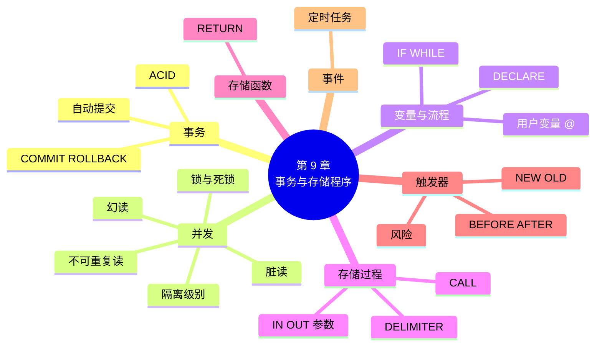

# 第 9 章 事务、存储过程与触发器

!!! abstract "本章学时"
    理论 6 学时 · 实验 2 学时 · 线下研讨 1 学时（本章共 3 个实验，教师可任选）

## 学习目标

学完本章，你应该能够：

1. **说出**事务的概念和 ACID 四个特性，并各举一个小店的例子（记忆、理解）；
2. **解释**脏读、不可重复读、幻读的含义，以及四种隔离级别分别能防止哪几种问题（理解）；
3. **使用** START TRANSACTION、COMMIT、ROLLBACK 完成一次可靠的下单操作（应用）；
4. **编写**带参数和流程控制的存储过程、简单的存储函数和触发器（应用）；
5. **判断**一项业务规则适合放在存储过程、触发器里，还是放在应用程序里（评价）。

!!! info "先修要求"
    学习本章前，你需要：

    - 会写增删改语句和多表查询（[3.6](../03-sql-ddl-dml/index.md#36)、[第 5 章](../05-multi-table-query/index.md)）；
    - 了解反规范化带来的数据同步问题（[7.6](../07-normalization/index.md#76)）。

??? abstract "本章概念清单（14 个，点击查看定义和例子）"
    1. [事务](../../appendix/glossary.md#g-事务)
    2. [提交](../../appendix/glossary.md#g-提交)
    3. [回滚](../../appendix/glossary.md#g-回滚)
    4. [ACID](../../appendix/glossary.md#g-ACID)
    5. [并发](../../appendix/glossary.md#g-并发)
    6. [脏读](../../appendix/glossary.md#g-脏读)
    7. [不可重复读](../../appendix/glossary.md#g-不可重复读)
    8. [幻读](../../appendix/glossary.md#g-幻读)
    9. [隔离级别](../../appendix/glossary.md#g-隔离级别)
    10. [锁](../../appendix/glossary.md#g-锁)
    11. [存储过程](../../appendix/glossary.md#g-存储过程)
    12. [存储函数](../../appendix/glossary.md#g-存储函数)
    13. [触发器](../../appendix/glossary.md#g-触发器)
    14. [事件](../../appendix/glossary.md#g-事件)

## 情景导入

网上订货开通第一周，小林就遇到了两件怪事。

第一件：顾客下单买 2 袋燕麦片，系统先把库存减了 2，接着写订单时网络断了，订单没写进去。结果库存少了 2 袋，却找不到是谁买的。

第二件：挂面只剩最后 1 包。店里收银台和网上同时有人买，两边都查到“库存 1”，两边都卖了，库存变成了 −1。

表哥说：“第一件要用**事务**：下单的几个步骤要么全做完，要么全不做。第二件是**并发**问题：两个人同时改同一份数据，要靠数据库的隔离和锁来管。”他还说，像“卖出商品就扣库存”“改价要留记录”这样的规则，可以交给数据库自动执行，这就是**触发器**；常做的一串操作可以存成**存储过程**，一句话就能调用。

本章的实验都在 txshop 库里做，它是示例库 shop 的一份副本，做坏了随时可以重建（运行 `labs/ch09/lab9_0_setup.sql`）。

## 9.1 事务

### 9.1.1 要么全做，要么全不做

一次下单，在数据库里至少是三步：

1. 扣库存：`UPDATE product SET stock = stock - 2 WHERE product_id = 8;`
2. 写订单：`INSERT INTO orders …`
3. 写明细：`INSERT INTO order_item …`

这三步在业务上是**一件事**。如果第 1 步做了、第 2 步失败了，数据就乱了。[**事务**](../../appendix/glossary.md#g-事务 "由一组 SQL 操作组成的不可分割的工作单位，其中的操作要么全部成功并保存，要么全部撤销"){ .term }就是把几条 SQL 捆成一个整体：**要么全部成功，要么全部撤销，不允许只做一半。**

MySQL 中用三条语句控制事务：

| 语句 | 作用 |
|---|---|
| `START TRANSACTION;`（或 `BEGIN;`） | 开始一个事务 |
| `COMMIT;` | [**提交**](../../appendix/glossary.md#g-提交 "结束事务并把事务中的全部修改永久保存到数据库，用 COMMIT 语句"){ .term }：把事务里的所有修改永久保存 |
| `ROLLBACK;` | [**回滚**](../../appendix/glossary.md#g-回滚 "撤销事务中尚未提交的全部修改，使数据回到事务开始前的状态，用 ROLLBACK 语句"){ .term }：撤销事务里的所有修改，回到开始前的样子 |

一次成功的下单：

```sql
START TRANSACTION;
UPDATE product SET stock = stock - 2 WHERE product_id = 8;        -- 燕麦片扣 2 袋
INSERT INTO orders (customer_id, employee_id, order_time, pay_method, status)
VALUES (1, 3, '2026-07-01 08:15:00', '微信', '已完成');
INSERT INTO order_item (order_id, product_id, quantity, unit_price)
VALUES (LAST_INSERT_ID(), 8, 2, 26.90);                            -- 刚生成的订单号
COMMIT;
```

提交后，燕麦片库存从 91 变成 89，订单 2502 和它的明细都在了。

中途出错的情况：扣了薯片的库存，写明细时商品编号写成了不存在的 999：

```sql
START TRANSACTION;
UPDATE product SET stock = stock - 1 WHERE product_id = 14;   -- 事务里看库存是 7
INSERT INTO order_item (order_id, product_id, quantity, unit_price)
VALUES (2502, 999, 1, 8.90);
ROLLBACK;                                                     -- 发现出错，全部撤销
```

```text
ERROR 1452 (23000): Cannot add or update a child row: a foreign key constraint fails (`txshop`.`order_item`, CONSTRAINT `order_item_ibfk_2` FOREIGN KEY (`product_id`) REFERENCES `product` (`product_id`))
```

回滚以后再查，薯片库存回到了 8，就像什么都没发生过。

!!! warning "出错时 MySQL 不会自动回滚整个事务"
    上面的例子里，INSERT 报错只是**这一条语句**失败了，前面的 UPDATE 还留在事务里。必须由你（或程序）发出 ROLLBACK，整个事务才会撤销。如果不管它、接着 COMMIT，扣库存这一步就被保存了。第 11 章用 Python 写程序时，会用 `try … except` 在出错时自动回滚。

### 9.1.2 自动提交

平时没写 START TRANSACTION 时，MySQL 处于**自动提交**模式：每一条增删改语句都被当成一个单独的事务，执行完立刻提交，没法回滚。这就是第 3 章说“DELETE 忘写 WHERE 就救不回来”的原因。

| 操作 | 语句 |
|---|---|
| 查看是否自动提交 | `SELECT @@autocommit;`（1 是开，0 是关） |
| 本会话关闭自动提交 | `SET autocommit = 0;`，之后每次都要手动 COMMIT |
| 临时用一次事务 | `START TRANSACTION;` … `COMMIT;`，结束后恢复自动提交 |

在 DBeaver 工具栏上有一个“自动提交 / 手动提交”的切换按钮。切到手动提交后，执行的修改要点“提交”按钮才会保存，点“回滚”按钮可以撤销。做危险的修改前切到手动模式，是个好习惯。

另外要注意：CREATE、ALTER、DROP、TRUNCATE 等 DDL 语句会**自动提交**当前事务，不能回滚。

### 9.1.3 事务的四个特性：ACID

可靠的事务要满足四个特性，取英文首字母叫 [**ACID**](../../appendix/glossary.md#g-ACID "事务的四个特性：原子性 Atomicity、一致性 Consistency、隔离性 Isolation、持久性 Durability"){ .term }：<sup class="cite">[[3]](#ref9-3)</sup>

| 特性 | 意思 | 小店的例子 |
|---|---|---|
| **原子性**（Atomicity） | 事务里的操作是一个整体，不可分割，要么全做，要么全不做 | 扣库存、写订单、写明细，不会只做了一半 |
| **一致性**（Consistency） | 事务前后，数据都满足所有规则（约束） | 库存不会变成负数，明细不会指向不存在的订单 |
| **隔离性**（Isolation） | 多个事务同时进行时，互相不干扰，就像一个一个排队执行 | 收银台和网上同时卖挂面，不会都卖出去 |
| **持久性**（Durability） | 一旦提交，修改就永久保存，即使马上断电也不会丢 | 顾客付了款、订单提交了，服务器重启后订单还在 |

数据库靠日志实现原子性和持久性（第 10 章介绍的二进制日志是其中一种），靠锁和多版本机制实现隔离性。一致性则是前三者加上约束共同保证的结果。

!!! tip "约束是一致性的最后一道防线"
    txshop 的商品表加了检查约束 `CHECK (stock >= 0)`。想卖库存为 0 的挂面：

    ```sql
    UPDATE product SET stock = stock - 1 WHERE product_id = 5;
    ```

    ```text
    ERROR 3819 (HY000): Check constraint 'chk_stock' is violated.
    ```

    哪怕程序有漏洞，数据库也不会让库存变成负数。

## 9.2 并发与隔离级别

### 9.2.1 并发带来的三种问题

很多人**同时**访问同一个数据库，叫[**并发**](../../appendix/glossary.md#g-并发 "多个用户或程序在同一时间访问、修改同一个数据库"){ .term }。如果多个事务完全不隔离，会出现下面三种问题。设想两个会话：A 是店长在改价，B 是收银员在查价。

| 问题 | 发生了什么 | 例子 |
|---|---|---|
| [**脏读**](../../appendix/glossary.md#g-脏读 "一个事务读到了另一个事务修改了但还没有提交的数据，而那个修改后来可能被撤销"){ .term } | 读到了别人**还没提交**的修改，而这个修改后来被撤销了 | A 把薯片从 8.90 改成 9.90，还没提交；B 读到 9.90 按这个价卖了；A 又撤销了。B 读到的是一个“从来没有真正存在过”的价格 |
| [**不可重复读**](../../appendix/glossary.md#g-不可重复读 "在同一个事务中两次读取同一行数据，因为中间有其他事务修改并提交，结果不一样"){ .term } | 同一个事务里，**两次读同一行**，结果不一样 | B 开始对账，先读到薯片 8.90；A 改价并提交；B 再读变成 9.90，对账对不上 |
| [**幻读**](../../appendix/glossary.md#g-幻读 "在同一个事务中两次按相同条件查询，因为中间有其他事务插入或删除了行，返回的行数不一样"){ .term } | 同一个事务里，**两次按同样的条件查**，行数不一样，像出现了“幻影” | B 统计“库存不足 10 件的商品”，第一次 5 种；A 插入了一种新商品（库存 3）并提交；B 再统计变成 6 种 |

不可重复读和幻读的区别：前者是**已有的行被改了**，后者是**多了或少了行**。

### 9.2.2 四种隔离级别

隔离得越严，问题越少，但多个事务互相等待也越多，速度越慢。SQL 标准定义了四种[**隔离级别**](../../appendix/glossary.md#g-隔离级别 "规定一个事务能看到其他并发事务修改的程度，从低到高为读未提交、读已提交、可重复读、可串行化"){ .term }，让你在“安全”和“速度”之间选择：<sup class="cite">[[4]](#ref9-4)</sup>

| 隔离级别 | 脏读 | 不可重复读 | 幻读 | 说明 |
|---|---|---|---|---|
| READ UNCOMMITTED（读未提交） | 会 | 会 | 会 | 最低，几乎不用 |
| READ COMMITTED（读已提交） | 不会 | 会 | 会 | Oracle、PostgreSQL、SQL Server 的默认值 |
| REPEATABLE READ（可重复读） | 不会 | 不会 | 会（标准规定） | **MySQL InnoDB 的默认值** |
| SERIALIZABLE（可串行化） | 不会 | 不会 | 不会 | 最高，事务像排队一样一个个执行，最慢 |

两点补充：

1. 按 SQL 标准，可重复读还可能幻读。MySQL 的 InnoDB 在这一级别上做了加强：普通查询读的是事务开始时的“快照”，看不到别人新插入的行；加锁的查询和修改会把扫描的范围锁住，不让别人往里插。所以在 MySQL 默认级别下，幻读在大多数情况下也不会发生；<sup class="cite">[[6]](#ref9-6)</sup>
2. 这张表是考试的高频考点，记住两头：**读未提交什么都防不住，可串行化什么都能防住**，中间每升一级多防一种。

查看和设置隔离级别：

```sql
SELECT @@transaction_isolation;                                    -- 查看当前会话
SET SESSION TRANSACTION ISOLATION LEVEL READ COMMITTED;            -- 只改当前会话
SET GLOBAL TRANSACTION ISOLATION LEVEL REPEATABLE READ;            -- 改全局（新连接生效）
```

<iframe class="sim-frame" src="../../sims/isolation-levels/main.html" height="640" loading="lazy" title="隔离级别与并发问题"></iframe>
动画：隔离级别与并发问题。左右两个收银台（会话 A、B）按时间顺序一步步操作同一种商品。切换四种隔离级别，看 B 每一步读到的价格，什么时候出现脏读、不可重复读、幻读。[全屏打开](../../sims/isolation-levels/main.html){ target=_blank }
{ .sim-caption }

### 9.2.3 编者实测：两个会话

实验 9-2 打开两个会话，按步骤交替执行。编者在 MySQL 8.4.13 上的结果（薯片原价 8.90，A 改成 9.90）：

| 场景 | B 的隔离级别 | A 做了什么 | B 读到 | 说明 |
|---|---|---|---|---|
| ① | 读未提交 | 改价，**未提交** | 9.90 | 脏读；A 回滚后 B 再读，又是 8.90 |
| ② | 读已提交 | 改价，**未提交** | 8.90 | 没有脏读 |
| ③ | 读已提交 | B 事务中先读一次（8.90），A 改价**并提交**，B 再读 | 9.90 | 不可重复读 |
| ④ | 可重复读 | 同上 | 8.90 | 可重复读；B 提交后再读，才是 9.90 |

### 9.2.4 锁：一次只让一个人改

隔离性的另一个工具是[**锁**](../../appendix/glossary.md#g-锁 "数据库为了防止多个事务同时修改同一数据而施加的控制，一个事务持有某行的锁时，其他事务要修改这行必须等待"){ .term }。InnoDB 在修改一行时会给这一行加锁，直到事务提交或回滚才释放。别的事务想改这一行，就得**等**。

实验 9-2 的场景 ⑤：A 开始事务修改燕麦片的库存，还没提交；B 也来改燕麦片的库存，于是 B 停住了。B 等了 5 秒（实验里把等待时间设成了 5 秒，默认是 50 秒）还没等到，报错：

```text
ERROR 1205 (HY000): Lock wait timeout exceeded; try restarting transaction
```

回到“最后一包挂面”的问题。正确的卖法是在事务里**先锁住再判断**：

```sql
START TRANSACTION;
SELECT stock FROM product WHERE product_id = 5 FOR UPDATE;   -- 读的同时锁住这一行
-- 程序判断：stock >= 1 才继续，否则 ROLLBACK
UPDATE product SET stock = stock - 1 WHERE product_id = 5;
COMMIT;
```

`FOR UPDATE` 让第二个人的 SELECT 也要等第一个人提交，等他读到时库存已经是 0 了，就不会超卖。再加上 `CHECK (stock >= 0)` 兜底，就万无一失了。

两个事务互相等对方手里的锁，谁也走不了，叫**死锁**（比如 A 锁了商品 1 想要商品 2，B 锁了商品 2 想要商品 1）。InnoDB 会自动发现死锁，选一个事务回滚，报错 1213。避免的办法是：**事务尽量短，多个事务按相同的顺序访问数据。**

## 9.3 变量与流程控制

在学存储过程之前，先认识 SQL 里的变量和流程控制语句。

### 9.3.1 用户变量

以 `@` 开头的是**用户变量**，在当前会话里一直有效，不用声明：

```sql
SET @low = 10;                                                   -- 给变量赋值
SELECT name, stock FROM product WHERE stock < @low;              -- 使用变量
SELECT COUNT(*) INTO @n FROM orders WHERE status = '已退款';     -- 把查询结果存进变量
SELECT @n AS 退款单数;                                           -- 结果是 51
```

第 6 章实验 6-2 里的 `SET @oid = LAST_INSERT_ID();` 就是用户变量。

### 9.3.2 局部变量和流程控制

在存储过程、函数、触发器的 `BEGIN … END` 里面，还可以用：

| 语句 | 作用 | 写法 |
|---|---|---|
| DECLARE | 声明局部变量（只在 BEGIN … END 里有效，不加 @） | `DECLARE i INT DEFAULT 1;` |
| SET | 赋值 | `SET i = i + 1;` |
| IF | 条件判断 | `IF 条件 THEN … ELSEIF 条件 THEN … ELSE … END IF;` |
| CASE | 多分支 | `CASE WHEN … THEN … END CASE;` |
| WHILE | 条件循环 | `WHILE 条件 DO … END WHILE;` |

这些语句只能写在存储程序里，不能单独执行。下一节结合例子来学。

## 9.4 存储过程与存储函数

### 9.4.1 存储过程：起了名字的一组 SQL

[**存储过程**](../../appendix/glossary.md#g-存储过程 "保存在数据库中、有名字的一组 SQL 语句，可以带参数，用 CALL 调用"){ .term }就是把一组 SQL 语句起个名字存在数据库里，以后用 `CALL 名字(参数)` 一句话调用。<sup class="cite">[[5]](#ref9-5)</sup>

先看最简单的：查库存不足的商品，“不足”的标准作为参数传进去：

```sql
DELIMITER //
CREATE PROCEDURE sp_low_stock(IN p_limit INT)
BEGIN
  SELECT product_id, name, stock
  FROM product
  WHERE stock < p_limit
  ORDER BY stock;
END //
DELIMITER ;

CALL sp_low_stock(10);
```

```text
+------------+-------------------+-------+
| product_id | name              | stock |
+------------+-------------------+-------+
|          5 | 挂面 1kg          |     0 |
|         23 | 橙汁 1L           |     0 |
|         14 | 原味薯片 104g     |     8 |
|         32 | 苹果 1kg          |     8 |
|         41 | 火锅底料 200g     |     8 |
+------------+-------------------+-------+
```

几个要点：

1. **DELIMITER**：存储过程里面有好几个分号，如果还用分号表示“语句结束”，MySQL 读到第一个分号就以为结束了。所以先用 `DELIMITER //` 把结束符临时改成 `//`，写完再改回分号。在 DBeaver 里，可以直接选中整个 `CREATE PROCEDURE … END` 再按 Ctrl+Enter 执行；
2. 参数有三种：`IN`（传进去，最常用，可省略不写）、`OUT`（传出来）、`INOUT`（传进去、改了再传出来）；
3. 参数名习惯加 `p_` 前缀，免得和列名混淆。

### 9.4.2 带流程控制和输出参数

按积分算会员等级（1500 分以上金卡，600 分以上银卡，其余普通），等级通过 OUT 参数传出来：

```sql
DELIMITER //
CREATE PROCEDURE sp_level(IN p_points INT, OUT p_level VARCHAR(10))
BEGIN
  IF p_points >= 1500 THEN
    SET p_level = '金卡';
  ELSEIF p_points >= 600 THEN
    SET p_level = '银卡';
  ELSE
    SET p_level = '普通';
  END IF;
END //
DELIMITER ;

CALL sp_level(800, @lv);     -- 用一个用户变量接住输出参数
SELECT @lv AS 等级;          -- 银卡
```

再看一个循环的例子，用 WHILE 求 1 到 100 的和（运行结果 5050）：

```sql
DELIMITER //
CREATE PROCEDURE sp_sum100()
BEGIN
  DECLARE i INT DEFAULT 1;
  DECLARE s INT DEFAULT 0;
  WHILE i <= 100 DO
    SET s = s + i;
    SET i = i + 1;
  END WHILE;
  SELECT s AS 一到一百的和;
END //
DELIMITER ;
```

管理存储过程：

| 操作 | 语句 |
|---|---|
| 查看有哪些 | `SHOW PROCEDURE STATUS WHERE Db = 'txshop';` |
| 查看定义 | `SHOW CREATE PROCEDURE sp_level;` |
| 删除 | `DROP PROCEDURE IF EXISTS sp_level;` |

存储过程不能用 ALTER 修改内容，要先 DROP 再 CREATE。

### 9.4.3 存储函数

[**存储函数**](../../appendix/glossary.md#g-存储函数 "保存在数据库中、用 RETURN 返回一个值的程序，可以像 ROUND、CONCAT 等内置函数一样写在 SQL 表达式里"){ .term }和存储过程很像，区别是它**必须用 RETURN 返回一个值**，而且可以像 ROUND、CONCAT 一样直接写在 SELECT 里。例如计算一张订单的金额：

```sql
DELIMITER //
CREATE FUNCTION fn_order_amount(p_order_id INT)
RETURNS DECIMAL(10,2)
READS SQL DATA
BEGIN
  DECLARE v DECIMAL(10,2);
  SELECT SUM(quantity * unit_price) INTO v FROM order_item WHERE order_id = p_order_id;
  RETURN IFNULL(v, 0);
END //
DELIMITER ;

SELECT order_id, fn_order_amount(order_id) AS 金额
FROM orders WHERE order_id IN (2499, 2500, 2501);
```

```text
+----------+--------+
| order_id | 金额   |
+----------+--------+
|     2499 | 152.60 |
|     2500 |  26.90 |
|     2501 |  19.80 |
+----------+--------+
```

`READS SQL DATA` 声明这个函数会读表但不改表。MySQL 默认开启了二进制日志，要求函数声明这类特性，不写会报错 1418。

| | 存储过程 | 存储函数 |
|---|---|---|
| 调用方式 | `CALL 名字(…)` | 写在表达式里，如 `SELECT 名字(…)` |
| 返回 | 可以没有，也可以用 OUT 参数返回多个值，或直接输出结果集 | 必须用 RETURN 返回一个值 |
| 适合做 | 一组操作（汇总、批量更新） | 一个计算（算金额、算等级） |

### 9.4.4 什么时候用存储过程

| 适合 | 不太适合 |
|---|---|
| 固定的批处理，如每月汇总、清理过期数据 | 复杂的业务逻辑（调试、版本管理都不方便） |
| 多个程序都要用的同一段数据操作 | 需要经常修改的规则 |
| 减少程序和数据库之间的来回通信 | 要在不同数据库之间迁移的系统（各家的语法不一样） |

现在很多互联网公司倾向于把业务逻辑写在应用程序里（第 11 章），数据库只负责存数据和保证约束；银行、电信、企业内部系统则大量使用存储过程。两种做法都要会看懂。

## 9.5 触发器

### 9.5.1 自动执行的“开关”

[**触发器**](../../appendix/glossary.md#g-触发器 "绑定在某张表上、在插入、修改或删除行时由数据库自动执行的一段程序"){ .term }是绑在一张表上的一段程序，当这张表发生 INSERT、UPDATE 或 DELETE 时，**数据库自动执行它**，不需要谁去调用。<sup class="cite">[[7]](#ref9-7)</sup>

```sql
CREATE TRIGGER 触发器名
{BEFORE | AFTER} {INSERT | UPDATE | DELETE} ON 表名
FOR EACH ROW
BEGIN
  …
END
```

- `BEFORE`、`AFTER`：在修改之前还是之后执行。BEFORE 适合检查数据、拒绝不合格的修改；AFTER 适合联动修改别的表、记日志；
- `FOR EACH ROW`：每影响一行就执行一次。一条 UPDATE 改了 5 行，触发器执行 5 次；
- `NEW` 和 `OLD`：代表正在被修改的这一行。INSERT 时只有 NEW（新插入的行），DELETE 时只有 OLD（被删的行），UPDATE 时两个都有（改前和改后）。

### 9.5.2 卖出商品自动扣库存

在订单明细表上建两个触发器：插入前检查库存够不够，插入后扣库存。

```sql
DELIMITER //
CREATE TRIGGER trg_item_check
BEFORE INSERT ON order_item
FOR EACH ROW
BEGIN
  IF (SELECT stock FROM product WHERE product_id = NEW.product_id) < NEW.quantity THEN
    SIGNAL SQLSTATE '45000' SET MESSAGE_TEXT = '库存不足，不能下单';
  END IF;
END //

CREATE TRIGGER trg_item_stock
AFTER INSERT ON order_item
FOR EACH ROW
BEGIN
  UPDATE product SET stock = stock - NEW.quantity WHERE product_id = NEW.product_id;
END //
DELIMITER ;
```

`SIGNAL SQLSTATE '45000'` 的作用是主动报一个错，让这次插入失败。试一试：

```sql
INSERT INTO order_item VALUES (@oid, 14, 3, 8.90);   -- 买 3 包薯片：成功，库存 8 → 5
INSERT INTO order_item VALUES (@oid, 5, 1, 8.50);    -- 买 1 包挂面（库存 0）：
```

```text
ERROR 1644 (45000): 库存不足，不能下单
```

现在，不管是哪个程序、哪个人往订单明细里插数据，库存都会自动扣，而且不会超卖。第 7 章担心的“冗余数据忘了同步”，也可以这样用触发器解决。

### 9.5.3 改价日志

老板想知道每次改价是谁改的、从多少改成多少。在商品表上建一个 AFTER UPDATE 触发器（实验 9-3）：

```sql
CREATE TRIGGER trg_price_log
AFTER UPDATE ON product
FOR EACH ROW
BEGIN
  IF NEW.price <> OLD.price THEN
    INSERT INTO price_log (product_id, old_price, new_price, changed_by)
    VALUES (OLD.product_id, OLD.price, NEW.price, CURRENT_USER());
  END IF;
END
```

`IF NEW.price <> OLD.price` 保证只改库存、不改价格时不记日志。

### 9.5.4 触发器的风险

触发器很方便，但要慎用：

1. **看不见**：程序员看程序代码，不知道插入一行明细会悄悄改了商品表。出了问题很难查；
2. **连锁反应**：触发器里的修改又触发了别的触发器，一环扣一环，难以控制；
3. **拖慢速度**：每一行都要执行一次，批量导入几十万行时会明显变慢；
4. **限制**：MySQL 的触发器里不能用 COMMIT、ROLLBACK，不能修改触发它的那张表。

**建议：触发器只用来做简单、必须保证的规则（如扣库存、记日志），并在设计文档里写清楚。** 用 `SHOW TRIGGERS;` 可以查看库里所有的触发器。

## 9.6 事件：定时执行的任务

[**事件**](../../appendix/glossary.md#g-事件 "MySQL 中按设定的时间或周期自动执行的任务，由事件调度器负责运行"){ .term }（Event）是 MySQL 的“定时任务”：到了指定的时间，或者每隔一段时间，自动执行一段 SQL。<sup class="cite">[[8]](#ref9-8)</sup> 例如每月 1 日凌晨 2 点，自动汇总上个月的销售：

```sql
CREATE EVENT ev_month_summary
ON SCHEDULE EVERY 1 MONTH STARTS '2026-08-01 02:00:00'
DO CALL sp_month_summary(DATE_FORMAT(CURDATE() - INTERVAL 1 MONTH, '%Y-%m'), @s);
```

事件由**事件调度器**负责运行，MySQL 8 默认是打开的，可以用 `SHOW VARIABLES LIKE 'event_scheduler';` 查看（值为 ON）。查看已有的事件用 `SHOW EVENTS;`，删除用 `DROP EVENT ev_month_summary;`。

计算机等级考试二级 MySQL 的大纲把触发器、事件、存储过程和存储函数并列为“数据库编程”的内容，这四者都要会写简单的例子。

## 9.7 前沿视窗：分布式事务与国产数据库

一台服务器上的事务，靠本章的日志和锁就能保证 ACID。可是大型电商、银行的数据分布在几十上百台服务器上：一笔转账，扣款在北京的服务器，入账在上海的服务器，怎样保证“要么都成功、要么都失败”？这就是**分布式事务**问题。

传统做法是“两阶段提交”：先问所有服务器“你们都准备好了吗”，都回答“好了”，再一起提交；有一个说“不行”，就一起回滚。它可靠但慢。近十几年出现了一批**分布式数据库**，把这些复杂的工作藏在数据库内部，对用户来说就像用一个普通数据库：Google 的 Spanner 用原子钟和 GPS 给全球的服务器对时，保证跨洲的事务也有正确的先后顺序；<sup class="cite">[[9]](#ref9-9)</sup> 国产的 OceanBase、TiDB、PolarDB 等也都支持分布式事务，并且兼容 MySQL 的语法，本章学的 START TRANSACTION、COMMIT、ROLLBACK 在它们上面照样能用。

## 本章实验

!!! abstract "实验总览"
    | 实验 | 类型 | 建议时长 | 内容 |
    |---|---|---|---|
    | 实验 9-1 | ★ 基础 | 30 分钟 | 用事务完成下单，故意制造失败看回滚，验证检查约束防超卖 |
    | 实验 9-2 | ★ 基础 | 45 分钟 | 打开两个会话，演示脏读、不可重复读、可重复读和锁等待 |
    | 实验 9-3 | ☆ 拓展 | 45 分钟 | 写一个“月度销售汇总”存储过程和一个改价日志触发器 |

    SQL 脚本见配套资源 `labs/ch09/` 目录。先运行 `lab9_0_setup.sql` 建立练习库 txshop；任何时候想重来，再运行一次即可还原。正文中的例子在 `ch9_examples.sql` 里。

### 实验 9-1 ★ 用事务完成下单

**实验目的**

1. 掌握 START TRANSACTION、COMMIT、ROLLBACK 的用法；
2. 体会原子性和一致性：出错时回滚，约束兜底。

**实验环境**：本机 MySQL 8.4 + DBeaver（或命令行）。**实验数据**：`lab9_0_setup.sql` 从示例库 shop 复制出的 txshop，并给商品表加了 `CHECK (stock >= 0)`。

**实验步骤与代码**

1. 运行 `labs/ch09/lab9_0_setup.sql`，记下燕麦片（8）、薯片（14）、挂面（5）的库存；
2. 打开 `labs/ch09/lab9_1_order_tx.sql`，**逐条执行**，每执行一条就想一想“现在库存是多少”：

```sql
-- ② 中途出错：扣了库存，写明细时商品编号写错了（999 不存在）
START TRANSACTION;
UPDATE product SET stock = stock - 1 WHERE product_id = 14;
SELECT stock FROM product WHERE product_id = 14;               -- 事务里看到 7
INSERT INTO order_item (order_id, product_id, quantity, unit_price)
VALUES (2502, 999, 1, 8.90);                                   -- 报错 1452
ROLLBACK;                                                      -- 发现出错，全部撤销
SELECT stock FROM product WHERE product_id = 14;               -- 回到 8

-- ③ 超卖：挂面（商品 5）库存是 0，还想卖 1 包
START TRANSACTION;
UPDATE product SET stock = stock - 1 WHERE product_id = 5;     -- 违反 chk_stock，报错 3819
ROLLBACK;
```

3. 在 DBeaver 里把事务模式切换为“手动提交”，执行一条 `DELETE FROM order_item WHERE order_id = 2502;`，查一下明细没了，再点工具栏的“回滚”，查一下明细回来了。

**运行结果**

编者在 MySQL 8.4.13 上的运行结果：

```text
准备：挂面 0，燕麦片 91，薯片 8
① 提交后燕麦片库存 89，新订单号 2502
② 事务中薯片库存 7
   ERROR 1452 (23000): Cannot add or update a child row: a foreign key constraint fails (`txshop`.`order_item`, CONSTRAINT `order_item_ibfk_2` FOREIGN KEY (`product_id`) REFERENCES `product` (`product_id`))
   回滚后薯片库存 8
③ ERROR 3819 (HY000): Check constraint 'chk_stock' is violated.
   挂面库存仍为 0
```

**实验记录表**

| 步骤 | 操作后的库存 | 你的解释 |
|---|---|---|
| ① 提交后 | 燕麦片： | |
| ② 事务中 | 薯片： | |
| ② 回滚后 | 薯片： | |
| ③ | 挂面： | |
| 第 3 步回滚后 | 订单 2502 的明细还在吗？ | |

**常见问题排查**

| 现象 | 原因 | 解决办法 |
|---|---|---|
| 回滚以后库存没有恢复 | 处于自动提交模式，没写 START TRANSACTION，UPDATE 已经提交了 | 先 START TRANSACTION，或在 DBeaver 中切到手动提交 |
| 在 DBeaver 里 ROLLBACK 没效果 | 两条语句在不同的连接里执行（DBeaver 的“独立连接”设置） | 在同一个 SQL 编辑器里执行；或使用工具栏的提交、回滚按钮 |
| 新订单号不是 2502 | 之前多运行过几次，自增编号往后跳了 | 正常；重新运行 lab9_0_setup.sql 可以还原 |

**思考与练习**

1. 第 ② 步如果在报错后不执行 ROLLBACK，而是执行 COMMIT，薯片的库存会是多少？为什么？
2. 为什么说 `CHECK (stock >= 0)` 是“最后一道防线”？只靠程序判断库存够不够，可能出什么问题？

**实验报告要求**

完成实验记录表，截图三次报错信息，回答思考题。

### 实验 9-2 ★ 两个会话演示隔离级别

**实验目的**

1. 亲眼看到脏读、不可重复读，以及可重复读如何防止它们；
2. 体会锁等待。

**实验环境**：本机 MySQL 8.4。需要**两个独立的会话**：在 DBeaver 中打开两个 SQL 编辑器（工具栏“SQL 编辑器 → 新建脚本”，并在“首选项 → 编辑器 → SQL 编辑器”中勾选“为每个编辑器打开单独的连接”），或打开两个命令行窗口各登录一次 mysql。**实验数据**：txshop。

**实验步骤与代码**

1. 左边窗口打开 `labs/ch09/lab9_2_session_A.sql`，右边打开 `lab9_2_session_B.sql`；
2. **严格按“步骤号”交替执行**，一次只执行一步（选中那一两行，按 Ctrl+Enter）。把每一步 B 读到的价格记在记录表里；
3. 关键步骤如下：

```sql
-- 会话 B 步骤 1：隔离级别降到最低
SET SESSION TRANSACTION ISOLATION LEVEL READ UNCOMMITTED;
-- 会话 A 步骤 2：开始事务，改价但不提交
START TRANSACTION;
UPDATE product SET price = 9.90 WHERE product_id = 14;
-- 会话 B 步骤 3：读到了吗？
SELECT price FROM product WHERE product_id = 14;
-- 会话 A 步骤 4：撤销
ROLLBACK;
-- 会话 B 步骤 5：再读
SELECT price FROM product WHERE product_id = 14;
```

4. 把 B 的隔离级别依次改成 READ COMMITTED、REPEATABLE READ，按脚本中的说明重做相应步骤；
5. 最后做场景 ⑤（锁等待）：A 开事务改燕麦片库存不提交，B 也改同一行，观察 B 等待、超时报错。

**运行结果**

编者用两个连接在 MySQL 8.4.13 上按步骤执行的结果：

```text
场景①  B 读未提交：A 改价未提交时 B 读到 9.90（脏读）；A 回滚后 B 读到 8.90
场景②  B 读已提交：A 改价未提交时 B 读到 8.90
场景③  B 读已提交：B 事务中第一次读 8.90；A 改价并提交；B 第二次读 9.90（不可重复读）
场景④  B 可重复读：B 事务中第一次读 8.90；A 改价并提交；B 第二次读 8.90；B 提交后再读 9.90
场景⑤  B 等待 5.0 秒后：ERROR 1205 (HY000): Lock wait timeout exceeded; try restarting transaction
全局默认隔离级别：REPEATABLE-READ
```

**实验记录表**

| 场景 | B 的隔离级别 | B 读到的价格（每一步） | 出现了哪种问题 |
|---|---|---|---|
| ① | READ UNCOMMITTED | | |
| ② | READ COMMITTED | | |
| ③ | READ COMMITTED | | |
| ④ | REPEATABLE READ | | |
| ⑤ | — | B 等了多久？报什么错？ | |

**常见问题排查**

| 现象 | 原因 | 解决办法 |
|---|---|---|
| B 读到的总是新价格，场景 ④ 也一样 | 两个编辑器其实共用一个连接 | 按“实验环境”的说明设置单独连接，或用两个命令行窗口 |
| B 读不到 A 的修改，场景 ① 也一样 | B 的隔离级别没改成功，或 A 没有在事务中 | 在 B 执行 `SELECT @@transaction_isolation;` 确认 |
| 场景 ⑤ B 一直不报错 | A 已经提交或回滚，锁已释放 | 按顺序重做：A 先开事务改、不提交，B 再改 |
| 后面的场景价格不对 | 前面场景没把价格改回 8.90 | 执行 A 的步骤 9，或重新运行 lab9_0_setup.sql |

**思考与练习**

1. 收银台和网上同时卖最后一包挂面，用 `SELECT … FOR UPDATE` 怎样解决？写出完整的事务。
2. 为什么 MySQL 不把默认隔离级别设成最安全的 SERIALIZABLE？

**实验报告要求**

完成实验记录表，截图场景 ① 和场景 ④ 中 B 两次读到的结果，回答思考题。

### 实验 9-3 ☆ 月度汇总存储过程和改价日志触发器

**实验目的**

1. 编写带输入、输出参数的存储过程，并把结果写入汇总表；
2. 编写 AFTER UPDATE 触发器，体会 OLD 和 NEW 的用法。

**实验环境**：本机 MySQL 8.4 + DBeaver。**实验数据**：txshop。

**实验步骤与代码**

1. 打开 `labs/ch09/lab9_3_proc_trigger.sql`，先读懂存储过程 sp_month_summary：它根据传入的月份（如 '2026-06'）算出这个月已完成订单的销售额，通过 OUT 参数传出来，同时把订单数和销售额写进 monthly_summary 表：

```sql
CREATE PROCEDURE sp_month_summary(IN p_month CHAR(7), OUT p_sales DECIMAL(12,2))
BEGIN
  DECLARE v_start DATE;
  SET v_start = STR_TO_DATE(CONCAT(p_month, '-01'), '%Y-%m-%d');

  SELECT IFNULL(SUM(oi.quantity * oi.unit_price), 0) INTO p_sales
  FROM orders o JOIN order_item oi ON oi.order_id = o.order_id
  WHERE o.status = '已完成'
    AND o.order_time >= v_start AND o.order_time < v_start + INTERVAL 1 MONTH;

  REPLACE INTO monthly_summary (month, order_count, sales)
  SELECT p_month, COUNT(*), p_sales
  FROM orders
  WHERE status = '已完成'
    AND order_time >= v_start AND order_time < v_start + INTERVAL 1 MONTH;
END
```

`REPLACE INTO` 的意思是“主键已经有这一行就替换，没有就插入”，同一个月重复汇总不会报错。

2. 执行建表、建存储过程的部分，然后调用：

```sql
CALL sp_month_summary('2026-05', @s);
CALL sp_month_summary('2026-06', @s);
SELECT @s AS 六月销售额;
SELECT month, order_count, sales FROM monthly_summary ORDER BY month;
```

3. 执行建 price_log 表和触发器 trg_price_log 的部分（见 9.5.3 节），然后做三次修改，查看日志：

```sql
UPDATE product SET price = 42.00 WHERE product_id = 1;      -- 改价：会记日志
UPDATE product SET stock = stock + 10 WHERE product_id = 1;  -- 只改库存：不记
UPDATE product SET price = ROUND(price * 0.9, 1) WHERE category_id = 4;   -- 饮料九折
SELECT product_id, old_price, new_price, changed_by FROM price_log ORDER BY log_id;
```

**运行结果**

编者在 MySQL 8.4.13 上的运行结果：

```text
+-----------------+
| 六月销售额      |
+-----------------+
|        11241.30 |
+-----------------+
+---------+-------------+----------+
| month   | order_count | sales    |
+---------+-------------+----------+
| 2026-05 |         141 |  9936.40 |
| 2026-06 |         139 | 11241.30 |
+---------+-------------+----------+
+------------+-----------+-----------+----------------+
| product_id | old_price | new_price | changed_by     |
+------------+-----------+-----------+----------------+
|          1 |     39.90 |     42.00 | root@localhost |
|         20 |     28.00 |     25.20 | root@localhost |
|         21 |     15.90 |     14.30 | root@localhost |
|         22 |      4.50 |      4.10 | root@localhost |
|         23 |     13.80 |     12.40 | root@localhost |
|         24 |     36.00 |     32.40 | root@localhost |
+------------+-----------+-----------+----------------+
```

汇总的 6 月销售额和第 5 章、第 8 章算出来的一样。一条 UPDATE 给 5 种饮料打折，触发器执行了 5 次，记了 5 条日志；只改库存的那次没有记。

**实验记录表**

| 任务 | 你的结果 |
|---|---|
| 调用 sp_month_summary 汇总 2026 年 1～4 月，四个月的销售额 | |
| 同一个月调用两次，monthly_summary 里有几行这个月的？为什么？ | |
| 把触发器里的 `IF NEW.price <> OLD.price` 去掉，再只改库存，会记日志吗？ | |
| 写一个存储函数 fn_level(p_points INT)，返回会员等级（参考 9.4.2 节） | |

**常见问题排查**

| 现象 | 原因 | 解决办法 |
|---|---|---|
| `ERROR 1064 … near 'END'` 或建到一半就报语法错 | 命令行里没有改 DELIMITER | 用 `DELIMITER //` 包住；DBeaver 中选中整段再执行 |
| `PROCEDURE sp_month_summary already exists` | 已经建过 | 先 `DROP PROCEDURE IF EXISTS …` |
| 汇总结果是 0 | 月份格式不对，如写成 '2026-6' | 写成 '2026-06' |
| `ERROR 1418 … This function has none of DETERMINISTIC, NO SQL, or READS SQL DATA` | 建函数时没声明特性 | 加 `READS SQL DATA` |

**思考与练习**

1. 用 9.6 节的方法，为 sp_month_summary 建一个每月 1 日自动执行的事件。
2. 改价日志记录了是谁改的（CURRENT_USER()）。如果所有程序都用 root 连数据库，这个记录还有意义吗？第 10 章会讲怎样给每个人分配自己的账号。

**实验报告要求**

提交存储过程、触发器的代码和运行结果截图，完成实验记录表。

## 本章小结

- **事务**把多条 SQL 捆成一个整体，要么全部成功（**COMMIT**），要么全部撤销（**ROLLBACK**）。MySQL 默认自动提交；出错时不会自动回滚整个事务，要显式 ROLLBACK；DDL 语句会自动提交。
- **ACID**：原子性（全做或全不做）、一致性（前后都满足约束）、隔离性（并发事务互不干扰）、持久性（提交后永久保存）。
- 并发问题：**脏读**（读到未提交的数据）、**不可重复读**（同一行两次读不一样）、**幻读**（同样条件两次查行数不一样）。
- 四种**隔离级别**：读未提交、读已提交、可重复读（**MySQL 默认**）、可串行化，级别越高防住的问题越多、速度越慢。修改行会加**锁**，别人要等；`SELECT … FOR UPDATE` 读的同时加锁，防止超卖；死锁由 InnoDB 自动检测并回滚一方。
- **存储过程**：`CREATE PROCEDURE`，参数分 IN、OUT、INOUT，用 `CALL` 调用；可用 DECLARE、IF、WHILE 等流程控制；命令行中要改 **DELIMITER**。**存储函数**用 RETURN 返回一个值，可写在 SELECT 里。
- **触发器**在 INSERT、UPDATE、DELETE 时自动执行，分 BEFORE、AFTER，用 **NEW**、**OLD** 引用行；适合扣库存、记日志等简单规则，但看不见、易连锁，要慎用。**事件**是定时任务。



**下一章预告**

到目前为止，我们一直用 root 账号做所有事情。真实的小店里，收银员、会计、老板该有不同的权限；数据库硬盘坏了，数据还能找回来吗？第 10 章学习数据库管理：安装配置 MySQL 和 PostgreSQL、创建用户和分配权限、备份与恢复，以及数据库安全。

## 参考文献

正文中的上标编号（如<sup class="cite">[[3]](#ref9-3)</sup>）对应下面的文献。带链接的可以直接打开；书籍可在图书馆或电子书平台查阅。

<div class="refs" markdown>

**教材与专著**

- <span id="ref9-1"></span>[1] 王珊，杜小勇，陈红. 数据库系统概论[M]. 6 版. 北京：高等教育出版社，2023.
    <span class="ref-note">第 8 章讲存储过程和函数，第 10、11 章讲事务、恢复和并发控制，与本章对应。</span>
- <span id="ref9-2"></span>[2] GRAY J, REUTER A. Transaction Processing: Concepts and Techniques[M]. San Francisco: Morgan Kaufmann, 1992.
    <span class="ref-note">事务处理领域的经典著作，作者 Jim Gray 因事务处理方面的贡献获得图灵奖。</span>

**经典论文**

- <span id="ref9-3"></span>[3] HAERDER T, REUTER A. Principles of transaction-oriented database recovery[J]. ACM Computing Surveys, 1983, 15(4): 287-317.
    <span class="ref-note">首次用 ACID 概括事务的四个特性，对应 9.1.3 节。</span>
- <span id="ref9-4"></span>[4] BERENSON H, BERNSTEIN P, GRAY J, et al. A critique of ANSI SQL isolation levels[C]//Proceedings of the 1995 ACM SIGMOD International Conference on Management of Data. New York: ACM, 1995: 1-10.
    <span class="ref-note">分析 SQL 标准中四种隔离级别和脏读、不可重复读、幻读的经典论文，对应 9.2 节。</span>
- <span id="ref9-9"></span>[9] CORBETT J C, DEAN J, EPSTEIN M, et al. Spanner: Google's globally-distributed database[C]//Proceedings of the 10th USENIX Symposium on Operating Systems Design and Implementation (OSDI). Hollywood: USENIX Association, 2012: 251-264.
    <span class="ref-note">Google 全球分布式数据库 Spanner 的论文，用原子钟和 GPS 实现跨数据中心的事务，对应 9.7 节。</span>

**在线资源与数据**

- <span id="ref9-5"></span>[5] Oracle. MySQL 8.4 Reference Manual: CREATE PROCEDURE and CREATE FUNCTION Statements[EB/OL]. [2026-11-01]. https://dev.mysql.com/doc/refman/8.4/en/create-procedure.html.
    <span class="ref-note">存储过程和存储函数的完整语法，包括参数类型和 READS SQL DATA 等特性，对应 9.4 节。</span>
- <span id="ref9-6"></span>[6] Oracle. MySQL 8.4 Reference Manual: Transaction Isolation Levels[EB/OL]. [2026-11-01]. https://dev.mysql.com/doc/refman/8.4/en/innodb-transaction-isolation-levels.html.
    <span class="ref-note">InnoDB 四种隔离级别的说明，默认级别为 REPEATABLE READ，以及它如何用间隙锁防止幻读，对应 9.2.2 节。</span>
- <span id="ref9-7"></span>[7] Oracle. MySQL 8.4 Reference Manual: Trigger Syntax and Examples[EB/OL]. [2026-11-01]. https://dev.mysql.com/doc/refman/8.4/en/trigger-syntax.html.
    <span class="ref-note">触发器的语法和 NEW、OLD 的用法，对应 9.5 节。</span>
- <span id="ref9-8"></span>[8] Oracle. MySQL 8.4 Reference Manual: Using the Event Scheduler[EB/OL]. [2026-11-01]. https://dev.mysql.com/doc/refman/8.4/en/event-scheduler.html.
    <span class="ref-note">事件调度器和 CREATE EVENT 的说明，对应 9.6 节。</span>

</div>

## 课后练习

选择题和判断题可以直接点击选项作答，系统会马上告诉你对错，并展开答案与解析；多选题选好后点“提交答案”。简答和实操题请先自己作答，再点开“答案与解析”核对。每道题的解析下方都有“回看”链接，做错了可以直接跳回正文复习。

**一、单项选择题**

<div class="quiz" data-answer="A" markdown>

**1.** 事务中的操作要么全部完成，要么全部不做，这是事务的（　　）。

- A. 原子性
- B. 一致性
- C. 隔离性
- D. 持久性

</div>

??? tip "答案与解析"
    **答案：A**

    考查：ACID · 认知层次：记忆 · [回看 9.1.3](#913-acid)
    { .quiz-meta }

<div class="quiz" data-answer="C" markdown>

**2.** 撤销事务中尚未提交的全部修改，使用的语句是（　　）。

- A. COMMIT
- B. START TRANSACTION
- C. ROLLBACK
- D. DELETE

</div>

??? tip "答案与解析"
    **答案：C**

    考查：事务控制语句 · 认知层次：记忆 · [回看 9.1.1](#911)
    { .quiz-meta }

<div class="quiz" data-answer="B" markdown>

**3.** 一个事务读到了另一个事务修改了但尚未提交的数据，称为（　　）。

- A. 幻读
- B. 脏读
- C. 不可重复读
- D. 死锁

</div>

??? tip "答案与解析"
    **答案：B**

    考查：并发问题 · 认知层次：记忆 · [回看 9.2.1](#921)
    { .quiz-meta }

<div class="quiz" data-answer="D" markdown>

**4.** MySQL InnoDB 默认的事务隔离级别是（　　）。

- A. READ UNCOMMITTED
- B. READ COMMITTED
- C. SERIALIZABLE
- D. REPEATABLE READ

</div>

??? tip "答案与解析"
    **答案：D**

    考查：隔离级别 · 认知层次：记忆 · [回看 9.2.2](#922)
    { .quiz-meta }

<div class="quiz" data-answer="C" markdown>

**5.** 能够防止脏读、但不能防止不可重复读的隔离级别是（　　）。

- A. READ UNCOMMITTED
- B. REPEATABLE READ
- C. READ COMMITTED
- D. SERIALIZABLE

</div>

??? tip "答案与解析"
    **答案：C**

    考查：隔离级别 · 认知层次：理解 · [回看 9.2.2](#922)
    { .quiz-meta }

<div class="quiz" data-answer="A" markdown>

**6.** 调用存储过程使用的语句是（　　）。

- A. CALL
- B. EXECUTE
- C. RUN
- D. SELECT

</div>

??? tip "答案与解析"
    **答案：A**

    解析：存储函数可以写在 SELECT 中，存储过程用 CALL 调用。

    考查：存储过程 · 认知层次：记忆 · [回看 9.4.1](#941-sql)
    { .quiz-meta }

<div class="quiz" data-answer="B" markdown>

**7.** 在 DELETE 触发器中，可以引用的是（　　）。

- A. 只有 NEW
- B. 只有 OLD
- C. NEW 和 OLD 都可以
- D. 都不可以

</div>

??? tip "答案与解析"
    **答案：B**

    解析：DELETE 时只有被删除的旧行 OLD；INSERT 时只有 NEW；UPDATE 时两者都有。

    考查：触发器 · 认知层次：理解 · [回看 9.5.1](#951)
    { .quiz-meta }

<div class="quiz" data-answer="D" markdown>

**8.** 在 mysql 命令行中创建存储过程前，通常要先执行 `DELIMITER //`，原因是（　　）。

- A. 存储过程名必须以 // 结尾
- B. 提高执行速度
- C. 开启事务
- D. 避免过程体中的分号被当作整条语句的结束

</div>

??? tip "答案与解析"
    **答案：D**

    考查：DELIMITER · 认知层次：理解 · [回看 9.4.1](#941-sql)
    { .quiz-meta }

<div class="quiz" data-answer="C" markdown>

**9.** 要在每月 1 日自动执行一次汇总，应使用 MySQL 的（　　）。

- A. 触发器
- B. 视图
- C. 事件
- D. 存储函数

</div>

??? tip "答案与解析"
    **答案：C**

    解析：触发器由表的增删改触发，事件按时间触发。

    考查：事件 · 认知层次：应用 · [回看 9.6](#96)
    { .quiz-meta }

**二、多项选择题**

<div class="quiz quiz-multi" data-answer="ABCD" markdown>

**1.** 事务的 ACID 特性包括（　　）。

- A. 原子性
- B. 一致性
- C. 隔离性
- D. 持久性

</div>

??? tip "答案与解析"
    **答案：ABCD**

    考查：ACID · 认知层次：记忆 · [回看 9.1.3](#913-acid)
    { .quiz-meta }

<div class="quiz quiz-multi" data-answer="ABC" markdown>

**2.** 下列关于 MySQL 事务的说法，正确的有（　　）。

- A. 默认处于自动提交模式，每条语句执行完立即提交
- B. 事务中某条语句出错后，需要显式执行 ROLLBACK 才会撤销整个事务
- C. DROP TABLE 等 DDL 语句会自动提交当前事务
- D. 提交后的事务仍然可以用 ROLLBACK 撤销

</div>

??? tip "答案与解析"
    **答案：ABC**

    解析：提交后修改已永久保存，不能再回滚（持久性）。

    考查：事务控制 · 认知层次：理解 · [回看 9.1.2](#912)
    { .quiz-meta }

<div class="quiz quiz-multi" data-answer="ACD" markdown>

**3.** 关于存储过程和存储函数，正确的有（　　）。

- A. 存储函数必须用 RETURN 返回一个值
- B. 存储过程不能有参数
- C. 存储过程可以通过 OUT 参数返回值
- D. 存储函数可以直接写在 SELECT 语句中

</div>

??? tip "答案与解析"
    **答案：ACD**

    考查：存储过程与函数 · 认知层次：理解 · [回看 9.4.3](#943)
    { .quiz-meta }

<div class="quiz quiz-multi" data-answer="ABD" markdown>

**4.** 使用触发器可能带来的问题有（　　）。

- A. 程序员看不到触发器的存在，出问题难以排查
- B. 触发器之间可能产生连锁反应
- C. 触发器会让数据完全无法修改
- D. 大批量修改数据时速度变慢

</div>

??? tip "答案与解析"
    **答案：ABD**

    考查：触发器的风险 · 认知层次：评价 · [回看 9.5.4](#954)
    { .quiz-meta }

**三、判断题**

<div class="quiz quiz-judge" data-answer="×" markdown>

**1.** 在 MySQL 中，事务里有一条语句执行出错时，整个事务会自动回滚。

- √ 正确
- × 错误

</div>

??? tip "答案与解析"
    **答案：×**

    解析：只是出错的那条语句失败，前面的修改仍在事务中，需要显式 ROLLBACK。

    考查：回滚 · 认知层次：理解 · [回看 9.1.1](#911)
    { .quiz-meta }

<div class="quiz quiz-judge" data-answer="√" markdown>

**2.** 隔离级别越高，并发问题越少，但多个事务之间的等待也越多。

- √ 正确
- × 错误

</div>

??? tip "答案与解析"
    **答案：√**

    考查：隔离级别 · 认知层次：理解 · [回看 9.2.2](#922)
    { .quiz-meta }

<div class="quiz quiz-judge" data-answer="√" markdown>

**3.** 一条 UPDATE 语句修改了 5 行，FOR EACH ROW 的触发器会执行 5 次。

- √ 正确
- × 错误

</div>

??? tip "答案与解析"
    **答案：√**

    解析：实验 9-3 中饮料九折时记了 5 条日志。

    考查：触发器 · 认知层次：理解 · [回看 9.5.1](#951)
    { .quiz-meta }

<div class="quiz quiz-judge" data-answer="×" markdown>

**4.** 不可重复读指的是同一事务中两次查询返回的行数不同。

- √ 正确
- × 错误

</div>

??? tip "答案与解析"
    **答案：×**

    解析：行数不同是幻读；不可重复读是同一行两次读到的值不同。

    考查：并发问题 · 认知层次：理解 · [回看 9.2.1](#921)
    { .quiz-meta }

<div class="quiz quiz-judge" data-answer="√" markdown>

**5.** `SELECT … FOR UPDATE` 在读取数据的同时会给这些行加锁。

- √ 正确
- × 错误

</div>

??? tip "答案与解析"
    **答案：√**

    考查：锁 · 认知层次：记忆 · [回看 9.2.4](#924)
    { .quiz-meta }

**四、简答题**

**1.** 什么是事务？用小店下单的例子说明为什么需要事务。

??? tip "答案与解析"
    **参考答案：** 事务是由一组 SQL 操作组成的不可分割的工作单位，其中的操作要么全部成功并提交，要么全部撤销。下单要扣库存、写订单、写明细三步，如果扣了库存而写订单失败，库存就少了却没有对应的订单，数据不一致。把三步放在一个事务里，任何一步失败就回滚，三步都撤销，保证数据正确。

    考查：事务的概念 · 认知层次：理解 · [回看 9.1.1](#911)
    { .quiz-meta }

**2.** 说明四种隔离级别分别能防止哪些并发问题。

??? tip "答案与解析"
    **参考答案：** READ UNCOMMITTED 不能防止脏读、不可重复读和幻读；READ COMMITTED 能防止脏读；REPEATABLE READ 能防止脏读和不可重复读（MySQL InnoDB 在此级别下通过快照和间隙锁，大多数情况下也不会出现幻读），是 MySQL 默认级别；SERIALIZABLE 三种问题都能防止，但并发性能最差。

    考查：隔离级别 · 认知层次：理解 · [回看 9.2.2](#922)
    { .quiz-meta }

**3.** 比较存储过程和触发器：它们分别怎样被执行？各适合做什么？

??? tip "答案与解析"
    **参考答案：** 存储过程需要用 CALL 主动调用，可以带参数，适合固定的批处理和多个程序共用的数据操作，如月度汇总；触发器绑定在表上，当表发生 INSERT、UPDATE、DELETE 时由数据库自动执行，不能直接调用，适合必须保证的简单规则，如卖出商品自动扣库存、改价时记日志。触发器隐蔽、可能连锁，应慎用。

    考查：存储过程与触发器 · 认知层次：分析 · [回看 9.5.4](#954)
    { .quiz-meta }

**五、实操题**

**1.** 学生选课库中有表 sc(sno, cno, grade) 和 student(sno, sname, total_credit)、course(cno, cname, credit)。写一个存储过程 sp_student_avg(IN p_sno CHAR(10), OUT p_avg DECIMAL(4,1))，求某个学生所有课程的平均成绩，并写出调用和查看结果的语句。

??? tip "答案与解析"
    **参考答案：**

    ```sql
    DELIMITER //
    CREATE PROCEDURE sp_student_avg(IN p_sno CHAR(10), OUT p_avg DECIMAL(4,1))
    BEGIN
      SELECT AVG(grade) INTO p_avg FROM sc WHERE sno = p_sno;
    END //
    DELIMITER ;

    CALL sp_student_avg('2026010001', @a);
    SELECT @a AS 平均成绩;
    ```

    考查：存储过程 · 认知层次：应用 · [回看 9.4.2](#942)
    { .quiz-meta }

**2.** 接上题，写一个触发器：当 sc 表插入一条选课记录且成绩 grade 不低于 60 时，自动把该课程的学分加到 student 表的 total_credit 上。

??? tip "答案与解析"
    **参考答案：**

    ```sql
    DELIMITER //
    CREATE TRIGGER trg_sc_credit
    AFTER INSERT ON sc
    FOR EACH ROW
    BEGIN
      IF NEW.grade >= 60 THEN
        UPDATE student
        SET total_credit = total_credit + (SELECT credit FROM course WHERE cno = NEW.cno)
        WHERE sno = NEW.sno;
      END IF;
    END //
    DELIMITER ;
    ```

    思考：如果成绩后来被修改（从 55 改成 70），这个触发器管不到，还需要一个 AFTER UPDATE 触发器。

    考查：触发器 · 认知层次：应用 · [回看 9.5.2](#952)
    { .quiz-meta }
