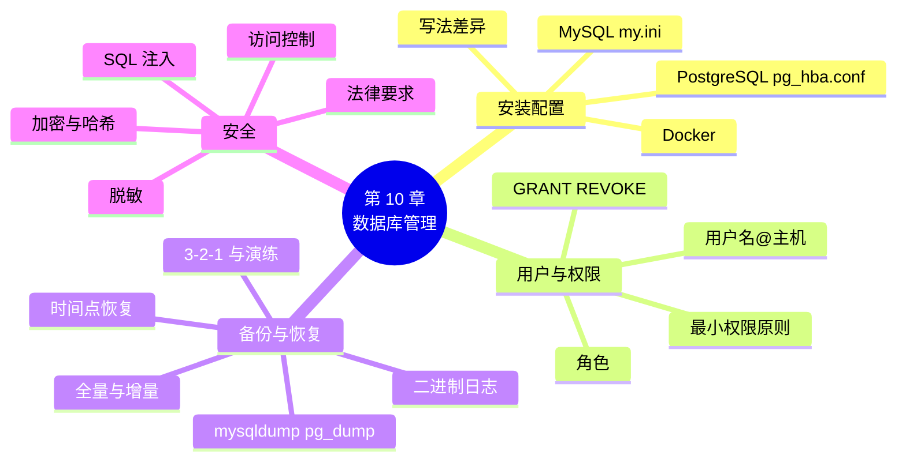

# 第 10 章 数据库管理：安装配置、权限、备份与安全

!!! abstract "本章学时"
    理论 5 学时 · 实验 1 学时 · 线下研讨 1 学时（本章共 3 个实验，教师可任选）

## 学习目标

学完本章，你应该能够：

1. **说出** MySQL 和 PostgreSQL 的常用配置项、默认端口和主要管理工具（记忆）；
2. **解释**用户、权限、角色之间的关系和最小权限原则（理解）；
3. **使用** CREATE USER、GRANT、REVOKE 为不同岗位建账号并授权，用 mysqldump 完成备份和恢复（应用）；
4. **说明**全量备份、增量备份和二进制日志各自的作用，能为小店设计一个简单的备份策略（应用、分析）；
5. **判断**一个数据库系统存在哪些安全隐患，并提出访问控制、加密、脱敏等防护办法（评价）。

!!! info "先修要求"
    学习本章前，你需要：

    - 会写增删改查语句，了解视图的作用（[第 3–5 章](../03-sql-ddl-dml/index.md)、[8.1](../08-view-index/index.md#81)）；
    - 了解事务的提交和回滚（[9.1](../09-transaction/index.md#91)）；
    - 会在命令行里输入命令、了解 Docker 容器的启动（《Linux 操作系统》课程的命令行和 Docker 部分）。

??? abstract "本章概念清单（13 个，点击查看定义和例子）"
    1. [用户账号](../../appendix/glossary.md#g-用户账号)
    2. [权限](../../appendix/glossary.md#g-权限)
    3. [角色](../../appendix/glossary.md#g-角色)
    4. [最小权限原则](../../appendix/glossary.md#g-最小权限原则)
    5. [备份](../../appendix/glossary.md#g-备份)
    6. [恢复](../../appendix/glossary.md#g-恢复)
    7. [逻辑备份](../../appendix/glossary.md#g-逻辑备份)
    8. [增量备份](../../appendix/glossary.md#g-增量备份)
    9. [二进制日志](../../appendix/glossary.md#g-二进制日志)
    10. [时间点恢复](../../appendix/glossary.md#g-时间点恢复)
    11. [SQL 注入](../../appendix/glossary.md#g-SQL-注入)
    12. [数据加密](../../appendix/glossary.md#g-数据加密)
    13. [数据脱敏](../../appendix/glossary.md#g-数据脱敏)

## 情景导入

小店的数据库上线三个月，一直用 root 账号。新来的收银员小周也用这个账号登录，一天他在 DBeaver 里随手点开顾客表，200 位顾客的手机号全在眼前。老板吓了一跳：“收银员只要查商品、录订单，为什么能看到所有人的手机号？要是他把表删了怎么办？”

没过几天，又出了一件事：店里那台旧电脑开不了机，维修师傅说硬盘坏了。好在表哥上个月帮忙在 U 盘里备份过一次，可是这一个月的订单全没了。

表哥总结了两条教训：

1. **不同的人用不同的账号，每个账号只给它需要的权限。**收银员查商品、录订单，会计只看报表，只有老板能改价格、看员工工资；
2. **数据要定期备份，而且备份要放在别的地方，还要真的试过能恢复。**

这一章就来做数据库管理员（DBA）的几件基本工作：把数据库装好、配好，给每个人分好账号和权限，做好备份和恢复，堵上常见的安全漏洞。

## 10.1 MySQL 的安装与配置

### 10.1.1 在 Windows 上安装

本书使用 MySQL 8.4，它是 MySQL 官方的长期支持（LTS）版本，只提供 64 位 Windows 安装包。官方手册推荐的安装方法是 MSI 安装包<sup class="cite">[[2]](#ref10-2)</sup>：

1. 在 MySQL 官网下载页（dev.mysql.com/downloads）选择 MySQL Community Server 8.4、Windows (x86, 64-bit)、MSI Installer，下载后双击运行；
2. 安装类型选 Typical（典型）。安装程序会装好服务器程序和一个名为 **MySQL Configurator** 的配置工具；
3. 安装结束时勾选“运行 MySQL Configurator”。**不配置，服务器是启动不了的**；
4. 在 Configurator 里依次设置：端口（默认 **3306**）、root 口令、是否作为 Windows 服务运行（服务名默认 MySQL84，勾选开机自动启动）；
5. 最后一步 Configurator 会启动服务。在“开始”菜单里打开 MySQL 8.4 Command Line Client，输入 root 口令，看到 `mysql>` 提示符就说明装好了。

一步一图的说明见[附录 B](../../appendix/b-environment.md)。装不上的同学，可以用 10.3 节的 Docker 环境，或者继续用网页里的“试一试”。

!!! warning "root 口令一定要记住"
    root 是数据库的“超级管理员”，口令忘了要按官方手册的步骤重置，很麻烦。建议把口令写在实验报告的第一页。

### 10.1.2 配置文件 my.ini

MySQL 启动时会读一个**配置文件**，Windows 上叫 `my.ini`，Linux 上一般叫 `my.cnf`。用 MSI 安装时，它通常在 `C:\ProgramData\MySQL\MySQL Server 8.4\` 目录下（ProgramData 是隐藏文件夹，要在资源管理器里打开“显示隐藏的项目”）。

配置文件按“节”分组，服务器的设置写在 `[mysqld]` 节里。初学者最常改的几项：

```ini
[mysqld]
port=3306                          # 端口：别的程序占用了 3306 时可以改成 3307
character-set-server=utf8mb4       # 服务器默认字符集：中文和表情符号都能存
max_connections=151                # 最多同时连接多少个客户端
datadir=C:/ProgramData/MySQL/MySQL Server 8.4/Data   # 数据文件存放的目录
```

**改完配置文件，要重启 MySQL 服务才会生效。**重启后可以用 `SHOW VARIABLES` 查看当前值。编者在 Docker 里的 MySQL 8.4.13 上查询的结果：

```sql
SHOW VARIABLES WHERE Variable_name IN
  ('port', 'character_set_server', 'collation_server',
   'max_connections', 'datadir', 'default_storage_engine');
```

```text
+------------------------+--------------------+
| Variable_name          | Value              |
+------------------------+--------------------+
| character_set_server   | utf8mb4            |
| collation_server       | utf8mb4_0900_ai_ci |
| datadir                | /var/lib/mysql/    |
| default_storage_engine | InnoDB             |
| max_connections        | 151                |
| port                   | 3306               |
+------------------------+--------------------+
```

`max_connections` 默认是 151。小店只有几台收银机，完全够用；一个有几百个并发用户的网站，就要调大这个值，同时考虑服务器内存够不够。

### 10.1.3 启动、停止与连接

MySQL 服务器是一个在后台一直运行的程序（Windows 上叫“服务”）。常用的操作：

| 操作 | Windows 命令（以管理员身份打开命令提示符） | 图形界面 |
|---|---|---|
| 启动服务 | `net start MySQL84` | Win + R 输入 `services.msc`，找到 MySQL84，点“启动” |
| 停止服务 | `net stop MySQL84` | 同上，点“停止” |
| 用命令行连接 | `mysql -u root -p`（回车后输入口令） | DBeaver 新建连接，填主机、端口、用户名和口令 |
| 检查服务是否在运行 | `mysqladmin -u root -p ping` | 服务列表里看状态 |

`mysql`、`mysqladmin` 这些命令在 MySQL 安装目录的 `bin` 文件夹里（默认 `C:\Program Files\MySQL\MySQL Server 8.4\bin`）。提示“不是内部或外部命令”时，要么先 `cd` 到这个目录，要么把它加到系统的 Path 环境变量里。

编者在 Docker 里运行 `mysqladmin ping` 和 `mysqladmin version` 的结果：

```text
mysqld is alive

Server version		8.4.13
Protocol version	10
Connection		Localhost via UNIX socket
Uptime:			22 min 38 sec
```

## 10.2 PostgreSQL 的安装与配置

### 10.2.1 安装与管理工具

PostgreSQL 是另一种最常用的开源关系数据库。人大金仓、openGauss、华为 GaussDB 等不少国产数据库都与它的语法兼容，第 12 章的向量扩展 pgvector 也装在它上面，所以本书把它和 MySQL 对照着学。本书使用 PostgreSQL 17。

Windows 上一般使用 PostgreSQL 官网下载页推荐的 EDB 安装包，安装过程中要设置：

- 超级用户 **postgres** 的口令（相当于 MySQL 的 root）；
- 端口，默认 **5432**；
- 安装组件：服务器、命令行工具、图形管理工具 **pgAdmin 4**、扩展安装器 Stack Builder（可以不装）。

两种数据库的对照：

| 项目 | MySQL 8.4 | PostgreSQL 17 |
|---|---|---|
| 默认端口 | 3306 | 5432 |
| 超级管理员 | root | postgres |
| 命令行客户端 | mysql | psql |
| 官方图形工具 | MySQL Workbench | pgAdmin 4 |
| 主配置文件 | my.ini / my.cnf | postgresql.conf |
| 谁能从哪里登录 | 账号的“主机”部分（10.4.1） | pg_hba.conf 文件 |
| 逻辑备份工具 | mysqldump | pg_dump |

DBeaver 两种都能连，新建连接时选对数据库类型就行。

### 10.2.2 两个配置文件

PostgreSQL 的配置分在两个文件里，都在数据目录下：

- **postgresql.conf**：服务器本身的设置，比如端口 `port`、最大连接数 `max_connections`、允许监听的网卡 `listen_addresses`；
- **pg_hba.conf**：规定“哪些用户、从哪些地址、用什么方式验证身份，才能连哪些库”（hba 是 host-based authentication，基于主机的认证）。

在 psql 里可以直接查到这些文件的位置和当前设置：

```sql
SHOW port;
SHOW max_connections;
SHOW hba_file;
```

编者在 Docker 里的 PostgreSQL 17.11 上查询的结果：

```text
 port
------
 5432

 max_connections
-----------------
 100

               hba_file
--------------------------------------
 /var/lib/postgresql/data/pg_hba.conf
```

这个 Docker 环境的 pg_hba.conf 里（去掉注释和复制相关的行）是这样的：

```text
local   all   all                    trust
host    all   all   127.0.0.1/32     trust
host    all   all   ::1/128          trust
host    all   all   all              scram-sha-256
```

每一行从左到右是：连接方式、数据库、用户、来源地址、验证方法。PostgreSQL **从上往下找第一条匹配的规则**<sup class="cite">[[5]](#ref10-5)</sup>。前三行的意思是：在本机上连接，**不用口令**（trust）；最后一行是：从其他任何地址连接，都要用 scram-sha-256 方式验证口令。

!!! warning "trust 只能用在自己的实验电脑上"
    trust 表示“相信对方，不验证口令”。正式环境里本机连接也应改成 scram-sha-256。改完 pg_hba.conf 后，在 psql 里执行 `SELECT pg_reload_conf();` 让它重新读配置。

### 10.2.3 psql 的常用命令

psql 里以反斜杠开头的是 psql 自己的命令，不是 SQL，结尾不用加分号：

| psql 命令 | 作用 | MySQL 里的对应写法 |
|---|---|---|
| `\l` | 列出所有数据库 | `SHOW DATABASES;` |
| `\c shop` | 切换到 shop 库 | `USE shop;` |
| `\dt` | 列出当前库的表 | `SHOW TABLES;` |
| `\d product` | 查看 product 表的结构 | `DESC product;` |
| `\du` | 列出用户和角色 | `SELECT user, host FROM mysql.user;` |
| `\q` | 退出 | `exit` |

### 10.2.4 两种数据库 SQL 写法的常见差异

两种数据库都遵循 SQL 标准，第 3–9 章学过的大部分语句可以直接通用。不一样的地方主要在函数名和一些细节上。下表的每一条，编者都在两边实际运行过（见实验 10-3）：

| 写法 | MySQL 8.4 | PostgreSQL 17 |
|---|---|---|
| 自增编号 | `AUTO_INCREMENT` | `GENERATED BY DEFAULT AS IDENTITY`（或旧写法 `SERIAL`） |
| 日期格式化 | `DATE_FORMAT(order_time, '%Y-%m')` | `TO_CHAR(order_time, 'YYYY-MM')` |
| 空值替换 | `IFNULL(x, '无')` 或 `COALESCE` | 只有 `COALESCE(x, '无')` |
| 字符串拼接 | `CONCAT(a, b)`；`a || b` 是“或”运算，结果是 0 | `CONCAT(a, b)` 或 `a || b` |
| 整数相除 `7 / 2` | 3.5000 | 3（整数除法；写成 `7.0 / 2` 才得 3.5） |
| `'abc' = 'ABC'` | 1（默认排序规则不区分大小写） | f（区分大小写） |
| 名字加引号 | 反引号 `` `name` `` | 双引号 `"name"`，反引号报语法错误 |
| 插入后取新编号 | `SELECT LAST_INSERT_ID();` | `INSERT … RETURNING customer_id;` |

所以，**尽量写标准 SQL**（比如用 COALESCE 而不是 IFNULL，用 CONCAT 拼接字符串），程序换数据库时要改的地方就少。

## 10.3 用 Docker 一键启动数据库

在《Linux 操作系统》课上你已经用过 Docker：一个**镜像**就是一个装好软件的“模板”，从镜像启动的**容器**就是一台“小电脑”。数据库厂商都提供了官方镜像，不用安装、不用配置，一条命令就能启动一个数据库。

本书配套资源 `labs/docker/docker-compose.yml` 同时启动 MySQL 8.4 和带 pgvector 的 PostgreSQL 17，并把小店示例数据放在容器的 `/data` 目录下：

```yaml
services:
  mysql:
    image: mysql:8.4                      # 官方 MySQL 8.4 镜像
    container_name: shop-mysql
    environment:
      MYSQL_ROOT_PASSWORD: shop123        # root 口令（只用于实验）
    command: ["--character-set-server=utf8mb4", "--local-infile=1"]
    ports: ["3306:3306"]                  # 本机 3306 端口 → 容器 3306 端口
    volumes:
      - mysql-data:/var/lib/mysql         # 数据存在数据卷里，删了容器数据也还在
```

（PostgreSQL 部分写法相同，完整文件见配套资源。）常用命令：

```bash
cd labs/docker
docker compose up -d                         # 后台启动两个数据库
docker ps                                    # 查看正在运行的容器
docker exec -it shop-mysql mysql -uroot -p   # 进入容器里的 mysql 命令行
docker exec -it shop-postgres psql -U postgres
docker compose stop                          # 停止（数据保留）
```

编者运行 `docker ps` 的结果：

```text
NAMES           IMAGE                    STATUS          PORTS
shop-postgres   pgvector/pgvector:pg17   Up 22 minutes   0.0.0.0:5432->5432/tcp
shop-mysql      mysql:8.4                Up 22 minutes   0.0.0.0:3306->3306/tcp, 33060/tcp
```

启动以后，DBeaver 里照常连接 localhost:3306 或 localhost:5432 就行，和本机安装的用起来没有区别。注意，配置文件里写 `MYSQL_ROOT_PASSWORD: shop123` 只适合实验；正式环境的口令不能明文写在文件里，更不能上传到代码仓库。

## 10.4 用户与权限

### 10.4.1 账号：用户名 @ 主机

到现在为止，我们一直用 root 做所有事。root 什么都能做，包括删库，所以日常工作不应该用它。管理员要为每个使用者建立自己的[**用户账号**](../../appendix/glossary.md#g-用户账号 "登录数据库的身份，由用户名、允许登录的主机和口令组成；MySQL 中写作 '用户名'@'主机'"){ .term }。

MySQL 的账号由**用户名和主机**两部分组成，写成 `'用户名'@'主机'`：

| 账号写法 | 含义 |
|---|---|
| `'clerk'@'localhost'` | clerk 只能在数据库服务器本机上登录 |
| `'clerk'@'192.168.1.%'` | clerk 只能从店里局域网（192.168.1.x）的电脑登录 |
| `'clerk'@'%'` | clerk 可以从任何地址登录（% 是通配符） |

`'clerk'@'localhost'` 和 `'clerk'@'%'` 是**两个不同的账号**，口令和权限可以不一样。建账号用 CREATE USER：

```sql
CREATE USER 'clerk'@'%' IDENTIFIED BY 'Clerk#2026';   -- 建账号并设置口令
ALTER USER 'clerk'@'%' IDENTIFIED BY 'New#Pass1';     -- 改口令
DROP USER 'clerk'@'%';                                -- 删账号
SELECT user, host FROM mysql.user;                    -- 查看所有账号
```

刚建好的账号只能登录，什么数据都看不到，因为它还没有任何**权限**。

### 10.4.2 GRANT 授权与 REVOKE 收回

[**权限**](../../appendix/glossary.md#g-权限 "允许某个账号对某个数据库对象执行某种操作的许可，例如对 product 表执行 SELECT；用 GRANT 授予、REVOKE 收回"){ .term }回答的是“谁可以对什么做什么”。授予权限用 GRANT，收回用 REVOKE，它们属于第 3 章讲的数据控制语言 DCL：

```sql
GRANT 权限列表 ON 对象 TO 账号;
REVOKE 权限列表 ON 对象 FROM 账号;
```

常用权限：

| 权限 | 允许做什么 |
|---|---|
| SELECT | 查询 |
| INSERT、UPDATE、DELETE | 插入、修改、删除数据 |
| CREATE、ALTER、DROP | 建、改、删表等对象 |
| INDEX、CREATE VIEW | 建索引、建视图 |
| EXECUTE | 调用存储过程和函数 |
| ALL PRIVILEGES | 以上全部 |

“对象”可以大到整个服务器，也可以小到一列：

```sql
GRANT ALL PRIVILEGES ON *.* TO 'dba'@'localhost';         -- 全局：所有库的所有表
GRANT SELECT ON shop.* TO 'report'@'%';                   -- 库级：shop 库的所有表
GRANT SELECT, INSERT ON shop.orders TO 'clerk'@'%';       -- 表级：只有 orders 表
GRANT SELECT (customer_id, name) ON shop.customer TO 'clerk'@'%';  -- 列级：只有两列
REVOKE INSERT ON shop.orders FROM 'clerk'@'%';            -- 收回插入权限
SHOW GRANTS FOR 'clerk'@'%';                              -- 查看 clerk 有哪些权限
```

列级权限很实用：店员要在订单上填顾客，需要看到顾客编号和姓名，但不该看到手机号。授权后，店员查手机号会报错（实验 10-1 实测）：

```text
ERROR 1143 (42000): SELECT command denied to user 'clerk'@'localhost' for column 'phone' in table 'customer'
```

想让店员看到“打了星号”的手机号，可以像第 8 章那样建一个脱敏视图，只把视图的 SELECT 权限给店员（见 10.6.3）。**视图 + 权限**是控制“谁能看到哪些数据”最常用的组合。

### 10.4.3 角色：把权限打包

小店有 3 个收银员，每人一个账号。如果每个账号都要写五六条 GRANT，以后要加一项权限又要改三遍，很容易漏。[**角色**](../../appendix/glossary.md#g-角色 "一组权限的集合，可以像账号一样被授权，再整体授予多个账号，便于按岗位统一管理权限"){ .term }就是把一组权限打包起来，起个名字，再把这个“包”授给多个账号<sup class="cite">[[3]](#ref10-3)</sup>：

```sql
CREATE ROLE r_clerk;                                  -- ① 建角色
GRANT SELECT ON shop.product TO r_clerk;              -- ② 权限给角色
GRANT SELECT, INSERT ON shop.orders TO r_clerk;
GRANT r_clerk TO 'clerk1'@'%', 'clerk2'@'%';          -- ③ 角色给账号
SET DEFAULT ROLE ALL TO 'clerk1'@'%', 'clerk2'@'%';   -- ④ 登录后自动启用角色
```

第 ④ 步容易忘。MySQL 中，授给账号的角色默认**不启用**，不写这一句，店员登录后仍然什么都查不到。登录后可以用 `SELECT CURRENT_ROLE();` 查看当前启用了哪些角色。

以后要给所有收银员加一项权限，只要 `GRANT … TO r_clerk` 一次；新来一个收银员，只要 `GRANT r_clerk TO` 他的账号。

### 10.4.4 最小权限原则与账号安全

分配权限时要遵守[**最小权限原则**](../../appendix/glossary.md#g-最小权限原则 "只授予账号完成其工作所必需的最少权限，不多给，用完及时收回"){ .term }：**每个账号只给完成工作所必需的最少权限。**按这个原则，小店的三个岗位可以这样分：

| 岗位 | 角色 | 权限 | 不能做的事 |
|---|---|---|---|
| 老板 | r_boss | shop 库全部权限 | 动别的库、建新账号 |
| 收银员 | r_clerk | 查商品和类别；查、录订单和明细；只看顾客编号和姓名 | 改价格、删订单、看手机号、看员工工资 |
| 会计 | r_accountant | 查订单、明细和月度销售视图 | 改任何数据、看顾客信息 |

除了分权限，账号本身也要管好：

```sql
-- 连续输错 3 次口令，锁定 1 天
CREATE USER 'temp'@'%' IDENTIFIED BY 'Temp#2026'
  FAILED_LOGIN_ATTEMPTS 3 PASSWORD_LOCK_TIME 1;
-- 员工离职：先锁定账号，确认没问题再删除
ALTER USER 'clerk'@'%' ACCOUNT LOCK;
```

编者实测，用错误口令连续登录 temp 三次后，第三次起就被锁定，**即使后来输对了口令也登录不了**：

```text
ERROR 1045 (28000): Access denied for user 'temp'@'localhost' (using password: YES)
ERROR 1045 (28000): Access denied for user 'temp'@'localhost' (using password: YES)
ERROR 3955 (HY000): Access denied for user 'temp'@'localhost'. Account is blocked for 1 day(s) (1 day(s) remaining) due to 3 consecutive failed logins.
```

账号安全的几条习惯：

1. **root 只给管理员用**，不在程序里、不在收银机上用 root 登录；
2. 口令要够长、混合大小写字母、数字和符号，不同账号不用同一个口令；
3. 能写具体主机就不写 `%`；
4. 员工离职、岗位调整，**当天**锁定账号或收回权限；
5. 定期用 `SHOW GRANTS` 检查，收回不再需要的权限。

!!! note "PostgreSQL 的写法"
    PostgreSQL 里用户和角色是同一种东西，能登录的角色就是用户：

    ```sql
    CREATE ROLE clerk LOGIN PASSWORD 'Clerk#2026';    -- 能登录的角色 = 用户
    GRANT SELECT ON product, category TO clerk;
    GRANT SELECT (customer_id, name) ON customer TO clerk;
    ```

    编者用 clerk 登录后查手机号、改价格，分别得到 `ERROR:  permission denied for table customer` 和 `ERROR:  permission denied for table product`。GRANT、REVOKE 的写法和 MySQL 几乎一样。

## 10.5 备份与恢复

### 10.5.1 为什么要备份

数据丢失的原因很多：硬盘损坏、电脑被盗、误删数据（忘写 WHERE 的 DELETE、DROP 错了库）、勒索病毒把文件加密……第 9 章讲的事务能保证“一次操作要么全做要么全不做”，但挡不住这些情况。唯一的办法是[**备份**](../../appendix/glossary.md#g-备份 "把数据库中的数据和结构复制一份保存到别处，以便数据损坏或丢失时用来恢复"){ .term }：定期把数据复制一份，放到别处。出了事，用备份把数据库还原回来，这叫[**恢复**](../../appendix/glossary.md#g-恢复 "数据库损坏或数据丢失后，利用备份文件和日志把数据还原到某个正确状态的过程"){ .term }。

常说的“3-2-1”备份原则：**至少 3 份数据，存在 2 种不同的介质上，其中 1 份放在另一个地方**（比如店里电脑一份、移动硬盘一份、云盘一份）。情景导入中的小店只有 U 盘里的一份旧备份，所以丢了一个月的订单。

### 10.5.2 用 mysqldump 做逻辑备份

MySQL 自带的 mysqldump 把数据库导出成一个 SQL 文件，里面是一条条 CREATE TABLE 和 INSERT 语句。这种“导出成 SQL 语句”的备份叫[**逻辑备份**](../../appendix/glossary.md#g-逻辑备份 "把数据库对象和数据导出为 SQL 语句等可读格式的备份方式，如 mysqldump、pg_dump；与直接复制数据文件的物理备份相对"){ .term }。与它相对的是直接复制数据文件的物理备份，速度快，但要停机或用专门工具，本书不展开。

在 Windows 命令提示符里（**不是**在 mysql> 里）运行：

```bash
mysqldump -u root -p --databases shop --routines --triggers --events ^
  --single-transaction > D:\backup\shop_20261101.sql
```

各选项的含义<sup class="cite">[[4]](#ref10-4)</sup>：

| 选项 | 作用 |
|---|---|
| `--databases shop` | 备份 shop 库，文件里会带上 CREATE DATABASE 和 USE 语句 |
| `--routines --triggers --events` | 同时备份存储过程和函数、触发器、事件（第 9 章建的） |
| `--single-transaction` | 在一个事务里读取数据，备份时不用停业，得到的是同一时刻的一致数据 |
| `> 文件名` | 把输出保存到文件 |

（`^` 是 Windows 命令提示符的续行符，也可以把整条命令写在一行里。）恢复时，把这个 SQL 文件交给 mysql 执行：

```bash
mysql -u root -p < D:\backup\shop_20261101.sql
```

编者备份 shop 库得到一个 273 KB 的 SQL 文件。然后执行 `DROP DATABASE shop;` 模拟误删，再用上面的命令恢复。恢复前后各运行一次 `lab10_2_check.sql`，两次结果完全一样（实验 10-2）：

```text
+------------+--------+
| 表名       | 行数   |
+------------+--------+
| category   |      8 |
| product    |     48 |
| customer   |    200 |
| orders     |   2501 |
| order_item |   5811 |
+------------+--------+
```

在 DBeaver 里也可以做：在库名上点右键，选“工具 → 转储数据库”（Dump database）备份，选“工具 → 执行脚本”恢复。它背后调用的仍然是 mysqldump 和 mysql。

### 10.5.3 全量、增量与二进制日志

上面那种每次把整个库都导出一遍的备份，叫**全量备份**。它简单可靠，但数据多了以后很慢，不可能每小时做一次。如果每天晚上 11 点做一次全量备份，第二天下午 3 点硬盘坏了，那么当天上午到下午的订单就丢了。

解决办法是**全量备份** + [**增量备份**](../../appendix/glossary.md#g-增量备份 "只备份上一次备份之后发生变化的数据，通常与全量备份配合使用；MySQL 中常用二进制日志实现"){ .term }：全量备份之后，只记录“后来又改了什么”。MySQL 用[**二进制日志**](../../appendix/glossary.md#g-二进制日志 "MySQL 把所有修改数据的操作按时间顺序记录下来的日志文件（binlog），可用于时间点恢复和主从复制"){ .term }（binary log，简称 binlog）做这件事：它按时间顺序记下**每一次修改数据的操作**。MySQL 8.4 默认就开着：

```sql
SHOW VARIABLES LIKE 'log_bin';                      -- ON 表示已开启
SHOW BINARY LOGS;                                   -- 列出所有 binlog 文件
SHOW VARIABLES LIKE 'binlog_expire_logs_seconds';   -- binlog 保留多久
```

编者的查询结果：`log_bin` 为 ON，`binlog_expire_logs_seconds` 为 2592000 秒，也就是默认保留 30 天。

恢复时，先用全量备份把数据还原到备份那一刻，再把 binlog 里备份之后、出事之前的操作“重放”一遍，数据就能回到出事前的那一刻。这叫[**时间点恢复**](../../appendix/glossary.md#g-时间点恢复 "先用全量备份还原，再重放二进制日志中备份之后到故障之前的操作，把数据库恢复到故障前某一时刻的状态"){ .term }（point-in-time recovery）<sup class="cite">[[6]](#ref10-6)</sup>：


实验 10-2 的选做部分完整演示了一遍：备份后新增订单 2502，接着删库；只用全量备份恢复时，订单 2502 不见了；再用 mysqlbinlog 重放 binlog 中备份之后、删库之前的那一段，订单 2502 回来了。

### 10.5.4 PostgreSQL 的 pg_dump

PostgreSQL 的逻辑备份工具是 pg_dump，用法和 mysqldump 很像<sup class="cite">[[7]](#ref10-7)</sup>：

```bash
pg_dump -U postgres -d shop -f shop_pg.sql            # 备份 shop 库
createdb -U postgres shop_restore                     # 先建一个空库
psql -U postgres -d shop_restore -f shop_pg.sql       # 把备份导入空库
```

和 mysqldump 不同的是，pg_dump 的备份文件里**不含 CREATE DATABASE**，所以恢复前要先建好空库。编者把 PostgreSQL 里的 shop 库备份成 235 KB 的文件，导入新库 shop_restore 后，订单表仍是 2501 行。

### 10.5.5 制定备份策略

备份不是“想起来做一次”，而是要写成制度。小店可以参考这张表：

| 项目 | 小店的做法 |
|---|---|
| 备份什么 | shop 库（含存储过程、触发器、事件）；数据库账号和权限另外记录 |
| 多久一次 | 每天打烊后全量备份；binlog 一直开着，作为增量 |
| 保留多久 | 每天的备份保留 30 天，每月 1 日的备份保留 1 年 |
| 放在哪里 | 店里电脑一份、移动硬盘一份、云盘一份（3-2-1 原则） |
| 怎么做 | 写成一个批处理文件，用 Windows“任务计划程序”每天定时运行 |
| 怎么验证 | **每月做一次恢复演练**：把备份导入一个测试库，核对行数和销售额 |

最后一条最容易被忽略。没有试过恢复的备份，等于没有备份：文件可能是空的、可能只备了一半、口令可能早就忘了。

## 10.6 数据库安全

### 10.6.1 SQL 注入：最常见的攻击

假设小店的会员小程序用手机号查会员，程序员把用户输入的内容**直接拼进 SQL 字符串**：

```python
sql = "SELECT * FROM customer WHERE phone = '" + 用户输入 + "'"
```

正常用户输入 `10054751779`，拼出的 SQL 是：

```sql
SELECT * FROM customer WHERE phone = '10054751779'
```

只查出 1 位顾客（徐洋娟）。可是如果有人在输入框里填的是 `' OR '1'='1`，拼出来的 SQL 就变成了：

<div class="sql-try" markdown>

```sql
SELECT customer_id, name, phone
FROM customer
WHERE phone = '' OR '1'='1'
LIMIT 3;
```

</div>

`'1'='1'` 永远成立，所以 WHERE 条件对每一行都是真，**全部 200 位顾客**的信息都被查了出来（试一试框里加了 LIMIT 3，只显示前 3 行；把 LIMIT 去掉，改成 `SELECT COUNT(*)` 看看是多少）。这就是[**SQL 注入**](../../appendix/glossary.md#g-SQL-注入 "攻击者在输入中夹带 SQL 片段，利用程序拼接字符串的漏洞改变原来 SQL 语句的含义，从而窃取或破坏数据"){ .term }：攻击者在输入里夹带 SQL 片段，改变了原来语句的意思。更危险的输入还能删表、改数据、窃取口令。

防止 SQL 注入的根本办法是**参数化查询**：SQL 语句和用户输入分开交给数据库，输入的内容只会被当作“值”，不会被当作 SQL 执行。第 11 章用 Python 写程序时会详细讲，还有一个动画对比两种写法。数据库这一侧能做的是**最小权限**：小程序用的账号只有查询权限，就算被注入，也删不了表。

### 10.6.2 口令与网络访问控制

数据库是全店最值钱的东西，要像保险柜一样层层上锁：

1. **网络这一层**：数据库端口（3306、5432）不要直接暴露在互联网上。只在店里局域网使用时，用防火墙只放行收银机的地址；MySQL 可以在 my.ini 里设置 `bind-address` 只监听指定网卡，PostgreSQL 用 `listen_addresses` 和 pg_hba.conf 控制；
2. **账号这一层**：强口令、输错锁定、不共用账号、不用 root（10.4.4）；
3. **权限这一层**：最小权限原则，敏感数据用视图和列级权限隔开（10.4）；
4. **数据这一层**：敏感数据加密、展示时脱敏（10.6.3）；
5. **审计这一层**：记录谁在什么时候做了什么，出了问题能追查。第 9 章的改价日志触发器就是一种简单的审计。

### 10.6.3 敏感数据的加密与脱敏

[**数据加密**](../../appendix/glossary.md#g-数据加密 "用密钥把数据变成别人看不懂的密文保存或传输，只有持有密钥的人才能还原；口令则用不可还原的哈希值保存"){ .term }是把数据变成看不懂的“密文”，即使数据文件被偷走，没有密钥也读不出来。MySQL 提供了加密函数，编者的运行结果：

```sql
SET @k = 'shop-key-2026';                                   -- 密钥（实际要妥善保管，不能写在代码里）
SELECT HEX(AES_ENCRYPT('13800001234', @k)) AS 密文;          -- A1640591A58CD270793FC3347D1FAA37
SELECT CAST(AES_DECRYPT(AES_ENCRYPT('13800001234', @k), @k) AS CHAR) AS 解密;   -- 13800001234
```

口令要用另一种办法：**哈希**。哈希函数把口令变成一串固定长度的字符，无法倒推回原文。登录时把用户输入的口令也算一次哈希，和存的值比较是否相同：

```sql
SELECT SHA2('Boss#2026', 256) AS 口令摘要;
-- 7da46e18eea4cf97789e011b94448f575bdec1f232b4f5f4bb96be63deb3eb78
```

（实际开发中，口令哈希还要“加盐”，用 bcrypt 等专门算法，由程序完成，这里只是让你看到“存的不是口令本身”。）

[**数据脱敏**](../../appendix/glossary.md#g-数据脱敏 "把敏感数据中的部分内容替换或遮盖后再展示或提供，如手机号显示为 100****1779，使数据可用但不暴露个人信息"){ .term }是把敏感信息遮住一部分再给人看。收银员要核对会员，看到手机号后 4 位就够了。用第 4 章学过的字符串函数建一个视图，只把视图授权给收银员：

```sql
CREATE VIEW v_customer_masked AS
SELECT customer_id, name,
       CONCAT(LEFT(phone, 3), '****', RIGHT(phone, 4)) AS phone   -- 中间 4 位打星号
FROM customer;
GRANT SELECT ON shop.v_customer_masked TO r_clerk;
```

```text
+-------------+-----------+-------------+
| customer_id | name      | phone       |
+-------------+-----------+-------------+
|           1 | 徐洋娟    | 100****1779 |
|           2 | 刘斌      | 100****3208 |
|           3 | 潘梅      | 100****2646 |
+-------------+-----------+-------------+
```

把数据交给别人做分析、做测试、训练人工智能模型时，也要先脱敏。

### 10.6.4 法律对数据库的要求

保护数据不只是技术问题，也是法律义务。和数据库工作关系最密切的两部法律：

- **《中华人民共和国数据安全法》**，2021 年 6 月 10 日通过，2021 年 9 月 1 日起施行<sup class="cite">[[8]](#ref10-8)</sup>。它规定国家建立数据分类分级保护制度（第二十一条），开展数据处理活动应当建立健全全流程数据安全管理制度，采取相应的技术措施和其他必要措施，保障数据安全（第二十七条）；
- **《中华人民共和国个人信息保护法》**，2021 年 8 月 20 日通过，2021 年 11 月 1 日起施行<sup class="cite">[[9]](#ref10-9)</sup>。它把一旦泄露或者非法使用就容易损害个人人格尊严、人身财产安全的信息定为**敏感个人信息**，包括生物识别、医疗健康、金融账户、行踪轨迹等（第二十八条）；要求个人信息处理者采取措施防止未经授权的访问以及个人信息泄露、篡改、丢失，其中包括**加密、去标识化**等安全技术措施，以及合理确定操作权限（第五十一条）。

把法律条文和本章学的技术对一对：

| 法律要求 | 数据库里的做法 |
|---|---|
| 防止未经授权的访问 | 每人一个账号、最小权限、网络访问控制（10.4、10.6.2） |
| 合理确定操作权限 | 按岗位建角色，定期检查权限（10.4.3） |
| 加密、去标识化 | 敏感字段加密、展示和对外提供时脱敏（10.6.3） |
| 防止丢失 | 定期备份、恢复演练（10.5） |

小店的顾客手机号、会员生日也是个人信息。这些法律的更多内容，可以参考《人工智能导论》中人工智能伦理与安全的相关章节。

## 10.7 前沿视窗：云数据库与“自动驾驶”的数据库

本章讲的安装、配置、备份，在越来越多的企业里已经交给了**云数据库**。阿里云的 RDS 和 PolarDB、腾讯云的 TDSQL、华为云的 GaussDB 等云服务，只要在网页上点几下就能得到一个配置好的 MySQL 或 PostgreSQL 兼容数据库，自动备份、自动故障切换、按用量付费。

更进一步，一些厂商推出了“自治数据库”：用机器学习自动调参数、自动建索引、自动发现慢查询和异常访问。这是否意味着 DBA 要失业？目前看并不会：自动化接管了重复劳动，**权限怎么分、数据怎么分类分级、备份策略是否符合业务和法律要求**，仍然要由人来判断和负责。会用云数据库控制台、看得懂自动生成的诊断报告，正在成为数据库岗位的基本技能。

## 本章实验

!!! abstract "实验总览"
    | 实验 | 类型 | 建议时长 | 内容 |
    |---|---|---|---|
    | 实验 10-1 | ★ 基础 | 45 分钟 | 为老板、店员、会计建三个账号并授权，验证各自能做什么 |
    | 实验 10-2 | ★ 基础 | 45 分钟 | 备份小店库，删库后恢复；选做：用 binlog 找回备份之后的订单 |
    | 实验 10-3 | ☆ 拓展 | 45 分钟 | 在 PostgreSQL 里建同一个小店库，记下 SQL 写法的差异 |

    代码见配套资源 `labs/ch10/` 目录。

### 实验 10-1 ★ 为三个岗位建账号并授权

**实验目的**

1. 掌握 CREATE USER、CREATE ROLE、GRANT、REVOKE 的用法；
2. 体会最小权限原则：每个账号只能做它该做的事。

**实验环境**：本机 MySQL 8.4 + DBeaver（或 Docker 环境）。**实验数据**：示例库 shop，需要先运行 `labs/ch08/lab8_1_views.sql` 建好月度销售视图 v_monthly_sales。

**实验步骤与代码**

1. 用 root 登录，运行 `labs/ch10/lab10_1_accounts.sql`，关键部分如下：

```sql
CREATE ROLE r_boss, r_clerk, r_accountant;
GRANT ALL PRIVILEGES ON shop.* TO r_boss;                       -- 老板
GRANT SELECT ON shop.product TO r_clerk;                        -- 店员
GRANT SELECT, INSERT ON shop.orders TO r_clerk;
GRANT SELECT (customer_id, name) ON shop.customer TO r_clerk;
GRANT SELECT ON shop.v_monthly_sales TO r_accountant;           -- 会计
CREATE USER 'clerk'@'%' IDENTIFIED BY 'Clerk#2026';
GRANT r_clerk TO 'clerk'@'%';
SET DEFAULT ROLE ALL TO 'boss'@'%', 'clerk'@'%', 'accountant'@'%';
SHOW GRANTS FOR 'clerk'@'%' USING r_clerk;
```

2. 在 DBeaver 里新建一个连接，用户名 clerk、口令 `Clerk#2026`，默认数据库 shop。在这个连接里**逐条**运行 `lab10_1_test_clerk.sql`，记下哪些成功、哪些报错；
3. 用 accountant（口令 `Acct#2026`）再建一个连接，逐条运行 `lab10_1_test_accountant.sql`；
4. 回到 root 连接，运行 `lab10_1_revoke.sql`：收回店员录订单的权限，并锁定 clerk 账号；再用 clerk 连接一次，看看提示什么。

**运行结果**

编者在 MySQL 8.4.13 上的运行结果（节选）：

```text
-- 第 1 步 SHOW GRANTS FOR 'clerk'@'%' USING r_clerk
| GRANT USAGE ON *.* TO `clerk`@`%`                                        |
| GRANT SELECT ON `shop`.`category` TO `clerk`@`%`                         |
| GRANT SELECT (`customer_id`, `name`) ON `shop`.`customer` TO `clerk`@`%` |
| GRANT SELECT, INSERT ON `shop`.`order_item` TO `clerk`@`%`               |
| GRANT SELECT, INSERT ON `shop`.`orders` TO `clerk`@`%`                   |
| GRANT SELECT ON `shop`.`product` TO `clerk`@`%`                          |
| GRANT `r_clerk`@`%` TO `clerk`@`%`                                       |

-- 第 2 步 店员
CURRENT_USER() = clerk@%    CURRENT_ROLE() = `r_clerk`@`%`
查商品：燕麦片 1kg  26.90  91
查顾客姓名：1  徐洋娟
ERROR 1143 (42000): SELECT command denied to user 'clerk'@'localhost' for column 'phone' in table 'customer'
ERROR 1142 (42000): UPDATE command denied to user 'clerk'@'localhost' for table 'product'
ERROR 1142 (42000): SELECT command denied to user 'clerk'@'localhost' for table 'employee'
ERROR 1142 (42000): DELETE command denied to user 'clerk'@'localhost' for table 'orders'

-- 第 3 步 会计
月报：2026-04  135  9989.30 / 2026-05  141  9936.40 / 2026-06  139  11241.30
订单数：2501
ERROR 1142 (42000): INSERT command denied to user 'accountant'@'localhost' for table 'orders'
ERROR 1142 (42000): SELECT command denied to user 'accountant'@'localhost' for table 'customer'

-- 第 4 步 锁定后再登录
ERROR 3118 (HY000): Access denied for user 'clerk'@'localhost'. Account is locked.
```

（报错信息里显示的是 `'clerk'@'localhost'`，因为编者是在服务器本机连接的；账号 `'clerk'@'%'` 允许从任何地址登录，本机也包括在内。）

**实验记录表**

| 账号 | 操作 | 成功还是报错（写错误号） | 为什么 |
|---|---|---|---|
| clerk | 查商品 | | |
| clerk | 查顾客手机号 | | |
| clerk | 改商品价格 | | |
| clerk | 查员工表 | | |
| accountant | 看月度销售视图 | | |
| accountant | 录订单 | | |
| clerk（锁定后） | 登录 | | |

**常见问题排查**

| 现象 | 原因 | 解决办法 |
|---|---|---|
| clerk 登录后查商品也报 1142 | 没有执行 SET DEFAULT ROLE，角色没启用 | root 执行 `SET DEFAULT ROLE ALL TO 'clerk'@'%';`，clerk 重新连接；或 clerk 自己执行 `SET ROLE ALL;` |
| DBeaver 连接 clerk 时报 “Public Key Retrieval is not allowed” | MySQL 8 的口令验证方式需要客户端取公钥 | 在连接设置的“驱动属性”里把 allowPublicKeyRetrieval 设为 true |
| 会计查 v_monthly_sales 报错，表不存在 | 没有运行第 8 章的建视图脚本 | 先运行 `labs/ch08/lab8_1_views.sql` |
| 重复运行脚本报 “Operation CREATE USER failed” | 账号已经存在 | 脚本开头已经先 DROP USER IF EXISTS；单独运行某一句时要先删 |

**思考与练习**

1. 会计没有 customer 表的权限，为什么能查 v_monthly_sales 视图？视图在这里起了什么作用？
2. 小店新来一个收银员小吴，你要写哪几条语句让他能开始工作？如果不用角色，又要写几条？

**实验报告要求**

完成实验记录表，截图店员和会计各两条报错信息，回答思考题。

### 实验 10-2 ★ 备份小店库，删库后恢复

**实验目的**

1. 会用 mysqldump 备份、用 mysql 恢复一个数据库；
2. 体会“只有全量备份”会丢掉什么，理解二进制日志的作用。

**实验环境**：本机 MySQL 8.4（命令提示符）或 Docker 环境。**实验数据**：示例库 shop。万一恢复失败，可以运行 `labs/data/shop_mysql.sql` 重建 shop 库。

**实验步骤与代码**

1. 运行 `labs/ch10/lab10_2_check.sql`，记下各表行数和全部销售额；
2. 在命令提示符里做全量备份（Docker 环境把 `mysqldump` 换成 `docker exec shop-mysql mysqldump`）。`--source-data=2` 会把备份时 binlog 的位置作为注释写进备份文件，选做部分要用：

```bash
mysqldump -u root -p --databases shop --routines --triggers --events ^
  --single-transaction --source-data=2 > D:\backup\shop_full.sql
```

3. 运行 `lab10_2_after_backup.sql`，模拟备份之后又卖出一单：

```sql
START TRANSACTION;
INSERT INTO orders (customer_id, employee_id, order_time, pay_method)
VALUES (1, 3, '2026-11-01 10:30:00', '微信');
SET @oid = LAST_INSERT_ID();
INSERT INTO order_item (order_id, product_id, quantity, unit_price)
VALUES (@oid, 8, 1, 26.90);
COMMIT;
```

4. “误删”：在 mysql 或 DBeaver 里执行 `DROP DATABASE shop;`，刷新，确认 shop 库不见了；
5. 恢复：`mysql -u root -p < D:\backup\shop_full.sql`，再运行一次 `lab10_2_check.sql`，并查一下订单 2502 还在不在；
6. （选做）时间点恢复：
    - 用记事本打开备份文件，在前 30 行里找到 `CHANGE REPLICATION SOURCE TO SOURCE_LOG_FILE='binlog.000003', SOURCE_LOG_POS=93456533;` 这样一行，记下文件名和位置；
    - 在 mysql 里执行 `SHOW BINLOG EVENTS IN 'binlog.000003' FROM 93456533;`（换成你的文件名和位置），找到 `DROP DATABASE shop` 那一行，记下它**前一行**（Anonymous_Gtid）的 Pos；
    - 重放这两个位置之间的操作：

```bash
mysqlbinlog --start-position=93456533 --stop-position=93456978 ^
  "C:\ProgramData\MySQL\MySQL Server 8.4\Data\binlog.000003" | mysql -u root -p
```

**运行结果**

编者在 MySQL 8.4.13 上的运行结果：

```text
① 备份前：category 8，product 48，customer 200，orders 2501，order_item 5811；全部销售额 189972.40
② 备份文件 273K，其中一行：
   -- CHANGE REPLICATION SOURCE TO SOURCE_LOG_FILE='binlog.000003', SOURCE_LOG_POS=93456533;
③ 新订单号 2502
④ DROP DATABASE shop 后，SHOW DATABASES 里没有 shop
⑤ 恢复后：category 8，product 48，customer 200，orders 2501，order_item 5811；全部销售额 189972.40
   订单 2502：查不到（0 行）
⑥ SHOW BINLOG EVENTS（节选）：
   | Pos      | Event_type     | Info                              |
   | 93456612 | Query          | BEGIN                             |
   | 93456697 | Table_map      | table_id: 247 (shop.orders)       |
   | 93456764 | Write_rows     | table_id: 247 flags: STMT_END_F   |
   | 93456834 | Table_map      | table_id: 246 (shop.order_item)   |
   | 93456895 | Write_rows     | table_id: 246 flags: STMT_END_F   |
   | 93456947 | Xid            | COMMIT /* xid=1656 */             |
   | 93456978 | Anonymous_Gtid | SET @@SESSION.GTID_NEXT= 'ANONYMOUS' |
   | 93457055 | Query          | DROP DATABASE shop /* xid=1664 */ |
   重放 93456533 到 93456978 之后：
   | order_id | order_time          | product_id | quantity | unit_price |
   |     2502 | 2026-11-01 10:30:00 |          8 |        1 |      26.90 |
   订单数 2502
```

你的 binlog 文件名和位置一定和编者的不同，按自己查到的填。编者使用的 Docker 版 MySQL 镜像里没有带 mysqlbinlog 程序，第 ⑥ 步是用 MySQL 8.0.46 的 mysqlbinlog 读取 8.4 的 binlog 完成的；Windows 上用 MSI 安装的 MySQL，`bin` 目录里有 mysqlbinlog.exe。

**实验记录表**

| 步骤 | 观察内容 | 你的结果 |
|---|---|---|
| ① 备份前 | 订单数、全部销售额 | |
| ② | 备份文件大小；binlog 文件名和位置 | |
| ⑤ 恢复后 | 订单数、全部销售额；订单 2502 在不在 | |
| ⑥（选做） | DROP 前一个事件的位置；重放后订单 2502 在不在 | |

**常见问题排查**

| 现象 | 原因 | 解决办法 |
|---|---|---|
| “mysqldump 不是内部或外部命令” | 不在 MySQL 的 bin 目录，也没有加到 Path | `cd "C:\Program Files\MySQL\MySQL Server 8.4\bin"` 后再运行 |
| 在 mysql> 里输入 mysqldump 报语法错误 | mysqldump 是操作系统命令，不是 SQL | 退出 mysql，在命令提示符里运行 |
| 备份文件里中文是乱码 | 用 PowerShell 的 `>` 重定向，文件被存成了 UTF-16 编码 | 改用“命令提示符”（cmd），或改用 `--result-file=D:\backup\shop_full.sql` 选项 |
| 备份时报 “Access denied … RELOAD or FLUSH_TABLES privilege” | 用了 `--source-data`，当前账号权限不够 | 用 root 备份 |

**思考与练习**

1. 如果只有每天晚上的全量备份、没有 binlog，第 ⑤ 步之后订单 2502 能找回来吗？小店要怎样避免这种损失？
2. 为什么第 ⑥ 步的结束位置要选在 DROP DATABASE **之前**？如果把结束位置写到 binlog 末尾会怎样？

**实验报告要求**

完成实验记录表，截图恢复前后两次 `lab10_2_check.sql` 的结果，回答思考题。

### 实验 10-3 ☆ 在 PostgreSQL 里建小店库并对照写法

**实验目的**

1. 会用 psql 或 pgAdmin 建库、导入 SQL 文件；
2. 通过实际运行，记住 MySQL 和 PostgreSQL 写法的主要差异。

**实验环境**：PostgreSQL 17（本机安装或 Docker 环境），MySQL 8.4。**实验数据**：`labs/data/shop_postgres.sql`（与 shop_mysql.sql 内容相同的 PostgreSQL 版本）。

**实验步骤与代码**

1. 建库并导入（Docker 环境在命令前加 `docker exec -i shop-postgres`，文件路径用 `/data/shop_postgres.sql`）：

```bash
psql -U postgres -c "CREATE DATABASE shop"
psql -U postgres -d shop -f shop_postgres.sql
psql -U postgres -d shop -c "\dt"
```

2. 在 PostgreSQL 的 shop 库里逐条运行 `labs/ch10/lab10_3_postgres.sql`，在 MySQL 的 shop 库里逐条运行 `lab10_3_mysql.sql`，对比结果。PostgreSQL 版的前半部分：

```sql
-- ① 按月统计：DATE_FORMAT 换成 TO_CHAR
SELECT TO_CHAR(order_time, 'YYYY-MM') AS month, COUNT(*) AS orders
FROM orders WHERE order_time >= '2026-01-01' AND order_time < '2026-07-01'
GROUP BY month ORDER BY month;
SELECT 7 / 2 AS result, 7.0 / 2 AS result2;                         -- ② 整数相除
SELECT 'abc' = 'ABC' AS same;                                        -- ③ 大小写
SELECT name || unit AS item FROM product WHERE product_id = 8;       -- ④ 拼接
SELECT IFNULL(NULL, '无') AS a;                                      -- ⑤ 会报错
```

3. 把 10.2.4 节的差异表抄到实验报告里，每一行后面写上你自己的运行结果。

**运行结果**

编者的运行结果（MySQL 8.4.13 / PostgreSQL 17.11）：

```text
① 两边结果相同：2026-01 141，2026-02 124，2026-03 141，2026-04 136，2026-05 144，2026-06 141
② MySQL：3.5000          PostgreSQL：3  和  3.5000000000000000
③ MySQL：1               PostgreSQL：f
④ CONCAT 两边都是“燕麦片 1kg（袋）”
   || ：MySQL 得 0（另有警告 1287：'|| as a synonym for OR' is deprecated）
        PostgreSQL 得“燕麦片 1kg袋”
⑤ MySQL：IFNULL、COALESCE 都得“无”
   PostgreSQL：ERROR:  function ifnull(unknown, unknown) does not exist
⑥ 反引号 MySQL 正常；PostgreSQL：ERROR:  syntax error at or near "FROM"
   双引号 "name" 在 PostgreSQL 正常
⑦ MySQL：SELECT LAST_INSERT_ID() 得 201
   PostgreSQL：INSERT … RETURNING customer_id 直接返回 201
```

**实验记录表**

| 差异 | MySQL 的结果 | PostgreSQL 的结果 | 我的结论 |
|---|---|---|---|
| 日期格式化 | | | |
| 7 / 2 | | | |
| 'abc' = 'ABC' | | | |
| a \|\| b | | | |
| IFNULL | | | |
| 反引号 | | | |
| 取新编号 | | | |

**常见问题排查**

| 现象 | 原因 | 解决办法 |
|---|---|---|
| psql 提示“口令认证失败” | 口令错误，或 pg_hba.conf 要求口令 | 确认安装时设的 postgres 口令；Docker 环境是 shop123 |
| 导入时报 “relation already exists” | shop 库里已经有表 | 脚本开头已有 DROP TABLE IF EXISTS；确认连的是 shop 库而不是 postgres 库 |
| psql 里中文显示乱码（Windows） | 命令提示符代码页不是 UTF-8 | 先执行 `chcp 65001`，或改用 pgAdmin 4 |

**思考与练习**

1. 一个程序原来用 MySQL，现在要换成 PostgreSQL，表里哪些写法一定要改？怎样写 SQL 可以减少要改的地方？
2. `'abc' = 'ABC'` 两边结果不同，会给“按用户名登录”这样的功能带来什么问题？

**实验报告要求**

完成实验记录表，截图至少 3 处两边结果不同的地方，回答思考题。

## 本章小结

- **安装配置**：MySQL 8.4 用 MSI + MySQL Configurator 安装，默认端口 3306，配置文件 my.ini，改完要重启服务；PostgreSQL 17 默认端口 5432，超级用户 postgres，postgresql.conf 管服务器设置，**pg_hba.conf** 管谁能从哪里登录。两者大部分 SQL 通用，函数名和细节有差异，尽量写标准 SQL。
- **Docker**：一条 `docker compose up -d` 启动配好的数据库，数据存在数据卷里。
- **用户与权限**：MySQL 账号是 `'用户名'@'主机'`；**GRANT** 授权、**REVOKE** 收回，范围可以是全局、库、表、列；**角色**把权限打包，授给账号后要 SET DEFAULT ROLE 启用；遵守**最小权限原则**，root 只给管理员用。
- **备份与恢复**：mysqldump、pg_dump 做**逻辑备份**，导入 SQL 文件即可恢复；**全量备份 + 二进制日志**可以做**时间点恢复**；按 3-2-1 原则存放，定期做恢复演练。
- **安全**：**SQL 注入**利用拼接字符串改变 SQL 的含义，根本防法是参数化查询（第 11 章）；网络、账号、权限、数据、审计层层设防；敏感数据**加密**、口令存哈希、展示时**脱敏**；《数据安全法》《个人信息保护法》对访问控制、加密去标识化、防丢失都有明确要求。



**下一章预告**

老板不会写 SQL，想要一个能点按钮查库存、录订单、看报表的小程序。第 11 章用 Python 连接数据库：用 PyMySQL 执行查询和事务、用参数化查询防住本章讲的 SQL 注入、用 pandas 和窗口函数做销售分析，最后做一个“小店管理助手”。

## 参考文献

正文中的上标编号（如<sup class="cite">[[3]](#ref10-3)</sup>）对应下面的文献。带链接的可以直接打开；书籍可在图书馆或电子书平台查阅。

<div class="refs" markdown>

**教材与专著**

- <span id="ref10-1"></span>[1] 王珊，杜小勇，陈红. 数据库系统概论[M]. 6 版. 北京：高等教育出版社，2023.
    <span class="ref-note">第 4 章讲数据库安全性（用户、权限、角色、审计、加密），第 10 章讲数据库恢复技术，与本章对应。</span>

**在线资源与数据**

- <span id="ref10-2"></span>[2] Oracle. MySQL 8.4 Reference Manual: Installing MySQL on Microsoft Windows[EB/OL]. [2026-11-01]. https://dev.mysql.com/doc/refman/8.4/en/windows-installation.html.
    <span class="ref-note">MSI 安装包和 MySQL Configurator 的官方说明，对应 10.1.1 节。</span>
- <span id="ref10-3"></span>[3] Oracle. MySQL 8.4 Reference Manual: Using Roles[EB/OL]. [2026-11-01]. https://dev.mysql.com/doc/refman/8.4/en/roles.html.
    <span class="ref-note">CREATE ROLE、GRANT 角色和 SET DEFAULT ROLE 的用法，对应 10.4.3 节。</span>
- <span id="ref10-4"></span>[4] Oracle. MySQL 8.4 Reference Manual: mysqldump — A Database Backup Program[EB/OL]. [2026-11-01]. https://dev.mysql.com/doc/refman/8.4/en/mysqldump.html.
    <span class="ref-note">mysqldump 全部选项的说明，包括 --single-transaction、--routines、--source-data，对应 10.5.2 节。</span>
- <span id="ref10-5"></span>[5] PostgreSQL Global Development Group. PostgreSQL 17 Documentation: The pg_hba.conf File[EB/OL]. [2026-11-01]. https://www.postgresql.org/docs/17/auth-pg-hba-conf.html.
    <span class="ref-note">pg_hba.conf 每一列的含义、“第一条匹配的规则生效”和各种验证方法，对应 10.2.2 节。</span>
- <span id="ref10-6"></span>[6] Oracle. MySQL 8.4 Reference Manual: Point-in-Time Recovery Using Event Positions[EB/OL]. [2026-11-01]. https://dev.mysql.com/doc/refman/8.4/en/point-in-time-recovery-positions.html.
    <span class="ref-note">用 mysqlbinlog 的 --start-position 和 --stop-position 跳过误操作做时间点恢复，对应 10.5.3 节和实验 10-2。</span>
- <span id="ref10-7"></span>[7] PostgreSQL Global Development Group. PostgreSQL 17 Documentation: SQL Dump[EB/OL]. [2026-11-01]. https://www.postgresql.org/docs/17/backup-dump.html.
    <span class="ref-note">pg_dump 备份和用 psql 恢复的方法，对应 10.5.4 节。</span>

**法律法规**

- <span id="ref10-8"></span>[8] 中华人民共和国数据安全法[EB/OL]. (2021-06-10)[2026-11-01]. https://wb.flk.npc.gov.cn/flfg/PDF/8a19eb7aaa1e463cb21ff7cc2bac99d1.pdf.
    <span class="ref-note">国家法律法规数据库发布的法律文本，第二十一条数据分类分级、第二十七条数据安全保护义务，对应 10.6.4 节。</span>
- <span id="ref10-9"></span>[9] 中华人民共和国个人信息保护法[EB/OL]. (2021-08-20)[2026-11-01]. https://www.cac.gov.cn/2021-08/20/c_1631050028355286.htm.
    <span class="ref-note">国家互联网信息办公室网站刊登的法律全文，第二十八条敏感个人信息、第五十一条安全保护措施，对应 10.6.4 节。</span>

</div>

## 课后练习

选择题和判断题可以直接点击选项作答，系统会马上告诉你对错，并展开答案与解析；多选题选好后点“提交答案”。简答和实操题请先自己作答，再点开“答案与解析”核对。每道题的解析下方都有“回看”链接，做错了可以直接跳回正文复习。

**一、单项选择题**

<div class="quiz" data-answer="C" markdown>

**1.** MySQL 和 PostgreSQL 默认使用的端口分别是（　　）。

- A. 3306 和 1521
- B. 1433 和 5432
- C. 3306 和 5432
- D. 8080 和 3306

</div>

??? tip "答案与解析"
    **答案：C**

    1521 是 Oracle 的默认端口，1433 是 SQL Server 的默认端口。

    考查：安装配置 · 认知层次：记忆 · [回看 10.2.1](#1021)
    { .quiz-meta }

<div class="quiz" data-answer="B" markdown>

**2.** 修改了 MySQL 的配置文件 my.ini 后，要让新设置生效，需要（　　）。

- A. 执行 COMMIT
- B. 重启 MySQL 服务
- C. 重新建库
- D. 执行 FLUSH TABLES

</div>

??? tip "答案与解析"
    **答案：B**

    配置文件只在服务启动时读取，改完要重启服务，再用 SHOW VARIABLES 确认。

    考查：配置文件 · 认知层次：记忆 · [回看 10.1.2](#1012-myini)
    { .quiz-meta }

<div class="quiz" data-answer="D" markdown>

**3.** 在 PostgreSQL 中，规定“哪些用户可以从哪些地址、用什么方式登录”的文件是（　　）。

- A. my.ini
- B. postgresql.conf
- C. pg_dump
- D. pg_hba.conf

</div>

??? tip "答案与解析"
    **答案：D**

    postgresql.conf 管服务器本身的设置，pg_hba.conf 管客户端认证；pg_dump 是备份工具。

    考查：PostgreSQL 配置 · 认知层次：记忆 · [回看 10.2.2](#1022)
    { .quiz-meta }

<div class="quiz" data-answer="A" markdown>

**4.** 要把查询 student 表的权限授予用户 'teacher'@'%'，正确的语句是（　　）。

- A. `GRANT SELECT ON school.student TO 'teacher'@'%';`
- B. `GRANT 'teacher'@'%' TO SELECT ON school.student;`
- C. `REVOKE SELECT ON school.student TO 'teacher'@'%';`
- D. `CREATE USER SELECT ON school.student;`

</div>

??? tip "答案与解析"
    **答案：A**

    格式是 `GRANT 权限 ON 对象 TO 账号`。REVOKE 是收回权限，而且要用 FROM。

    考查：GRANT 语法 · 认知层次：应用 · [回看 10.4.2](#1042-grant-revoke)
    { .quiz-meta }

<div class="quiz" data-answer="C" markdown>

**5.** 在 MySQL 中，`'clerk'@'localhost'` 和 `'clerk'@'%'` 的关系是（　　）。

- A. 同一个账号的两种写法
- B. 前者是后者的角色
- C. 两个不同的账号，口令和权限可以不同
- D. 后者只能在本机登录

</div>

??? tip "答案与解析"
    **答案：C**

    MySQL 的账号由用户名和主机共同确定；% 表示任何主机，localhost 表示只能在本机登录。

    考查：账号 · 认知层次：理解 · [回看 10.4.1](#1041)
    { .quiz-meta }

<div class="quiz" data-answer="B" markdown>

**6.** 把一组权限打包，再整体授予多个账号，使用的是（　　）。

- A. 视图
- B. 角色
- C. 触发器
- D. 存储过程

</div>

??? tip "答案与解析"
    **答案：B**

    考查：角色 · 认知层次：记忆 · [回看 10.4.3](#1043)
    { .quiz-meta }

<div class="quiz" data-answer="A" markdown>

**7.** 用 mysqldump 导出的备份文件中保存的主要是（　　）。

- A. CREATE TABLE、INSERT 等 SQL 语句
- B. 数据库的二进制数据文件
- C. 只有表结构，没有数据
- D. 加密后的口令

</div>

??? tip "答案与解析"
    **答案：A**

    mysqldump 是逻辑备份，把结构和数据导出为 SQL 语句，用 mysql 执行这个文件就能恢复。

    考查：逻辑备份 · 认知层次：理解 · [回看 10.5.2](#1052-mysqldump)
    { .quiz-meta }

<div class="quiz" data-answer="D" markdown>

**8.** 某系统每天 23:00 做一次全量备份，并开启了二进制日志。第二天 15:00 发生误删，要把数据恢复到误删前，正确的做法是（　　）。

- A. 只导入前一天 23:00 的全量备份
- B. 只重放二进制日志
- C. 重新建库，手工录入当天数据
- D. 先导入全量备份，再重放二进制日志中备份之后、误删之前的操作

</div>

??? tip "答案与解析"
    **答案：D**

    只导入全量备份会丢失当天 23:00 以后到 15:00 之间的数据；这就是时间点恢复。

    考查：时间点恢复 · 认知层次：应用 · [回看 10.5.3](#1053)
    { .quiz-meta }

<div class="quiz" data-answer="B" markdown>

**9.** 防止 SQL 注入最根本的方法是（　　）。

- A. 把数据库端口改成 3307
- B. 使用参数化查询，不把用户输入直接拼进 SQL
- C. 每天做全量备份
- D. 给所有用户 ALL PRIVILEGES

</div>

??? tip "答案与解析"
    **答案：B**

    改端口、做备份都不能防注入；最小权限能减小注入造成的损失，但根本办法是参数化查询。

    考查：SQL 注入 · 认知层次：理解 · [回看 10.6.1](#1061-sql)
    { .quiz-meta }

**二、多项选择题**

<div class="quiz" data-answer="ABD" data-multi markdown>

**10.** 下列做法中，符合最小权限原则的有（　　）。

- A. 收银员只授予查商品、录订单的权限
- B. 报表程序使用只读账号连接数据库
- C. 为了方便，所有员工共用 root 账号
- D. 员工离职当天锁定其账号

</div>

??? tip "答案与解析"
    **答案：ABD**

    共用 root 既违反最小权限原则，也无法追查是谁做的操作。

    考查：最小权限原则 · 认知层次：应用 · [回看 10.4.4](#1044)
    { .quiz-meta }

<div class="quiz" data-answer="AC" data-multi markdown>

**11.** 关于 MySQL 的角色，下列说法正确的有（　　）。

- A. 可以把权限授予角色，再把角色授予账号
- B. 角色授予账号后，登录时一定自动启用
- C. 修改角色的权限，所有拥有该角色的账号都会受影响
- D. 角色就是一个可以登录的账号

</div>

??? tip "答案与解析"
    **答案：AC**

    B 错：MySQL 中授予的角色默认不启用，要用 SET DEFAULT ROLE 设置。D 错：MySQL 的角色不能登录（PostgreSQL 中带 LOGIN 的角色才能登录）。

    考查：角色 · 认知层次：理解 · [回看 10.4.3](#1043)
    { .quiz-meta }

<div class="quiz" data-answer="ABCD" data-multi markdown>

**12.** 下列属于保护敏感个人信息的技术措施的有（　　）。

- A. 手机号在收银界面显示为 100****1779
- B. 身份证号用 AES 加密后存储
- C. 只把脱敏视图的查询权限授给店员
- D. 口令只保存哈希值

</div>

??? tip "答案与解析"
    **答案：ABCD**

    脱敏、加密、权限控制、哈希存储都是常用的技术措施，对应《个人信息保护法》第五十一条中的加密、去标识化和操作权限要求。

    考查：加密与脱敏 · 认知层次：应用 · [回看 10.6.3](#1063)
    { .quiz-meta }

<div class="quiz" data-answer="ACD" data-multi markdown>

**13.** 关于备份策略，下列说法正确的有（　　）。

- A. 备份至少有一份要放在另一个地方
- B. 备份文件生成了就说明一定能恢复，不用演练
- C. 可以用“全量备份 + 二进制日志”减少数据丢失
- D. 应当规定备份的频率和保留时间

</div>

??? tip "答案与解析"
    **答案：ACD**

    没有试过恢复的备份不可靠，要定期做恢复演练。

    考查：备份策略 · 认知层次：理解 · [回看 10.5.5](#1055)
    { .quiz-meta }

**三、判断题**

<div class="quiz" data-answer="B" data-judge markdown>

**14.** 用 CREATE USER 新建的账号，默认可以查询所有数据库中的表。

- A. 正确
- B. 错误

</div>

??? tip "答案与解析"
    **答案：错误**

    新账号只能登录，没有任何数据权限，要用 GRANT 授权。

    考查：账号与权限 · 认知层次：理解 · [回看 10.4.1](#1041)
    { .quiz-meta }

<div class="quiz" data-answer="A" data-judge markdown>

**15.** MySQL 可以把权限细化到某张表的某几列。

- A. 正确
- B. 错误

</div>

??? tip "答案与解析"
    **答案：正确**

    例如 `GRANT SELECT (customer_id, name) ON shop.customer TO …`。

    考查：列级权限 · 认知层次：记忆 · [回看 10.4.2](#1042-grant-revoke)
    { .quiz-meta }

<div class="quiz" data-answer="B" data-judge markdown>

**16.** 事务能保证数据不丢失，所以有了事务就不需要备份。

- A. 正确
- B. 错误

</div>

??? tip "答案与解析"
    **答案：错误**

    事务保证一次操作的完整性，挡不住硬盘损坏、误删整个库、病毒等情况，仍然必须备份。

    考查：备份的必要性 · 认知层次：理解 · [回看 10.5.1](#1051)
    { .quiz-meta }

<div class="quiz" data-answer="A" data-judge markdown>

**17.** 在 PostgreSQL 中，`SELECT 7 / 2;` 的结果是 3。

- A. 正确
- B. 错误

</div>

??? tip "答案与解析"
    **答案：正确**

    两个整数相除是整数除法；MySQL 中同样的语句结果是 3.5000。

    考查：SQL 写法差异 · 认知层次：记忆 · [回看 10.2.4](#1024-sql)
    { .quiz-meta }

<div class="quiz" data-answer="B" data-judge markdown>

**18.** 口令应该用 AES_ENCRYPT 加密后存储，这样忘记口令时可以解密找回。

- A. 正确
- B. 错误

</div>

??? tip "答案与解析"
    **答案：错误**

    口令应只保存哈希值，不能还原；能解密就意味着密钥泄露时所有口令都会泄露。忘记口令应走重置流程。

    考查：加密与哈希 · 认知层次：评价 · [回看 10.6.3](#1063)
    { .quiz-meta }

**四、简答题**

**1.** 什么是最小权限原则？以“学生选课系统”为例，说明学生、任课教师、教务员三类账号分别应该有哪些权限。

??? tip "答案与解析"
    **参考答案：**最小权限原则是只授予账号完成工作所必需的最少权限。在选课系统中：

    - 学生：查询课程表；对选课表 sc 插入、删除自己的选课记录（一般由程序控制“只能是自己的”）；查询自己的成绩；不能修改成绩；
    - 任课教师：查询自己所教课程的选课名单；修改这些记录的成绩（UPDATE sc 的 grade 列）；
    - 教务员：管理课程表和学生表（增删改），查询所有成绩，但修改成绩应走审批或由教师完成。

    评分要点：说出定义（2 分）；三类账号权限合理、体现“不多给”（各 1 分）。

    考查：最小权限原则 · 认知层次：应用 · [回看 10.4.4](#1044)
    { .quiz-meta }

**2.** 什么是全量备份和增量备份？二进制日志在恢复中起什么作用？

??? tip "答案与解析"
    **参考答案：**全量备份是每次把整个数据库完整地备份一遍；增量备份只记录上一次备份之后发生变化的数据。MySQL 的二进制日志按时间顺序记录所有修改数据的操作，可以作为增量：恢复时先导入最近的全量备份，再重放二进制日志中备份之后、故障之前的操作，把数据恢复到故障前的时刻，即时间点恢复。

    考查：全量与增量备份 · 认知层次：理解 · [回看 10.5.3](#1053)
    { .quiz-meta }

**3.** 用户在登录框的用户名处输入 `' OR '1'='1`，程序用拼接字符串的方式生成 `SELECT * FROM users WHERE username = '输入' AND …`。说明这会造成什么问题，以及从程序和数据库两方面怎样防范。

??? tip "答案与解析"
    **参考答案：**拼接后 WHERE 条件中出现 `OR '1'='1'`，条件恒为真，可能绕过登录验证或查出全部用户数据，这就是 SQL 注入。防范：程序方面使用参数化查询，用户输入只作为值传给数据库，不参与拼接 SQL；对输入长度、格式做检查。数据库方面，程序使用的账号遵守最小权限原则，只给必需的权限，口令只存哈希值，即使被注入，损失也有限。

    考查：SQL 注入 · 认知层次：分析 · [回看 10.6.1](#1061-sql)
    { .quiz-meta }

**五、实操题**

**1.** 选课库 school 中有 student、course、sc 三张表。写出 SQL：① 创建只能从 192.168.10 网段登录的账号 teacher_li，口令为 `Li#2026`；② 授予他查询 student、course 表，以及查询和修改 sc 表 grade 列的权限；③ 查看他的权限；④ 学期结束后，收回他修改成绩的权限。

??? tip "答案与解析"
    **参考答案：**

    ```sql
    CREATE USER 'teacher_li'@'192.168.10.%' IDENTIFIED BY 'Li#2026';      -- ①
    GRANT SELECT ON school.student TO 'teacher_li'@'192.168.10.%';        -- ②
    GRANT SELECT ON school.course  TO 'teacher_li'@'192.168.10.%';
    GRANT SELECT, UPDATE (grade) ON school.sc TO 'teacher_li'@'192.168.10.%';
    SHOW GRANTS FOR 'teacher_li'@'192.168.10.%';                          -- ③
    REVOKE UPDATE (grade) ON school.sc FROM 'teacher_li'@'192.168.10.%';  -- ④
    ```

    评分要点：主机写成 `'192.168.10.%'`；列级权限写法正确；REVOKE 用 FROM。

    考查：用户与权限 · 认知层次：应用 · [回看 10.4.2](#1042-grant-revoke)
    { .quiz-meta }

**2.** 写出命令：① 用 mysqldump 把 school 库（含存储过程和触发器）备份到 `D:\backup\school.sql`；② school 库被误删后，用这个文件恢复。说明这两条命令应该在哪里运行，并为学校的选课系统设计一个简单的备份策略（备份频率、保留时间、存放位置、验证方法各一句）。

??? tip "答案与解析"
    **参考答案：**

    ```bash
    mysqldump -u root -p --databases school --routines --triggers --single-transaction > D:\backup\school.sql
    mysql -u root -p < D:\backup\school.sql
    ```

    两条命令都在操作系统的命令提示符里运行，不是在 mysql> 提示符里。

    备份策略示例：每天凌晨全量备份并开启二进制日志；每日备份保留 30 天、每学期末的备份保留到学生毕业；一份在服务器、一份在学校另一栋楼的备份服务器、一份在离线硬盘；每月把备份导入测试库核对行数，进行恢复演练。

    考查：备份与恢复 · 认知层次：应用 · [回看 10.5.2](#1052-mysqldump)
    { .quiz-meta }
