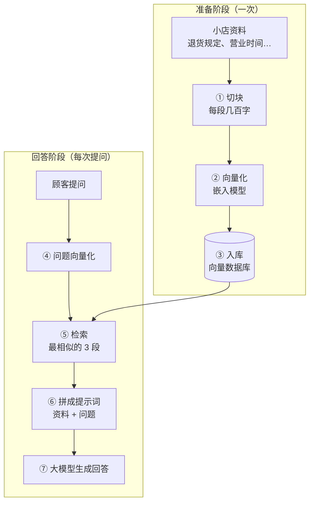
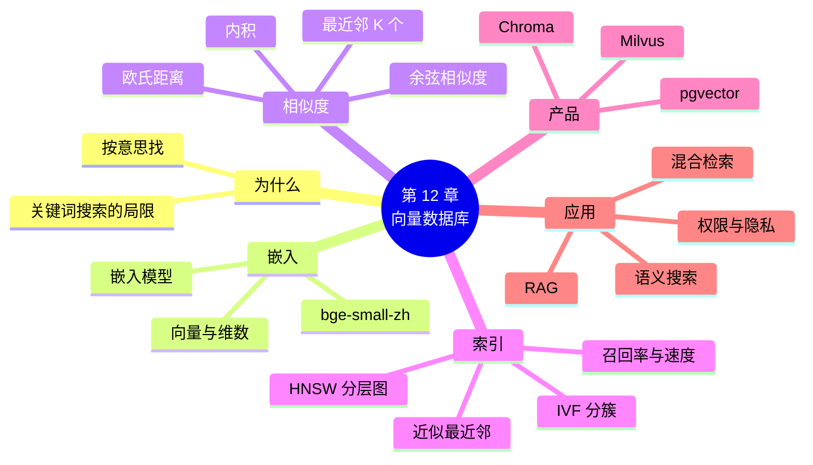

# 第 12 章 向量数据库原理

!!! abstract "本章学时"
    理论 5 学时 · 实验 1 学时 · 线下研讨 1 学时（本章共 3 个实验，教师可任选）

## 学习目标

学完本章，你应该能够：

1. **说出**嵌入、向量数据库、近似最近邻、检索增强生成等概念的含义（记忆）；
2. **解释**为什么关键词搜索找不到“意思相近”的内容，而向量搜索可以（理解）；
3. **计算**两个向量的余弦相似度、欧氏距离和内积，并找出最近的 K 个（应用）；
4. **解释** HNSW 和 IVF 加速查找的思路，以及召回率与速度的权衡（理解）；
5. **比较**向量数据库与关系数据库，能为一个应用场景选择合适的向量存储方案（分析、评价）。

!!! info "先修要求"
    学习本章前，你需要：

    - 理解索引为什么能加快查找（[8.2](../08-view-index/index.md#82)）；
    - 会写带 WHERE、ORDER BY、LIMIT 的查询（[第 4 章](../04-single-table-query/index.md)），会用 PostgreSQL（[10.2](../10-administration/index.md#102-postgresql)）；
    - 会运行 Python 程序（[第 11 章](../11-python-app/index.md)）。

??? abstract "本章概念清单（13 个，点击查看定义和例子）"
    1. [嵌入](../../appendix/glossary.md#g-嵌入)
    2. [嵌入模型](../../appendix/glossary.md#g-嵌入模型)
    3. [余弦相似度](../../appendix/glossary.md#g-余弦相似度)
    4. [欧氏距离](../../appendix/glossary.md#g-欧氏距离)
    5. [内积](../../appendix/glossary.md#g-内积)
    6. [最近邻搜索](../../appendix/glossary.md#g-最近邻搜索)
    7. [近似最近邻](../../appendix/glossary.md#g-近似最近邻)
    8. [召回率](../../appendix/glossary.md#g-召回率)
    9. [HNSW](../../appendix/glossary.md#g-HNSW)
    10. [元数据过滤](../../appendix/glossary.md#g-元数据过滤)
    11. [pgvector](../../appendix/glossary.md#g-pgvector)
    12. [检索增强生成](../../appendix/glossary.md#g-检索增强生成)
    13. [混合检索](../../appendix/glossary.md#g-混合检索)

## 情景导入

小店的小程序上线了“搜商品”功能，后台用的是第 4 章学的 LIKE。一位阿姨在搜索框里输入：**适合老人吃的软一点的早餐**。结果：一件商品也没有。

小林去数据库里试了几次：

```sql
SELECT product_id, name FROM product WHERE name LIKE '%早餐%';                        -- 0 行
SELECT product_id, name FROM product WHERE description LIKE '%适合老人吃的软一点的早餐%';  -- 0 行
SELECT product_id, name FROM product WHERE description LIKE '%软%';                    -- 9 行
```

商品名里没有“早餐”两个字；描述里也没有哪一句和阿姨的话一字不差。退一步只搜一个“软”字，查出 9 行，里面有燕麦片、鲜肉包，也有土豆、东北大米，甚至还有“柔软有韧性”的抽纸；而“温水冲调、细腻顺滑、老人家早餐常备”的芝麻糊反倒没搜到。

表哥说：“LIKE 是**按字面**找，只认字一样不一样。阿姨要的是**按意思**找。现在的大模型、智能客服、以图搜图，背后都用一种新的办法：把文字变成一串数字，意思越接近，数字越接近。专门存这些数字、按‘接近程度’找东西的数据库，就是**向量数据库**。”

第 1 章介绍数据库家族时提到过向量数据库，这一章讲清楚它的原理。

## 12.1 关键词搜索的局限

前面各章的查询，本质上都是**精确匹配**：`WHERE price < 20` 要么满足要么不满足，`LIKE '%软%'` 要么包含“软”字要么不包含。用这种办法做搜索叫**关键词搜索**，它有三个先天的问题：

| 问题 | 例子 |
|---|---|
| **说法不同就找不到**（同义词） | 搜“早餐”找不到描述里写“熬粥”“冲泡”的商品 |
| **字面相同意思不同**（误匹配） | 搜“软”匹配到“柔软”的抽纸 |
| **只认字，不懂整句话** | 整句“适合老人吃的软一点的早餐”一个结果也没有 |

搜索引擎会用分词、同义词词典、拼音纠错等办法改进关键词搜索，但这些都是“打补丁”。要真正“按意思找”，需要先让计算机能**度量两句话意思有多接近**。

## 12.2 向量与嵌入

### 12.2.1 用一串数字描述“意思”

先看一个手工的例子。给每种商品打四个分（0 到 1）：**早餐程度、软糯易嚼程度、零食程度、日用清洁程度**。

| 商品 | 早餐 | 软糯易嚼 | 零食 | 日用清洁 |
|---|---|---|---|---|
| 小米 1kg | 0.9 | 1.0 | 0 | 0 |
| 燕麦片 1kg | 0.9 | 0.8 | 0 | 0 |
| 芝麻糊 600g | 0.7 | 0.9 | 0 | 0 |
| 原味薯片 104g | 0 | 0 | 0.9 | 0 |
| 洗衣液 3kg | 0 | 0 | 0 | 1.0 |

每种商品就变成了 4 个数组成的一串数字，比如燕麦片是 `[0.9, 0.8, 0, 0]`。这样一串有顺序的数叫**向量**，数的个数叫向量的**维数**。阿姨的问题“适合老人吃的软一点的早餐”也可以按同样的标准打分：`[0.9, 0.9, 0, 0]`。

现在，“意思接不接近”就变成了“**数字接不接近**”：问题的向量和小米、燕麦片、芝麻糊很像，和薯片、洗衣液完全不像。这就是向量搜索的全部思想。

只有两维时，可以把向量画成平面上的点。下面的动画里，每个词是一个点，意思相近的词靠在一起：

<iframe class="sim-frame" src="../../sims/vector-space/main.html" height="620" loading="lazy" title="词语向量空间"></iframe>
动画：词语向量空间。平面上的每个点是一个词的二维向量。拖动“查询”点，右侧实时显示它和每个词的余弦相似度、欧氏距离，并标出最近的 3 个词。[全屏打开](../../sims/vector-space/main.html){ target=_blank }
{ .sim-caption }

### 12.2.2 嵌入与嵌入模型

上面四个维度是编者手工定的，只适合教学。真实世界的东西千千万万，不可能靠人来打分。实际使用的向量由**嵌入模型**自动算出：把一段文字（或一张图片、一段声音）交给模型，模型输出一个几百维的向量。这个“把内容变成向量”的过程，以及得到的向量，都叫[**嵌入**](../../appendix/glossary.md#g-嵌入 "把文字、图片等内容转换成一个固定长度的数值向量，使意思相近的内容得到相近的向量；这个过程和得到的向量都叫嵌入（Embedding）"){ .term }（Embedding）。

[**嵌入模型**](../../appendix/glossary.md#g-嵌入模型 "把文字、图片等内容转换为嵌入向量的人工智能模型，例如中文文本常用的 bge-small-zh-v1.5，输出 512 维向量"){ .term }是用海量文本训练出来的神经网络，它在训练中学会了“哪些说法意思相近”。本书实验使用北京智源人工智能研究院发布的中文嵌入模型 **bge-small-zh-v1.5**<sup class="cite">[[4]](#ref12-4)</sup>：

- 输出 **512 维**向量，每一维是什么意思人看不懂，但整体上意思相近的句子向量也相近；
- 模型文件约 100 MB，普通笔记本电脑的 CPU 就能跑；
- 可以从 Hugging Face 或魔搭社区（ModelScope）免费下载，许可证为 MIT，可以商用。

嵌入模型怎样训练，在《自然语言处理导论》课程中学习。本课程只把它当作一个“黑盒子”：**输入一句话，输出一个向量。**

!!! note "嵌入不只用于文字"
    图片也有嵌入模型，以图搜图就是把图片变成向量再比较；声音、商品、用户也都可以嵌入。只要能变成向量，就能用向量数据库找“相似的”。

## 12.3 怎样比较两个向量

### 12.3.1 三种度量方法

比较两个向量 **a** 和 **b**，最常用三种方法。以问题向量 **q** = [0.9, 0.9, 0, 0] 和燕麦片 **o** = [0.9, 0.8, 0, 0] 为例：

**① 内积**：对应位置相乘再相加。

$$
\boldsymbol{q}\cdot\boldsymbol{o} = 0.9\times0.9 + 0.9\times0.8 + 0\times0 + 0\times0 = 0.81 + 0.72 = 1.53
$$

**② 欧氏距离**：就是中学学过的两点间距离，对应位置相减、平方、相加、开方。

$$
d = \sqrt{(0.9-0.9)^2 + (0.9-0.8)^2 + 0 + 0} = \sqrt{0.01} = 0.1
$$

**③ 余弦相似度**：内积除以两个向量长度的乘积（向量长度 = 各分量平方和再开方）。它衡量两个向量**方向**是否一致，取值在 −1 到 1 之间，越接近 1 越相似。

$$
|\boldsymbol{q}| = \sqrt{0.81+0.81} \approx 1.2728,\quad |\boldsymbol{o}| = \sqrt{0.81+0.64} \approx 1.2042
$$

$$
\cos(\boldsymbol{q},\boldsymbol{o}) = \frac{1.53}{1.2728\times1.2042} \approx 0.9983
$$

而问题和薯片 [0, 0, 0.9, 0] 的内积是 0，余弦相似度也是 0：方向完全不同，毫不相关。

| 度量 | 含义 | 越相似时 | 常见用途 |
|---|---|---|---|
| [**余弦相似度**](../../appendix/glossary.md#g-余弦相似度 "两个向量内积除以两者长度的乘积，衡量方向是否一致，取值 −1 到 1，越接近 1 越相似；文本嵌入最常用"){ .term } | 方向是否一致 | 越大（接近 1） | 文本语义搜索，最常用 |
| [**欧氏距离**](../../appendix/glossary.md#g-欧氏距离 "两个向量对应分量差的平方和再开方，即空间中两点的直线距离，越小越相似"){ .term } | 两点的直线距离 | 越小（接近 0） | 图像、位置等 |
| [**内积**](../../appendix/glossary.md#g-内积 "两个向量对应分量相乘再相加的结果；向量长度都为 1 时，内积等于余弦相似度"){ .term } | 方向和长度都考虑 | 越大 | 推荐系统；向量已归一化时等同余弦 |

向量数据库里常用的是**余弦距离** = 1 − 余弦相似度，这样三种度量都是“越小越近”。很多嵌入模型输出的向量长度已经是 1（归一化），这时内积就等于余弦相似度，三种方法排出的顺序完全一样。

### 12.3.2 找最近的 K 个

“搜索”就是：把问题变成向量，和库里每个向量算一遍相似度，按从高到低排序，取前 K 个。这叫 [**最近邻搜索**](../../appendix/glossary.md#g-最近邻搜索 "给定一个查询向量，在向量集合中找出与它最相似（距离最近）的 K 个向量，也叫 K 近邻搜索（KNN）"){ .term }（K 近邻，KNN）。用 12.2.1 节的 11 种教学商品试一试，编者用 numpy 计算的结果（实验 12-1）：

```text
问题：适合老人吃的软一点的早餐
    1. 小米 1kg         相似度 0.9986  售价 15.80
    2. 燕麦片 1kg        相似度 0.9983  售价 26.90
    3. 芝麻糊 600g       相似度 0.9923  售价 18.80
    4. 全麦面包 400g      相似度 0.9850  售价 12.90
    5. 鲜肉包 6 个        相似度 0.9744  售价 15.00
    6. 纯牛奶 250ml×16   相似度 0.9648  售价 52.00
    7. 速溶咖啡 40 条      相似度 0.6860  售价 45.00
    8. 儿童奶酪棒 20 支     相似度 0.6100  售价 39.90
    9. 牛肉干 100g       相似度 0.0000  售价 35.00
```

（后面两行洗衣液、薯片也是 0。）关键词搜索没找到的小米、芝麻糊，现在排在了最前面；洗衣液、薯片排在最后。

用 SQL 的眼光看，这就是：

```sql
SELECT name FROM 商品向量 ORDER BY 和问题的距离 LIMIT 3;
```

12.5 节会看到，PostgreSQL 的 pgvector 扩展真的就是这么写的。

## 12.4 为什么需要专门的向量数据库

### 12.4.1 逐个比较太慢

小店只有 48 种商品，逐个比较一瞬间就完成了。可是一个电商平台有上亿件商品，一个企业知识库有几百万段文字，每段 512 维，每次搜索都和所有向量算一遍，就太慢了。

第 8 章用 B+ 树索引解决过“逐行扫描太慢”的问题。但 B+ 树只能处理“大于、小于、等于”这种**一维有序**的比较，而“哪个向量离我最近”是在几百维空间里找邻居，B+ 树帮不上忙。向量数据库的核心本领，就是一种新的索引：**向量索引**。

### 12.4.2 近似最近邻：用一点准确换很多速度

向量索引的思路是：**不保证找到的一定是最近的，但保证绝大多数时候是，而且快得多。**这叫[**近似最近邻**](../../appendix/glossary.md#g-近似最近邻 "Approximate Nearest Neighbor（ANN），不逐个比较全部向量，而是借助索引只比较一部分，以少量准确性为代价换取查询速度的大幅提升"){ .term }搜索（Approximate Nearest Neighbor，ANN）。

找得准不准用[**召回率**](../../appendix/glossary.md#g-召回率 "近似搜索返回的结果中，有多少比例确实属于真正的前 K 个最近邻；召回率越高越准确"){ .term }衡量：近似搜索返回的 10 个结果里，有几个确实是真正的前 10 名。召回率 90%，就是 10 个里平均有 9 个是对的。

常见的向量索引有两类，都只讲直观：

**IVF（倒排文件索引）：先分簇，再在簇里找。**建索引时，先把所有向量分成若干“簇”（比如 1000 个），每个簇有一个中心点。查询时，先找出离问题最近的几个簇中心，**只在这几个簇里**逐个比较。就像在图书馆找书，先找到对应的书架，再在书架上一本本看，不用把整个图书馆翻一遍。代价是：如果要找的向量恰好在边界上、被分到了隔壁的簇，就会漏掉。

[**HNSW**](../../appendix/glossary.md#g-HNSW "分层可导航小世界图（Hierarchical Navigable Small World），把向量连成多层的“邻居网”，查询时从稀疏的上层大步跳到目标附近，再到下层细找，是最常用的向量索引"){ .term }（分层可导航小世界图）**：分层“跳着找”。**它把所有向量连成一张“邻居网”，每个点和离它最近的若干个点相连；网又分好几层，越上层点越少、连线跨度越大<sup class="cite">[[2]](#ref12-2)</sup>。查询时：

1. 从最上层的入口点出发，每次走到“离问题更近的邻居”，大步跳到目标附近；
2. 到下一层，从刚才的位置继续，步子变小；
3. 到最底层（包含所有点）时，已经在目标附近，细细找出最近的 K 个。

这很像问路：先坐飞机到城市，再坐地铁到街区，最后步行找门牌号。

<iframe class="sim-frame" src="../../sims/hnsw-search/main.html" height="640" loading="lazy" title="HNSW 分层搜索"></iframe>
动画：HNSW 分层搜索。播放一次查询在三层图上的路线：上层大步跳、下层细找。调节“候选数”（ef_search），看比较次数和是否找到真正的最近邻怎样变化。[全屏打开](../../sims/hnsw-search/main.html){ target=_blank }
{ .sim-caption }

### 12.4.3 召回率与速度的权衡：一次实测

HNSW 有一个查询参数 **ef_search**：查询时同时保留多少个候选点。候选越多，找得越仔细，召回率越高，但也越慢。编者在 Docker 中的 PostgreSQL 17 + pgvector 0.8.7 上做了一次实测（脚本 `labs/ch12/demo12_hnsw_bench.sql`）：生成 10 万条 128 维向量（模拟真实嵌入“成簇”的特点），用 20 个查询各找最近的 10 个：

| 方法 | 20 次查询总耗时 | 召回率 |
|---|---|---|
| 逐个比较（精确） | 591.5 毫秒 | 100%（标准答案） |
| HNSW，ef_search = 10 | 11.1 毫秒 | 72.0% |
| HNSW，ef_search = 40（默认值） | 12.9 毫秒 | 85.0% |
| HNSW，ef_search = 100 | 58.5 毫秒 | 100.0% |

建 HNSW 索引花了约 20.5 秒。从表中可以看出：

- 用索引后，查询快了 10 倍到 50 倍。数据越多，差距越大；
- ef_search 调大，召回率上升，速度下降。**没有又快又全准的免费午餐**，要按业务选：商品推荐漏掉一两个无所谓，可以选快的；法律、医疗检索要求准，就选大一点的 ef_search；
- 建索引本身要花时间和内存，这是第 8 章“索引不是越多越好”在向量数据库里的翻版。

这组数字是编者机器上的结果，你的机器上耗时会不同，但规律一样。

## 12.5 向量数据库的基本操作

### 12.5.1 和关系数据库对照

向量数据库的操作很像前面学的增删改查，只是多了“按相似度找”：

| 关系数据库（MySQL） | 向量数据库（以 Chroma 为例） | 说明 |
|---|---|---|
| 表 | 集合（collection） | 一组同类数据 |
| 行 | 一条记录：编号 + 向量 + 原文 + 元数据 | 原文如商品描述；元数据如价格、类别 |
| `INSERT` | `add()` | 插入时可以直接给向量，也可以给原文让嵌入模型自动算 |
| `SELECT … WHERE price <= 16` | `query(…, where={"price": {"$lte": 16}})` | [**元数据过滤**](../../appendix/glossary.md#g-元数据过滤 "在向量相似度查询的同时，按价格、类别、日期等普通字段筛选结果，如“价格不超过 16 元的最相似商品”"){ .term } |
| `ORDER BY … LIMIT 3` | `query(…, n_results=3)` | 按相似度取最近的 K 个 |
| `UPDATE`、`DELETE` | `update()`、`delete()` | |
| B+ 树索引 | HNSW 索引 | 向量库自动建好 |
| 结果精确 | 结果近似 | 最大的区别 |

### 12.5.2 Chroma：专用向量数据库

Chroma 是一个开源、轻量的向量数据库，`pip install chromadb` 就能在 Python 里使用，适合学习和小型应用<sup class="cite">[[6]](#ref12-6)</sup>。用 12.2.1 节的教学向量（实验 12-2 第一部分）：

```python
import chromadb
client = chromadb.Client()                                   # 内存中的向量库
col = client.create_collection(name="shop_demo",             # 建集合，用余弦距离
                               configuration={"hnsw": {"space": "cosine"}})
col.add(ids=["7", "8", "10"],                                # 插入：编号、向量、原文、元数据
        embeddings=[[0.9, 1.0, 0, 0], [0.9, 0.8, 0, 0], [0.7, 0.9, 0, 0]],
        documents=["小米 1kg", "燕麦片 1kg", "芝麻糊 600g"],
        metadatas=[{"price": 15.80}, {"price": 26.90}, {"price": 18.80}])
res = col.query(query_embeddings=[[0.9, 0.9, 0, 0]], n_results=3,
                where={"price": {"$lte": 16}})               # 相似度查询 + 元数据过滤
```

编者用全部 11 种教学商品运行的结果：

```text
① 集合中的向量条数： 11
② 问题：适合老人吃的软一点的早餐，最相近的 3 个：
   小米 1kg         余弦距离 0.0014
   燕麦片 1kg        余弦距离 0.0017
   芝麻糊 600g       余弦距离 0.0077
③ 加上“售价不超过 16 元”：
   小米 1kg         售价 15.80  余弦距离 0.0014
   全麦面包 400g      售价 12.90  余弦距离 0.0150
   鲜肉包 6 个        售价 15.00  余弦距离 0.0256
```

余弦距离 0.0014 就是 1 − 0.9986，和 12.3.2 节手算的相似度对得上。加上价格过滤后，燕麦片（26.90 元）、芝麻糊（18.80 元）被排除，全麦面包和鲜肉包补了上来。

真正使用时，不用自己给向量，而是把商品“名称 + 描述”交给嵌入模型。实验 12-2 第二部分用 bge-small-zh-v1.5 给小店全部 48 种商品建库，只需把 `embeddings=` 换成 `documents=`，并在建集合时指定嵌入模型。

### 12.5.3 pgvector：在关系数据库里存向量

另一条路是**不另装数据库**，给熟悉的关系数据库加上向量功能。[**pgvector**](../../appendix/glossary.md#g-pgvector "PostgreSQL 的开源扩展，增加 vector 数据类型、<=> 等距离运算符和 HNSW、IVFFlat 向量索引，使关系数据库能直接存储和检索向量"){ .term }是 PostgreSQL 的开源扩展，它增加了 `vector` 数据类型、三个距离运算符和向量索引<sup class="cite">[[5]](#ref12-5)</sup>：

| 运算符 | 含义 |
|---|---|
| `<=>` | 余弦距离 |
| `<->` | 欧氏距离 |
| `<#>` | 负内积（取负号是为了让“越小越近”，和另外两个一致） |

```sql
CREATE EXTENSION IF NOT EXISTS vector;                 -- 启用扩展
CREATE TABLE product_vec (product_id INT PRIMARY KEY, name VARCHAR(40),
                          price DECIMAL(8,2), embedding vector(4));   -- 向量就是一列
SELECT name, price
FROM product_vec
WHERE price <= 16                                      -- 普通条件
ORDER BY embedding <=> '[0.9, 0.9, 0, 0]'              -- 按余弦距离排序
LIMIT 3;
CREATE INDEX ON product_vec USING hnsw (embedding vector_cosine_ops);  -- HNSW 索引
```

编者在 PostgreSQL 17 + pgvector 0.8.7 上的运行结果（实验 12-3）：

```text
     name      | price | 余弦距离
---------------+-------+----------
 小米 1kg      | 15.80 |   0.0014
 全麦面包 400g | 12.90 |   0.0150
 鲜肉包 6 个   | 15.00 |   0.0256
```

和 Chroma 的结果完全一致。pgvector 最大的好处是：**向量和订单、库存、会员这些业务数据在同一个库里**，可以在一条 SQL 里连接、过滤、做事务，备份恢复也照第 10 章的办法做。

## 12.6 产品版图与选择

| 类型 | 代表产品 | 特点 | 适合 |
|---|---|---|---|
| 专用向量数据库 | **Milvus**（国产开源，Zilliz 公司）<sup class="cite">[[3]](#ref12-3)</sup>、Qdrant、Weaviate、Chroma | 为向量设计，支持海量数据、分布式、多种索引 | 向量规模大（千万以上）、以向量检索为核心的系统 |
| 关系数据库扩展 | PostgreSQL + pgvector；不少国产数据库也已支持向量类型 | 不用另装系统，向量与业务数据一起管理，可用 SQL | 已有关系数据库、向量规模中小的应用 |
| 搜索引擎扩展 | Elasticsearch、OpenSearch | 关键词搜索和向量搜索都强 | 已有搜索系统，需要混合检索 |
| 云服务 | 阿里云、腾讯云、华为云等提供的向量检索服务 | 免运维，按量付费 | 不想自己维护服务器的团队 |
| 轻量库 | Chroma（嵌入式模式）、Faiss（向量检索库）<sup class="cite">[[7]](#ref12-7)</sup> | 装起来简单，嵌在程序里用 | 学习、原型、小应用 |

怎样选？可以问自己三个问题：

1. **数据有多少？**几万到几百万条，pgvector 或 Chroma 足够；上亿条，考虑 Milvus 这类分布式专用库；
2. **已经在用什么数据库？**已经用 PostgreSQL，优先 pgvector，少维护一套系统；
3. **团队能不能运维？**不能，就用云服务。

小店只有几十种商品、几百条客服问答，用 pgvector 就够了。

## 12.7 应用：语义搜索与检索增强生成

### 12.7.1 常见应用

- **语义搜索**：本章的“按意思找商品”；
- **以图搜图**：拍一张照片，找出相似的商品；
- **推荐**：把用户和商品都变成向量，给用户推荐离他“近”的商品；
- **去重**：找出意思几乎相同的重复问题、重复文章；
- **大模型知识库**：也就是下面要讲的检索增强生成，是向量数据库近几年最热门的用途。

### 12.7.2 检索增强生成（RAG）

大模型很会说话，但它不知道小店的退货规定、营业时间，问它只会编一个。[**检索增强生成**](../../appendix/glossary.md#g-检索增强生成 "Retrieval-Augmented Generation（RAG），先从知识库中检索与问题相关的资料，再把资料和问题一起交给大模型生成回答，使回答有据可查、减少编造"){ .term }（Retrieval-Augmented Generation，RAG）的办法是：**先到自己的知识库里找到相关资料，再把资料和问题一起交给大模型，让它“照着资料回答”**<sup class="cite">[[1]](#ref12-1)</sup>。



1. **切块**：把长文档切成一段一段（每段几百字），因为一整本手册的意思太杂，向量表达不准；
2. **向量化**：用嵌入模型把每一段变成向量；
3. **入库**：向量、原文、出处一起存进向量数据库；
4. 顾客提问时，把问题也用**同一个**嵌入模型变成向量；
5. **检索**：在向量库里找出最相似的几段；
6. 把这几段资料和问题拼成一段“提示词”，例如“请根据以下资料回答顾客的问题，资料里没有的就说不知道：……”；
7. 交给大模型生成回答。

第 ①—⑤ 步都是本课程学的数据库工作，第 ⑥、⑦ 步属于大模型应用开发，在自然语言处理和智能体开发课程中学习。

<iframe class="sim-frame" src="../../sims/rag-flow/main.html" height="640" loading="lazy" title="RAG 检索流程"></iframe>
动画：RAG 检索流程。选一个顾客问题，逐步播放切块、向量化、检索的过程，看检索出的前 3 段资料和最终拼成的提示词。[全屏打开](../../sims/rag-flow/main.html){ target=_blank }
{ .sim-caption }

### 12.7.3 混合检索

向量搜索也不是万能的。顾客搜商品编号“A1024”、搜品牌名、搜“5L”这样的规格，这些需要字面完全一致，关键词搜索反而更准。实际系统常用[**混合检索**](../../appendix/glossary.md#g-混合检索 "同时使用关键词搜索和向量搜索，再把两路结果合并排序，兼顾字面精确匹配和语义相似"){ .term }：关键词搜索和向量搜索各找一批，再合并排序，两者取长补短。pgvector 的好处在这里又体现出来：同一条 SQL 里既能写 `LIKE`、全文检索，也能写 `<=>`。

## 12.8 局限与安全

- **嵌入模型决定效果上限。**向量数据库只负责“存得下、找得快”，找得准不准取决于嵌入模型。模型没见过的专业词、方言、新词，向量可能不准。换了嵌入模型，所有向量都要重新计算，不同模型的向量**不能混在一起比较**；
- **结果是近似的，也没有“对错”。**关系数据库的查询结果是确定的，向量搜索永远会返回“最相近的 K 个”，哪怕它们其实都不相关。实际使用时要设一个相似度门槛，低于门槛就回答“没找到”；
- **权限不能丢。**把公司文档全部放进知识库，如果不做权限控制，普通员工一问就可能检索出工资表、合同。入库时要带上“谁能看”的元数据，检索时按用户身份过滤，这就是第 10 章最小权限原则在知识库里的应用；
- **隐私。**嵌入向量看上去是一串数字，但研究表明，有时可以从向量中还原出相当一部分原文<sup class="cite">[[8]](#ref12-8)</sup>。含个人信息的文本做嵌入入库，同样要遵守《个人信息保护法》，该脱敏的先脱敏。

## 12.9 前沿视窗：智能体的“长期记忆”

大模型本身只“记得”一次对话里的内容。要让 AI 助手记住“这位顾客上次说过他有糖尿病”“老板喜欢周报用表格”，一种常见做法是：把对话中值得记住的内容做成嵌入，存进向量数据库；下次对话时，先检索出和当前话题相关的“记忆”，再交给大模型。这就是智能体的**长期记忆**，本质上就是本章的 RAG 流程，只是知识库的内容来自对话本身。

随之而来的问题也和数据库息息相关：哪些记忆该存、存多久、用户要求“忘掉我”时怎样删除干净、不同用户的记忆怎样隔离。这些问题，在智能体开发课程中会继续讨论。

## 本章实验

!!! abstract "实验总览"
    | 实验 | 类型 | 建议时长 | 内容 |
    |---|---|---|---|
    | 实验 12-1 | ★ 基础 | 30 分钟 | 手算并验证余弦相似度、欧氏距离和内积 |
    | 实验 12-2 | ★ 基础 | 60 分钟 | 用 Chroma 建向量库：先用教学向量熟悉操作，再用 bge-small-zh 做商品语义搜索 |
    | 实验 12-3 | ☆ 拓展 | 45 分钟 | 在 PostgreSQL + pgvector 里用一条 SQL 做相似度查询 |

    代码见配套资源 `labs/ch12/` 目录。

### 实验 12-1 ★ 手算并验证相似度

**实验目的**

1. 会手算内积、向量长度、余弦相似度和欧氏距离；
2. 理解“找最近的 K 个”就是计算相似度后排序。

**实验环境**：本机 Python + numpy；笔和计算器。**实验数据**：`labs/ch12/teaching_vectors.py` 中的 11 种商品教学向量。

**实验步骤与代码**

1. 先**手算**：问题向量 q = [0.9, 0.9, 0, 0]，燕麦片 o = [0.9, 0.8, 0, 0]，薯片 c = [0, 0, 0.9, 0]，在记录表里写出 q·o、|q|、|o|、cos(q, o)、q 与 o 的欧氏距离，以及 cos(q, c)；
2. 运行 `python lab12_1_similarity.py` 核对，关键部分：

```python
import numpy as np
q, oats = np.array([0.9, 0.9, 0, 0]), np.array([0.9, 0.8, 0, 0])
dot = np.dot(q, oats)                                      # 内积
norm_q, norm_o = np.linalg.norm(q), np.linalg.norm(oats)   # 向量长度
print("余弦相似度", dot / (norm_q * norm_o))
print("欧氏距离", np.linalg.norm(q - oats))
```

3. 改一改：把问题换成“看球时吃的零食”，自己按四个维度给它打分（比如 [0, 0, 1, 0]），改 `teaching_vectors.py` 中的 QUERY_VEC 后重新运行，看排名怎样变化。

**运行结果**

```text
① 查询向量 [0.9 0.9 0.  0. ]  燕麦片 [0.9 0.8 0.  0. ]  薯片 [0.  0.  0.9 0. ]
   内积 q·燕麦片 = 1.53
   长度 |q| = 1.2728，|燕麦片| = 1.2042
   余弦相似度 = 0.9983
   欧氏距离   = 0.1000
   查询与薯片：余弦相似度 = 0.0000，欧氏距离 = 1.5588
```

第 ② 部分的排名见 12.3.2 节。

**实验记录表**

| 计算项 | 手算结果 | 程序结果 |
|---|---|---|
| q · o | | |
| \|q\|、\|o\| | | |
| cos(q, o) | | |
| q 与 o 的欧氏距离 | | |
| cos(q, c) | | |
| 第 3 步换成零食问题后的前 3 名 | — | |

**常见问题排查**

| 现象 | 原因 | 解决办法 |
|---|---|---|
| `ModuleNotFoundError: No module named 'numpy'` | 没装 numpy | `pip install numpy` |
| 手算的余弦相似度大于 1 | 分母用错了，或忘了开方 | 长度要先平方相加再开方 |
| `ModuleNotFoundError: No module named 'teaching_vectors'` | 不在 labs/ch12 目录下运行 | 先 `cd labs/ch12` |

**思考与练习**

1. 小米 [0.9, 1.0, 0, 0] 和燕麦片 [0.9, 0.8, 0, 0] 到问题的欧氏距离都是 0.1，但余弦相似度不同。为什么？
2. 真正的嵌入向量有 512 维。手算一次要做多少次乘法？100 万种商品呢？

**实验报告要求**

完成实验记录表（手算部分写出过程），回答思考题。

### 实验 12-2 ★ 用 Chroma 建向量库做商品语义搜索

**实验目的**

1. 掌握向量库的基本操作：建集合、插入、相似度查询、元数据过滤、更新、删除；
2. 体会嵌入模型带来的“按意思找”。

**实验环境**：本机 Python；第二部分需要能访问 Hugging Face 或魔搭社区（学校机房可以）。**实验数据**：第一部分用教学向量；第二部分从 MySQL 的 shop 库读取 48 种商品的名称和描述。

**实验步骤与代码**

1. 安装：`pip install chromadb`。运行 `python lab12_2_chroma_basic.py`（第一部分，教学向量），对照 12.5.2 节的结果；
2. 安装：`pip install sentence-transformers pymysql`。打开 `lab12_2_chroma_bge.py`，把 DB 中的口令改成你的 root 口令。下载慢时，先在命令提示符里执行 `set HF_ENDPOINT=https://hf-mirror.com`；或者从魔搭社区下载 bge-small-zh-v1.5 模型文件夹，把 MODEL 改成文件夹路径；
3. 运行 `python lab12_2_chroma_bge.py`（第二部分）。程序的核心：

```python
embed_fn = embedding_functions.SentenceTransformerEmbeddingFunction(
    model_name="BAAI/bge-small-zh-v1.5")                    # 指定嵌入模型
col = client.create_collection(name="products", embedding_function=embed_fn,
                               configuration={"hnsw": {"space": "cosine"}})
col.add(ids=[...], documents=["燕麦片 1kg：无蔗糖纯燕麦片，开水冲泡三分钟就软……", ...],
        metadatas=[{"price": 26.9, "category": "早餐冲饮"}, ...])   # 只给原文，向量自动算
res = col.query(query_texts=["适合老人吃的软一点的早餐"], n_results=3)
```

4. 自己出三个问题试一试，例如 `python lab12_2_chroma_bge.py 夏天解渴的 给小孩的零食 做饭用的油`。

**运行结果**

第一部分编者的运行结果见 12.5.2 节，另外两行：

```text
④ 更新、删除后：燕麦片 {'price': 23.9} ，条数 10
```

第二部分**待实测**：编者的编写环境无法访问 Hugging Face 和魔搭社区，下载不到 bge-small-zh-v1.5 模型，只用一个假的嵌入函数检查过程序流程（48 种商品能入库、查询和价格过滤能运行）。请在学校机房运行，把结果填进记录表。预期“已入库商品：48，向量维数：512”；“适合老人吃的软一点的早餐”的前几名应以小米、燕麦片、芝麻糊这类商品为主，具体名次和距离以实际运行为准。

**实验记录表**

| 问题 | 前 3 名（商品名和余弦距离） | 你认为合理吗 |
|---|---|---|
| 适合老人吃的软一点的早餐 | | |
| 看球的时候吃点什么 | | |
| 家里洗衣服用的 | | |
| 适合老人吃的软一点的早餐（≤16 元） | | |
| 你自己的问题 1 | | |
| 你自己的问题 2 | | |

**常见问题排查**

| 现象 | 原因 | 解决办法 |
|---|---|---|
| `ValueError: The sentence_transformers python package is not installed` | 没装 sentence-transformers | `pip install sentence-transformers` |
| 下载模型很慢或连接超时 | 访问 Hugging Face 网络不畅 | 设置 HF_ENDPOINT 镜像，或从魔搭社区下载后改 MODEL 为本地路径 |
| `OperationalError: (1045, …)` | DB 中的口令和你的不一致 | 修改 lab12_2_chroma_bge.py 中的 DB 设置 |
| 第一次运行很慢，之后变快 | 第一次要下载模型、计算 48 条向量 | 正常；向量库保存在 `chroma_shop` 文件夹，删除它可以重建 |

**思考与练习**

1. 第一部分和第二部分，向量分别是谁给出的？哪一种能用在真实的小店里？为什么？
2. 找一个向量搜索结果“不合理”的问题，分析可能的原因。如果加上关键词搜索，能改善吗？

**实验报告要求**

完成实验记录表，截图第二部分的运行结果，回答思考题。

### 实验 12-3 ☆ 在 pgvector 里用 SQL 做相似度查询

**实验目的**

1. 会在 PostgreSQL 中启用 pgvector，建向量列，用 `<=>` 做相似度查询；
2. 比较 Chroma 和 pgvector 两种做法。

**实验环境**：Docker 环境中的 PostgreSQL 17 + pgvector（`pgvector/pgvector:pg17` 镜像已装好扩展）。本机安装的 PostgreSQL 需另外安装 pgvector 扩展，Windows 上较麻烦，建议用 Docker。**实验数据**：教学向量。

**实验步骤与代码**

1. 在 PostgreSQL 的 shop 库里运行 `labs/ch12/lab12_3_pgvector.sql`（Docker：`docker exec -i shop-postgres psql -U postgres -d shop < lab12_3_pgvector.sql`）；
2. 对照每一段的结果，特别注意第 ⑤ 段三种距离的排序有什么不同；
3. （选做，约 1 分钟）运行 `demo12_hnsw_bench.sql`，体验 10 万条向量下精确查找和 HNSW 的差别，记下你机器上的耗时和召回率。

**运行结果**

编者在 PostgreSQL 17.11 + pgvector 0.8.7 上的运行结果（节选）：

```text
③ 余弦距离前 3 名
    name     | price | 余弦距离 | 余弦相似度
-------------+-------+----------+------------
 小米 1kg    | 15.80 |   0.0014 |     0.9986
 燕麦片 1kg  | 26.90 |   0.0017 |     0.9983
 芝麻糊 600g | 18.80 |   0.0077 |     0.9923

④ 售价不超过 16 元：小米 1kg 0.0014，全麦面包 400g 0.0150，鲜肉包 6 个 0.0256

⑤ 按欧氏距离排序
    name     | 欧氏距离 |  内积
-------------+----------+--------
 燕麦片 1kg  |   0.1000 | 1.5300
 小米 1kg    |   0.1000 | 1.7100
 芝麻糊 600g |   0.2000 | 1.4400

⑥ EXPLAIN
 Limit  (cost=8.08..9.21 rows=3 width=106)
   ->  Index Scan using product_vec_embedding_idx on product_vec  (cost=8.08..12.22 rows=11 width=106)
         Order By: (embedding <=> '[0.9,0.9,0,0]'::vector)
```

第 ⑤ 段里，燕麦片和小米到问题的欧氏距离相同（并列，谁在前不确定），而内积小米更大，因为小米的向量更“长”。三种度量排出的顺序可以不同，所以建索引时要选和查询一致的距离（`vector_cosine_ops` 对应 `<=>`）。选做部分编者的结果见 12.4.3 节。

**实验记录表**

| 观察内容 | 你的结果 |
|---|---|
| 余弦距离前 3 名 | |
| 加价格条件后前 3 名 | |
| 欧氏距离排序和余弦排序有何不同 | |
| EXPLAIN 中是否用到了索引，用的是哪一个 | |
| （选做）精确查找和 ef_search = 40 的耗时、召回率 | |

**常见问题排查**

| 现象 | 原因 | 解决办法 |
|---|---|---|
| `ERROR: extension "vector" is not available` | PostgreSQL 没装 pgvector | 使用 Docker 的 pgvector 镜像 |
| `ERROR: expected 4 dimensions, not 3` | 插入的向量维数和列定义不一致 | 检查方括号里数的个数 |
| 选做脚本报 `could not resize shared memory segment … No space left on device` | Docker 默认共享内存只有 64 MB，并行建索引不够用 | 脚本里已设置 `max_parallel_maintenance_workers = 0`；不要删掉这一行 |

**思考与练习**

1. 同样的查询，用 Chroma 写和用 pgvector 写，各有什么好处？小店应该选哪个？
2. 第 ⑥ 段为什么要先 `SET enable_seqscan = off` 才能看到索引扫描？（提示：回忆第 8 章，表很小时优化器会怎么选？）

**实验报告要求**

完成实验记录表，截图第 ③、④、⑥ 段结果，回答思考题。

## 本章小结

- **关键词搜索**按字面匹配，说法不同找不到、字面相同会误配；向量搜索**按意思**找。
- **嵌入**把文字、图片变成向量，意思相近的向量也相近；向量由**嵌入模型**算出，本书用 bge-small-zh-v1.5（512 维）。
- 比较向量：**内积**（相乘再相加）、**欧氏距离**（两点距离，越小越近）、**余弦相似度**（方向是否一致，越接近 1 越近，文本最常用）；向量库常用余弦距离 = 1 − 余弦相似度。找最相似的 K 个叫**最近邻搜索**。
- 数据多时逐个比较太慢，向量数据库用**近似最近邻**索引：**IVF** 先分簇再在簇里找，**HNSW** 分层图上大步跳、细步找。用**召回率**衡量准确程度，ef_search 越大越准越慢。
- 基本操作：集合、插入、相似度查询、**元数据过滤**、更新删除；结果是近似的。**Chroma** 是专用轻量向量库，**pgvector** 让 PostgreSQL 用 `<=>` 等运算符和 SQL 做向量检索，向量与业务数据同库管理。国产开源的 **Milvus** 适合海量数据。
- **RAG**：切块 → 向量化 → 入库 → 检索 → 交给大模型生成；**混合检索**结合关键词和向量。要注意嵌入模型的上限、相似度门槛、权限控制和隐私保护。



**全书结语**

从第 1 章小店老板的 Excel 账本开始，我们一路把小店的数据搬进了数据库：建表、查询、设计、规范化、加索引、用事务保证下单不出错、分权限做备份、写程序做管理助手，最后让它学会“按意思”找商品。关系数据库管着小店的每一笔账，向量数据库让人工智能能读懂小店的每一段资料，两者在今天的人工智能系统中缺一不可。希望这门课让你在后续的数据分析、自然语言处理、智能体开发课程里，遇到“数据存在哪、怎么取”时，心里有底。

## 参考文献

正文中的上标编号（如<sup class="cite">[[2]](#ref12-2)</sup>）对应下面的文献。带链接的可以直接打开；书籍可在图书馆或电子书平台查阅。

<div class="refs" markdown>

**经典论文**

- <span id="ref12-1"></span>[1] LEWIS P, PEREZ E, PIKTUS A, et al. Retrieval-augmented generation for knowledge-intensive NLP tasks[C]//Advances in Neural Information Processing Systems 33 (NeurIPS 2020). Red Hook: Curran Associates, 2020: 9459-9474.
    <span class="ref-note">提出“检索增强生成”（RAG）的论文，对应 12.7.2 节。</span>
- <span id="ref12-2"></span>[2] MALKOV Y A, YASHUNIN D A. Efficient and robust approximate nearest neighbor search using hierarchical navigable small world graphs[J]. IEEE Transactions on Pattern Analysis and Machine Intelligence, 2020, 42(4): 824-836.
    <span class="ref-note">提出 HNSW 索引的论文，预印本见 https://arxiv.org/abs/1603.09320，对应 12.4.2 节。</span>
- <span id="ref12-3"></span>[3] WANG J, YI X, GUO R, et al. Milvus: a purpose-built vector data management system[C]//Proceedings of the 2021 International Conference on Management of Data (SIGMOD '21). New York: ACM, 2021: 2614-2627.
    <span class="ref-note">国产开源向量数据库 Milvus 的系统论文，对应 12.6 节。</span>
- <span id="ref12-4"></span>[4] XIAO S, LIU Z, ZHANG P, et al. C-Pack: packed resources for general Chinese embeddings[EB/OL]. (2024-05-12)[2026-11-01]. https://arxiv.org/abs/2309.07597.
    <span class="ref-note">北京智源人工智能研究院 BGE 系列中文嵌入模型的论文，本书实验使用其中的 bge-small-zh-v1.5，对应 12.2.2 节。</span>
- <span id="ref12-7"></span>[7] JOHNSON J, DOUZE M, JÉGOU H. Billion-scale similarity search with GPUs[J]. IEEE Transactions on Big Data, 2021, 7(3): 535-547.
    <span class="ref-note">向量检索库 Faiss 的论文，介绍了 IVF 等索引在十亿级向量上的实现，对应 12.4.2 节和 12.6 节。</span>
- <span id="ref12-8"></span>[8] MORRIS J, KULESHOV V, SHMATIKOV V, et al. Text embeddings reveal (almost) as much as text[C]//Proceedings of the 2023 Conference on Empirical Methods in Natural Language Processing. Singapore: Association for Computational Linguistics, 2023: 12448-12460.
    <span class="ref-note">研究表明可以从文本嵌入向量中较大程度地还原原文，说明嵌入向量同样需要按个人信息保护，对应 12.8 节。</span>

**在线资源与数据**

- <span id="ref12-5"></span>[5] pgvector contributors. pgvector: open-source vector similarity search for Postgres[EB/OL]. [2026-11-01]. https://github.com/pgvector/pgvector.
    <span class="ref-note">pgvector 的官方说明：vector 类型、&lt;=&gt; 等运算符、HNSW 索引及其参数 m、ef_construction、ef_search（默认 40），对应 12.5.3 节和 12.4.3 节。</span>
- <span id="ref12-6"></span>[6] Chroma. Chroma Docs: Introduction[EB/OL]. [2026-11-01]. https://docs.trychroma.com/docs/overview/introduction.
    <span class="ref-note">Chroma 官方文档，介绍集合、向量检索和元数据过滤，对应 12.5.2 节和实验 12-2。</span>

</div>

## 课后练习

选择题和判断题可以直接点击选项作答，系统会马上告诉你对错，并展开答案与解析；多选题选好后点“提交答案”。简答和实操题请先自己作答，再点开“答案与解析”核对。每道题的解析下方都有“回看”链接，做错了可以直接跳回正文复习。

**一、单项选择题**

<div class="quiz" data-answer="B" markdown>

**1.** 顾客搜索“适合老人吃的软一点的早餐”，用 `LIKE '%适合老人吃的软一点的早餐%'` 查不到任何商品，根本原因是（　　）。

- A. 数据库没有建索引
- B. 关键词搜索按字面匹配，不理解意思
- C. 商品表的数据太少
- D. 没有使用 ORDER BY

</div>

??? tip "答案与解析"
    **答案：B**

    考查：关键词搜索的局限 · 认知层次：理解 · [回看 12.1](#121)
    { .quiz-meta }

<div class="quiz" data-answer="C" markdown>

**2.** 把一段文字转换成一个能表示其意思的数值向量，这个过程叫（　　）。

- A. 规范化
- B. 分词
- C. 嵌入
- D. 脱敏

</div>

??? tip "答案与解析"
    **答案：C**

    考查：嵌入 · 认知层次：记忆 · [回看 12.2.2](#1222)
    { .quiz-meta }

<div class="quiz" data-answer="A" markdown>

**3.** 向量 a = [1, 2] 和 b = [3, 4] 的内积是（　　）。

- A. 11
- B. 10
- C. 7
- D. 24

</div>

??? tip "答案与解析"
    **答案：A**

    1×3 + 2×4 = 3 + 8 = 11。

    考查：内积 · 认知层次：应用 · [回看 12.3.1](#1231)
    { .quiz-meta }

<div class="quiz" data-answer="D" markdown>

**4.** 向量 a = [1, 0] 和 b = [0, 1] 的余弦相似度是（　　）。

- A. 1
- B. −1
- C. 0.5
- D. 0

</div>

??? tip "答案与解析"
    **答案：D**

    内积 1×0 + 0×1 = 0，所以余弦相似度为 0：两个向量互相垂直，方向完全不同。

    考查：余弦相似度 · 认知层次：应用 · [回看 12.3.1](#1231)
    { .quiz-meta }

<div class="quiz" data-answer="B" markdown>

**5.** 向量 a = [0, 0] 和 b = [3, 4] 的欧氏距离是（　　）。

- A. 7
- B. 5
- C. 25
- D. 12

</div>

??? tip "答案与解析"
    **答案：B**

    √(3² + 4²) = √25 = 5。

    考查：欧氏距离 · 认知层次：应用 · [回看 12.3.1](#1231)
    { .quiz-meta }

<div class="quiz" data-answer="C" markdown>

**6.** 关于近似最近邻（ANN）搜索，下列说法正确的是（　　）。

- A. 结果一定和逐个比较完全相同
- B. 比逐个比较更慢，但更准
- C. 以少量准确性为代价，大幅提高查询速度
- D. 只能用于关系数据库

</div>

??? tip "答案与解析"
    **答案：C**

    考查：近似最近邻 · 认知层次：理解 · [回看 12.4.2](#1242)
    { .quiz-meta }

<div class="quiz" data-answer="A" markdown>

**7.** “先把向量分成若干簇，查询时只在离问题最近的几个簇里比较”，描述的是（　　）索引的思路。

- A. IVF
- B. HNSW
- C. B+ 树
- D. 哈希

</div>

??? tip "答案与解析"
    **答案：A**

    HNSW 是分层图上跳着找；B+ 树用于一维有序数据的查找。

    考查：IVF · 认知层次：理解 · [回看 12.4.2](#1242)
    { .quiz-meta }

<div class="quiz" data-answer="B" markdown>

**8.** 在 pgvector 中，表示余弦距离的运算符是（　　）。

- A. `<->`
- B. `<=>`
- C. `<#>`
- D. `LIKE`

</div>

??? tip "答案与解析"
    **答案：B**

    `<->` 是欧氏距离，`<#>` 是负内积。

    考查：pgvector · 认知层次：记忆 · [回看 12.5.3](#1253-pgvector)
    { .quiz-meta }

<div class="quiz" data-answer="D" markdown>

**9.** 在检索增强生成（RAG）中，向量数据库负责的步骤是（　　）。

- A. 训练大模型
- B. 生成最终回答
- C. 把回答翻译成英文
- D. 存储资料片段的向量，并检索出与问题最相似的片段

</div>

??? tip "答案与解析"
    **答案：D**

    考查：RAG · 认知层次：理解 · [回看 12.7.2](#1272-rag)
    { .quiz-meta }

**二、多项选择题**

<div class="quiz" data-answer="ABC" data-multi markdown>

**10.** 关键词搜索的局限包括（　　）。

- A. 说法不同就找不到
- B. 字面相同但意思不同时会误匹配
- C. 不理解整句话的意思
- D. 无法搜索商品编号

</div>

??? tip "答案与解析"
    **答案：ABC**

    搜索编号、型号这种需要字面完全一致的场景，恰恰是关键词搜索的长处。

    考查：关键词搜索的局限 · 认知层次：理解 · [回看 12.1](#121)
    { .quiz-meta }

<div class="quiz" data-answer="ACD" data-multi markdown>

**11.** 关于 HNSW 索引，下列说法正确的有（　　）。

- A. 把向量连成多层的“邻居网”
- B. 查询结果一定是真正的最近邻
- C. 查询时从上层大步跳，到下层细找
- D. 查询参数 ef_search 越大，召回率一般越高，速度越慢

</div>

??? tip "答案与解析"
    **答案：ACD**

    HNSW 是近似最近邻索引，不保证一定找到真正的最近邻。

    考查：HNSW · 认知层次：理解 · [回看 12.4.3](#1243)
    { .quiz-meta }

<div class="quiz" data-answer="ABD" data-multi markdown>

**12.** 下列属于向量数据库基本操作的有（　　）。

- A. 向集合中插入向量和元数据
- B. 按相似度查询最近的 K 个
- C. 用 GRANT 授予列级权限
- D. 查询时按价格等元数据过滤

</div>

??? tip "答案与解析"
    **答案：ABD**

    考查：向量数据库的基本操作 · 认知层次：记忆 · [回看 12.5.1](#1251)
    { .quiz-meta }

<div class="quiz" data-answer="BCD" data-multi markdown>

**13.** 公司要用向量数据库搭建内部文档知识库，下列做法合理的有（　　）。

- A. 所有员工都能检索全部文档，方便使用
- B. 入库时记录每段文档的可见范围，检索时按用户身份过滤
- C. 设置相似度门槛，太低时回答“没有找到”
- D. 含个人信息的文档先脱敏再入库

</div>

??? tip "答案与解析"
    **答案：BCD**

    考查：局限与安全 · 认知层次：评价 · [回看 12.8](#128)
    { .quiz-meta }

**三、判断题**

<div class="quiz" data-answer="B" data-judge markdown>

**14.** 用不同嵌入模型算出的向量，可以放在同一个集合里直接比较相似度。

- A. 正确
- B. 错误

</div>

??? tip "答案与解析"
    **答案：错误**

    不同模型的向量空间不同，甚至维数都不一样，不能混在一起比较。换模型要重新计算全部向量。

    考查：嵌入模型 · 认知层次：理解 · [回看 12.8](#128)
    { .quiz-meta }

<div class="quiz" data-answer="A" data-judge markdown>

**15.** 向量长度都为 1 时，两个向量的内积等于它们的余弦相似度。

- A. 正确
- B. 错误

</div>

??? tip "答案与解析"
    **答案：正确**

    余弦相似度 = 内积 ÷ (长度 × 长度)，长度都为 1 时分母为 1。

    考查：内积与余弦 · 认知层次：理解 · [回看 12.3.1](#1231)
    { .quiz-meta }

<div class="quiz" data-answer="B" data-judge markdown>

**16.** B+ 树索引同样适用于在几百维向量中查找最近邻。

- A. 正确
- B. 错误

</div>

??? tip "答案与解析"
    **答案：错误**

    B+ 树适合一维有序数据的等值和范围查找，向量最近邻要用 HNSW、IVF 等专门的向量索引。

    考查：向量索引 · 认知层次：理解 · [回看 12.4.1](#1241)
    { .quiz-meta }

<div class="quiz" data-answer="A" data-judge markdown>

**17.** 使用 pgvector 时，可以在一条 SQL 中同时写向量相似度排序和普通的 WHERE 条件。

- A. 正确
- B. 错误

</div>

??? tip "答案与解析"
    **答案：正确**

    例如 `WHERE price <= 16 ORDER BY embedding <=> '[…]' LIMIT 3`。

    考查：pgvector · 认知层次：记忆 · [回看 12.5.3](#1253-pgvector)
    { .quiz-meta }

<div class="quiz" data-answer="B" data-judge markdown>

**18.** 有了向量搜索，关键词搜索就完全没有用了。

- A. 正确
- B. 错误

</div>

??? tip "答案与解析"
    **答案：错误**

    编号、品牌、规格等需要字面精确匹配的场景，关键词搜索更准；实际系统常用混合检索。

    考查：混合检索 · 认知层次：评价 · [回看 12.7.3](#1273)
    { .quiz-meta }

**四、简答题**

**1.** 用自己的话说明：向量数据库为什么能“按意思”找到内容？它和关系数据库在查询结果上最大的区别是什么？

??? tip "答案与解析"
    **参考答案：**内容先由嵌入模型转换成向量，嵌入模型在训练中学会了让意思相近的内容得到相近的向量；查询时把问题也转换成向量，找出距离最近（相似度最高）的向量，对应的内容就是意思最接近的。最大区别：关系数据库的查询结果是精确、确定的，满足条件的行一行不多一行不少；向量数据库返回的是“最相似的 K 个”，结果是近似的，即使都不相关也会返回，需要设相似度门槛。

    考查：向量搜索原理 · 认知层次：理解 · [回看 12.2](#122)
    { .quiz-meta }

**2.** 什么是召回率？结合 12.4.3 节的实测数据，说明 HNSW 的 ef_search 参数怎样影响召回率和速度，以及应该怎样选择。

??? tip "答案与解析"
    **参考答案：**召回率是近似搜索返回的结果中，确实属于真正前 K 个最近邻的比例。实测中 ef_search 从 10 增大到 40、100，召回率从 72.0% 升到 85.0%、100%，20 次查询的耗时从 11.1 毫秒增加到 12.9 毫秒、58.5 毫秒，但都远快于逐个比较的 591.5 毫秒。选择时看业务：允许漏掉少量结果的推荐、搜索可以选较小的值求快；要求准确的专业检索选较大的值。

    考查：召回率与速度 · 认知层次：分析 · [回看 12.4.3](#1243)
    { .quiz-meta }

**3.** 简述检索增强生成（RAG）的流程，并指出哪些步骤属于数据库的工作。

??? tip "答案与解析"
    **参考答案：**准备阶段：把资料切块，用嵌入模型把每块向量化，连同原文、出处存入向量数据库。回答阶段：把用户问题用同一个嵌入模型向量化，在向量库中检索最相似的几段，把这几段资料和问题拼成提示词，交给大模型生成回答。其中切块后的存储、入库、检索（含元数据和权限过滤）属于数据库的工作。

    考查：RAG · 认知层次：理解 · [回看 12.7.2](#1272-rag)
    { .quiz-meta }

**五、实操题**

**1.** 已知问题向量 q = [1, 1, 0]，三门课程的向量：数据库 d = [1, 0, 0]、机器学习 m = [1, 1, 1]、体育 s = [0, 0, 1]。分别计算 q 与三者的余弦相似度（保留 4 位小数），并按相似度从高到低排序。

??? tip "答案与解析"
    **参考答案：**|q| = √2 ≈ 1.4142。

    - q·d = 1，|d| = 1，cos = 1 / 1.4142 ≈ 0.7071；
    - q·m = 2，|m| = √3 ≈ 1.7321，cos = 2 / (1.4142 × 1.7321) ≈ 0.8165；
    - q·s = 0，cos = 0。

    排序：机器学习（0.8165）> 数据库（0.7071）> 体育（0）。

    考查：余弦相似度 · 认知层次：应用 · [回看 12.3.1](#1231)
    { .quiz-meta }

**2.** 在 PostgreSQL + pgvector 中，为选课系统建一张课程向量表 course_vec（课程号 cno、课程名 cname、学分 credit、3 维向量 embedding），插入上题的三门课程（学分分别为 4、3、1），写出 SQL：① 建表并插入数据；② 查询与 [1, 1, 0] 余弦距离最近的 2 门课程；③ 只在学分不少于 3 的课程中查询最近的 1 门；④ 为向量列建 HNSW 索引。

??? tip "答案与解析"
    **参考答案：**

    ```sql
    CREATE EXTENSION IF NOT EXISTS vector;
    CREATE TABLE course_vec (cno CHAR(4) PRIMARY KEY, cname VARCHAR(20),
                             credit INT, embedding vector(3));            -- ①
    INSERT INTO course_vec VALUES
      ('C001', '数据库',   4, '[1, 0, 0]'),
      ('C002', '机器学习', 3, '[1, 1, 1]'),
      ('C003', '体育',     1, '[0, 0, 1]');
    SELECT cname, embedding <=> '[1, 1, 0]' AS dist
    FROM course_vec ORDER BY embedding <=> '[1, 1, 0]' LIMIT 2;           -- ②
    SELECT cname FROM course_vec WHERE credit >= 3
    ORDER BY embedding <=> '[1, 1, 0]' LIMIT 1;                           -- ③
    CREATE INDEX ON course_vec USING hnsw (embedding vector_cosine_ops);  -- ④
    ```

    ② 的结果为机器学习、数据库；③ 的结果为机器学习。

    考查：pgvector · 认知层次：应用 · [回看 12.5.3](#1253-pgvector)
    { .quiz-meta }
